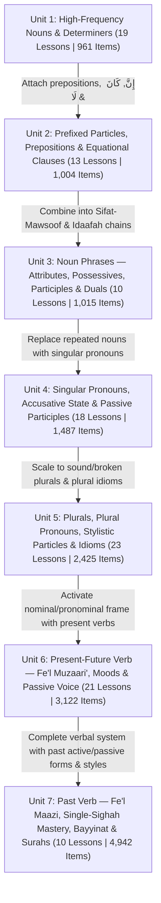

# Muallim ul-Qur'an — Complete Context & Pedagogical Mind

## 1. Book Identity, 4-Volume Architecture & Visual Teaching System

### 1.1 Book Profile

- **Title:** *Muallim ul-Qur'an* (Arabic/Urdu: *Mu'allim ul-Qur'an*; English cover subtitle: *"An easy and comprehensive system to understand the Qur'an yourself"*; Urdu tagline across Volume 4 headers and model exam footer: *"Muallim ul-Qur'an: Qur'an khud samajhne ke liye aasaan andaaz aur jaami' nizaam"*).
- **Author & Institution:** Dr. Ubaid-ur-Rahman Basheer, *Ma'had al-Lughah al-Arabiyyah* / Jamia Masjid Rahmatul-lil-Alameen, Islamabad. Volume 4's closing colophon (printed p. 175) and self-assessment showcase (printed p. 176) record an 8-year scholarly effort completed on 27 Ramadan 1446 AH (28 March 2025).
- **Languages & Edition Split:** Across the four-volume textbook archive, **Volume 1 (Stages 1–3)** is presented in the **English edition** (English instructional prose and glosses alongside vocalized Qur'anic Arabic), whereas **Volume 2 (Units 4–5)**, **Volume 3 (Unit 6)**, and **Volume 4 (Unit 7)** are presented in the **Urdu edition** (Urdu instructional prose and glosses alongside vocalized Qur'anic Arabic, documented throughout this reference in Roman Urdu/Hinglish and English alongside full-harakat Arabic).
- **Target Learner:** Non-Arab Muslims (*Ajami* learners) who can read Arabic script with basic familiarity and seek direct comprehension of the Qur'an without prior study of classical *sarf-o-nahw* paradigms. Volume 4 (printed p. 04) explicitly addresses five audiences: students of Unit 7, teachers, heads of Qur'an-comprehension institutions, thinkers seeking accessible pathways to Qur'anic understanding, and researchers in Qur'anic linguistics.
- **Four-Volume Physical Layout & Pagination Resets:** Each physical volume resets its page numbering independently:

| Volume | Units / Stages Included | Printed Page Span & Resets | Non-Lesson Front/Back Matter |
|---|---|---|---|
| **Volume 1** (*Stages 1–3*) | Units 1–3 (42 lessons) | **pp. 3–104** (continuous across Stages 1–3) | Frontmatter pp. 3–12; Stage 1 Intro p. 13; Stage 2 Intro p. 51; Stage 3 Intro p. 75; Standalone Vocabulary Sheet p. 76; Model Paper p. 103; Table of Contents p. 104 |
| **Volume 2** (*Units 4–5*) | Units 4–5 (41 lessons) | **pp. 2–112 + unnumbered pages** (resets at p. 2) | Unit 4 Model Paper p. 40 (with p. 41 preceding Unit 5 at p. 42); unnumbered Unit 5 Model Paper; unnumbered Table of Contents sheet |
| **Volume 3** (*Unit 6*) | Unit 6 (21 lessons) | **pp. 1–82 + 2 unnumbered TOC pages** (resets at p. 1) | Unit 6 Title/Intro p. 1; 2-page unnumbered Table of Contents |
| **Volume 4** (*Unit 7*) | Unit 7 (10 lessons) | **pp. 1–185 + unnumbered Model Paper** (resets at p. 1) | Frontmatter & Methodology Spread pp. 3–8; Closing Self-Assessment Showcase p. 176; Index Divider (*Fihrist*) p. 177; Table of Contents pp. 178–185; unnumbered Model Paper |

- **Grand Textbook Scale:** **4 Volumes | 7 Units | 114 Lessons | 1,536 Sections | 14,956 Teaching & Practice Items | 7,944 Verified Qur'anic References** (captured across 443 unique lesson page scans and 22 front-matter, TOC, standalone vocabulary, and model-paper scans, totaling 465 top-level scans).

---

### 1.2 Authorial Philosophy

1. **Inductive, Exposure-First Methodology:** As laid out in Volume 1's opening essay (*Theory of the understanding of Quran through word, phrase, sentence, and verse*, pp. 8–10), *Muallim ul-Qur'an* rejects abstract rule memorization prior to textual contact. Learners begin with more than 400 high-frequency Qur'anic words already recognizable in daily Muslim life (`اَلْإِسْلَامُ`, `اَلْقُرْآنُ`, `اَلصَّلَاةُ`, `اَلْجَنَّةُ`), then discover grammatical meaning through patterned visual contrast (`اَلْكِتَابُ ➔ كِتَابٌ`, `رَسُولٌ ⬅ هُوَ رَسُولٌ`) and immediate immersion in authentic Qur'anic sentences.
2. **Five-Step Discourse Escalation:** Every unit advances systematically up a five-rung comprehension ladder:
   - **Word (*Lafz*):** Isolated nouns, attributes, pronouns, and single verb forms.
   - **Phrase (*Qit'ah*):** Preposition-bound fragments (`فِي الْكِتَابِ`), attributive pairs (`عَذَابٌ عَظِيمٌ`), and possessive chains (`كِتَابُ اللَّهِ`).
   - **Short Sentence (*Jumlah*):** Complete nominal and verbal clauses drawn directly from the Qur'an.
   - **Long Verse (*Taweel Aayat*):** Multi-clause verses segmented by visual pause slashes (`/`) and organized into thematic sets.
   - **Continuous Mushaf Passage (*Bayyinat* & Direct Surah Reading):** Multi-verse Qur'anic paragraphs (*Bayyinat Muallim ul-Qur'an* at the end of Unit 7 Lessons 1–4) and complete surahs read directly in Arabic (starting with *Surah As-Saff* on Volume 4 p. 133).
3. **Single-*Sighah* Mastery vs. 14-Form *Gardaan*:** Volume 4's methodological manifesto (pp. 04–05, *Points 1 and 8*, and p. 47 *Qur'ani Raaz*) articulates the textbook's signature pedagogical departure from conventional Arabic instruction. Teaching a 14-form conjugation table (*gardaan*) upfront burdens beginners without opening access to even a single complete verse. Instead, *Muallim ul-Qur'an* isolates **one single verb form (*sighah*) per lesson**—declaring *"Ek seeghah ek mukammal riyaasat hai"* ("One verb form is a complete state having its own subordinate words, sentences, and verses"). Mastering one form alongside its preceding prefixes, attached object pronouns, idioms, hundreds of short sentences, and dozens of long verses builds natural Arabic linguistic intuition (*Arabi zauq*) before moving to the next form.
4. **Cumulative Recycling & Semantic Harmony (*Alfaaz ka Baaham Ittifaaq*):** Every unit treats prior lessons as active infrastructure. No lesson introduces isolated random vocabulary once syntax begins; instead, Unit 2 attaches particles to Unit 1 nouns, Unit 3 builds phrases from Units 1–2, Units 4–5 attach pronouns and plurals to Units 1–3 bases, and Units 6–7 drop present and past verbs into those already-mastered nominal and pronominal frames. Within Unit 7, semantically allied "brother verbs" (such as `خَلَقَ`, `جَعَلَ`, `سَخَّرَ`, `أَنْزَلَ` or `آمَنُوا`, `عَمِلُوا`, `تَابُوا`, `صَبَرُوا`) are grouped into thematic sets so vocabulary and Qur'anic meaning reinforce each other.

---

### 1.3 Visual Grammar of the Printed Pages

Every page of *Muallim ul-Qur'an* encodes grammatical structure visually so beginners parse Arabic syntax without technical terminology:

1. **Two-Color Red vs. Black Pedagogical Highlighting:**
   - **Black Ink:** Marks previously mastered stems, vocabulary, and constructions carried forward from earlier lessons or units.
   - **Red Ink:** Isolates the exact new grammatical target of the current lesson—prefixed particles and prepositions (`الْـ`, `وَ`, `لَـ`, `إِنَّ`, `لِـ`, `فِي`, `عَلَىٰ`, `مِنْ`, `إِلَىٰ`, `بِـ`, `لَا`, `إِلَّا`), case and number inflections (`ـٌ`, `ـًا`, `ـٍ`, `ـانِ`, `ـونَ`, `ـينَ`), morphological template letters (`أَ` superlative, second-letter `ا` in `فَاعِلٌ`, `مُـ` in `مُسْلِمٌ`, `مَـ` and `و` in `مَفْعُولٌ`), detached and attached pronouns (`هُوَ / ـهُ`, `أَنْتَ / ـكَ`, `هِيَ / ـهَا`, `أَنَا / ـي`, `هُمْ / ـهُمْ`, `أَنْتُمْ / ـكُمْ`, `نَحْنُ / ـنَا`), and target present/past verb stems.
   - **Special Highlighting & Cross-Language Alignment:** In Stage 1 Lesson 1, proper names (`مُحَمَّدٌ`, `مُوسَىٰ`, `فِرْعَوْنُ`) appear in red without `الْـ` to demonstrate visually that personal proper names do not take the definite prefix. Across English and Urdu glosses, the corresponding translated word or phrase is likewise printed in red directly alongside the Arabic target.
2. **RTL Multi-Column Grids & Scaffolded Answer Lines:**
   - Vocabulary drills and short-phrase exercises fill **3-column, 4-column, and 5-column Right-to-Left (RTL) grids**, always reading from top-right to left and downward.
   - Items carry horizontal write-in rules (`_______`) for active recall. The opening item (and selected unfamiliar vocabulary) displays a preprinted gloss as an anchor while remaining slots remain blank for student exercise.
   - Numbered Qur'anic sentences and verses use a **Two-Column Numbered List** (odd items on the right, even items on the left) or **Three-Column Numbered List** (e.g., Unit 7 `جَعَلَ` sets), automatically breaking out into full-width single-column lines whenever a verse exceeds half-page width.
3. **Transformation Arrows (`←` / `➔`), Hero Formula Banners & Introductory Comparison Tables:**
   - Each conceptual lesson opens beneath its top running chrome (title pill, centered oval page badge, stage/unit badge, and tilted linguistic code tag such as `4(.10)x1/2/3`, `5x1/2/3/4`, `6(.1)x1/2/3/4/5`, or `7(.1)x1/2/3/4/5/6`) with a **Hero Formula Banner** pairing a known base form with the target transformation.
   - Arrow orientation follows the edition's reading direction: **Left-to-Right (`➔`)** in English Volume 1 (plus 3-arrow radial fans in Stage 3 Lessons 1, 2, and 4) and **Right-to-Left (`←`)** in Urdu Volumes 2–4. Secondary inline drill pairs use colons (`:`) or 2-to-4-way branching tree diagrams (in Units 6–7).
   - Beneath the banner sits a 3-row **Introductory Comparison Table** (`Misaal 1–3` / Column 1 vs. Column 2) isolating the minimal morphological or syntactic change across three parallel examples.
4. **Grammar Rule Boxes, `!` Study-Advice Boxes & Section Headings:**
   - **Grammar Rule Boxes** follow each Introductory Comparison Table with concise prose rules embedding red Arabic markers in parentheses, supported by bulleted (`•`), arrow (`➡`), or rosette (`✿`) refinements. Multi-item lessons (such as Unit 5 Lessons 20–21) separate sub-topics using centered filigree **Section Headings** bearing a numbered circle, red Arabic keyword, and translation. Pattern-recognition lessons carry diamond (`2`, `3`, `4`) or star (`5`) badges, while Unit 6–7 idiom and style segments display numbered seals (`Qur'ani Muhaawarah [4]`, `Khaas Qur'ani Usloob [9]`).
   - **Bordered `!` Study-Advice Boxes** sit at the foot of milestone pages, distinguished by a solid black corner triangle containing a white `!` (bottom-right in English Stage 3; bottom-left in Urdu Units 4–7). They deliver direct study habits: reciting translated sentences aloud in Arabic to build direct comprehension, memorizing Qur'anic passages concurrently, teaching the book to others, and valuing time for Qur'anic understanding.
5. **Encouragement / Grace Banners:**
   - Centered ornamental frames with symmetrical arabesque side caps precede major Qur'anic verse sections, offering praise to Allah (*Alhamdulillah*) and affirming the student's newly gained capability—for example, *"Alhamdulillah, now you are able to understand and translate the following Qur'anic sentences and verses by yourself"* (Stage 2 p. 73) and *"Alhamdulillah, ab darj zail Qur'ani jumlon aur aayaat ka tarjumah aap ba-aasaani khud kar sakte hain"* (Unit 5 p. 111).
6. **Numbered Short Qur'anic Sentences, `/` Clause Slashes, *Taweel Aayaat* & *Bayyinat*:**
   - Authentic Qur'anic excerpts appear inside ornate brackets (`﴿ ﴾`), with **forward slashes (`/`, `//`)** inserted at natural clause boundaries so learners parse long compound verses piece by piece without formal *i'rab* terminology.
   - **Long Verses (*Taweel Aayaat*)** in Units 6–7 open with ornamental verb-cartouche ribbons (`Set 1–3`), tilted marginal thematic stamps (summarizing the shared topic of the grouped verses), tiny supralinear Urdu lexical glosses above rare non-target words, and numbered unit-origin circles (`1`, `2`, `6`, `7`) above words demonstrating how earlier units combine to illuminate full verses.
   - **Continuous Mushaf Passages (*Bayyinat*) & Closing Self-Assessment Showcase:** Unit 7 Lessons 1–4 culminate in *Bayyinat Muallim ul-Qur'an* multi-verse passages; Lesson 6 (p. 133) presents the entire *Surah As-Saff* directly in Arabic with only the sparse unlearned words underlined; and printed page 176 closes Volume 4 with a 3×2 showcase of six Mushaf pages (*Surah Maryam* 1–11, *Surah Al-Jumu'ah* 1–8, *Surah An-Nahl* 15–26, *Surah Aal 'Imran* 16–22, *Surah Al-Baqarah* 6–16, and *Surah Qaf* 1–15) where understood text stands visible in black print and only ~2–6 unlearned words per page are masked under solid black rectangles.

---

## 2. The Macro Learning Arc (Unit 1 → Unit 7 Flow)

### 2.1 Cognitive Progression Flowchart

---

### 2.2 Cumulative Decoding Progression (Concrete Verified Examples)

The table below traces what a student can independently read and translate at the close of each unit, using verified examples drawn directly from the textbook:

| After Completing | Newly Mastered Grammatical Power | Verified Textbook Arabic Example | Roman Urdu (Hinglish) & English Translation |
|---|---|---|---|
| **Unit 1** (Stage 1) | Definite vs. indefinite nouns (`الْـ` vs. `ـٌ`), conjunction `وَ`, demonstratives (`هَٰذَا`, `ذَٰلِكَ`, `هٰذِهِ`, `تِلْكَ`), emphatic `لَـ`, and superlative `أَفْعَلُ` | `وَلَلْآخِرَةُ خَيْرٌ` *(U1L19, 93:4)* | *Aur yaqeenan aakhirat sabse behtar hai* — "And surely the Hereafter is better." |
| **Unit 2** (Stage 2) | Prepositions (`لِـ`, `فِي`, `عَلَىٰ`, `مِنْ`, `إِلَىٰ`, `بِـ`), emphatic `إِنَّ`/`أَنَّ`, categorical `لَا`, exception `إِلَّا`, oath `وَ`, `كَانَ`, and vocative `يَا أَيُّهَا` | `يَا أَيُّهَا الْكَافِرُونَ` *(U2L13, 109:1)*; `بِالْبَيِّنَاتِ وَالزُّبُرِ وَالْكِتَابِ` *(U2L7, 3:184)* | *Ae kafiron!* — "O disbelievers!"; *Waazeh nishaniyon, saheefon aur kitaab ke saath* — "With clear proofs, scriptures, and the Book." |
| **Unit 3** (Stage 3) | Attributive (*Sifat–Mawsoof*) and possessive (*Idaafah*) noun chains, `كُلُّ`, participles (`فَاعِلٌ`, `مُفْعِلٌ`), and duals (`ـَانِ` / `ـَيْنِ`) | `وَلِمَنْ خَافَ مَقَامَ رَبِّهِ جَنَّتَانِ` *(U3L10, 55:46)* | *Aur jo apne Rabb ke saamne khade hone se dara uske liye do baagh hain* — "And for he who feared the standing before his Lord are two gardens." |
| **Unit 4** (Vol. 2) | Singular detached and attached pronouns (`هُوَ/ـهُ`, `أَنْتَ/ـكَ`, `هِيَ/ـهَا`, `أَنَا/ـي`), prepositional pronoun fusions, accusative `ـًا`, and passive participles (`مَفْعُولٌ`) | `كَلِمَةً طَيِّبَةً كَشَجَرَةٍ طَيِّبَةٍ / أَصْلُهَا ثَابِتٌ / وَفَرْعُهَا فِي السَّمَاءِ` *(U4L10, 14:24)* | *Pakiza kalima pakiza darakht ki tarah hai, uski jarr mazboot hai aur uski shaakh aasman mein hai* — "A good word like a good tree, its root is firmly fixed and its branch is in the sky." |
| **Unit 5** (Vol. 2) | Sound masculine plurals (`ـُونَ`/`ـِينَ`), broken plurals, plural pronouns (`هُمْ/ـهُمْ`, `أَنْتُمْ/ـكُمْ`, `نَحْنُ/ـنَا`), `أُولَٰئِكَ`/`هَٰؤُلَاءِ`, restrictive `مَا/إِنْ — إِلَّا`, and 15 Qur'anic idioms | `عَلَيْكُمْ عَذَابًا مِنْ فَوْقِكُمْ` *(U5L12, 6:65)*; `مِنْ قُوَّةٍ وَلَا نَاصِرٍ` *(U5L23, 86:10)* | *Tum par tumhare upar se azaab* — "Upon you punishment from above you"; *Na koi quwwat aur na hi koi madadgar* — "Neither any power nor helper." |
| **Unit 6** (Vol. 3) | Present-future active and passive verbs (*Fe'l Muzaari'* across 3rd/2nd/1st persons), object pronouns on verbs, prohibitive `لَا`, conditional `مَنْ`, subjunctive `أَنْ`/`لِـ`/`لَنْ`, and jussive `لَمْ` | `أَمْوَاتٌ غَيْرُ أَحْيَاءٍ / وَمَا يَشْعُرُونَ أَيَّانَ يُبْعَثُونَ` *(U6L21, 16:21)* | *Woh murda hain zinda nahin, aur unhein khabar nahin ke log kab uthaye jayenge* — "They are dead, not alive, and they do not perceive when they will be resurrected." |
| **Unit 7** (Vol. 4) | Active and passive past verbs (*Fe'l Maazi* across 7 core forms + passive `فُعِلَ` / `فُعِلُوا`), 10 rhetorical past-tense styles, *Bayyinat* continuous passages, and direct Mushaf Surah reading | `لَقَدْ عَلِمْتَ مَا هَٰؤُلَاءِ يَنْطِقُونَ` *(U7L6, 21:65)*; full passages in *Bayyinat* (e.g., *Ayat al-Kursi* 2:255–256, *Surah As-Saff* 61:1–14) | *Yaqeenan tu jaanta hai ke yeh nahin bolte* — "Certainly you know that these do not speak"; direct comprehension of ~85%+ of continuous Mushaf pages (p. 133 and p. 176 showcase). |

---

### 2.3 Volume-by-Volume Milestone Table

| Volume | Units | Lessons | Printed Pages | Total Items | Core Linguistic Leap | Real Qur'anic Text Readiness |
|---|---|---:|---|---:|---|---|
| **Volume 1** (*English Edition*) | Units 1–3 (Stages 1–3) | 42 | pp. 3–104 (lessons pp. 14–50, 52–74, 77–102) | 2,980 | Foundational noun lexicon, definite/indefinite polarity, prepositions, `إِنَّ`/`كَانَ`, attributive and possessive noun phrases, duals, participles | Short nominal/equational sentences and multi-word Qur'anic noun phrases (`50`-mark Vol. 1 Model Paper, p. 103) |
| **Volume 2** (*Urdu Edition*) | Units 4–5 | 41 | pp. 2–112 + unnumbered Model Paper & TOC (U4 pp. 2–40; U5 pp. 42–112) | 3,912 | Complete singular and plural pronominal system (`هُوَ` through `نَحْنُ`), sound/broken plurals, `مَفْعُولٌ`, restrictive styles, sentence openers, and 15 Qur'anic idioms | Slash-segmented compound sentences and connected 3–4-verse blocks with idiomatic accuracy (`50`-mark U4 & `60`-mark U5 Model Papers) |
| **Volume 3** (*Urdu Edition*) | Unit 6 | 21 | pp. 1–82 + 2 unnumbered TOC pages | 3,122 | Complete active and passive *Fe'l Muzaari'* (present-future) system, subject-object case marking, verbal pronouns, prohibitive `لَا`, `لَنْ`, `لَمْ`, `أَنْ`, `لِـ`, `مَنْ` | Multi-clause verbal sentences and up to 30+ long verses per lesson combining nominal/pronominal frames with live present-future verbs |
| **Volume 4** (*Urdu Edition*) | Unit 7 | 10 | pp. 1–185 + unnumbered Model Paper (lessons pp. 9–175; showcase p. 176) | 4,942 | Single-*sighah* mastery of active and passive *Fe'l Maazi* (past verbs), semantic verb sets, 10 specialized Qur'anic rhetorical styles | Continuous Mushaf paragraphs (*Bayyinat*), direct Surah reading (*Surah As-Saff*), thematic exposition, and ~85%+ Mushaf page coverage (`100`-mark 2-hour Model Paper) |
| **Total (4 Volumes)** | **7 Units** | **114** | **463+ numbered/unnumbered book pages** | **14,956** | **Full nominal, pronominal, and verbal Qur'anic grammar without classical *gardaan* clutter** | **Independent comprehension of continuous Mushaf passages and full Surahs (`7,944` verified Qur'anic verse references)** |

---

## 3. Master Table of Contents & Complete Scan Image Concordance

### 3A. Complete Table of Contents Transcriptions (All 12 TOC Scans)

All twelve Table of Contents scans across Volumes 1–4 are transcribed below in exact structural order, preserving printed page numbers, groupings, red-highlighted target elements, and verified typographic notes. Urdu titles and notes are rendered in Roman Urdu/Hinglish alongside full-harakat Arabic using standard Arabic `ي` (U+064A) and `ك` (U+0643).

#### 3A.1 Volume 1 TOC — `S1_S2_S3_toc.png` (Printed Page 104, English Edition)

- **Running Header:** Black pill `Muallim ul-Qur'an` (left) | Centered oval `104` | Blank right corner.
- **Heading (red):** `Muallim ul Qur'an Table of content (Stages 1,2,3)`
- **Layout:** Two side-by-side Left-to-Right (LTR) panels (`Lesson | Subject | page`). Frontmatter and Stage 1 occupy the left panel; Stage 2 (upper) and Stage 3 (lower) occupy the right panel.

**Frontmatter & Stage 1 (`Easy Quranic Vocabulary`) — Left Panel:**

| Lesson | Printed Subject / Arabic Pattern (Full Harakat) | Red Highlighted Span | Roman Urdu (Hinglish) / English Summary | Printed Start Page |
|---|---|---|---|---:|
| — | Attribution | — | *Mansoobiyat / Intisaab* — Attribution | 3 |
| — | Unique features of the book | — | *Kitaab ki Munfarid Khusoosiyaat* — Unique features of the book | 4 |
| — | Preface | — | *Muqaddamah / Pesh Lafz* — Preface | 5 |
| — | Theory of the understanding of Quran through word, phrase, sentence, and verse. | — | *Lafz, Qit'ah, Jumlah aur Aayat ke Zariye Fehm-ul-Qur'an ka Nazariyah* | 8 |
| — | Extraordinary, unique results of this teaching method. | — | *Is Tareeqa-e-Taleem ke Hairat-Angez Nataaij* | 11 |
| — | Essential Instructions for Students | — | *Talaba ke Liye Zaroori Hidaayaat* | 12 |
| **Stage 1** | **Easy Quranic Vocabulary** (grey banner) | Full header | *Marhala 1: Aasaan Qur'ani Alfaaz* — Easy Quranic Vocabulary | 13 |
| 1 | A few simple Quranic words | — | *Chand Aasaan Qur'ani Alfaaz* | 14 |
| 2 | A few more Quranic words | — | *Mazeed Chand Qur'ani Alfaaz* | 16 |
| 3 | A few more Quranic words | — | *Mazeed Chand Qur'ani Alfaaz* | 18 |
| 4 | Some famous Quranic words | — | *Chand Mash'hoor Qur'ani Alfaaz* | 20 |
| 5 | A few more Quranic words | — | *Mazeed Chand Qur'ani Alfaaz* | 22 |
| 6 | A few more easy Quranic words | — | *Mazeed Chand Aasaan Qur'ani Alfaaz* | 24 |
| 7 | More simple and famous Quranic words | — | *Mazeed Aasaan aur Mash'hoor Qur'ani Alfaaz* | 26 |
| 8 | A few simple Quranic words | — | *Chand Aasaan Qur'ani Alfaaz* | 28 |
| 9 | Some famous attributes of Allah | — | *Allah ki Chand Mash'hoor Sifaat* | 30 |
| 10 | A few simple Quranic words of plural form | — | *Jama ki Shakl mein Chand Aasaan Qur'ani Alfaaz* | 32 |
| 11 | More simple Quranic words of plural form | — | *Jama ki Shakl mein Mazeed Aasaan Qur'ani Alfaaz* | 34 |
| 12 | اَلْكِتَابُ وَالْقَلَمُ | وَ | *Kitaab aur Qalam* — The Book and the Pen | 36 |
| 13 | اَلْكِتَابُ ➔ كِتَابٌ (١) | اَلْـ ; tanween ـٌ | *Kitaab (1): Ma'rifah se Nakirah* — The book ➔ A book / Any book | 38 |
| 14 | اَلْكِتَابُ ➔ كِتَابٌ (٢) | اَلْـ ; tanween ـٌ | *Kitaab (2): Nakirah aur "Wa" ke Saath* — The book ➔ A book / Any book | 40 |
| 15 | كِتَابٌ ➔ هٰذَا كِتَابٌ. | هٰذَا | *Yeh (ek) kitaab hai* — A book ➔ This is a book. | 42 |
| 16 | كِتَابٌ ➔ ذٰلِكَ كِتَابٌ | ذٰلِكَ | *Woh (ek) kitaab hai* — A book ➔ That is a book | 44 |
| 17 | آيَةٌ ➔ هٰذِهِ آيَةٌ. | هٰذِهِ | *Yeh (ek) nishaani/aayat hai* — A sign ➔ This is a sign. | 46 |
| 18 | كِتَابٌ ➔ لَكِتَابٌ | لَـ | *Yaqeenan ek kitaab* — A book ➔ Verily a book | 48 |
| 19 | كَبِيرٌ ➔ أَكْبَرُ | أَ | *Bada ➔ Sabse Bada (Ism-e-Tafzeel)* — Great ➔ Greatest | 50 |

**Stage 2 (`The various letters that frequently appear at the beginning of previous Quranic words`) — Top Right Panel:**

| Lesson | Arabic Pattern (Full Harakat) | Red Highlighted Span | Roman Urdu (Hinglish) & English Gloss | Printed Start Page |
|---|---|---|---|---:|
| **Stage 2** | **The various letters that frequently appear at the beginning of previous Quranic words** | Full header | *Guzishta Qur'ani alfaaz ke shuru mein kasrat se aane wale mukhtalif huroof* | 51 |
| 1 | الْكِتَابُ ➔ إِنَّ الْكِتَابَ | إِنَّ | *Beshak kitaab* — Verily, the Book | 52 |
| 2 | الْكِتَابُ ➔ لِلْكِتَابِ | لِـ | *Kitaab ke liye* — For the Book | 54 |
| 3 | الْكِتَابُ ➔ فِي الْكِتَابِ | فِي | *Kitaab mein* — In the Book | 56 |
| 4 | الْكِتَابُ ➔ عَلَى الْكِتَابِ | عَلَى | *Kitaab par* — On / Upon the Book | 58 |
| 5 | الْكِتَابُ ➔ مِنَ الْكِتَابِ | مِنَ | *Kitaab se* — From the Book | 60 |
| 6 | الْكِتَابُ ➔ إِلَى الْكِتَابِ | إِلَى | *Kitaab ki taraf* — Toward / To the Book | 62 |
| 7 | الْكِتَابُ ➔ بِالْكِتَابِ | بِـ | *Kitaab ke saath / zariye* — With / By the Book | 64 |
| 8 | كِتَابٌ ➔ لَا كِتَابَ | لَا | *Koi kitaab nahin* — No book | 66 |
| 9 | الْكِتَابُ ➔ إِلَّا الْكِتَابَ | إِلَّا | *Siwaaye kitaab ke / Magar kitaab* — Except the Book | 68 |
| 10 | الْكِتَابُ ➔ وَالْكِتَابِ | وَ | *Qasam hai kitaab ki* — By the Book (Oath) | 70 |
| 11 | الْكِتَابُ ➔ أَنَّ الْكِتَابَ | أَنَّ | *Keh beshak kitaab* — That indeed the Book | 71 |
| 12 | رَسُولٌ ➔ كَانَ رَسُولًا | كَانَ | *Rasool tha (ya Azali ma'na mein Hai)* — Was a Messenger | 72 |
| 13 | آدَمُ ➔ يَا آدَمُ | يَا | *Aye Aadam!* — O Adam! | 74 |

**Stage 3 (`Quranic words With their attributes and qualities`) — Bottom Right Panel:**

| Lesson | Arabic Pattern (Full Harakat) | Red Highlighted Span | Roman Urdu (Hinglish) & English Gloss | Printed Start Page |
|---|---|---|---|---:|
| **Stage 3** | **Quranic words With their attributes and qualities** | Full header | *Qur'ani alfaaz apni sifaat aur nisbaton ke saath* (followed by p. 76 standalone vocabulary sheet) | 75 |
| 1 | عَظِيمٌ ➔ شَيْءٌ عَظِيمٌ، عَذَابٌ عَظِيمٌ | عَظِيمٌ (both occurrences) | *Azeem cheez, Azeem azaab* — Great thing, Great punishment | 77 |
| 2 | عَذَابٌ ➔ عَذَابٌ شَدِيدٌ، عَذَابٌ عَظِيمٌ | عَذَابٌ (both occurrences) | *Sakht azaab, Azeem azaab* — Severe punishment, Great punishment | 80 |
| 3 | عَذَابٌ عَظِيمٌ ➔ فِي عَذَابٍ عَظِيمٍ | فِي ; final ـٍ on عَذَابٍ & عَظِيمٍ | *Ek azeem azaab mein* — In a great punishment | 83 |
| 4 | رَبٌّ ➔ رَبُّ الْمَشْرِقِ | رَبُّ الْـ | *Mashriq ka Rabb* — Lord of the East | 85 |
| 5 | اللّٰهُ ➔ كِتَابُ اللّٰهِ | اللّٰهِ | *Allah ki kitaab* — Book of Allah | 89 |
| 6 | كِتَابُ اللّٰهِ ➔ فِي كِتَابِ اللّٰهِ | فِي ; kasra ـِ under بِ | *Allah ki kitaab mein* — In the Book of Allah | 94 |
| 7 | كُلٌّ ➔ كُلُّ كِتَابٍ | كُلُّ | *Har kitaab* — Every book | 98 |
| 8 | خَالِقٌ . رَازِقٌ . حَافِظٌ | Second-letter ا in each word | *Paida karne wala, Rizq dene wala, Hifaazat karne wala* — Creator, Sustainer, Protector | 99 |
| 9 | مُسْلِمٌ . مُهَاجِرٌ . مُنْتَظِرٌ | Initial مُـ in each word | *Musalmaan, Hijrat karne wala, Intizaar karne wala* — Muslim, Immigrant, Waiter | 101 |
| 10 | مُؤْمِنٌ ➔ مُؤْمِنَانِ | ـانِ | *Ek momin ➔ Do momin (Tasniyah/Dual)* — A believer ➔ Two believers | 102 |

*(Print note on `S1_S2_S3_toc.png`: In print, Stage 1 Lessons 12–15, Stage 2 Lesson 13 `آدَمُ`, and Stage 3 Lessons 9–10 omit final vowel tanween/damma on headwords; full harakat is restored above. In Stage 3 Lessons 1, 2, 8, and 9, Arabic reads RTL inside each cell, placing `شَيْءٌ عَظِيمٌ` and `خَالِقٌ` first.)*

---

#### 3A.2 Volume 2 TOC — `S4_S5_toc.png` (Unnumbered Page, Urdu Edition)

- **Running Header:** Black pill `Muallim ul-Qur'an` (top right, Urdu script); geometric border without centered page number.
- **Heading (red):** *Fehrist-e-Asbaaq Mu'allim ul-Qur'an (Unit 4 aur 5)* — Table of Contents for Units 4 and 5.
- **Layout:** Two-column RTL table (`Sabaq` | `Mauzoo'` | `Safhah`). The right column holds **Unit 4** in full plus **Unit 5 Lessons 1–4**; the left column holds **Unit 5 Lessons 5–23** and the **Unit 5 Model Paper**.

**Unit 4 (`Unit — 4`) — Right Column (Upper Block):**

| Lesson | Arabic Pattern / Heading (Full Harakat) | Red Highlighted Span | Roman Urdu (Hinglish) & English Gloss | Printed Start Page |
|---|---|---|---|---:|
| 1 | رَسُولٌ ⬅ هُوَ رَسُولٌ. | هُوَ | *Rasool ⬅ Woh rasool hai.* — A messenger ➔ He is a messenger. | 2 |
| 2 | بَيْتٌ ⬅ بَيْتُهُ | ـهُ | *Ghar ⬅ Uska ghar* — A house ➔ His house | 6 |
| 3 | بَيْتُهُ ⬅ فِي بَيْتِهِ | فِي ; ـهِ | *Uska ghar ⬅ Uske ghar mein* — His house ➔ In his house | 8 |
| 4 | لِـ ⬅ لَهُ، مِنْ ⬅ مِنْهُ، فِي ⬅ فِيهِ | لَهُ، مِنْهُ، فِيهِ | *Uske liye, Us se, Us mein* — For him, From him, In him | 11 |
| 5 | يُوسُفُ ⬅ أَنْتَ يُوسُفُ | أَنْتَ | *Yusuf ⬅ Tum/Aap Yusuf ho* — Yusuf ➔ You are Yusuf | 15 |
| 6 | بَيْتٌ ⬅ بَيْتُكَ | ـكَ | *Ghar ⬅ Tumhara ghar* — A house ➔ Your house | 16 |
| 7 | بَيْتُكَ ⬅ فِي بَيْتِكَ | فِي ; ـكَ | *Tumhara ghar ⬅ Tumhare ghar mein* — Your house ➔ In your house | 17 |
| 8 | لِـ ⬅ لَكَ، مِنْ ⬅ مِنْكَ، فِي ⬅ فِيكَ | لَكَ، مِنْكَ، فِيكَ | *Tumhare liye, Tum se, Tum mein* — For you, From you, In you | 20 |
| 9 | فِتْنَةٌ ⬅ هِيَ فِتْنَةٌ. | هِيَ | *Aazmaish ⬅ Woh aazmaish hai.* — A trial ➔ She/It is a trial. | 23 |
| 10 | بَيْتٌ ⬅ بَيْتُهَا | ـهَا | *Ghar ⬅ Us (aurat) ka ghar* — A house ➔ Her house | 24 |
| 11 | بَيْتُهَا ⬅ فِي بَيْتِهَا | فِي ; ـهَا | *Uska ghar ⬅ Uske ghar mein* — Her house ➔ In her house | 25 |
| 12 | لِـ ⬅ لَهَا، مِنْ ⬅ مِنْهَا، فِي ⬅ فِيهَا | لَهَا، مِنْهَا، فِيهَا | *Uske liye, Us se, Us mein (mu'annas)* — For her, From her, In her | 27 |
| 13 | يُوسُفُ ⬅ أَنَا يُوسُفُ | أَنَا | *Yusuf ⬅ Main Yusuf hoon* — Yusuf ➔ I am Yusuf | 30 |
| 14 | بَيْتٌ ⬅ بَيْتِي | ـي | *Ghar ⬅ Mera ghar* — A house ➔ My house | 31 |
| 15 | بَيْتِي ⬅ فِي بَيْتِي | فِي ; ـي | *Mera ghar ⬅ Mere ghar mein* — My house ➔ In my house | 33 |
| 16 | لِـ ⬅ لِي، مِنْ ⬅ مِنِّي، عَلَىٰ ⬅ عَلَيَّ | لِي، مِنِّي، عَلَيَّ | *Mere liye, Mujh se, Mujh par* — For me, From me, Upon me | 35 |
| 17 | مُجْرِمٌ ⬅ مُجْرِمًا | ـًا | *Mujrim ⬅ Mujrim ban kar / bahaisiyat mujrim* — A criminal ➔ As a criminal | 38 |
| 18 | مَظْلُومٌ ⬅ مَذْكُورٌ مَنْصُورٌ | مَـ and و in all three | *Jis par zulm hua ho, Jiska zikr kiya gaya ho, Jiski madad ki gayi ho (Ism-e-Maf'ool)* — Wronged, Mentioned, Helped (p. 39 bottom; shares `S4L17p2.png`) | 39 |
| — | *Model Paper baraye Unit 4* | — | Model Paper for Unit 4 | 40 |

**Unit 5 (`Unit — 5`) — Right Column (Lower Block, L1–4) & Left Column (L5–23 + Model Paper):**

| Lesson | Arabic Pattern / Heading (Full Harakat) | Red Highlighted Span | Roman Urdu (Hinglish) & English Gloss | Printed Start Page |
|---|---|---|---|---:|
| 1 | الْمُسْلِمُ ⬅ الْمُسْلِمُونَ | ـونَ | *Musalmaan ⬅ Musalmaan (sab) / Islam laane wale* — The Muslim ➔ The Muslims | 42 |
| 2 | الْمُسْلِمُونَ ⬅ الْمُسْلِمِينَ | ـينَ | *Musalmaan (fa'il) ⬅ Musalmaanon (maf'ool/majroor)* — The Muslims (nom.) ➔ (acc./gen.) | 44 |
| 3 | الْمُسْلِمُونَ ⬅ أَجْرُ الْمُسْلِمِينَ | أَجْرُ الْمُسْلِمِينَ | *Musalmaanon ka ajr* — The reward of the Muslims | 49 |
| 4 | عَالِمٌ ⬅ عُلَمَاءُ، حَاكِمٌ ⬅ حُكَّامٌ | عُلَمَاءُ، حُكَّامٌ | *Aalim ⬅ Ulama, Haakim ⬅ Hukkaam (Jama' Mukassar)* — Scholar ➔ Scholars, Ruler ➔ Rulers | 52 |
| 5 | مُسْلِمُونَ ⬅ هُمْ مُسْلِمُونَ | هُمْ | *Woh sab musalmaan hain* — Muslims ➔ They are Muslims | 54 |
| 6 | كِتَابٌ ⬅ كِتَابُهُمْ | ـهُمْ | *Unki kitaab* — Book ➔ Their book | 56 |
| 7 | كِتَابُهُمْ ⬅ فِي كِتَابِهِمْ | فِي ; ـهُمْ / ـهِمْ | *Unki kitaab mein* — Their book ➔ In their book | 59 |
| 8 | لِـ ⬅ لَهُمْ، مِنْ ⬅ مِنْهُمْ، إِنَّ ⬅ إِنَّهُمْ | لَهُمْ، مِنْهُمْ، إِنَّهُمْ | *Unke liye, Un mein se, Beshak woh* — For them, From them, Verily they | 62 |
| 9 | مُسْلِمُونَ ⬅ أَنْتُمْ مُسْلِمُونَ | أَنْتُمْ | *Tum sab musalmaan ho* — Muslims ➔ You (pl.) are Muslims | 67 |
| 10 | كِتَابٌ ⬅ كِتَابُكُمْ | ـكُمْ | *Tumhari kitaab* — Book ➔ Your (pl.) book | 69 |
| 11 | كِتَابُكُمْ ⬅ فِي كِتَابِكُمْ | فِي ; ـكُمْ | *Tumhari kitaab mein* — Your book ➔ In your book | 72 |
| 12 | لِـ ⬅ لَكُمْ، مِنْ ⬅ مِنْكُمْ، إِنَّ ⬅ إِنَّكُمْ | لَكُمْ، مِنْكُمْ، إِنَّكُمْ | *Tumhare liye, Tum mein se, Beshak tum* — For you (pl.), From you, Verily you | 74 |
| 13 | مُسْلِمُونَ ⬅ نَحْنُ مُسْلِمُونَ | نَحْنُ | *Hum musalmaan hain* — Muslims ➔ We are Muslims | 80 |
| 14 | كِتَابٌ ⬅ كِتَابُنَا | ـنَا | *Hamari kitaab* — Book ➔ Our book | 81 |
| 15 | كِتَابُنَا ⬅ فِي كِتَابِنَا | فِي ; ـنَا | *Hamari kitaab mein* — Our book ➔ In our book | 83 |
| 16 | لِـ ⬅ لَنَا، مِنْ ⬅ مِنَّا، إِنَّ ⬅ إِنَّا، إِنَّ ⬅ إِنَّا *(TOC print typo; p. 85 teaches إِنَّا / إِنَّنَا and أَنَّا / أَنَّنَا)* | لَنَا، مِنَّا، إِنَّا، إِنَّا | *Hamare liye, Hum se, Beshak hum, Keh hum* — For us, From us, Verily we | 85 |
| 17 | مُسْلِمُونَ ⬅ أُولٰئِكَ مُسْلِمُونَ | أُولٰئِكَ | *Woh log musalmaan hain* — Muslims ➔ Those are Muslims | 88 |
| 18 | مُسْلِمُونَ ⬅ هٰؤُلَاءِ مُسْلِمُونَ | هٰؤُلَاءِ | *Yeh log musalmaan hain* — Muslims ➔ These are Muslims | 91 |
| 19 | **Mash'hoor Qur'ani Usloob** *(Famous Qur'anic Style)* | — | Heading for sub-items 19a–19c | 92 |
| 19a | مَا هٰذَا إِلَّا سِحْرٌ | مَا ; إِلَّا | *Yeh nahin hai magar ek jaadu* — This is nothing except magic | 92 |
| 19b | إِنْ هٰذَا إِلَّا سِحْرٌ. | إِنْ ; إِلَّا | *Yeh nahin hai magar ek jaadu* — This is nothing except magic | 93 |
| 19c | إِنَّمَا أَنْتَ نَذِيرٌ | إِنَّمَا | *Beshak tum sirf darane wale ho* — You are only a warner | 93 |
| 20 | **Qur'ani Jumlon ke Shuru mein Aane Wale Aham Alfaaz** | — | Important Words Opening Qur'anic Sentences (sub-items 20a–20g) | 95 |
| 20a | لَيْسَ | لَيْسَ | *Nahin hai* — Is not | 95 |
| 20b | مَا | مَا | *Nahin / Kya* — Not / What | 96 |
| 20c | أَ / هَلْ | أَ / هَلْ | *Kya?* — Interrogative (Is/Do?) | 96 |
| 20d | أَمْ | أَمْ | *Ya kya?* — Or is it? | 97 |
| 20e | أَنَّىٰ | أَنَّىٰ | *Kahan se / Kaise?* — How / Whence? | 97 |
| 20f | بَلْ | بَلْ | *Balkeh* — Rather / Nay | 98 |
| 20g | كَأَنَّ | كَأَنَّ | *Goya keh* — As though | 98 |
| 21 | **Chand Mash'hoor Qur'ani Muhaaware** | — | A Few Famous Qur'anic Idioms (sub-items 21a–21o) | 99 |
| 21a | أَلَا | أَلَا | *Khabardaar / Sun lo* — Behold / Unquestionably | 99 |
| 21b | أَلَيْسَ | أَلَيْسَ | *Kya nahin hai?* — Is not? | 99 |
| 21c | الْيَوْمَ | الْيَوْمَ | *Aaj ke din* — Today / This day | 100 |
| 21d | يَوْمَئِذٍ | يَوْمَئِذٍ | *Us din* — On that day | 100 |
| 21e | سُبْحَانَ | سُبْحَانَ | *Paak hai* — Glory be to / Exalted is | 101 |
| 21f | وَمَا بَيْنَهُمَا | وَمَا بَيْنَهُمَا | *Aur jo kuch un dono ke darmiyaan hai* — And whatever is between them | 101 |
| 21g | قُلْ | قُلْ | *Keh dijiye* — Say | 102 |
| 21h | إِذًا | إِذًا | *Phir to / Is soorat mein* — Then indeed / In that case | 103 |
| 21i | بِئْسَ | بِئْسَ | *Bahut bura hai* — Evil / Wretched is | 104 |
| 21j | نِعْمَ | نِعْمَ | *Kya hi khoob hai* — Excellent is | 104 |
| 21k | كَلَّا | كَلَّا | *Hargiz nahin* — Nay / By no means | 105 |
| 21l | مَا أَدْرَاكَ مَا | مَا أَدْرَاكَ مَا | *Aur aapko kya ma'loom keh kya hai* — And what can make you know what is? | 105 |
| 21m | حَسْبُ | حَسْبُ | *Kaafi hai* — Sufficient is | 106 |
| 21n | أَعْلَمُ بِـ | أَعْلَمُ بِـ | *Sabse behtar aagaah hai* — Most knowing of | 106 |
| 21o | مَصِيرٌ / مَرْجِعٌ | مَصِيرٌ / مَرْجِعٌ | *Thikaana / Palatna* — Final destination / Return | 106 |
| 22 | دِينٌ ⬅ دِينًا | ـًا | *Deen ⬅ Deen ke taur par / Deen ban kar* — Religion ➔ As a religion | 107 |
| 23 | خَالِقٌ ⬅ مِنْ خَالِقٍ | مِنْ ; final ـٍ | *Khaaliq ⬅ Koi bhi khaaliq* — Creator ➔ Any creator at all | 110 |
| — | *Model Paper baraye Unit 5* | — | Model Paper for Unit 5 (unnumbered scan `S5_model_paper.png`) | *(blank)* |

---

#### 3A.3 Volume 3 (Unit 6) TOC — `S6_toc_p1.jpg` & `S6_toc_p2.jpg` (Unnumbered Pages, Urdu Edition)

- **Header (`S6_toc_p1.jpg`):** Top-right crest *Muallim ul-Qur'an*; red title *Muallim ul-Qur'an Jild Som (Unit 6)*; main heading *Fihrist-e-Asbaaq*; intro note (*Zer-e-nazar fihrist mein "Hadaf" ke tehat mazkoor tafseel se is tarteeb ka pata chalta hai jis ki badolat tadreejan talib-e-ilm ko Qur'ani ibarat ke fehm mein wus'at haasil hoti hai. Ahdaaf mein maujood mustalahaat talib-e-ilm ki zaroorat nahi hain*).
- **Columns (RTL):** `Sabaq` (Lesson) | `Unwaan` (Title) | `Hadaf` (Target / Objective) | `Safhah` (Page).

**`S6_toc_p1.jpg` (Unit 6 Intro & Lessons 1–10):**

| Lesson | Printed Page | Title (`Unwaan`) — Arabic / Roman Urdu | Target (`Hadaf`) — Roman Urdu / Arabic | Red Highlighted Element(s) |
|---|---:|---|---|---|
| — | 01 | **Unit 6** | *Fe'l Muzaari'* — Present / Future Verb | — |
| 1 | 02 | يَعْبُدُ . يَسْجُدُ . يُسَافِرُ | *Aham Qur'ani Af'aal* (Important Qur'anic Verbs) | — |
| 2 | 04 | يُرْسِلُ ← لَا يُرْسِلُ . الَّذِي يُرْسِلُ . مَا يُرْسِلُ | *Qur'ani Af'aal ke saath Aane Waale Aham Alfaaz* (Frequent Words Preceding Verbs) | لَا، الَّذِي، مَا |
| 3 | 07 | يَغْفِرُ ← يَغْفِرُ اللَّهُ | *Fe'l ke ba'd Faa'il* (Subject after Verb) | اللَّهُ |
| — | 08 | يَغْفِرُ اللَّهُ ← يَغْفِرُ اللَّهُ الذُّنُوبَ *(TOC omits harakat on الذُّنُوبَ; verified on p. 8)* | *Fe'l aur Faa'il ke saath Maf'ool* (Object with Verb & Subject) | الذُّنُوبَ |
| 4 | 20 | يَشَاءُ ← مَنْ يَشَاءُ | *Mash'hoor Qur'ani Muhaawarah* (Famous Qur'anic Idiom) | مَنْ |
| — | 21 | مَنْ يَشَاءُ ← لِمَنْ يَشَاءُ | *Mash'hoor Qur'ani Muhaawarah* | لِمَنْ |
| — | 21 | مَنْ يَشَاءُ ← عَلَىٰ مَنْ يَشَاءُ | *Mash'hoor Qur'ani Muhaawarah* | عَلَىٰ مَنْ |
| — | 22 | يَشَاءُ ← مَا يَشَاءُ | *Mash'hoor Qur'ani Muhaawarah* | مَا |
| 5 | 23 | يَأْمُرُ ← يَأْمُرُكُمْ : يَأْمُرُهُمْ : يَأْمُرُهُ | *Fe'l ke saath Maf'ool ki Zameer* (Attached Object Pronoun) | يَأْمُرُكُمْ : يَأْمُرُهُمْ : يَأْمُرُهُ |
| 6 | 26 | يَعْبُدُ ← يَعْبُدُونَ | *Muzaari' ka Jama' Ghaaib ka Seeghah* (3rd Person Masc. Plural) | يَعْبُدُونَ |
| 7 | 34 | *Seegha يَعْبُدُونَ ke saath munsalik mash'hoor Qur'ani muhaavare* | *(blank)* | يَعْبُدُونَ, *mash'hoor Qur'ani muhaavare* |
| — | 34 | أَكْثَرُ النَّاسِ لَا يَعْلَمُونَ | *Mash'hoor Qur'ani Muhaawarah* (Most People Do Not Know) | أَكْثَرُ النَّاسِ لَا |
| — | 35 | إِنَّ فِي ذٰلِكَ لَآيَاتٍ لِقَوْمٍ يَعْلَمُونَ | *Mash'hoor Qur'ani Muhaawarah* | إِنَّ فِي ذٰلِكَ لَآيَاتٍ لِقَوْمٍ |
| — | 35 | لَعَلَّهُمْ يَعْلَمُونَ | *Mash'hoor Qur'ani Muhaawarah* (So That They May Know) | لَعَلَّهُمْ |
| — | 36 | أَفَلَا يَعْلَمُونَ | *Mash'hoor Qur'ani Muhaawarah* (Do They Not Then Know?) | أَفَلَا |
| — | 36 | ذٰلِكَ بِأَنَّهُمْ قَوْمٌ لَا يَعْلَمُونَ | *Mash'hoor Qur'ani Muhaawarah* | ذٰلِكَ بِأَنَّهُمْ قَوْمٌ لَا |
| 8 | 37 | يُؤْمِنُونَ ← الَّذِينَ يُؤْمِنُونَ | *الَّذِينَ, Ism-e-Mawsool* (Relative Pronoun) | الَّذِينَ |
| 9 | 40 | يَعْبُدُ ← تَعْبُدُ | *Muzaari' mein Seeghah Waahid Muzakkar Mukhaatab* (2nd Masc. Sing.) | تَعْبُدُ |
| 10 | 43 | تَعْبُدُ ← تَعْبُدُونَ | *Muzaari' mein Seeghah Jama' Muzakkar Mukhaatab* (2nd Masc. Plural) | تَعْبُدُونَ |
| — | 46 | تَعْمَلُونَ ← مَا تَعْمَلُونَ | *مَا Mawsoolah aur mazkoorah baalaa seeghah* | مَا |
| — | 47 | مَا تَعْمَلُونَ ← بِمَا تَعْمَلُونَ | *بِـ aur مَا Mawsoolah aur mazkoorah baalaa seeghah* | بِمَا |
| — | 48 | مَا تَعْمَلُونَ ← مِمَّا تَعْمَلُونَ | *مِنْ aur مَا Mawsoolah aur mazkoorah baalaa seeghah* | مِمَّا |
| — | 48 | مَا تَعْمَلُونَ ← عَمَّا تَعْمَلُونَ | *عَنْ aur مَا Mawsoolah aur mazkoorah baalaa seeghah* | عَمَّا |

**`S6_toc_p2.jpg` (Unit 6 Lessons 11–21):**

| Lesson | Printed Page | Title (`Unwaan`) — Arabic / Roman Urdu | Target (`Hadaf`) — Roman Urdu / Arabic | Red Highlighted Element(s) |
|---|---:|---|---|---|
| 11 | 49 | *Seegha تَعْبُدُونَ ke saath munsalik mash'hoor Qur'ani muhaavare* | *(blank)* | تَعْبُدُونَ |
| — | 49 | تَعْمَلُونَ ← وَأَنْتُمْ تَعْمَلُونَ | *Mash'hoor Qur'ani Muhaawarah* | وَأَنْتُمْ |
| — | 50 | تَعْمَلُونَ ← لَعَلَّكُمْ تَعْمَلُونَ | *Mash'hoor Qur'ani Muhaawarah* | لَعَلَّكُمْ |
| — | 50 | تَعْمَلُونَ ← أَفَلَا تَعْمَلُونَ | *Mash'hoor Qur'ani Muhaawarah* | أَفَلَا |
| — | 51 | تَعْمَلُونَ ← كُنْتُمْ تَعْمَلُونَ | *Mash'hoor Qur'ani Muhaawarah* | كُنْتُمْ |
| — | 52 | تَعْمَلُونَ ← مَا لَكُمْ لَا تَعْمَلُونَ | *Mash'hoor Qur'ani Muhaawarah* | مَا لَكُمْ |
| — | 52 | تَعْمَلُونَ ← لِمَ تَعْمَلُونَ | *Mash'hoor Qur'ani Muhaawarah* | لِمَ |
| — | 52 | تَعْمَلُونَ ← لَوْلَا تَعْمَلُونَ | *Mash'hoor Qur'ani Muhaawarah* | لَوْلَا |
| 12 | 53 | يَعْبُدُ ← أَعْبُدُ | *Muzaari' mein Seeghah Waahid Mutakallim* (1st Person Sing.) | أَعْبُدُ |
| — | 55 | يُقْسِمُ ← أُقْسِمُ | *Mash'hoor Qur'ani Muhaawarah* | أُقْسِمُ |
| — | 55 | أَدْعُو ← أَدْعُوكُمْ | *Seeghah Waahid Mutakallim ke saath Zameer Maf'ool bihi* | أَدْعُوكُمْ |
| 13 | 56 | يَعْبُدُ ← نَعْبُدُ | *Muzaari' mein Seeghah Jama' Mutakallim* (1st Person Plural) | نَعْبُدُ |
| — | 58 | نَجْزِي ← كَذٰلِكَ نَجْزِي | *Mash'hoor Qur'ani Muhaawarah* | كَذٰلِكَ |
| — | 58 | نَدْعُو ← يَوْمَ نَدْعُو | *Mash'hoor Qur'ani Muhaawarah* | يَوْمَ |
| — | 59 | نَعْلَمُ ← إِنَّا نَعْلَمُ | *Mash'hoor Qur'ani Muhaawarah* | إِنَّا |
| — | 59 | نَصْبِرُ ← لَنْ نَصْبِرَ *(TOC print shows slight dot blur on نَصْبِرُ; verified on p. 59 `S6L15p4.jpg`)* | *Mash'hoor Qur'ani Muhaawarah aur لَنْ النَّاصِبَةُ* | لَنْ |
| — | 60 | نَحْشُرُ ← نَحْشُرُهُمْ | *Seeghah Jama' Mutakallim ke saath Zameer Maf'ool bihi* | هُمْ |
| 14 | 61 | تَقْتُلُونَ ← لَا تَقْتُلُوا | *Fe'l Nahi, Seeghah Jama' Muzakkar* (Plural Prohibitive) | لَا |
| 15 | 64 | تَظْلِمُ ← لَا تَظْلِمْ | *Fe'l Nahi, Seeghah Waahid Muzakkar* (Singular Prohibitive) | لَا |
| 16 | 66 | يَشْكُرُ ← مَنْ يَشْكُرْ | *مَنْ الشَّرْطِيَّةُ, Shart aur Jawaab-e-Shart* (Conditional `مَنْ`) | مَنْ |
| 17 | 68 | يَتُوبُ — أَنْ يَتُوبَ *(no arrow printed)* | *أَنْ النَّاصِبَةُ* (Subjunctive `أَنْ`) | — |
| — | 69 | أَنْ يَتُوبَ ← عَسَىٰ أَنْ يَتُوبَ | *Mash'hoor Qur'ani Muhaawarah* | عَسَىٰ أَنْ |
| — | 70 | أَنْ يَظْلِمَ ← مَا كَانَ لِفُلَانٍ أَنْ يَظْلِمَ | *Mash'hoor Qur'ani Muhaawarah* | مَا كَانَ لِفُلَانٍ أَنْ |
| 18 | 71 | يَغْفِرُ ← لِيَغْفِرَ | *لَامُ التَّعْلِيلِ* (*Laam ut-Ta'leel* — Purpose `لِـ`) | لِـ |
| 19 | 73 | يَجْعَلُ ← لَمْ يَجْعَلْ | *لَمْ لِلْجُحُودِ* (Past Negation with `لَمْ`) | لَمْ |
| — | 74 | لَمْ يَعْلَمْ ← أَلَمْ يَعْلَمْ؟ | *Mash'hoor Qur'ani Muhaawarah* | أَ، ؟ |
| — | 75 | لَمْ يَجِدْ ← مَنْ لَمْ يَجِدْ | *Mash'hoor Qur'ani Muhaawarah* | مَنْ |
| 20 | 76 | يَسْأَلُونَ ← يَسْأَلُونَكُمْ | *Muzaari' se Seeghah Jama' Ghaaib ke saath Zameer Maf'ool bihi* | يَسْأَلُونَكُمْ |
| 21 | 80 | يَرْزُقُ ← يُرْزَقُ (يُرْزَقُونَ / تُرْزَقُونَ) | *Fe'l Ma'roof se Fe'l Majhool* (Active to Passive) | يُرْزَقُ |

---

#### 3A.4 Volume 4 (Unit 7) TOC — `S7_toc_p1.jpg` through `S7_toc_p8.jpg` (Printed Pages 178–185, Urdu Edition)

- **Header (`S7_toc_p1.jpg`, Printed Page 178):** *Fihrist-e-Asbaaq مُعَلِّمُ الْقُرْآنِ Jild Chahaarum (Unit 7)*.
- **Footer (all 8 TOC pages, pp. 178–185):** *Muallim ul-Qur'an: Qur'an khud samajhne ke liye aasaan andaaz aur jaami' nizaam*.

**`S7_toc_p1.jpg` (Printed TOC Page 178) — Frontmatter & Lesson 1 (Part 1):**

| Section | Printed Page | TOC Entry — Arabic / Roman Urdu & English Gloss (with Printed Counts) | Red Highlighted Element(s) |
|---|---:|---|---|
| — | 3 | *Khaas Nikaat* — Special Points | — |
| — | 4–5 | *Unit 7 ke har sabaq ka naqshah aur munfarid pehlu* — Blueprint & Unique Aspects of Every Lesson | — |
| — | 6 | *Muqaddima* — Preface | — |
| — | 7 | *Tadreesi Hidaayaat bara-e-Mu'allimeen* — Teaching Instructions for Teachers | — |
| — | 8 | *Hidaayaat bara-e-Talaba* — Instructions for Students | — |
| **Sabaq 1** | **9** | **Lesson 1 Banner** | — |
| Section 1 | 9 | عَمِلَ . جَاهَدَ . أَنْزَلَ . اِسْتَغْفَرَ — *Maazi ki Pehli Shakl* (First Form of Past Verb) | عَمِلَ . جَاهَدَ . أَنْزَلَ . اِسْتَغْفَرَ |
| — | 10 | *Qur'an Kareem mein ba-kasrat aane wale buniyadi fe'l maazi (pehli shakl wale)* — Frequent Foundational Past Verbs | — |
| Section 2 | 12 | فَعَلِمَ . إِذْ عَلِمَ . الَّذِي عَلِمَ . مَا عَلِمَ — *Maazi ke shuru mein ba-kasrat aane wale alfaaz* (Frequent Prefixes Before Past Verbs) | فَـ، إِذْ، الَّذِي، مَا |
| Section 3 | 16 | *Fe'l maazi ki pehli buniyadi shakl samajh kar sainkdon jumlon aur aayaat ko Arabi mein hi samajhna* (`475` sentences) | *Arabi mein hi*, `(475 jumle)` |
| Section 4 | 24 | *Fe'l maazi ki pehli buniyadi shakl samajh kar nisbatan lambe Qur'ani jumlon ko Arabi mein hi samajhna* (`72` sentences) | *Nisbatan lambe Qur'ani jumlon*, `(72 jumle)` |
| Section 5 | 26 | *Fe'l maazi ki pehli buniyadi shakl samajh kar taweel Qur'ani aayaat aur jumlon ko Arabi mein hi samajhna* (`59` verses) | *Taweel Qur'ani aayaat*, `(59 aayaat)` |
| Section 6 | 29 | *Fe'l maazi ki خَلَقَ shakl se munsalik chand Qur'ani muhaavare* — Idioms Linked to `خَلَقَ` | خَلَقَ |
| — | 29 | *Qur'ani Muhaawarah:* اللَّهُ خَلَقَ ← أَلَمْ تَرَ أَنَّ اللَّهَ خَلَقَ (`10` verses) | أَلَمْ تَرَ أَنَّ |
| — | 29 | *Qur'ani Muhaawarah:* ضَرَبَ ← كَيْفَ ضَرَبَ ← أَلَمْ تَرَ كَيْفَ ضَرَبَ (`3` verses) | كَيْفَ، أَلَمْ تَرَ |
| — | 30 | *Qur'ani Muhaawarah:* خَلَقَ ← الَّذِي خَلَقَ | — |
| — | 30 | *Qur'ani Muhaawarah:* الَّذِي خَلَقَ ← اللَّهُ الَّذِي خَلَقَ (`10` verses) | اللَّهُ الَّذِي |
| — | 30 | *Qur'ani Muhaawarah:* الَّذِي خَلَقَ ← هُوَ الَّذِي خَلَقَ (`24` verses) | هُوَ الَّذِي |
| — | 31 | *Qur'ani Muhaawarah:* الَّذِي خَلَقَ ← الْحَمْدُ لِلَّهِ الَّذِي خَلَقَ (`10` verses) | الْحَمْدُ لِلَّهِ الَّذِي |
| — | 31 | *Qur'ani Muhaawarah:* الَّذِي خَلَقَ ← تَبَارَكَ الَّذِي خَلَقَ | الَّذِي |
| — | 31 | *Qur'ani Muhaawarah:* الَّذِي خَلَقَ ← سُبْحَانَ الَّذِي خَلَقَ | الَّذِي |
| — | 32 | *Qur'ani Muhaawarah:* مَنْ خَلَقَ ← أَمَّنْ خَلَقَ (`12` verses) | أَمَّنْ |
| — | 33 | *Qur'ani Muhaawarah:* كَرِهَ ← وَلَوْ كَرِهَ (`5` verses) | وَلَوْ |
| — | 33 | *Qur'ani Usloob:* إِذَا أَسْفَرَ ← وَالصُّبْحِ إِذَا أَسْفَرَ — *Qasmiyah jumlon mein fe'l maazi* (`11` verses) | وَالصُّبْحِ إِذَا |
| Section 7 | 34 | *Khaas Qur'ani Usloob:* آمَنَ ← مَنْ آمَنَ (*Shart aur anjaam wale jumle*; `85` verses) | مَنْ آمَنَ |
| — | 38 | *Qur'ani Muhaawarah:* مَنْ ضَلَّ ← فَقَدْ ضَلَّ (`7` verses) | فَقَدْ |
| — | 38 | *Qur'ani Muhaawarah:* مَنْ آمَنَ ← أَمَّا مَنْ آمَنَ (`8` verses) | أَمَّا مَنْ |
| — | 39 | *Qur'ani Muhaawarah:* مَنْ كَذَّبَ ← مِمَّنْ كَذَّبَ ← مَنْ أَظْلَمُ مِمَّنْ كَذَّبَ (`17` verses) | مِمَّنْ، مَنْ أَظْلَمُ مِمَّنْ |

**`S7_toc_p2.jpg` (Printed TOC Page 179) — Lesson 1 (Conclusion) & Lesson 2 (Part 1):**

| Section | Printed Page | TOC Entry — Arabic / Roman Urdu & English Gloss (with Printed Counts) | Red Highlighted Element(s) |
|---|---:|---|---|
| — | 40 | *Qur'ani Muhaawarah:* مَنْ آمَنَ ← مِنَ النَّاسِ مَنْ آمَنَ (`13` verses) | مَنْ آمَنَ، مِنَ النَّاسِ مَنْ آمَنَ |
| — | 41 | *Qur'ani Usloob:* جَاءَ ← إِذَا جَاءَ / جَاءَ ← لَمَّا جَاءَ / جَاءَ ← إِنْ جَاءَ (`18` verses) | إِذَا، لَمَّا، إِنْ |
| Section 8 | 42 | *Khaas Qur'ani Fe'l:* قَالَ ← قَالَ مُوسَىٰ لِقَوْمِهِ / قَالَ لِقَوْمِهِ (`191` verses) | قَالَ، قَالَ مُوسَىٰ لِقَوْمِهِ، لِقَوْمِهِ |
| Section 9 | 46 | (بَيِّنَاتُ مُعَلِّمِ الْقُرْآنِ) — *Fe'l maazi ki عَمِلَ shakl ke asbaaq ke ba'd samajh aane wale Qur'ani maqaamaat* *(TOC prints الْقُرْآن without final kasra)* | — |
| **Sabaq 2** | **48** | **Lesson 2 Banner** | — |
| Section 1 | 48 | عَبَدَ se عَبَدُوا — *Maazi ki Doosri Shakl* (Second Form of Past Verb — 3rd Masc. Plural) | عَبَدُوا |
| — | 49 | *عَبَدُوا shakl se pehle aane wale alfaaz* — Frequent Words Preceding `عَبَدُوا` | عَبَدُوا |
| Section 2 | 50 | *عَبَدُوا shakl samajh kar darjanon Qur'ani jumlon ka Arabi mein fehm* (`241` sentences) | عَبَدُوا, `(241 jumle)` |
| Section 3 | 55 | *عَبَدُوا shakl samajh kar darjanon taweel aayaat ko Arabi mein samajhna* (`445` verses) | عَبَدُوا, `(445 aayaat)` |
| — | 55 | *Set 1 — Mauzoo': Saaliheen ki sifaat aur jazaa* (Qualities & Reward of the Righteous; `17` verses) | — |
| — | 56 | *Set 2 — Mauzoo': Saaliheen ke a'maal aur rawayye* (Deeds & Attitudes of the Righteous; `13` verses) | — |
| — | 56 | *Set 3 — Mauzoo': Saaliheen ke a'maal aur rawayye* (`10` verses) | — |
| — | 57 | *Set 4 — Mauzoo': Kaafiron ke a'maal aur badlah* (Deeds & Recompense of Disbelievers; `27` verses) | — |
| — | 58 | *Set 5 — Mauzoo': Kaafiron ke a'maal aur badlah* (`26` verses) | — |
| — | 58 | *Qur'ani Muhaawarah:* اِتَّخَذُوا | اِتَّخَذُوا |
| — | 59 | *Set 6 — Mauzoo': Gumraah logon ka bayaan* (Account of the Misguided; `25` verses) | — |
| — | 60 | *Set 7 — Mauzoo': Zaalimon ke rawayye aur anjaam* (Attitudes & End of Wrongdoers; `12` verses) | — |
| — | 60 | *Set 8 — Mauzoo': Mukhtalif waaqiaat aur a'maal* (Various Events & Deeds; `21` verses) | — |
| — | 61 | *Khaas Qur'ani Muhaawarah:* تَوَلَّوْا ← إِنْ تَوَلَّوْا (`12` verses) | إِنْ تَوَلَّوْا |
| Section 4 | 62 | *Do Khaas Qur'ani Fe'l:* الَّذِينَ آمَنُوا ↔ الَّذِينَ كَفَرُوا — *Ahl-e-Imaan aur Ahl-e-Kufr ka dilchasp muwazanah* (`62` verses) | آمَنُوا، كَفَرُوا |
| — | 64 | *Qur'ani Muhaawarah:* الَّذِينَ اشْتَرَوْا ← أُولٰئِكَ الَّذِينَ اشْتَرَوْا (`9` verses) | أُولٰئِكَ الَّذِينَ |
| — | 65 | *Qur'ani Muhaawarah:* الَّذِينَ آمَنُوا ← أَمَّا الَّذِينَ آمَنُوا (`14` verses) | أَمَّا الَّذِينَ |
| Section 5 | 66 | *Qur'ani Muhaawarah:* الَّذِينَ آمَنُوا ← يَا أَيُّهَا الَّذِينَ آمَنُوا (`42` verses) | يَا أَيُّهَا الَّذِينَ |
| — | 66 | *Mauzoo': Woh kaam jin se mana' kiya gaya* — Acts That Were Forbidden | — |
| — | 67 | *Mauzoo': Haqaa'iq aur kuch rawayye* — Realities and Certain Attitudes | — |
| — | 68 | *Qur'ani Muhaawarah:* الَّذِينَ كَفَرُوا ← كَالَّذِينَ كَفَرُوا . لَا تَكُونُوا كَالَّذِينَ كَفَرُوا (`7` verses) | كَالَّذِينَ، لَا تَكُونُوا كَالَّذِينَ |
| — | 68 | *Mauzoo': Woh kaam jin se mana' kiya gaya* — Acts That Were Forbidden | — |
| — | 68 | *Khaas Qur'ani Fe'l:* قَالَ ← قَالُوا — *Mauzoo': Mukhtalif logon ki kahi hui baatein* (`65` verses) | قَالَ، قَالُوا |

**`S7_toc_p3.jpg` (Printed TOC Page 180) — Lesson 2 (Conclusion) & Lesson 3 (Part 1):**

| Section | Printed Page | TOC Entry — Arabic / Roman Urdu & English Gloss (with Printed Counts) | Red Highlighted Element(s) |
|---|---:|---|---|
| Section 6 | 70 | *Khaas Qur'ani Fe'l:* كَانَ ← كَانُوا (`23` verses) | كَانَ، كَانُوا |
| — | 71 | *Qur'ani Muhaawarah:* كَانُوا مُؤْمِنِينَ ← مَا كَانُوا مُؤْمِنِينَ (`7` verses) | مَا كَانُوا |
| — | 72 | *Qur'ani Muhaawarah:* كَانُوا يَعْمَلُونَ ← مَا كَانُوا يَعْمَلُونَ (`11` verses) | مَا كَانُوا |
| — | 72 | *Qur'ani Muhaavare:* مَا كَانُوا يَكْسِبُونَ (`11` verses) | مَا كَانُوا |
| — | 72 | ضَلَّ عَنْهُمْ مَا كَانُوا يَكْسِبُونَ | — |
| — | 72 | حَبِطَ عَنْهُمْ مَا كَانُوا يَكْسِبُونَ | — |
| — | 72 | مَا أَغْنَىٰ عَنْهُمْ مَا كَانُوا يَكْسِبُونَ | — |
| — | 72 | بِئْسَ مَا كَانُوا يَكْسِبُونَ | بِئْسَ مَا |
| — | 72 | سَاءَ مَا كَانُوا يَكْسِبُونَ | سَاءَ مَا |
| — | 72 | *Mauzoo': Gumraah logon ke a'maal aur unka nateejah* — Deeds of the Misguided & Outcome | — |
| — | 73 | *Qur'ani Usloob:* كَانُوا يَكْفُرُونَ ← بِمَا كَانُوا يَكْفُرُونَ (`15` verses) | بِمَا كَانُوا |
| — | 73 | *Mauzoo': Mominon aur kaafiron ke badle ki wujoohat* — Causes of Recompense | — |
| — | 74 | *Qur'ani Usloob:* كَانُوا يَعْلَمُونَ ← لَوْ كَانُوا يَعْلَمُونَ (`8` verses) | لَوْ كَانُوا |
| — | 74 | *Mauzoo': Hasraton ka Qur'ani izhaar* — Qur'anic Expression of Regret | — |
| — | 74 | *Qur'ani Muhaawarah:* كَفَرُوا ← ذٰلِكَ بِمَا كَفَرُوا (`5` verses) | ذٰلِكَ بِمَا |
| — | 74 | *Mauzoo': Mukhtalif jazaaon ki wujoohat* — Causes of Various Recompenses | — |
| — | 75 | *Qur'ani Muhaawarah:* آمَنُوا ← ذٰلِكَ بِأَنَّهُمْ آمَنُوا (`13` verses) | آمَنُوا، ذٰلِكَ بِأَنَّهُمْ |
| — | 75 | *Mauzoo': Mukhtalif jazaaon ki wujoohat* — Causes of Various Recompenses | — |
| Section 7 *(printed typo: Section 6)* | 76 | (بَيِّنَاتُ مُعَلِّمِ الْقُرْآنِ) — *Fe'l maazi ki آمَنُوا shakl ke asbaaq ke ba'd samajh aane wale Qur'ani maqaamaat* *(TOC prints الْقُرْآن)* | — |
| **Sabaq 3** | **78** | **Lesson 3 Banner** | — |
| Section 1 | 78 | ذَهَبْنَا . كَتَبْنَا . جَعَلْنَا — *Maazi ki Teesri Shakl* (Third Form — 1st Person Plural) | ذَهَبْنَا . كَتَبْنَا . جَعَلْنَا |
| — | 79 | فَجَعَلْنَا . قَدْ جَعَلْنَا . إِذْ جَعَلْنَا . مَا جَعَلْنَا — *Maazi ki is shakl جَعَلْنَا ke shuru mein aane wale alfaaz* | فَـ، قَدْ، إِذْ، مَا |
| — | 80 | جَعَلْنَاهُ . جَعَلْنَاهَا . جَعَلْنَاهُمْ . جَعَلْنَاكَ — *Maazi ki shakl جَعَلْنَا ke aakhir mein aane wale alfaaz* | ـهُ، ـهَا، ـهُمْ، ـكَ |
| Section 2 | 82 | *Maazi ki جَعَلْنَا shakl samajh kar sainkdon Qur'ani jumlon ka Arabi mein fehm* (`382` sentences) | entire phrase & `(382 jumle)` |
| — | 82 | *Mauzoo': Wahi aur ni'maton ka nuzool* — Revelation and Descent of Blessings | — |
| — | 83 | *Mauzoo': Ambiyaa, Rasoolon aur Jinnon ka bhejna* — Sending of Prophets, Messengers & Jinn | — |
| — | 83 | *Mauzoo': Azaab bhejne ki shaklein* — Forms of Sending Punishment | — |

**`S7_toc_p4.jpg` (Printed TOC Page 181) — Lesson 3 (Conclusion):**

| Section | Printed Page | TOC Entry — Arabic / Roman Urdu & English Gloss (with Printed Counts) | Red Highlighted Element(s) |
|---|---:|---|---|
| — | 84 | *Mauzoo': Allah ka khaas ni'maton ka ataa karna* — Allah's Bestowal of Special Favors | — |
| — | 85 | *Mauzoo': Allah ka mukhtalif cheezein banana* — Allah's Making of Various Things | — |
| — | 85 | *Mauzoo': Allah ki qudrat* — Power of Allah | — |
| — | 85 | *Mauzoo': Mukhtalif cheezon ki takhleeq aur zindagi ka banana* — Creation & Making of Life | — |
| — | 86 | *Mauzoo': Allah ka apne mukhtalif ehsaan zikr karna* — Allah's Mention of His Favors | — |
| — | 87 | *Mauzoo': Najaat aur deegar ni'maton ka bayaan* — Deliverance and Other Blessings | — |
| — | 87 | *Mauzoo': Allah ka khaas ni'maton ka ataa karna* — Allah's Bestowal of Special Favors | — |
| — | 88 | *Mauzoo': Allah ki taraf se azaab ki shaklein, tayyari aur wa'dah lena* — Punishment & Covenants | — |
| — | 88 | *Mauzoo': Allah ki taraf se azaab ki shaklein aur mukhtalif waaqiaat* — Punishment & Events | — |
| — | 89 | *Mauzoo': Imaan, itaa'at aur inkaar ka izhaar* — Faith, Obedience & Denial | — |
| Section 3 | 90 | *Maazi ki shakl جَعَلْنَا ke ba'd mukammal samajh aane wali taweel aayaat* (`135` verses) | *mukammal samajh aane wali taweel aayaat*, `(135 aayaat)` |
| — | 90 | *Set 1 — Mauzoo': Wahi aur aasmaani kitaabon ka nuzool* (`19` verses) | — |
| — | 91 | *Set 2 — Mauzoo': Ambiyaa aur qawmon par Allah ke ehsaanaat* (`21` verses) | — |
| — | 92 | *Set 3 — Mauzoo': Ambiyaa aur qawmon par Allah ke ehsaanaat* (`10` verses) | — |
| — | 92 | *Set 4 — Mauzoo': Aasmaan se ni'maton ka nuzool* (`11` verses) | — |
| — | 93 | *Set 5 — Mauzoo': Zameen, insaan aur kaa'inaat ki takhleeq aur usool* (`18` verses) | — |
| — | 94 | *Set 6 — Mauzoo': Allah ki pakad aur azaab ka aana* (`30` verses) | — |
| — | 95 | *Set 7 — Mauzoo': Hazrat Moosaa, Bani Isra'eel aur Fir'aun se muta'alliq aayaat* (`19` verses) | — |
| — | 95 | *Set 8 — Mauzoo': Mukhtalif kahi hui ya bayaan kardah baatein* (`7` verses) | — |
| Section 4 | 96 | *Maazi ki جَعَلْنَا، آتَيْنَا shakl se munsalik Qur'ani muhaavare* — Idioms Linked to `جَعَلْنَا` / `آتَيْنَا` | *munsalik Qur'ani muhaavare* |
| — | 96 | *Khaas Qur'ani Fe'l:* كَانَ ← كُنَّا ← مَا كُنَّا (`17` verses) | كُنَّا، مَا كُنَّا |
| — | 97 | *كُنَّا se pehle aane wale alfaaz:* إِنَّا كُنَّا . قَدْ كُنَّا . إِنْ كُنَّا . مَا كُنَّا . بِمَا كُنَّا . لَكُنَّا (`16` verses) | كُنَّا، إِنَّا، قَدْ، إِنْ، مَا، بِمَا، لَـ |
| — | 98 | *Qur'ani Usloob:* إِذَا كُنَّا ← أَإِذَا كُنَّا (*Hasrat aur hairat ka andaaz*; `14` verses) | إِذَا كُنَّا، أَإِذَا كُنَّا |
| — | 99 | *Khaas Qur'ani Muhaawarah:* كُنَّا ← لَكُنَّا ← مَا كُنَّا (`5` verses) | لَـ، مَا |
| — | 100 | *Khaas Qur'ani Muhaawarah:* أَنْزَلْنَا ← كَذٰلِكَ أَنْزَلْنَا (`17` verses) | كَذٰلِكَ |
| — | 100 | *Mauzoo': Allah ka apne khaas kaam aur amal bayaan karna* — Allah's Declaration of His Special Actions | — |
| Section 5 | 101 | (بَيِّنَاتُ مُعَلِّمِ الْقُرْآنِ) — *Fe'l maazi ki جَعَلْنَا shakl ke asbaaq ke ba'd samajh aane wale Qur'ani maqaamaat* *(TOC prints الْقُرْآن)* | — |

**`S7_toc_p5.jpg` (Printed TOC Page 182) — Lesson 4 & Lesson 5:**

| Section | Printed Page | TOC Entry — Arabic / Roman Urdu & English Gloss (with Printed Counts) | Red Highlighted Element(s) |
|---|---:|---|---|
| **Sabaq 4** | **104** | **Lesson 4 Banner** | — |
| Section 1 | 104 | عَبَدَ se عَبَدْتُّمْ — *Maazi ki Chauthi Shakl* (Fourth Form — 2nd Masc. Plural) | عَبَدْتُّمْ |
| — | 104 | *عَبَدْتُّمْ shakl par mash'hoor Qur'ani af'aal* — Famous Verbs on `عَبَدْتُّمْ` Pattern | عَبَدْتُّمْ |
| — | 106 | كَفَرْتُمْ ← أَكَفَرْتُمْ . أَفَكَفَرْتُمْ . فَكَفَرْتُمْ — *Maazi ki عَبَدْتُّمْ se pehle aane wale alfaaz* | أَ، أَفَـ، فَـ |
| — | 107 | *عَبَدْتُمْ shakl se samajh aane wali taweel Qur'ani aayaat* (`32` sentences + `29` verses) | *taweel Qur'ani aayaat*, `(32 jumle + 29 aayaat)` |
| Section 2 | 108 | *Maazi ki جَعَلْتُمْ كَفَرْتُمْ shakl se munsalik Qur'ani muhaavare* | *munsalik Qur'ani muhaavare* |
| — | 108 | *Mauzoo': Allah Ta'ala ke mukhtalif girohon se sawaal* — Allah's Questions to Different Groups | — |
| — | 108 | *Qur'ani Muhaawarah:* كَفَرْتُمْ ← أَكَفَرْتُمْ ← أَفَكَفَرْتُمْ (`18` verses) | أَ، أَفَـ |
| — | 109 | *Qur'ani Muhaawarah:* رَأَيْتُمْ ← أَرَأَيْتُمْ ← أَفَرَأَيْتُمْ؟ (`15` verses) | أَ، أَفَـ، ؟ |
| — | 110 | *Qur'ani Muhaawarah:* سَأَلْتُمْ ← مَا سَأَلْتُمْ (`10` verses) | مَا |
| Section 3 | 111 | *Maazi ki جَعَلْتُمْ، كَفَرْتُمْ shakl se munsalik Qur'ani muhaavare* (`10` verses) *(TOC omits fatha on ك in كَفَرْتُمْ)* | *munsalik Qur'ani muhaavare* |
| — | 111 | *Qur'ani Muhaawarah:* سَأَلْتُمْ ← إِنْ سَأَلْتُمْ ← لَئِنْ سَأَلْتُمْ (`9` verses) | إِنْ، لَئِنْ |
| — | 112 | *Qur'ani Muhaawarah:* سَأَلْتُمْ ← إِذَا سَأَلْتُمْ (`21` verses) | إِذَا |
| — | 113 | *Qur'ani Muhaawarah:* ظَلَمْتُمْ ← إِذْ ظَلَمْتُمْ (`6` verses) | إِذْ |
| — | 113 | *Qur'ani Muhaawarah:* اِتَّبَعْتُمْ ← لَاتَّبَعْتُمْ (`3` verses) | لَـ |
| Section 4 | 114 | *Khaas Qur'ani Fe'l:* كَانَ ← كُنْتُمْ (`14` verses) | كُنْتُمْ |
| — | 114 | *Qur'ani Muhaawarah:* كُنْتُمْ ← إِنْ كُنْتُمْ (`23` verses) | إِنْ |
| — | 116 | *Qur'ani Muhaawarah:* تَكْفُرُونَ ← كُنْتُمْ تَكْفُرُونَ (`12` verses) | كُنْتُمْ |
| — | 116 | *Qur'ani Muhaawarah:* كُنْتُمْ تَعْمَلُونَ ← مَا كُنْتُمْ تَعْمَلُونَ (`13` verses) | مَا |
| — | 117 | *Qur'ani Muhaawarah:* مَا كُنْتُمْ تَعْمَلُونَ ← بِمَا كُنْتُمْ تَعْمَلُونَ (`9` verses) | بِمَا كُنْتُمْ |
| Section 5 | 118 | (بَيِّنَاتُ مُعَلِّمِ الْقُرْآنِ) — *Fe'l maazi ki عَبَدْتُّمْ shakl ke asbaaq ke ba'd samajh aane wale Qur'ani maqaamaat* *(TOC prints الْقُرْآن)* | — |
| **Sabaq 5** | **120** | **Lesson 5 Banner** | — |
| Section 1 | 120 | عَبَدَ se عَبَدْتُّ — *Maazi ki Paanchveen Shakl* (Fifth Form — 1st Person Singular) | عَبَدْتُّ |
| — | 120 | *عَبَدْتُّ shakl par aane wale Qur'ani af'aal* — Verbs on `عَبَدْتُّ` Pattern | — |
| — | 121 | *عَبَدْتُّ shakl se samajh aane wale Qur'ani jumle aur aayaat* (`30` sentences + `21` verses) | *Qur'ani jumle aur aayaat*, `(30 jumle + 21 aayaat)` |
| Section 2 | 123 | خَلَقْتُ ← خَلَقْتُكَ . خَلَقْتُكُمْ . خَلَقْتُهُ . خَلَقْتُهُمْ — *(خَلَقْتُ) shakl ke aakhir mein aane wale alfaaz* | ـكَ، ـكُمْ، ـهُ، ـهُمْ، (خَلَقْتُ) |
| — | 123 | *Is sabaq ke ba'd samajh aane wale Qur'ani jumle aur aayaat* (`32` sentences + `23` verses) | *Qur'ani jumle aur aayaat*, `(32 jumle + 23 aayaat)` |

**`S7_toc_p6.jpg` (Printed TOC Page 183) — Lesson 6 & Lesson 7 (Part 1):**

| Section | Printed Page | TOC Entry — Arabic / Roman Urdu & English Gloss (with Printed Counts) | Red Highlighted Element(s) |
|---|---:|---|---|
| **Sabaq 6** | **126** | **Lesson 6 Banner** | — |
| Section 1 | 126 | عَبَدَ se عَبَدْتَّ — *Maazi ki Chhati Shakl* (Sixth Form — 2nd Masc. Singular) | عَبَدْتَّ |
| — | 126 | *Maazi ki خَلَقْتَ shakl wale Qur'ani af'aal* — Verbs on `خَلَقْتَ` Pattern | — |
| — | 127 | إِذَا رَأَيْتَ . لِمَ كَتَبْتَ . لَوْ أَنْفَقْتَ — *خَلَقْتَ shakl se pehle aane wale alfaaz* | إِذَا، لِمَ، لَوْ، خَلَقْتَ |
| — | 127 | *خَلَقْتَ shakl se samajh aane wale mukhtasar jumle* (`40` sentences) | *mukhtasar jumle*, `(40 jumle)` |
| — | 128 | *خَلَقْتَ shakl se samajh aane wali taweel aayaat* (`30` verses) | *taweel aayaat*, `(30 aayaat)` |
| Section 2 | 129 | خَلَقْتَ ← خَلَقْتَهُ . خَلَقْتَهُمْ . خَلَقْتَهَا — *خَلَقْتَ shakl ke aakhir mein aane wale alfaaz* | ـهُ، ـهُمْ، ـهَا، خَلَقْتَ |
| Section 3 | 131 | *Maazi ki رَأَيْتَ، خَلَقْتَ shakl ke saath munsalik Qur'ani muhaavare* | *munsalik Qur'ani muhaavare* |
| — | 131 | *Qur'ani Muhaawarah:* رَأَيْتَ ← أَرَأَيْتَ (`6` verses) | أَرَأَيْتَ |
| — | 132 | *Qur'ani Muhaawarah:* اِتَّبَعْتَ ← إِنِ اتَّبَعْتَ ← لَئِنِ اتَّبَعْتَ (`7` verses) | إِنِ، لَئِنِ |
| — | 132 | *Qur'ani Muhaawarah:* رَأَيْتَ ← لَوْلَا رَأَيْتَ (`2` verses) | لَوْلَا |
| — | 133 | *Qur'ani Muhaawarah:* أَنْذَرْتَهُمْ ← أَ أَنْذَرْتَهُمْ (`3` verses) | أَ |
| — | 133 | *Ek aur azeem marhale ka aaghaaz: Soortein baraah-e-raast Arabi mein samajhna* — Direct Arabic Surah Reading (*Surah As-Saff*) | — |
| **Sabaq 7** | **134** | **Lesson 7 Banner** | — |
| Section 1 | 134 | عَبَدَ se عَبَدَتْ — *Maazi ki Saatveen Shakl* (Seventh Form — 3rd Fem. Singular) | عَبَدَتْ |
| — | 134 | *عَبَدَتْ shakl par aane wale aham Qur'ani af'aal* — Important Verbs on `عَبَدَتْ` Pattern | — |
| — | 135 | فَآمَنَتْ . الَّتِي كَانَتْ . مَا قَدَّمَتْ — *عَبَدَتْ shakl se pehle ba-kasrat aane wale alfaaz* | فَـ، الَّتِي، مَا، عَبَدَتْ |
| — | 135 | *Fe'l ke saath mu'annas ka zikr* — Feminine Subject Reference with the Verb | — |
| — | 136 | *عَبَدَتْ shakl se samajh aane wale mukhtasar jumle* (`120` sentences) | *mukhtasar jumle*, `(120 jumle)` |
| Section 2 | 139 | *عَبَدَتْ shakl se samajh aane wali lambi aayaat aur Qur'ani muhaavare* (`92` verses) | *lambi aayaat aur Qur'ani muhaavare*, `(92 aayaat)` |
| — | 139 | *Set 1 — Mauzoo': Mukhtalif aqwaam ke a'maal, barbaad hona aur nateejah* (`19` verses) | — |
| — | 139 | *Qur'ani Muhaawarah:* حَبِطَتْ أَعْمَالُهُمْ (`6` verses) | — |
| — | 139 | *Qur'ani Muhaawarah:* كَذَّبَتْ (`10` verses) | — |
| — | 140 | *Set 2 — Mauzoo': Mukhtalif a'maal karna aur unki jazaa aur sazaa* (`15` verses) | — |
| — | 140 | *Qur'ani Muhaawarah:* كَسَبَتْ | — |
| — | 140 | *Qur'ani Muhaawarah:* قَدَّمَتْ | — |
| — | 140 | *Qur'ani Muhaawarah:* مَلَكَتْ | — |
| — | 140 | *Set 3 — Mauzoo': A'maal ke wazan aur kuch Rabbani faisle* (`7` verses) | — |

**`S7_toc_p7.jpg` (Printed TOC Page 184) — Lesson 7 (Conclusion) & Lesson 8:**

| Section | Printed Page | TOC Entry — Arabic / Roman Urdu & English Gloss (with Printed Counts) | Red Highlighted Element(s) |
|---|---:|---|---|
| — | 141 | *Set 4 — Mauzoo': Mukhtalif waaqiaat, ahwaal aur ahkaamaat* (`22` verses) | — |
| — | 142 | *Set 5 — Mauzoo': Mukhtalif waaqiaat, ahwaal aur ahkaamaat* (`7` verses) | — |
| — | 142 | *Set 6 — Mauzoo': Mukhtalif waaqiaat aur ahwaal* (`7` verses) | — |
| — | 143 | *Qur'ani Muhaawarah:* خَلَا ← خَلَتْ (`10` verses) | — |
| **Sabaq 8** | **144** | **Lesson 8 Banner** | — |
| Section 1 | 144 | أَنْزَلَ se أُنْزِلَ — *Nisbat ke baghair banne wala fe'l maazi / Fe'l Majhool* (Passive Past Verb) | أُنْزِلَ |
| — | 144 | *Nisbat ke baghair banne wale aham Qur'ani fe'l maazi* — Important Passive Past Verbs | — |
| — | 145 | *Nisbat ke baghair banne wale fe'l maazi ko kisi lafz se mansoob karna* — Attributing Passive Past Verb to Deputy-Subject | — |
| — | 145 | أُنْزِلَ ← فَأُنْزِلَ . قَدْ أُنْزِلَ . مَا أُنْزِلَ . لَمَّا أُنْزِلَ | فَـ، قَدْ، مَا، لَمَّا |
| — | 145 | *Maazi ki shakl أُنْزِلَ se pehle aane wale alfaaz* — Words Preceding `أُنْزِلَ` | — |
| — | 146 | *Maazi ki shakl أُنْزِلَ samajhne ke ba'd samajh aane wale Qur'ani jumle* (`115` sentences) | *Qur'ani jumle*, `(115 jumle)` |
| Section 2 | 149 | *Maazi ki shakl أُنْزِلَ samajhne ke ba'd samajh aane wali lambi Qur'ani aayaat* (`77` verses) | *lambi Qur'ani aayaat*, `(77 aayaat)` |
| — | 149 | *Set 1 — Mauzoo': Aasmaan se mukhtalif kitaabon aur cheezon ka naazil kiya jaana* (`24` verses) | — |
| — | 150 | *Set 2 — Mauzoo': Kuffaar, munaafiqeen aur gumraah logon ke baare mein* (`17` verses) | — |
| — | 151 | *Set 3 — Mauzoo': Mukhtalif ahkaamaat* (`9` verses) | — |
| — | 151 | *Set 4 — Mauzoo': Jannat, Jahannam aur Qayaamat ke kuch haalaat* (`14` verses) | — |
| — | 152 | *Set 5 — Mauzoo': Mutafarriq waaqiaat aur mauzoo'aat* (`13` verses) | — |
| Section 3 | 153 | *Maazi ki shakl خُلِقَ aur أُنْزِلَ se munsalik khaas Qur'ani alfaaz aur muhaavare* | *khaas Qur'ani alfaaz aur muhaavare* |
| — | 153 | *Qur'ani Muhaawarah:* نُزِّلَ ← لَوْلَا نُزِّلَ (`9` verses) | لَوْلَا نُزِّلَ |
| — | 153 | *Mauzoo': Nuzool-e-aayaat par sawaalaat* — Questions on Revelation of Verses | — |
| — | 154 | *Qur'ani Muhaawarah:* ذُكِرَ ← إِذَا ذُكِرَ (`5` sentences) | إِذَا ذُكِرَ |
| — | 154 | *Qur'ani Muhaawarah:* السَّمَاءُ ← إِذَا السَّمَاءُ (`15` verses) | إِذَا السَّمَاءُ |
| — | 154 | *Mauzoo': Ghair ma'mooli haalaat ka hona* — Occurrence of Extraordinary Events | — |
| — | 155 | *Qur'ani Muhaawarah:* قِيلَ ← إِذَا قِيلَ (`9` sentences) | إِذَا قِيلَ |
| — | 155 | *Qur'ani Muhaawarah:* الَّذِي قِيلَ ← غَيْرَ الَّذِي قِيلَ (`2` sentences) | غَيْرَ |

**`S7_toc_p8.jpg` (Printed TOC Page 185) — Lesson 9, Lesson 10 & Closing Pages:**

| Section | Printed Page | TOC Entry — Arabic / Roman Urdu & English Gloss (with Printed Counts) | Red Highlighted Element(s) |
|---|---:|---|---|
| **Sabaq 9** | **156** | **Lesson 9 Banner** | — |
| Section 1 | 156 | أُخْرِجَ ← أُخْرِجُوا — *Nisbat ke baghair banne wale fe'l maazi se jama' ka lafz* (Passive Past Plural) | أُخْرِجُوا |
| — | 156 | *أُخْرِجُوا tarz par banne wale aham Qur'ani af'aal* — Verbs on `أُخْرِجُوا` Pattern | — |
| — | 156 | *أُخْرِجُوا shakl se pehle aane wale alfaaz:* إِذَا ذُكِرُوا . الَّذِينَ أُخْرِجُوا . مَا قُتِلُوا | — |
| — | 156 | *أُخْرِجُوا shakl samajhne ke ba'd samajh aane wale Qur'ani jumle aur aayaat* (`25` sentences + `9` verses) | *Qur'ani jumle aur aayaat*, `(25 jumle + 9 aayaat)` |
| — | 158 | *أُخْرِجُوا shakl se munsalik khaas Qur'ani muhaavare* | *khaas Qur'ani muhaavare* |
| — | 158 | *Qur'ani Muhaawarah:* أُوتُوا ← أُوتُوا الْكِتَابَ ← الَّذِينَ أُوتُوا (`20` sentences + `15` verses) | الْكِتَابَ، الَّذِينَ أُوتُوا |
| — | 159 | *Qur'ani Muhaawarah:* الَّذِينَ أُوتُوا ← أَلَمْ تَرَ إِلَى الَّذِينَ أُوتُوا (`3` verses) | أَلَمْ تَرَ إِلَى |
| **Sabaq 10** | **160** | **Lesson 10 Banner** | — |
| — | 160 | *Fe'l maazi se munsalik khaas Qur'ani usloob aur muhaavare* — Special Styles & Idioms Linked to Past Verbs | entire line in red |
| Section 1 | 161 | *Khaas Qur'ani Usloob:* شَاءَ ← لَوْ شَاءَ — *Mauzoo': Waaqi'ah bar-aks hota to kya hota* (`31` sentences + `12` verses) | لَوْ شَاءَ |
| — | 163 | *Khaas Qur'ani Usloob:* فَضْلُ اللَّهِ ← لَوْلَا فَضْلُ اللَّهِ — *Mauzoo': Ek cheez na hoti to kya hota* (`9` sentences + `7` verses) | لَوْلَا فَضْلُ اللَّهِ |
| — | 164 | *Khaas Qur'ani Usloob:* تَوَلَّوْا ← إِنْ تَوَلَّوْا — *Mauzoo': Rawayye aur mashroot anjaam* (`43` verses) | إِنْ تَوَلَّوْا |
| — | 164 | *Mauzoo': Kuch fiqhi ahkaamaat* — Some Jurisprudential (*Fiqhi*) Injunctions | — |
| — | 166 | *Qur'ani Muhaawarah:* كَفَرُوا ← ذٰلِكَ بِمَا كَفَرُوا — *Mauzoo': Anjaam aur wujoohat* (`10` verses) | ذٰلِكَ بِمَا |
| — | 167 | *Qur'ani Muhaawarah:* فَعَلَ ← كَذٰلِكَ فَعَلَ — *Mauzoo': Aham waaqiaat ka zikr* (`20` verses) | كَذٰلِكَ |
| — | 168 | *Khaas Qur'ani Usloob:* جَاءَ ← مَنْ جَاءَ — *Mauzoo': Mukhtalif a'maal aur unki jazaa* (`25` verses) | مَنْ |
| — | 170 | *Khaas Qur'ani Usloob:* أَفَمَنْ aur كَمَنْ — *Mauzoo': Do rawayyon ka sawaaliyah muwazanah* (`25` verses) | أَفَمَنْ، كَمَنْ |
| — | 173 | *Qur'ani Muhaawarah:* اِبْتِغَاءَ (`7` verses) | اِبْتِغَاءَ |
| — | 174 | *Khaas Qur'ani Usloob:* صَبَرُوا ← وَلَوْ أَنَّهُمْ صَبَرُوا — *Mauzoo': Waaqi'ah bar-aks hota to kya hota* (`14` verses) | وَلَوْ أَنَّهُمْ صَبَرُوا |
| — | 175 | *Khaas Qur'ani Usloob:* إِنَّهُ لَا يُفْلِحُ الظَّالِمُونَ — *Mauzoo': Atal haqaa'iq* (`11` verses) | إِنَّهُ |
| — | 176 | *Muallim ul-Qur'an ke Unit 7 ke ba'd har safhe se kitna Qur'an samajh aata hai? Jaaizah* — Self-Assessment Showcase (scan `S7L10p17.jpg`) | — |
| — | 177 | *Fihrist* — Table of Contents Index Divider Page | — |

---

### 3B. Front-Matter, Standalone Vocabulary & Model Examination Paper Index (All 10 Non-Lesson Scans)

#### 3B.1 Master Inventory of the 10 Non-Lesson, Non-TOC Scans

| # | Scan Filename | Category | Volume / Unit | Printed Page | Medium | Visual Layout & Key Contents | Pedagogical Role |
|---|---|---|---|---:|---|---|---|
| 1 | `S1_title.png` | Title & Overview | Vol. 1, Stage 1 | Unnumbered (Emblem `1`) | English | Full geometric chain-link border, top arabesque cartouche (`Muallim ul-Qur'an`), diamond emblem `1`, red heading `Easy Qur'anic Words`, ascending 10-step greyscale staircase (`1`–`10`), `In this Stage` prose overview | Activates 400+ familiar Qur'anic nouns (Lessons 1–11) and introduces initial word changes and singular demonstratives (Lessons 12–19) |
| 2 | `S2_title.png` | Title & Overview | Vol. 1, Stage 2 | Unnumbered (Emblem `2`) | English | Matching frame and arabesque cartouche, diamond `2`, 4-line red subtitle (`Different letters frequently occurring at the beginning of previously mentioned Qur'anic words`), 3 star-bulleted points | Bridges isolated Stage 1 words into recurring prepositional and particle-led Qur'anic phrases and short verses |
| 3 | `S3_title.png` | Title & Overview | Vol. 1, Stage 3 | Unnumbered (Emblem `3`) | English | Matching frame and arabesque cartouche, diamond `3`, red subtitle (`Qur'anic Words With their Specific Attributes and Associations`), 4 star-bulleted points | Completes Volume 1 via attributive (*Sifat–Mawsoof*, L1–3) and associative (*Idaafah*, L4–7) phrases, laying lexical foundations for singular pronouns |
| 4 | `S7_start1.jpg` | Methodological Opening (Part 1) | Vol. 4, Unit 7 | `04` | Urdu (Hinglish/English here) | Silver arabesque top band, 5-item audience strip, dark banner (*Is tarz par Unit 7 ke har sabaq ke darj zail naqshe aur munfarid pehluon ko zaroor samajhiye*), sub-banner (*Yeh hai ek seeghe ki duniya ka khoj / jo Muallim ul-Qur'an ne lagaya hai. Wal-hamdulillah*), 2×2 preview cards for Points `1`–`4` | Articulates Points 1–4 of single-*sighah* past-tense methodology: one verb form per lesson (`عَمِلَ`, `جَاهَدَ`, `أَنْزَلَ`, `اِسْتَغْفَرَ`), pre/post collocations (`فَعَلِمَ`, `جَعَلْنَاكَ`), hundreds of short sentences, and dozens of long verses |
| 5 | `S7_start2.jpg` | Methodological Opening (Part 2) | Vol. 4, Unit 7 | `05` | Urdu (Hinglish/English here) | Matching header, 2×2 preview cards for Points `5`–`8`, wide horizontal card for Point `9`, closing charcoal banner with mosque-arch (*mihrab*) seal (*Yeh nizaam Muallim ul-Qur'an ki daryaaft hai*) | Completes Points 5–9: marginal themes, Qur'anic idioms and styles, *Bayyinat* continuous passages, contrast between single-*sighah* mastery and 14-form *gardaan*, and semantic harmony across "brother verb" sets |
| 6 | `S3_vocab_p76.png` | Standalone Vocabulary Sheet | Vol. 1, Stage 3 | `76` | English | Title `Before The Lesson`, two 4×4 RTL grids with write-in lines (`16` general attributes: 10 pre-glossed, 6 blank; `14` words in `7` antonym pairs: 3 pre-glossed, 11 blank), bottom feminine `ة / ـة` rule box (`قَرِيبَةٌ/قَرِيبٌ`, `جَمِيلَةٌ/جَمِيلٌ`) | Pre-activates 30 core adjectives (60 masculine/feminine forms) right before Stage 3 Lessons 1–3 attributive phrases |
| 7 | `S1_S2_S3_model_paper.png` | Model Exam Paper | Vol. 1, Stages 1–3 | `103` | English | Centered red title `Model paper for the Muallim ul Quran Exam (Volume 1, Stages 1,2,3)`, 5 numbered questions (`Q1`–`Q5`) with right-side skill rubrics (`5 × 10 = 50` marks) | Summative Volume 1 exam scaling from isolated words (`Q1`) and 2-word phrases (`Q2`) to compound phrases (`Q3`), nominal sentences (`Q4`), and word-form distinctions (`Q5`) |
| 8 | `S4_model_paper.png` | Model Exam Paper | Vol. 2, Unit 4 | `40` | Urdu (Hinglish/English here) | Centered red title `Model Paper baraye Unit 4, az Muallim ul-Qur'an`, 4 RTL questions (`Q1`–`Q4`: `10 + 10 + 10 + 20 = 50` marks), introduces `/` clause slashes | Assesses singular detached and attached pronouns in isolated fragments (`Q1`–`Q2`), slash-chunked extended fragments (`Q3`), and 20 full sentences (`Q4`) |
| 9 | `S5_model_paper.png` | Model Exam Paper | Vol. 2, Unit 5 | Unnumbered | Urdu (Hinglish/English here) | Red-bordered pill title `Model Paper (Unit 5) az Muallim ul-Qur'an`, 4 RTL questions with parenthetical competence rubrics (`10 + 20 + 20 + 10 = 60` marks) | Assesses plurals and plural pronouns via a 15-item fill-in grid (`Q1`), 10 slash-chunked sentences (`Q2`), 10 long verses including 3–4-verse blocks (`Q3`), and idiomatic/stylistic translation (`Q4`) |
| 10 | `S7_model_paper.jpg` | Model Exam Paper | Vol. 4, Unit 7 | Unnumbered | Urdu (Hinglish/English here) | Double-winged plaque `Model Paper baraye Unit 7, az Muallim ul-Qur'an`, formal header (`Waqt: 2 Ghante`, `Kul Number: 100`), left margin objectives, 5 boxed sections (`5 × 20 = 100` marks) | Capstone timed exam assessing long verbal verses (`Q1`), short verbal clauses (`Q2`), continuous *Bayyinat* Mushaf paragraphs (`Q3`), contextual red-underlined words (`Q4`), and detailed thematic exposition (`Q5`) |

---

#### 3B.2 Standalone Vocabulary Sheet Inventory (`S3_vocab_p76.png`, Printed Page 76)

- **Grid 1 — Common Qur'anic Attributes (16 words, RTL across 4 columns × 4 rows; 10 pre-glossed, 6 blank for recall):**
  - **Row 1:** كَبِيرٌ *(blank)* | ثَقِيلٌ *(blank)* | شَدِيدٌ *(blank)* | عَظِيمٌ *(blank)*
  - **Row 2:** مُسْتَقِيمٌ (`Straight`) | وَاحِدٌ *(blank)* | مُبِينٌ (`Obvious`) | عَجِيبٌ *(blank)*
  - **Row 3:** كَرِيمٌ (`Generous`) | أَمِينٌ (`Honest`) | مُهِينٌ (`Degrading`) | أَلِيمٌ (`Painful`)
  - **Row 4:** مُصَدِّقٌ (`Confirmer`) | عَلِيمٌ (`Knowledgeable`) | غَلِيظٌ (`Severe / Harsh`) | مَجِيدٌ (`Great`)
- **Grid 2 — Frequent Qur'anic Antonyms (14 words = 7 pairs, RTL; 3 pre-glossed, 11 blank):**
  - **Row 1:** قَلِيلٌ *(blank)* ↔ كَثِيرٌ *(blank)* | خَبِيثٌ (`Impure/disgusting`) ↔ طَيِّبٌ (`Pure`)
  - **Row 2:** بَعِيدٌ *(blank)* ↔ قَرِيبٌ *(blank)* | جَدِيدٌ *(blank)* ↔ قَدِيمٌ *(blank)*
  - **Row 3:** مُشْرِكٌ *(blank)* ↔ مُؤْمِنٌ *(blank)* | مَلْعُونٌ *(blank)* ↔ مُبَارَكٌ *(blank)*
  - **Row 4:** *(right pair empty)* | أَعْجَمِيٌّ (`Non-Arab`) ↔ عَرَبِيٌّ *(blank)*
- **Feminine Conversion Rule:** Adding `ة / ـة` converts every attribute on the page into its feminine form (e.g., `قَرِيبَةٌ / قَرِيبٌ`, `جَمِيلَةٌ / جَمِيلٌ`), doubling the pre-lesson vocabulary bank from 30 to 60 adjectives. *(Note: On the printed sheet, pausal forms omit final tanween except `أَعْجَمِيٌّ` and rule examples; full harakat is provided above.)*

---

#### 3B.3 Model Examination Papers: Question Structure & Competency Escalation (Vol. 1 → Vol. 4)

*(Note: No separate Volume 3 / Unit 6 model examination scan is present in the textbook archive.)*

1. **Volume 1 Model Paper (`S1_S2_S3_model_paper.png`, Printed Page 103 — 50 Marks, 5 × 10):**
   - **Q1 (10 marks):** *Write the meaning of the following Quranic words* (10 definite nouns in 5 columns × 2 rows, e.g., `الْجَحِيمِ`, `الْفُلْكِ`, `الذِّكْرِ`, `السِّحْرُ`, `الْخِزْيُ`, `الْخَطَأُ`, `الْمَتَاعُ`, `الرِّضْوَانُ`, `الْعَاقِبَةُ`, `الْحَسَنَاتِ`).
   - **Q2 (10 marks):** *Write the meaning of the following Quranic phrases* (10 short 2-word particle phrases, e.g., `لَا عَاصِمَ`, `مِنَ الظُّلُمَاتِ`, `بِالْحِكْمَةِ`, `أَيُّهَا الْإِنْسَانُ`, `كُلُّ نَفْسٍ`).
   - **Q3 (10 marks):** *Write the meaning of the following Quranic phrases* (9 longer multi-word Stage 3 phrases, e.g., `لَقُرْآنٌ كَرِيمٌ`, `مِنَ الْمَسْجِدِ الْحَرَامِ`, `زِينَةً وَأَمْوَالًا فِي الْحَيَاةِ الدُّنْيَا`, `مِنَ السَّمَاءِ مَاءً مُبَارَكًا`).
   - **Q4 (10 marks):** *Write the meaning of the following Quranic Sentences* (9 short nominal/equational sentences in `﴿ ﴾`, e.g., `﴿هٰذَا سِحْرٌ مُبِينٌ﴾`, `﴿إِنَّمَا الْحَيَاةُ الدُّنْيَا لَعِبٌ وَلَهْوٌ﴾`, `﴿كُلُّ نَفْسٍ ذَائِقَةُ الْمَوْتِ﴾`).
   - **Q5 (10 marks):** *Explain the meaning of the following Quranic words, taking into account their structure* (10 derivational/inflectional pairs contrasting active vs. intensive participles, superlatives, and duals: `كَاذِبٌ`, `الْمَشْرِقَيْنِ`, `صَبَّارٌ`, `أَكْبَرُ`, `غَافِرٌ`, `الْعَيْنَانِ`, `أَحْسَنُ`, `صَابِرٌ`, `الْجَنَّتَيْنِ`, `غَفَّارٌ`).
2. **Volume 2, Unit 4 Model Paper (`S4_model_paper.png`, Printed Page 40 — 50 Marks, 10+10+10+20):**
   - **Q1 (10 marks):** Translate 13 isolated singular detached/attached pronouns and noun/preposition fusions (`هُوَ`, `فَضْلُهُ`, `مِنْ أَبْوَابِهَا`, `أَنْتَ`, `عَبْدُهُ`, `فِيهِ`, `أَنَا`, `رَحْمَتُكَ`, `عَلَىٰ قَلْبِهَا`, `هِيَ`, `بَيْتُهَا`, `رَبِّي`, `مِنْكَ`).
   - **Q2 (10 marks):** State the meaning of 10 short pronoun-bound Qur'anic fragments (`مِنْ خَشْيَتِهِ`, `فِي جَيْبِكَ`, `لَهُ مِنَ الْعَذَابِ`, `مُتِمُّ نُورِهِ`, `عَمَلِي`).
   - **Q3 (10 marks):** State the meaning of 5 extended pronoun-anchored fragments introducing `/` clause slashes (`عِنْدَ اللَّهِ / وَعِنْدَ رَسُولِهِ`, `لَكَ / فِي الْحَيَاةِ`).
   - **Q4 (20 marks):** State the meaning of 20 full pronoun-centered Qur'anic sentences in 2 numbered columns (e.g., `1. ﴿هِيَ ظَالِمَةٌ﴾`, `7. ﴿فَهُوَ / فِي الْآخِرَةِ / أَعْمَىٰ﴾`, `20. ﴿لَيْسَ لَهَا / مِنْ دُونِ اللَّهِ / وَلِيٌّ وَلَا شَفِيعٌ﴾`).
3. **Volume 2, Unit 5 Model Paper (`S5_model_paper.png`, Unnumbered — 60 Marks, 10+20+20+10):**
   - **Q1 (10 marks):** Fill-in grid of 15 plural nouns and plural-pronoun constructions (`الْمُكَذِّبُونَ`, `لَمِنَ الْغَابِرِينَ`, `شُفَعَاءُ`, `عَشِيرَتُكُمْ`, `خَطَايَانَا`, `جُلُودُهُمْ`).
   - **Q2 (20 marks):** State the meaning of 10 medium plural-anchored sentences with `/` slashes (e.g., `2. ﴿هُمْ / بِشَهَادَاتِهِمْ / قَائِمُونَ﴾`, `8. ﴿سِيمَاهُمْ فِي وُجُوهِهِمْ مِنْ أَثَرِ السُّجُودِ﴾`).
   - **Q3 (20 marks):** State the meaning of 10 long sentences and multi-verse passages (`1–8` in 2 columns; `9–10` full-width 3- and 4-verse connected blocks such as `10. ﴿إِلَّا عِبَادَ اللَّهِ الْمُخْلَصِينَ . أُولٰئِكَ لَهُمْ رِزْقٌ مَعْلُومٌ . فَوَاكِهُ وَهُمْ مُكْرَمُونَ . فِي جَنَّاتِ النَّعِيمِ﴾`).
   - **Q4 (10 marks):** Translate 10 Qur'anic sentences with idiomatic and stylistic fidelity (*Qur'ani muhaavare ka khayaal rakhte hue tarjumah kijiye*, testing `وَمَا — إِلَّا`, `إِنْ — إِلَّا`, `كَأَنَّهُمْ`, `فَهَلْ`, `أَلَيْسَ`).
4. **Volume 4, Unit 7 Model Paper (`S7_model_paper.jpg`, Unnumbered — 100 Marks, 2 Hours, 5 × 20):**
   - **Q1 (20 marks):** State the meaning of 3 full-width long multi-clause verbal verses with `/` slashes (highlighting `عَلَّمْتُكَ`, `أَبْلَغْتُكُمْ`, `فُتِحَتْ`).
   - **Q2 (20 marks):** State the meaning of 9 short past-verb sentences in a 3×3 RTL grid (highlighting `جَاهَدُوا`, `صَبَرُوا`, `رَأَوْا`, `قَامُوا`, `اتَّقَوْا`, `تَوَاصَوْا`, `أَحْسَنُوا`).
   - **Q3 (20 marks):** State the meaning of 2 continuous multi-verse *Bayyinat* Mushaf paragraphs with embedded verse-number medallions (*Surah Al-Hadid* 57:1–4 and *Surah Ibrahim* 14:32–33).
   - **Q4 (20 marks):** State the meaning of 8 red-underlined target words in context inside full verbal sentences (`حَطَبًا`, `ظَاهِرِينَ`, `السَّلَمَ`, `بِالْمَرْحَمَةِ`, `بِجَهَالَةٍ`, `حَظًّا`, `جَاهَدُوا`, `بِالصَّبْرِ`)—eliminating standalone word lists (`0%` isolated word recall).
   - **Q5 (20 marks):** Explain in detail the overarching Qur'anic theme of 3 complete verses (*Darj zail aayaat kis mauzoo' ke baare mein hain tafseel se bayaan karein*)—elevating the capstone benchmark from translation to thematic exposition.

---

### 3C. Master 114-Lesson Concordance Table

All 114 lessons across Units 1–7 are indexed below with exact Arabic focus expressions, Roman Urdu/English titles, printed page spans, exact scan image filenames, section counts, item counts, and core grammatical concepts.

**Verified Concordance Notes:**
- **Shared Printed Page (`S4L17p2.png`):** Printed page 39 of Volume 2 contains the conclusion of Unit 4 Lesson 17 on the upper half and all of Unit 4 Lesson 18 (`مَظْلُومٌ ⬅ مَذْكُورٌ مَنْصُورٌ`) on the lower half; both lessons map to `S4L17p2.png`.
- **Unit 7 Lesson 1 & Lesson 10 Scan Boundary Offsets:** Unit 7 Lesson 1 starts in the Volume 4 TOC at printed p. 9 (Lesson 1 divider), while the lesson scan sequence `S7L1p1.jpg`–`S7L1p38.jpg` covers printed pp. 10–47 (38 pages). Unit 7 Lesson 10 instructional content spans printed pp. 160–175 (`S7L10p1.jpg`–`S7L10p16.jpg`), while the 17th scan `S7L10p17.jpg` is the Volume 4 Closing Self-Assessment Showcase on printed p. 176.

| Unit | Lesson # | Arabic Focus / Title | Roman Urdu / English Title | Printed Book Page(s) | Exact Image Scan File(s) | Section Count | Item Count | Core Grammar Concept |
|---:|---:|---|---|---|---|---:|---:|---|
| 1 | 1 | إِسْلَامٌ ، قُرْآنٌ ، إِيمَانٌ ← الْإِسْلَامُ ، الْقُرْآنُ ، الْإِيمَانُ | Aasaan Qur'ani Alfaaz (Set 1 — Ma'rifah الْـ ki Pehchaan) | 14–15 | `S1L1p1.png`, `S1L1p2.png` | 10 | 91 | Definite prefix الْـ (Ma'rifah) on foundational nouns; proper names omit الْـ |
| 1 | 2 | الْجَوَابُ ، الصَّلَاةُ ← الصَّلَاةُ ، الزَّكَاةُ ، الْقِيَامَةُ ، الْجَنَّةُ | Mazeed Aasaan Qur'ani Alfaaz (Set 2 — Gol Taa ة Mu'annas) | 16–17 | `S1L2p1.png`, `S1L2p2.png` | 8 | 45 | High-frequency nouns and feminine round-taa (ة) endings |
| 1 | 3 | الْقِبْلَةُ ، الشَّفَاعَةُ ← الْقِبْلَةُ ، الشَّفَاعَةُ ، الْهِدَايَةُ ، الشَّهَادَةُ | Ma'roof Qur'ani Alfaaz (Set 3 — Ibadat wa Hidayat ke Alfaaz) | 18–19 | `S1L3p1.png`, `S1L3p2.png` | 8 | 45 | Worship, guidance, and revelation vocabulary with definite article الْـ |
| 1 | 4 | الصِّدْقُ ، الْعَدْلُ ← الصِّدْقُ ، الْعَدْلُ ، الشَّهِيدُ ، الْوَارِثُ | Mash'hoor Qur'ani Alfaaz (Set 4 — Sifaat wa Kirdar) | 20–21 | `S1L4p1.png`, `S1L4p2.png` | 8 | 48 | Moral attributes and actor nouns with definite article الْـ |
| 1 | 5 | الْأَجْرُ ، النِّعْمَةُ ← الْأَجْرُ ، الْمَغْفِرَةُ ، التَّقْوَىٰ ، الزَّلْزَلَةُ | Aham Qur'ani Asmaa (Set 5 — A'maal wa Jaza) | 22–23 | `S1L5p1.png`, `S1L5p2.png` | 8 | 48 | Deeds, recompense, and eschatological nouns |
| 1 | 6 | الْكَبِيرُ ، الْحَكِيمُ ← الْكَبِيرُ ، الْعَظِيمُ ، الْكَرِيمُ ، الْمُسْتَقِيمُ | Aasaan Qur'ani Alfaaz (Set 6 — Marfoo' Pesh ـُ ki Pehchaan) | 24–25 | `S1L6p1.png`, `S1L6p2.png` | 9 | 48 | Nominative dammah (ـُ) recognition on descriptive adjectives |
| 1 | 7 | الِاخْتِلَافُ ، الِاسْتِغْفَارُ ← الِاخْتِلَافُ ، الِاسْتِغْفَارُ ، الرِّضْوَانُ ، الْمِيثَاقُ | Sada aur Mash'hoor Qur'ani Alfaaz (Set 7 — Masadir wa Asmaa) | 26–27 | `S1L7p1.png`, `S1L7p2.png` | 11 | 48 | Verbal nouns (Masadir) and covenant/reflection vocabulary |
| 1 | 8 | الْغُرُورُ ، التَّسْبِيحُ ← الْغُرُورُ ، التَّسْبِيحُ ، التَّصْدِيقُ ، الْفُرْقَانُ | Buniyadi Qur'ani Alfaaz (Set 8 — Mukammal Buniyadi Zakheera) | 28–29 | `S1L8p1.png`, `S1L8p2.png` | 11 | 48 | Core foundational noun lexicon completing the 400+ word base |
| 1 | 9 | الْقَادِرُ ، الْعَلِيمُ ← الْقَادِرُ ، الْعَلِيمُ ، السَّمِيعُ ، الْبَصِيرُ ، الرَّحِيمُ | Allah Ta'ala ki Mash'hoor Sifaat (Asmaa-ul-Husna) | 30–31 | `S1L9p1.png`, `S1L9p2.png` | 11 | 36 | Divine attributes (Asmaa-ul-Husnaa) on intensive/active patterns |
| 1 | 10 | قَلَمٌ ، عَمَلٌ ، يَوْمٌ ← قَلَمٌ ← أَقْلَامٌ ، عَمَلٌ ← أَعْمَالٌ ، يَوْمٌ ← أَيَّامٌ | Jama ke Aasaan Qur'ani Alfaaz (1 — Jama Mukassar) | 32–33 | `S1L10p1.png`, `S1L10p2.png` | 10 | 39 | Broken plurals (Jama' Mukassar) from singular nouns |
| 1 | 11 | الْجَنَّةُ ، الْآيَةُ ، الصَّالِحَةُ ← الْجَنَّاتُ ، الْآيَاتُ ، الصَّالِحَاتُ | Jama ke Mazeed Qur'ani Alfaaz (2 — Jama Mu'annas Saalim ـَاتٌ) | 34–35 | `S1L11p1.png`, `S1L11p2.png` | 10 | 39 | Sound feminine plurals ending in ـَاتٌ (Jama' Mu'annas Saalim) |
| 1 | 12 | الْكِتَابُ ، الْقَلَمُ ← الْكِتَابُ وَالْقَلَمُ | Harf-e-'Atf 'Waw' (Aur): الْكِتَابُ ، الْقَلَمُ ← الْكِتَابُ وَالْقَلَمُ | 36–37 | `S1L12p1.png`, `S1L12p2.png` | 12 | 60 | Conjunction وَ ('and') joining two definite nouns |
| 1 | 13 | الْكِتَابُ ، الرَّسُولُ ← كِتَابٌ ، رَسُولٌ | Ma'rifah se Nakirah (1): الْكِتَابُ ← كِتَابٌ (Koi / Ek) | 38–39 | `S1L13p1.png`, `S1L13p2.png` | 10 | 91 | Definite الْـ to indefinite tanween (ـٌ / 'a, an, any') |
| 1 | 14 | الْعَلِيمُ ، الْحَكِيمُ ← عَلِيمٌ ، وَاللَّهُ سَمِيعٌ عَلِيمٌ | Ma'rifah se Nakirah (2 — Jumle mein 'Hai'): الْكِتَابُ ← كِتَابٌ ، وَاللَّهُ عَلِيمٌ | 40–41 | `S1L14p1.png`, `S1L14p2.png` | 12 | 71 | Nominal equational predicates using indefinite tanween ('is') |
| 1 | 15 | كِتَابٌ ، الْقُرْآنُ ← هَٰذَا كِتَابٌ ، هَٰذَا الْقُرْآنُ | Ism-e-Ishaarah Qareeb (Muzakkar): كِتَابٌ ← هَٰذَا كِتَابٌ | 42–43 | `S1L15p1.png`, `S1L15p2.png` | 17 | 50 | Near masculine demonstrative pronoun هَٰذَا ('this') |
| 1 | 16 | كِتَابٌ ، الْفَضْلُ ← ذَٰلِكَ كِتَابٌ ، ذَٰلِكَ الْفَضْلُ | Ism-e-Ishaarah Ba'eed (Muzakkar): كِتَابٌ ← ذَٰلِكَ كِتَابٌ | 44–45 | `S1L16p1.png`, `S1L16p2.png` | 16 | 41 | Far masculine demonstrative pronoun ذَٰلِكَ ('that') |
| 1 | 17 | آيَةٌ ، الْجَنَّةُ ← هَٰذِهِ آيَةٌ ، تِلْكَ الْجَنَّةُ | Ism-e-Ishaarah Mu'annas: آيَةٌ ← هَٰذِهِ آيَةٌ ، تِلْكَ آيَةٌ | 46–47 | `S1L17p1.png`, `S1L17p2.png` | 16 | 35 | Near and far feminine demonstratives هَٰذِهِ ('this') and تِلْكَ ('that') |
| 1 | 18 | كِتَابٌ ، الْحَقُّ ← لَكِتَابٌ ، لَلْحَقُّ | Laam-e-Ta'keed: كِتَابٌ ← لَكِتَابٌ (Yaqeenan Kitaab hai) | 48–49 | `S1L18p1.png`, `S1L18p2.png` | 15 | 41 | Emphatic prefix لَـ ('verily / surely') on indefinite and definite nouns |
| 1 | 19 | كَبِيرٌ ، عَلِيمٌ ، ظَالِمٌ ← أَكْبَرُ ، أَعْلَمُ ، أَظْلَمُ | Ism-ut-Tafzeel (Sabse / Zyada): كَبِيرٌ ← أَكْبَرُ ، عَلِيمٌ ← أَعْلَمُ | 50 | `S1L19p1.png` | 10 | 37 | Elative / superlative pattern أَفْعَلُ (أَكْبَرُ, أَعْلَمُ — 'greatest, most knowing') |
| 2 | 1 | الْكِتَابُ ، اللَّهُ ← إِنَّ الْكِتَابَ ، إِنَّ اللَّهَ | Harf-e-Ta'keed 'Inna': الْكِتَابُ ← إِنَّ الْكِتَابَ | 52–53 | `S2L1p1.png`, `S2L1p2.png` | 18 | 82 | Emphatic particle إِنَّ ('verily, indeed') inducing accusative ـَ on following noun |
| 2 | 2 | الْكِتَابُ ، اللَّهُ ← لِلْكِتَابِ ، لِلَّهِ | Harf-e-Jarr 'Li' (Ke liye): الْكِتَابُ ← لِلْكِتَابِ | 54–55 | `S2L2p1.png`, `S2L2p2.png` | 19 | 101 | Preposition لِـ ('for, belonging to') inducing genitive ـِ |
| 2 | 3 | الْكِتَابُ ، الْأَرْضُ ← فِي الْكِتَابِ ، فِي الْأَرْضِ | Harf-e-Jarr 'Fii' (Mein): الْكِتَابُ ← فِي الْكِتَابِ | 56–57 | `S2L3p1.png`, `S2L3p2.png` | 17 | 103 | Preposition فِي ('in') inducing genitive ـِ |
| 2 | 4 | الْكِتَابُ ، الْعَرْشُ ← عَلَى الْكِتَابِ ، عَلَى الْعَرْشِ | Harf-e-Jarr 'Alaa' (Par): الْكِتَابُ ← عَلَى الْكِتَابِ | 58–59 | `S2L4p1.png`, `S2L4p2.png` | 20 | 104 | Preposition عَلَىٰ ('on, upon') inducing genitive ـِ |
| 2 | 5 | الْكِتَابُ ، السَّمَاءُ ← مِنَ الْكِتَابِ ، مِنَ السَّمَاءِ | Harf-e-Jarr 'Min' (Se): الْكِتَابُ ← مِنَ الْكِتَابِ | 60–61 | `S2L5p1.png`, `S2L5p2.png` | 19 | 106 | Preposition مِنَ / مِنْ ('from, of') inducing genitive ـِ |
| 2 | 6 | الْكِتَابُ ، الصِّرَاطُ ← إِلَى الْكِتَابِ ، إِلَى الصِّرَاطِ | Harf-e-Jarr 'Ilaa' (Ki taraf / Tak): الْكِتَابُ ← إِلَى الْكِتَابِ | 62–63 | `S2L6p1.png`, `S2L6p2.png` | 19 | 91 | Preposition إِلَىٰ ('to, toward') inducing genitive ـِ |
| 2 | 7 | الْكِتَابُ ، الْحَقُّ ← بِالْكِتَابِ ، بِالْحَقِّ | Harf-e-Jarr 'Bi' (Se / Ke saath / Par): الْكِتَابُ ← بِالْكِتَابِ | 64–65 | `S2L7p1.png`, `S2L7p2.png` | 19 | 109 | Preposition بِـ ('with, by, in') inducing genitive ـِ |
| 2 | 8 | كِتَابٌ ، رَيْبٌ ، إِكْرَاهٌ ← لَا كِتَابَ ، لَا رَيْبَ ، لَا إِكْرَاهَ | Harf-e-Nafy-e-Jins 'Laa' (Koi [cheez] nahin): كِتَابٌ ← لَا كِتَابَ | 66–67 | `S2L8p1.png`, `S2L8p2.png` | 17 | 60 | Categorical negation لَا ('no / none at all') inducing accusative fatha |
| 2 | 9 | الْكِتَابُ ، قَلِيلٌ ← إِلَّا الْكِتَابَ ، إِلَّا قَلِيلًا | Harf-e-Istisna 'Illaa' (Magar / Siwaaye): الْكِتَابُ ← إِلَّا الْكِتَابَ | 68–69 | `S2L9p1.png`, `S2L9p2.png` | 20 | 80 | Exceptive particle إِلَّا ('except, only') after affirmative/negative clauses |
| 2 | 10 | الْكِتَابُ ، الْعَصْرُ ، التِّينُ ← وَالْكِتَابِ ، وَالْعَصْرِ ، وَالتِّينِ | Waw-e-Qasam (Ki Qasam): الْكِتَابُ ← وَالْكِتَابِ ، وَالْعَصْرِ | 70 | `S2L10p1.png` | 13 | 36 | Oath particle وَ ('by the Book') inducing genitive ـِ on sworn nouns |
| 2 | 11 | الْكِتَابُ ، اللَّهُ ← أَنَّ الْكِتَابَ ، أَنَّ اللَّهَ | Harf 'Anna' (Ke): الْكِتَابُ ← أَنَّ الْكِتَابَ ، أَنَّ اللَّهَ | 71 | `S2L11p1.png` | 9 | 27 | Subordinating emphatic particle أَنَّ ('that indeed') inducing accusative ـَ |
| 2 | 12 | رَسُولٌ ، غَفُورٌ رَحِيمٌ ← كَانَ رَسُولًا ، وَكَانَ اللَّهُ غَفُورًا رَحِيمًا | Fe'l Naaqis 'Kaana' (Tha / Hai): رَسُولٌ ← كَانَ رَسُولًا | 72–73 | `S2L12p1.png`, `S2L12p2.png` | 15 | 61 | Copular verb كَانَ ('was / eternally is') with accusative predicate ـًا |
| 2 | 13 | آدَمُ ، النَّاسُ ← يَا آدَمُ ، يَا أَيُّهَا النَّاسُ | Harf-e-Nida 'Yaa' aur 'Yaa Ayyuha': آدَمُ ← يَا آدَمُ ، يَا أَيُّهَا النَّاسُ | 74 | `S2L13p1.png` | 11 | 44 | Vocative particles يَا and يَا أَيُّهَا ('O!') |
| 3 | 1 | عَظِيمٌ ، كَبِيرٌ ، مُبِينٌ ← شَيْءٌ عَظِيمٌ ، عَذَابٌ عَظِيمٌ | Murakkab-e-Tawseefi (Sifat-Mawsoof 1): عَظِيمٌ ← شَيْءٌ عَظِيمٌ ، عَذَابٌ عَظِيمٌ | 77–79 | `S3L1p1.png`, `S3L1p2.png`, `S3L1p3.png` | 45 | 124 | Attributive phrase (Sifat–Mawsoof): noun + agreeing adjective |
| 3 | 2 | عَذَابٌ ، كِتَابٌ ، قَوْلٌ ← عَذَابٌ شَدِيدٌ ، عَذَابٌ أَلِيمٌ ، عَذَابٌ عَظِيمٌ | Sifat-o-Mawsoof (2 — Ek Ism ke Mukhtalif Awsaf): عَذَابٌ ← عَذَابٌ شَدِيدٌ ، عَذَابٌ عَظِيمٌ | 80–82 | `S3L2p1.png`, `S3L2p2.png`, `S3L2p3.png` | 62 | 94 | Multiple descriptive adjectives modifying a single head noun |
| 3 | 3 | عَذَابٌ عَظِيمٌ ← فِي عَذَابٍ عَظِيمٍ | Harf-e-Jarr ba-Murakkab-e-Tawseefi: عَذَابٌ عَظِيمٌ ← فِي عَذَابٍ عَظِيمٍ | 83–84 | `S3L3p1.png`, `S3L3p2.png` | 21 | 66 | Prepositional phrases governing noun + adjective compounds (فِي عَذَابٍ عَظِيمٍ) |
| 3 | 4 | رَبٌّ ، يَوْمٌ ، أَهْلٌ ← رَبُّ الْمَشْرِقِ ، يَوْمُ الْقِيَامَةِ ، أَهْلُ الْكِتَابِ | Murakkab-e-Izaafi (Mudaaf-o-Mudaaf Ilaih 1): رَبٌّ ← رَبُّ الْمَشْرِقِ | 85–88 | `S3L4p1.png`, `S3L4p2.png`, `S3L4p3.png`, `S3L4p4.png` | 41 | 175 | Possessive construct (Idaafah: Mudaaf + Mudaaf Ilaih) with definite possessor |
| 3 | 5 | اللَّهُ ، السَّمَاوَاتُ ، الدُّنْيَا ← كِتَابُ اللَّهِ ، نُورُ السَّمَاوَاتِ ، الحَيَاةُ الدُّنْيَا | Mudaaf-o-Mudaaf Ilaih (2): اللَّهُ ← كِتَابُ اللَّهِ | 89–93 | `S3L5p1.png`, `S3L5p2.png`, `S3L5p3.png`, `S3L5p4.png`, `S3L5p5.png` | 46 | 187 | Possessive constructs anchored on اللَّهِ, السَّمَاوَاتِ, and الدُّنْيَا |
| 3 | 6 | كِتَابُ اللَّهِ ، سَبِيلُ اللَّهِ ← فِي كِتَابِ اللَّهِ ، فِي سَبِيلِ اللَّهِ | Harf-e-Jarr ba-Murakkab-e-Izaafi: كِتَابُ اللَّهِ ← فِي كِتَابِ اللَّهِ | 94–97 | `S3L6p1.png`, `S3L6p2.png`, `S3L6p3.png`, `S3L6p4.png` | 33 | 133 | Prepositions governing possessive Idaafah chains (فِي كِتَابِ اللَّهِ) |
| 3 | 7 | كُلٌّ ← كُلُّ كِتَابٍ ، كُلُّ نَفْسٍ ، عَلَىٰ كُلِّ شَيْءٍ | Lafz 'Kull' ka Istemal: كُلٌّ ← كُلُّ كِتَابٍ ، عَلَىٰ كُلِّ شَيْءٍ | 98 | `S3L7p1.png` | 10 | 40 | Universal quantifier كُلُّ ('every / all') in Idaafah constructs |
| 3 | 8 | حَفِظَ ، رَزَقَ ، خَلَقَ ← حَافِظٌ ، رَازِقٌ ، خَالِقٌ (خَلَّاقٌ) | Asmaa-ul-Faa'il aur Mubalaghah: حَافِظٌ ، رَازِقٌ ، خَالِقٌ ← خَلَّاقٌ | 99–100 | `S3L8p1.png`, `S3L8p2.png` | 15 | 101 | Active participle pattern فَاعِلٌ and intensive pattern فَعَّالٌ |
| 3 | 9 | مُـ + نْتَظِرٌ / سْلِمٌ ← مُنْتَظِرٌ ، مُهَاجِرٌ ، مُسْلِمٌ / مُسَخَّرٌ | Mazeed Asmaa-ul-Faa'il wa Maf'ool: مُنْتَظِرٌ ، مُهَاجِرٌ ، مُسْلِمٌ | 101 | `S3L9p1.png` | 11 | 56 | Derived active/passive participles prefixed with مُـ (مُسْلِمٌ, مُسَخَّرٌ) |
| 3 | 10 | مُؤْمِنٌ ، آيَةٌ ، جَنَّةٌ ← مُؤْمِنَانِ (مُؤْمِنَيْنِ) ، آيَتَانِ ، جَنَّتَانِ | Tasniyah (Dual — Do Cheezein / Afraad): مُؤْمِنٌ ← مُؤْمِنَانِ ، مُؤْمِنَيْنِ | 102 | `S3L10p1.png` | 10 | 39 | Dual noun endings ـَانِ (nominative) and ـَيْنِ (accusative/genitive) |
| 4 | 1 | رَسُولٌ ← هُوَ رَسُولٌ | Zameer-e-Munfasil Muzakkar Ghaib: رَسُولٌ ← هُوَ رَسُولٌ | 2–5 | `S4L1p1.png`, `S4L1p2.png`, `S4L1p3.png`, `S4L1p4.png` | 24 | 140 | 3rd-person masculine singular detached pronoun هُوَ ('he / it') |
| 4 | 2 | بَيْتٌ ← بَيْتُهُ | Zameer-e-Muttasil Muzakkar Ghaib: بَيْتٌ ← بَيْتُهُ | 6–7 | `S4L2p1.png`, `S4L2p2.png` | 7 | 85 | 3rd-person masculine singular attached pronoun ـهُ ('his') |
| 4 | 3 | بَيْتُهُ ← فِي بَيْتِهِ | Harf-e-Jarr ba-Zameer: بَيْتُهُ ← فِي بَيْتِهِ | 8–10 | `S4L3p1.png`, `S4L3p2.png`, `S4L3p3.png` | 11 | 126 | Prepositions governing nouns with attached ـهِ ('in his house') |
| 4 | 4 | لِـ ، مِنْ ، فِي ← لَهُ ، مِنْهُ ، فِيهِ | Huroof ke saath Zameer: لِـ ← لَهُ ، مِنْ ← مِنْهُ ، فِي ← فِيهِ | 11–14 | `S4L4p1.png`, `S4L4p2.png`, `S4L4p3.png`, `S4L4p4.png` | 9 | 163 | Prepositions fused directly to 3rd-person singular pronoun (لَهُ, مِنْهُ, فِيهِ) |
| 4 | 5 | يُوسُفُ ← أَنْتَ يُوسُفُ | Zameer-e-Munfasil Mukhaatab: يُوسُفُ ← أَنْتَ يُوسُفُ | 15 | `S4L5p1.png` | 9 | 20 | 2nd-person masculine singular detached pronoun أَنْتَ ('you') |
| 4 | 6 | بَيْتٌ ← بَيْتُكَ | Zameer-e-Muttasil Mukhaatab: بَيْتٌ ← بَيْتُكَ | 16 | `S4L6p1.png` | 5 | 32 | 2nd-person masculine singular attached pronoun ـكَ ('your') |
| 4 | 7 | بَيْتُكَ ← فِي بَيْتِكَ | Harf-e-Jarr ba-Zameer: بَيْتُكَ ← فِي بَيْتِكَ | 17–19 | `S4L7p1.png`, `S4L7p2.png`, `S4L7p3.png` | 9 | 123 | Prepositions governing nouns with attached ـكَ ('in your house') |
| 4 | 8 | لِـ ، مِنْ ، فِي ← لَكَ ، مِنْكَ ، فِيكَ | Huroof ke saath Zameer: لِـ ← لَكَ ، مِنْ ← مِنْكَ ، فِي ← فِيكَ | 20–22 | `S4L8p1.png`, `S4L8p2.png`, `S4L8p3.png` | 6 | 111 | Prepositions fused directly to 2nd-person singular pronoun (لَكَ, مِنْكَ, فِيكَ) |
| 4 | 9 | فِتْنَةٌ ← هِيَ فِتْنَةٌ | Zameer-e-Munfasil Mu'annas Ghaib: فِتْنَةٌ ← هِيَ فِتْنَةٌ | 23 | `S4L9p1.png` | 5 | 29 | 3rd-person feminine singular detached pronoun هِيَ ('she / it') |
| 4 | 10 | بَيْتٌ ← بَيْتُهَا | Zameer-e-Muttasil Mu'annas Ghaib: بَيْتٌ ← بَيْتُهَا | 24 | `S4L10p1.png` | 9 | 83 | 3rd-person feminine singular attached pronoun ـهَا ('her / its') |
| 4 | 11 | بَيْتُهَا ← فِي بَيْتِهَا | Harf-e-Jarr ba-Zameer Mu'annas: بَيْتُهَا ← فِي بَيْتِهَا | 25–26 | `S4L11p1.png`, `S4L11p2.png` | 6 | 60 | Prepositions governing nouns with attached ـهَا ('in her house') |
| 4 | 12 | لِـ ، مِنْ ، فِي ← لَهَا ، مِنْهَا ، فِيهَا | Huroof ke saath Zameer Mu'annas: لِـ ← لَهَا ، مِنْ ← مِنْهَا ، فِي ← فِيهَا | 27–29 | `S4L12p1.png`, `S4L12p2.png`, `S4L12p3.png` | 11 | 109 | Prepositions fused directly to 3rd-person feminine pronoun (لَهَا, مِنْهَا, فِيهَا) |
| 4 | 13 | يُوسُفُ ← أَنَا يُوسُفُ | Zameer-e-Munfasil Mutakallim: يُوسُفُ ← أَنَا يُوسُفُ | 30 | `S4L13p1.png` | 9 | 28 | 1st-person singular detached pronoun أَنَا ('I') |
| 4 | 14 | بَيْتٌ ← بَيْتِي | Zameer-e-Muttasil Mutakallim: بَيْتٌ ← بَيْتِي | 31–32 | `S4L14p1.png`, `S4L14p2.png` | 8 | 140 | 1st-person singular attached pronoun ـي ('my') |
| 4 | 15 | بَيْتِي ← فِي بَيْتِي | Harf-e-Jarr ba-Zameer Mutakallim: بَيْتِي ← فِي بَيْتِي | 33–34 | `S4L15p1.png`, `S4L15p2.png` | 8 | 53 | Prepositions governing nouns with attached ـي ('in my house') |
| 4 | 16 | لِـ ، مِنْ ، عَلَىٰ ← لِي ، مِنِّي ، عَلَيَّ | Huroof ke saath Zameer Mutakallim: لِـ ← لِي ، مِنْ ← مِنِّي ، عَلَىٰ ← عَلَيَّ | 35–37 | `S4L16p1.png`, `S4L16p2.png`, `S4L16p3.png` | 7 | 92 | Prepositions fused directly to 1st-person singular pronoun (لِي, مِنِّي, عَلَيَّ) |
| 4 | 17 | مُجْرِمٌ ، خَائِفٌ ← مُجْرِمًا ، خَائِفًا | Haalat-e-Nasb (Haal): مُجْرِمٌ ← مُجْرِمًا (Do Zabar) | 38–39 | `S4L17p1.png`, `S4L17p2.png` | 9 | 62 | Accusative indefinite ending ـًا expressing state/condition (Haal) |
| 4 | 18 | ظُلْمٌ ، ذِكْرٌ ، نَصْرٌ ← مَظْلُومٌ ، مَذْكُورٌ ، مَنْصُورٌ | Ism-ul-Maf'ool (Jis par kaam hua): مَظْلُومٌ ، مَذْكُورٌ ، مَنْصُورٌ | 39 | `S4L17p2.png` | 8 | 31 | Passive participle pattern مَفْعُولٌ (مَظْلُومٌ, مَذْكُورٌ, مَنْصُورٌ) |
| 5 | 1 | الْمُسْلِمُ ← الْمُسْلِمُونَ | Jama Muzakkar Salim: Al-Muslimoona (ـُونَ) | 42–43 | `S5L1p1.png`, `S5L1p2.png` | 18 | 123 | Sound masculine plural nominative ending ـُونَ (الْمُسْلِمُونَ) |
| 5 | 2 | الْمُسْلِمُونَ ← الْمُسْلِمِينَ | Jama Muzakkar Salim: Al-Muslimeena (ـِينَ) | 44–48 | `S5L2p1.png`, `S5L2p2.png`, `S5L2p3.png`, `S5L2p4.png`, `S5L2p5.png` | 14 | 200 | Sound masculine plural accusative/genitive ending ـِينَ (الْمُسْلِمِينَ) |
| 5 | 3 | الْمُسْلِمُونَ ← أَجْرُ الْمُسْلِمِينَ | Murakkab-e-Izaafi Jama: Ajrul-Muslimeena | 49–51 | `S5L3p1.png`, `S5L3p2.png`, `S5L3p3.png` | 12 | 99 | Possessive Idaafah constructs with sound masculine plural possessor |
| 5 | 4 | عَالِمٌ ← عُلَمَاءُ ، حَاكِمٌ ← حُكَّامٌ | Jama Mukassar (Broken Plurals): Ulamaa'u, Hukkaamun | 52–53 | `S5L4p1.png`, `S5L4p2.png` | 10 | 98 | Major broken plural templates (عُلَمَاءُ, حُكَّامٌ) |
| 5 | 5 | مُسْلِمُونَ ← هُمْ مُسْلِمُونَ | Zameer-e-Munfasil Jama: Hum Muslimoona (Woh musalman hain) | 54–55 | `S5L5p1.png`, `S5L5p2.png` | 8 | 66 | 3rd-person masculine plural detached pronoun هُمْ ('they') |
| 5 | 6 | كِتَابٌ ← كِتَابُهُمْ | Kitaabun : Kitaabuhum (Unki Kitaab) | 56–58 | `S5L6p1.png`, `S5L6p2.png`, `S5L6p3.png` | 15 | 126 | 3rd-person masculine plural attached pronoun ـهُمْ ('their') |
| 5 | 7 | كِتَابُهُمْ ← فِي كِتَابِهِمْ | Kitaabuhum : Fii Kitaabihim (Unki Kitaab Mein) | 59–61 | `S5L7p1.png`, `S5L7p2.png`, `S5L7p3.png` | 13 | 101 | Prepositions governing nouns with attached ـهِمْ ('in their book') |
| 5 | 8 | لِـ ← لَهُمْ ، مِنْ ← مِنْهُمْ ، إِنَّ ← إِنَّهُمْ | Huroof ke saath Zameer Jama: Lahum, Minhum, Innahum | 62–66 | `S5L8p1.png`, `S5L8p2.png`, `S5L8p3.png`, `S5L8p4.png`, `S5L8p5.png` | 12 | 167 | Particles and prepositions fused with ـهُمْ (لَهُمْ, مِنْهُمْ, إِنَّهُمْ) |
| 5 | 9 | مُسْلِمُونَ ← أَنْتُمْ مُسْلِمُونَ | Muslimoona : Antum Muslimoona (Tum Log Musalman Ho) | 67–68 | `S5L9p1.png`, `S5L9p2.png` | 16 | 43 | 2nd-person masculine plural detached pronoun أَنْتُمْ ('you all') |
| 5 | 10 | كِتَابٌ ← كِتَابُكُمْ | Kitaabun : Kitaabukum (Tumhari Kitaab) | 69–71 | `S5L10p1.png`, `S5L10p2.png`, `S5L10p3.png` | 15 | 105 | 2nd-person masculine plural attached pronoun ـكُمْ ('your [pl.]') |
| 5 | 11 | كِتَابُكُمْ ← فِي كِتَابِكُمْ | Kitaabukum : Fii Kitaabikum (Tumhari Kitaab Mein) | 72–73 | `S5L11p1.png`, `S5L11p2.png` | 20 | 58 | Prepositions governing nouns with attached ـكُمْ ('in your [pl.] book') |
| 5 | 12 | لِـ ← لَكُمْ ، مِنْ ← مِنْكُمْ ، إِنَّ ← إِنَّكُمْ | Huroof ke saath Zameer: Lakum, Minkum, Innakum | 74–79 | `S5L12p1.png`, `S5L12p2.png`, `S5L12p3.png`, `S5L12p4.png`, `S5L12p5.png`, `S5L12p6.png` | 13 | 226 | Particles and prepositions fused with ـكُمْ (لَكُمْ, مِنْكُمْ, إِنَّكُمْ) |
| 5 | 13 | مُسْلِمُونَ ← نَحْنُ مُسْلِمُونَ | Muslimoona : Nahnu Muslimoona (Hum Musalman Hain) | 80 | `S5L13p1.png` | 10 | 24 | 1st-person plural detached pronoun نَحْنُ ('we') |
| 5 | 14 | كِتَابٌ ← كِتَابُنَا | Kitaabun : Kitaabunaa (Hamari Kitaab) | 81–82 | `S5L14p1.png`, `S5L14p2.png` | 13 | 80 | 1st-person plural attached pronoun ـنَا ('our') |
| 5 | 15 | كِتَابُنَا ← فِي كِتَابِنَا | Kitaabunaa → Fii Kitaabinaa (Hamaari Kitaab → Hamaari Kitaab Mein) | 83–84 | `S5L15p1.png`, `S5L15p2.png` | 26 | 62 | Prepositions governing nouns with attached ـنَا ('in our book') |
| 5 | 16 | لِـ ← لَنَا ، مِنْ ← مِنَّا ، إِنَّ ← إِنَّنَا / إِنَّا | Li → Lanaa, 'Alaa → 'Alaynaa, Inna → Innaa (Huroof ke saath Zameer نَا) | 85–87 | `S5L16p1.png`, `S5L16p2.png`, `S5L16p3.png` | 14 | 102 | Particles and prepositions fused with ـنَا (لَنَا, مِنَّا, إِنَّنَا/إِنَّا, أَنَّنَا/أَنَّا) |
| 5 | 17 | مُسْلِمُونَ ← أُولَٰئِكَ مُسْلِمُونَ | Muslimoona : Ulaa'ika Muslimoona (Woh Log Musalman Hain) | 88–90 | `S5L17p1.png`, `S5L17p2.png`, `S5L17p3.png` | 15 | 93 | Far plural demonstrative pronoun أُولَٰئِكَ ('those') |
| 5 | 18 | مُسْلِمُونَ ← هَٰؤُلَاءِ مُسْلِمُونَ | Muslimoona : Haa'ulaa'i Muslimoona (Yeh Log Musalman Hain) | 91 | `S5L18p1.png` | 11 | 25 | Near plural demonstrative pronoun هَٰؤُلَاءِ ('these') |
| 5 | 19 | مَا هَٰذَا إِلَّا سِحْرٌ ، إِنْ هَٰذَا إِلَّا سِحْرٌ ، إِنَّمَا أَنْتَ نَذِيرٌ | Mashhoor Qur'ani Usloob: Hasr-o-Ta'keed (Maa/In — Illaa, Innamaa) | 92–94 | `S5L19p1.png`, `S5L19p2.png`, `S5L19p3.png` | 14 | 99 | Restrictive style (Hasr): مَا/إِنْ followed by إِلَّا, and إِنَّمَا ('only') |
| 5 | 20 | لَيْسَ ، مَا ، أَ / هَلْ ، أَمْ ، أَنَّىٰ ، بَلْ ، كَأَنَّ | Qur'ani Jumlon ke Shuru mein Aane Wale Aham Alfaaz (Laysa, Maa, Hal, Am, Annaa, Bal, Ka'anna) | 95–98 | `S5L20p1.png`, `S5L20p2.png`, `S5L20p3.png`, `S5L20p4.png` | 28 | 131 | Sentence-opening particles: لَيْسَ, مَا, أَ/هَلْ, أَمْ, أَنَّىٰ, بَلْ, كَأَنَّ |
| 5 | 21 | أَلَا ، أَلَيْسَ ، الْيَوْمَ ، يَوْمَئِذٍ ، سُبْحَانَ ، وَمَا بَيْنَهُمَا ، قُلْ ، إِذًا ، بِئْسَ ، نِعْمَ ، كَلَّا ، مَا أَدْرَاكَ مَا ، حَسْبُ ، أَعْلَمُ بِـ ، الْمَصِيرُ | Chand Mashhoor Qur'ani Muhaware (15 Key Qur'anic Idioms — Pages 99–106) | 99–106 | `S5L21p1.png`, `S5L21p2.png`, `S5L21p3.png`, `S5L21p4.png`, `S5L21p5.png`, `S5L21p6.png`, `S5L21p7.png`, `S5L21p8.png` | 52 | 244 | 15 high-frequency Qur'anic idioms (أَلَا, أَلَيْسَ, يَوْمَئِذٍ, سُبْحَانَ, قُلْ, بِئْسَ/نِعْمَ, كَلَّا, مَا أَدْرَاكَ مَا, حَسْبُ) |
| 5 | 22 | دِينٌ ← دِينًا | Ism-e-Tafzeel aur Tamyeez: Deenun se Deenan (Ashaddu Quwwatan) | 107–109 | `S5L22p1.png`, `S5L22p2.png`, `S5L22p3.png` | 15 | 73 | Accusative specification (Tamyeez) and role/purpose ـًا (دِينًا, قُوَّةً) |
| 5 | 23 | خَالِقٌ ← مِنْ خَالِقٍ | Nafi-e-Aam aur 'Min' Taakeed: Khaaliqin se Min Khaaliqin | 110–112 | `S5L23p1.png`, `S5L23p2.png`, `S5L23p3.png` | 14 | 80 | Emphatic partitive مِنْ before indefinite singulars (مِنْ خَالِقٍ — 'any creator at all') |
| 6 | 1 | يَعْبُدُ ، يَسْجُدُ ، يُسَافِرُ | Aham Qur'ani Af'aal — Fe'l Muzare Wahid Ghaib (Ya'budu, Yasjudu) | 2–3 | `S6L1p1.jpg`, `S6L1p2.jpg` | 12 | 125 | Present-future verb (Fe'l Muzaari') 3rd-person singular masculine يَفْعُلُ / يُفْعِلُ + feminine تَفْعُلُ |
| 6 | 2 | يُرْسِلُ ← لَا يُرْسِلُ ، الَّذِي يُرْسِلُ ، مَا يُرْسِلُ | Qur'ani Af'aal ke saath Aane Waale Aham Alfaaz (Laa, Allazee, Maa) | 4–6 | `S6L2p1.jpg`, `S6L2p2.jpg`, `S6L2p3.jpg` | 17 | 131 | Verbal modifiers preceding Muzaari': negation لَا, relative الَّذِي, and مَا |
| 6 | 3 | يَغْفِرُ ← يَغْفِرُ اللَّهُ ← يَغْفِرُ اللَّهُ الذُّنُوبَ | Fe'l Muzare ke ba'd Faa'il aur Maf'ool (Yaghfirullaahu-z-Zunooba) | 7–19 | `S6L2p4.jpg`, `S6L3p1.jpg`, `S6L3p2.jpg`, `S6L3p3.jpg`, `S6L3p4.jpg`, `S6L4p1.jpg`, `S6L4p2.jpg`, `S6L4p3.jpg`, `S6L4p4.jpg`, `S6L5p1.jpg`, `S6L5p2.jpg`, `S6L5p3.jpg`, `S6L5p4.jpg` | 10 | 551 | Verbal clause word order: Verb + Subject (Faa'il ـُ) + Direct Object (Maf'ool ـَ) |
| 6 | 4 | يَشَاءُ ← مَنْ يَشَاءُ ، لِمَنْ يَشَاءُ ، عَلَىٰ مَنْ يَشَاءُ ، مَا يَشَاءُ | Mashhoor Qur'ani Muhawarah: Man Yashaa'u & Maa Yashaa'u | 20–22 | `S6L6p1.jpg`, `S6L6p2.jpg`, `S6L6p3.jpg` | 7 | 84 | Indefinite/generalizing idioms with مَنْ and مَا (مَنْ يَشَاءُ, لِمَنْ يَشَاءُ, مَا يَشَاءُ) |
| 6 | 5 | يَأْمُرُ ← يَأْمُرُكُمْ ، يَأْمُرُهُمْ ، يَأْمُرُهُ | Fe'l Muzare ke saath Maf'ool ki Zameer (Ya'murukum, Ya'muruhum) | 23–25 | `S6L6p4.jpg`, `S6L7p1.jpg`, `S6L7p2.jpg` | 7 | 113 | Attached object pronouns on singular Muzaari' verbs (ـكُمْ, ـهُمْ, ـهُ) |
| 6 | 6 | يَعْبُدُ ← يَعْبُدُونَ | Fe'l Muzare Jama Muzakkar Ghaib: Ya'budoona | 26–33 | `S6L7p3.jpg`, `S6L7p4.jpg`, `S6L8p1.jpg`, `S6L8p2.jpg`, `S6L8p3.jpg`, `S6L8p4.jpg`, `S6L9p1.jpg`, `S6L9p2.jpg` | 7 | 339 | 3rd-person masculine plural Muzaari' ending ـُونَ (يَعْبُدُونَ) |
| 6 | 7 | أَكْثَرُ النَّاسِ لَا يَعْلَمُونَ / لِقَوْمٍ يَعْلَمُونَ / لَعَلَّهُمْ / أَفَلَا | Seegha Ya'budoona ke saath Mashhoor Qur'ani Muhaware | 34–36 | `S6L9p3.jpg`, `S6L9p4.jpg`, `S6L10p1.jpg` | 7 | 92 | Five recurring Qur'anic idioms anchored on plural يَعْلَمُونَ / يَعْبُدُونَ |
| 6 | 8 | يُؤْمِنُونَ ← الَّذِينَ يُؤْمِنُونَ | Ism-e-Mawsool 'Allazeena' Fe'l Muzare ke saath (Allazeena Yu'minoona) | 37–39 | `S6L10p2.jpg`, `S6L10p3.jpg`, `S6L10p4.jpg` | 9 | 90 | Plural relative pronoun الَّذِينَ introducing Muzaari' clauses (الَّذِينَ يُؤْمِنُونَ) |
| 6 | 9 | يَعْبُدُ ← تَعْبُدُ (تَرَىٰ ، وَلَوْ تَرَىٰ ، لَا تَجِدُ) | Fe'l Muzare Wahid Muzakkar Mukhaatab: Ta'budu & Taraa | 40–42 | `S6L11p1.jpg`, `S6L11p2.jpg`, `S6L11p3.jpg` | 7 | 86 | 2nd-person masculine singular Muzaari' prefix تَـ (تَعْبُدُ, تَرَىٰ) |
| 6 | 10 | تَعْبُدُ ← تَعْبُدُونَ / بِمَا تَعْمَلُونَ | Fe'l Muzare Jama Muzakkar Mukhaatab: Ta'budoona & Bimaa Ta'maloona | 43–48 | `S6L11p4.jpg`, `S6L12p1.jpg`, `S6L12p2.jpg`, `S6L12p3.jpg`, `S6L12p4.jpg`, `S6L13p1.jpg` | 7 | 220 | 2nd-person masculine plural Muzaari' (تَعْبُدُونَ) with relative مَا / بِمَا / مِمَّا / عَمَّا |
| 6 | 11 | وَأَنْتُمْ تَعْلَمُونَ / لَعَلَّكُمْ / أَفَلَا / كُنْتُمْ / مَا لَكُمْ لَا | Seegha Ta'budoona ke saath Mashhoor Qur'ani Muhaware | 49–52 | `S6L13p2.jpg`, `S6L13p3.jpg`, `S6L13p4.jpg`, `S6L14p1.jpg` | 7 | 130 | Seven recurring Qur'anic idioms anchored on 2nd-plural تَعْلَمُونَ / تَعْمَلُونَ |
| 6 | 12 | يَعْبُدُ ← أَعْبُدُ (لَا أُقْسِمُ ، أَدْعُوكُمْ) | Fe'l Muzare Wahid Mutakallim: A'budu, Uqsimu & Ad'ookum | 53–55 | `S6L14p2.jpg`, `S6L14p3.jpg`, `S6L14p4.jpg` | 7 | 117 | 1st-person singular Muzaari' prefix أَـ / أُـ (أَعْبُدُ, أُقْسِمُ) with object pronoun ـكُمْ |
| 6 | 13 | يَعْبُدُ ← نَعْبُدُ (كَذَٰلِكَ نَجْزِي ، يَوْمَ نَدْعُو ، إِنَّا نَعْلَمُ ، لَنْ نَصْبِرَ) | Fe'l Muzare Jama Mutakallim & Lan Naasibah: Na'budu, Kazaalika Najzee, Nahshuruhum & Lan Nasbira | 56–60 | `S6L15p1.jpg`, `S6L15p2.jpg`, `S6L15p3.jpg`, `S6L15p4.jpg`, `S6L16p1.jpg` | 12 | 258 | 1st-person plural Muzaari' prefix نَـ (نَعْبُدُ), idioms, future negation لَنْ (subjunctive ـَ), and ـهُمْ |
| 6 | 14 | تَقْتُلُونَ ← لَا تَقْتُلُوا | Fe'l Nahi Jama Muzakkar: Laa Taqtuloo | 61–63 | `S6L16p2.jpg`, `S6L16p3.jpg`, `S6L16p4.jpg` | 7 | 118 | Plural prohibitive imperative (Fe'l Nahi): لَا + jussive plural ـُوا (لَا تَقْتُلُوا) |
| 6 | 15 | تَظْلِمُ ← لَا تَظْلِمْ (لَا تَدْعُ ، لَا تَخَفْ ، لَا تَقُلْ) | Fe'l Nahi Wahid Muzakkar: Laa Tazlim, Laa Tad'u & Laa Takhaf | 64–65 | `S6L17p1.jpg`, `S6L17p2.jpg` | 7 | 83 | Singular prohibitive imperative (Fe'l Nahi): لَا + jussive singular ـْ (لَا تَظْلِمْ) |
| 6 | 16 | يَشْكُرُ ← مَنْ يَشْكُرْ | Man Shartiyyah (Jazm): Man Yashkur (Shart aur Jawaab-e-Shart) | 66–67 | `S6L17p3.jpg`, `S6L17p4.jpg` | 7 | 61 | Conditional مَنْ (Shart & Jawaab-e-Shart) inducing jussive endings |
| 6 | 17 | يَتُوبُ ← أَنْ يَتُوبَ (عَسَىٰ أَنْ يَتُوبَ) | Harf-e-Nasb 'An': An Yatooba, 'Asaa An & Maa Kaana Lahu An | 68–70 | `S6L18p1.jpg`, `S6L18p2.jpg`, `S6L18p3.jpg` | 7 | 89 | Subjunctive particle أَنْ (أَنْ يَتُوبَ) and idioms عَسَىٰ أَنْ / مَا كَانَ لِفُلَانٍ أَنْ |
| 6 | 18 | يَغْفِرُ ← لِيَغْفِرَ (لِيَعْلَمُوا) | Laam-ut-Ta'leel 'Li': Li-yaghfira & Li-ya'lamoo | 71–72 | `S6L18p4.jpg`, `S6L19p1.jpg` | 7 | 71 | Purpose particle لِـ (Laam ut-Ta'leel) inducing subjunctive ـَ (لِيَغْفِرَ, لِيَعْلَمُوا) |
| 6 | 19 | يَجْعَلُ ← لَمْ يَجْعَلْ (أَلَمْ يَعْلَمْ؟ ، مَنْ لَمْ يَجِدْ) | Harf-e-Jazm 'Lam': Lam Yaj'al, Alam Ya'lam & Man Lam Yajid | 73–75 | `S6L19p2.jpg`, `S6L19p3.jpg`, `S6L19p4.jpg` | 7 | 105 | Past negation particle لَمْ inducing jussive (لَمْ يَجْعَلْ) and rhetorical أَلَمْ يَعْلَمْ |
| 6 | 20 | يَسْأَلُونَ ← يَسْأَلُونَكَ ، يَسْأَلُونَكُمْ ، تَخْلُقُونَهُ | Fe'l Muzare Jama ke saath Maf'ool ki Zameerein: Yas'aloonaka & Takhluqoonahu | 76–79 | `S6L20p1.jpg`, `S6L20p2.jpg`, `S6L20p3.jpg`, `S6L20p4.jpg` | 7 | 146 | 3rd/2nd-person plural Muzaari' verbs carrying attached object pronouns (يَسْأَلُونَكُمْ, تَخْلُقُونَهُ) |
| 6 | 21 | يَرْزُقُ ← يُرْزَقُ (يُرْزَقُونَ ، تُرْجَعُونَ) | Fe'l Ma'roof se Fe'l Majhool: Yurzaqu, Yurzaqoona & Turja'oona | 80–82 | `S6L21p1.jpg`, `S6L21p2.jpg`, `S6L21p3.jpg` | 7 | 113 | Passive present-future voice (Fe'l Majhool: يُفْعَلُ / يُفْعَلُونَ / تُفْعَلُونَ) |
| 7 | 1 | عَمِلَ ، جَاهَدَ ، أَنْزَلَ ، اسْتَغْفَرَ | Fe'l Maazi ki Pehli Shakl (Wahid Muzakkar Ghaib): عَمِلَ ، جَاهَدَ ، أَنْزَلَ ، اسْتَغْفَرَ | 9–47 | `S7L1p1.jpg`, `S7L1p2.jpg`, `S7L1p3.jpg`, `S7L1p4.jpg`, `S7L1p5.jpg`, `S7L1p6.jpg`, `S7L1p7.jpg`, `S7L1p8.jpg`, `S7L1p9.jpg`, `S7L1p10.jpg`, `S7L1p11.jpg`, `S7L1p12.jpg`, `S7L1p13.jpg`, `S7L1p14.jpg`, `S7L1p15.jpg`, `S7L1p16.jpg`, `S7L1p17.jpg`, `S7L1p18.jpg`, `S7L1p19.jpg`, `S7L1p20.jpg`, `S7L1p21.jpg`, `S7L1p22.jpg`, `S7L1p23.jpg`, `S7L1p24.jpg`, `S7L1p25.jpg`, `S7L1p26.jpg`, `S7L1p27.jpg`, `S7L1p28.jpg`, `S7L1p29.jpg`, `S7L1p30.jpg`, `S7L1p31.jpg`, `S7L1p32.jpg`, `S7L1p33.jpg`, `S7L1p34.jpg`, `S7L1p35.jpg`, `S7L1p36.jpg`, `S7L1p37.jpg`, `S7L1p38.jpg` | 15 | 1264 | Past verb (Fe'l Maazi) Form 1 (3rd masc. sing. عَمِلَ), prefixes (فَـ/إِذْ/الَّذِي/مَا), idioms & Bayyinat |
| 7 | 2 | عَبَدَ ← عَبَدُوا ، الَّذِينَ آمَنُوا / كَفَرُوا ، قَالُوا ، كَانُوا | Fe'l Maazi ki Doosri Shakl (Jama Muzakkar Ghaib): عَبَدَ ← عَبَدُوا | 48–77 | `S7L2p1.jpg`, `S7L2p2.jpg`, `S7L2p3.jpg`, `S7L2p4.jpg`, `S7L2p5.jpg`, `S7L2p6.jpg`, `S7L2p7.jpg`, `S7L2p8.jpg`, `S7L2p9.jpg`, `S7L2p10.jpg`, `S7L2p11.jpg`, `S7L2p12.jpg`, `S7L2p13.jpg`, `S7L2p14.jpg`, `S7L2p15.jpg`, `S7L2p16.jpg`, `S7L2p17.jpg`, `S7L2p18.jpg`, `S7L2p19.jpg`, `S7L2p20.jpg`, `S7L2p21.jpg`, `S7L2p22.jpg`, `S7L2p23.jpg`, `S7L2p24.jpg`, `S7L2p25.jpg`, `S7L2p26.jpg`, `S7L2p27.jpg`, `S7L2p28.jpg`, `S7L2p29.jpg`, `S7L2p30.jpg` | 11 | 876 | Past verb Form 2 (3rd masc. plural ـُوا: عَبَدُوا), thematic verse sets, قَالُوا, كَانُوا & Bayyinat |
| 7 | 3 | عَبَدَ ← عَبَدْنَا ، جَعَلْنَا ، أَنْزَلْنَا ، كُنَّا ، وَكَذَٰلِكَ جَعَلْنَا | Fe'l Maazi ki Teesri Shakl (Jama Mutakallim): ذَهَبْنَا ، كَتَبْنَا ، جَعَلْنَا | 78–103 | `S7L3p1.jpg`, `S7L3p2.jpg`, `S7L3p3.jpg`, `S7L3p4.jpg`, `S7L3p5.jpg`, `S7L3p6.jpg`, `S7L3p7.jpg`, `S7L3p8.jpg`, `S7L3p9.jpg`, `S7L3p10.jpg`, `S7L3p11.jpg`, `S7L3p12.jpg`, `S7L3p13.jpg`, `S7L3p14.jpg`, `S7L3p15.jpg`, `S7L3p16.jpg`, `S7L3p17.jpg`, `S7L3p18.jpg`, `S7L3p19.jpg`, `S7L3p20.jpg`, `S7L3p21.jpg`, `S7L3p22.jpg`, `S7L3p23.jpg`, `S7L3p24.jpg`, `S7L3p25.jpg`, `S7L3p26.jpg` | 11 | 840 | Past verb Form 3 (1st plural ـنَا: عَبَدْنَا/جَعَلْنَا), suffixes, كُنَّا idioms & Bayyinat |
| 7 | 4 | عَبَدَ ← عَبَدْتُمْ ، إِذَا قُمْتُمْ ، وَإِذْ قُلْتُمْ ، إِنْ كُنْتُمْ ، بِمَا كُنْتُمْ تَعْمَلُونَ | Fe'l Maazi ki Chauthi Shakl (Jama Muzakkar Mukhaatab): عَبَدَ ← عَبَدْتُمْ | 104–119 | `S7L4p1.jpg`, `S7L4p2.jpg`, `S7L4p3.jpg`, `S7L4p4.jpg`, `S7L4p5.jpg`, `S7L4p6.jpg`, `S7L4p7.jpg`, `S7L4p8.jpg`, `S7L4p9.jpg`, `S7L4p10.jpg`, `S7L4p11.jpg`, `S7L4p12.jpg`, `S7L4p13.jpg`, `S7L4p14.jpg`, `S7L4p15.jpg`, `S7L4p16.jpg` | 11 | 521 | Past verb Form 4 (2nd masc. plural ـتُمْ: عَبَدْتُمْ), rhetorical interrogatives, كُنْتُمْ & Bayyinat |
| 7 | 5 | عَبَدَ ← عَبَدْتُ ، آمَنْتُ ، تَوَكَّلْتُ ، خَلَقْتُكَ / جِئْتُكُمْ / أَخَذْتُهُمْ | Fe'l Maazi ki Paanchveen Shakl (Wahid Mutakallim): عَبَدَ ← عَبَدْتُ | 120–125 | `S7L5p1.jpg`, `S7L5p2.jpg`, `S7L5p3.jpg`, `S7L5p4.jpg`, `S7L5p5.jpg`, `S7L5p6.jpg` | 9 | 160 | Past verb Form 5 (1st singular ـتُ: عَبَدْتُ) and attached object pronouns (ـكَ, ـكُمْ, ـهُ, ـهُمْ) |
| 7 | 6 | عَبَدَ ← عَبَدْتَ ، أَرَأَيْتَ / أَفَرَأَيْتَ ، لَئِنِ اتَّبَعْتَ ، أَأَنْذَرْتَهُمْ | Fe'l Maazi ki Chhati Shakl (Wahid Muzakkar Mukhaatab): عَبَدَ ← عَبَدْتَ | 126–133 | `S7L6p1.jpg`, `S7L6p2.jpg`, `S7L6p3.jpg`, `S7L6p4.jpg`, `S7L6p5.jpg`, `S7L6p6.jpg`, `S7L6p7.jpg`, `S7L6p8.jpg` | 9 | 203 | Past verb Form 6 (2nd masc. singular ـتَ: عَبَدْتَ), idioms & direct Surah reading (Surah As-Saff) |
| 7 | 7 | عَبَدَ ← عَبَدَتْ ، قَالَتْ ، كَانَتْ ، حَبِطَتْ أَعْمَالُهُمْ ، كَذَّبَتْ ، قَدْ خَلَتْ | Fe'l Maazi ki Saatveen Shakl (Wahid Mu'annas Ghaib): عَبَدَ ← عَبَدَتْ | 134–143 | `S7L7p1.jpg`, `S7L7p2.jpg`, `S7L7p3.jpg`, `S7L7p4.jpg`, `S7L7p5.jpg`, `S7L7p6.jpg`, `S7L7p7.jpg`, `S7L7p8.jpg`, `S7L7p9.jpg`, `S7L7p10.jpg` | 9 | 284 | Past verb Form 7 (3rd fem. singular ـتْ: عَبَدَتْ), feminine subjects & thematic verse sets |
| 7 | 8 | أَنْزَلَ ← أُنْزِلَ ، خُلِقَ ، كُتِبَ ، لَوْلَا أُنْزِلَ ، إِذَا الشَّمْسُ كُوِّرَتْ ، وَإِذَا قِيلَ | Fe'l Maazi Majhool Wahid (Bina Nisbat Fe'l Maazi): أَنْزَلَ ← أُنْزِلَ ، خَلَقَ ← خُلِقَ | 144–155 | `S7L8p1.jpg`, `S7L8p2.jpg`, `S7L8p3.jpg`, `S7L8p4.jpg`, `S7L8p5.jpg`, `S7L8p6.jpg`, `S7L8p7.jpg`, `S7L8p8.jpg`, `S7L8p9.jpg`, `S7L8p10.jpg`, `S7L8p11.jpg`, `S7L8p12.jpg` | 9 | 361 | Passive past verb singular (Fe'l Maazi Majhool: أُنْزِلَ, خُلِقَ) and prophetic/eschatological idioms |
| 7 | 9 | أُخْرِجَ ← أُخْرِجُوا ، قُتِلُوا ، ذُكِّرُوا ، الَّذِينَ أُوتُوا الْكِتَابَ / الْعِلْمَ | Fe'l Maazi Majhool Jama: أُخْرِجَ ← أُخْرِجُوا ، الَّذِينَ أُوتُوا الْكِتَابَ | 156–159 | `S7L9p1.jpg`, `S7L9p2.jpg`, `S7L9p3.jpg`, `S7L9p4.jpg` | 9 | 98 | Passive past verb plural (أُخْرِجُوا, قُتِلُوا) and الَّذِينَ أُوتُوا الْكِتَابَ idioms |
| 7 | 10 | لَوْ شَاءَ اللَّهُ ، لَوْلَا فَضْلُ اللَّهِ ، فَإِنْ تَوَلَّوْا ، ذَٰلِكَ بِمَا ، أَفَمَنْ / كَمَنْ ، ابْتِغَاءَ ، وَلَوْ أَنَّهُمْ ، إِنَّهُ لَا يُفْلِحُ | Fe'l Maazi se Munsalik Khaas Qur'ani Asaleeb aur Muhaware (10 Capstone Patterns) | 160–175 | `S7L10p1.jpg`, `S7L10p2.jpg`, `S7L10p3.jpg`, `S7L10p4.jpg`, `S7L10p5.jpg`, `S7L10p6.jpg`, `S7L10p7.jpg`, `S7L10p8.jpg`, `S7L10p9.jpg`, `S7L10p10.jpg`, `S7L10p11.jpg`, `S7L10p12.jpg`, `S7L10p13.jpg`, `S7L10p14.jpg`, `S7L10p15.jpg`, `S7L10p16.jpg`, `S7L10p17.jpg` | 11 | 335 | Ten capstone past-tense Qur'anic styles & idioms (لَوْ شَاءَ, لَوْلَا فَضْلُ اللَّهِ, إِنْ تَوَلَّوْا, أَفَمَنْ/كَمَنْ, وَلَوْ أَنَّهُمْ) |

---

### 3D. Unit 6 Page-to-Filename Offset Table (All 81 Scans, Printed Pages 2–82)

In Volume 3 (Unit 6), the raw scan filenames (`S6L1p1.jpg`–`S6L21p3.jpg`, 81 scans total) were partitioned in mechanical 4-page batches (`2 + 19×4 + 3`) rather than following the actual lesson boundaries printed in `S6_toc_p1.jpg` and `S6_toc_p2.jpg` (where Lesson 3 spans 13 pages, Lesson 6 spans 8 pages, and Lesson 10 spans 6 pages). Printed page `01` (`Unit 6 — Fe'l Muzaari'` title/intro divider) is not part of the `S6L*p*.jpg` sequence. Every single Unit 6 scan from printed page 2 to printed page 82 is mapped 1-to-1 below:

| Printed Page | Exact Scan Filename | TOC Lesson | Filename-to-TOC Offset Note |
|---:|---|---:|---|
| 2 | `S6L1p1.jpg` | 1 | Matches raw filename lesson index |
| 3 | `S6L1p2.jpg` | 1 | Matches raw filename lesson index |
| 4 | `S6L2p1.jpg` | 2 | Matches raw filename lesson index |
| 5 | `S6L2p2.jpg` | 2 | Matches raw filename lesson index |
| 6 | `S6L2p3.jpg` | 2 | Matches raw filename lesson index |
| 7 | `S6L2p4.jpg` | 3 | Raw filename index `S6L2` belongs to TOC Lesson 3 |
| 8 | `S6L3p1.jpg` | 3 | Matches raw filename lesson index |
| 9 | `S6L3p2.jpg` | 3 | Matches raw filename lesson index |
| 10 | `S6L3p3.jpg` | 3 | Matches raw filename lesson index |
| 11 | `S6L3p4.jpg` | 3 | Matches raw filename lesson index |
| 12 | `S6L4p1.jpg` | 3 | Raw filename index `S6L4` belongs to TOC Lesson 3 |
| 13 | `S6L4p2.jpg` | 3 | Raw filename index `S6L4` belongs to TOC Lesson 3 |
| 14 | `S6L4p3.jpg` | 3 | Raw filename index `S6L4` belongs to TOC Lesson 3 |
| 15 | `S6L4p4.jpg` | 3 | Raw filename index `S6L4` belongs to TOC Lesson 3 |
| 16 | `S6L5p1.jpg` | 3 | Raw filename index `S6L5` belongs to TOC Lesson 3 |
| 17 | `S6L5p2.jpg` | 3 | Raw filename index `S6L5` belongs to TOC Lesson 3 |
| 18 | `S6L5p3.jpg` | 3 | Raw filename index `S6L5` belongs to TOC Lesson 3 |
| 19 | `S6L5p4.jpg` | 3 | Raw filename index `S6L5` belongs to TOC Lesson 3 |
| 20 | `S6L6p1.jpg` | 4 | Raw filename index `S6L6` belongs to TOC Lesson 4 |
| 21 | `S6L6p2.jpg` | 4 | Raw filename index `S6L6` belongs to TOC Lesson 4 |
| 22 | `S6L6p3.jpg` | 4 | Raw filename index `S6L6` belongs to TOC Lesson 4 |
| 23 | `S6L6p4.jpg` | 5 | Raw filename index `S6L6` belongs to TOC Lesson 5 |
| 24 | `S6L7p1.jpg` | 5 | Raw filename index `S6L7` belongs to TOC Lesson 5 |
| 25 | `S6L7p2.jpg` | 5 | Raw filename index `S6L7` belongs to TOC Lesson 5 |
| 26 | `S6L7p3.jpg` | 6 | Raw filename index `S6L7` belongs to TOC Lesson 6 |
| 27 | `S6L7p4.jpg` | 6 | Raw filename index `S6L7` belongs to TOC Lesson 6 |
| 28 | `S6L8p1.jpg` | 6 | Raw filename index `S6L8` belongs to TOC Lesson 6 |
| 29 | `S6L8p2.jpg` | 6 | Raw filename index `S6L8` belongs to TOC Lesson 6 |
| 30 | `S6L8p3.jpg` | 6 | Raw filename index `S6L8` belongs to TOC Lesson 6 |
| 31 | `S6L8p4.jpg` | 6 | Raw filename index `S6L8` belongs to TOC Lesson 6 |
| 32 | `S6L9p1.jpg` | 6 | Raw filename index `S6L9` belongs to TOC Lesson 6 |
| 33 | `S6L9p2.jpg` | 6 | Raw filename index `S6L9` belongs to TOC Lesson 6 |
| 34 | `S6L9p3.jpg` | 7 | Raw filename index `S6L9` belongs to TOC Lesson 7 |
| 35 | `S6L9p4.jpg` | 7 | Raw filename index `S6L9` belongs to TOC Lesson 7 |
| 36 | `S6L10p1.jpg` | 7 | Raw filename index `S6L10` belongs to TOC Lesson 7 (verified trap case: `S6L10p1.jpg` closes Lesson 7) |
| 37 | `S6L10p2.jpg` | 8 | Raw filename index `S6L10` belongs to TOC Lesson 8 |
| 38 | `S6L10p3.jpg` | 8 | Raw filename index `S6L10` belongs to TOC Lesson 8 |
| 39 | `S6L10p4.jpg` | 8 | Raw filename index `S6L10` belongs to TOC Lesson 8 |
| 40 | `S6L11p1.jpg` | 9 | Raw filename index `S6L11` belongs to TOC Lesson 9 |
| 41 | `S6L11p2.jpg` | 9 | Raw filename index `S6L11` belongs to TOC Lesson 9 |
| 42 | `S6L11p3.jpg` | 9 | Raw filename index `S6L11` belongs to TOC Lesson 9 |
| 43 | `S6L11p4.jpg` | 10 | Raw filename index `S6L11` belongs to TOC Lesson 10 |
| 44 | `S6L12p1.jpg` | 10 | Raw filename index `S6L12` belongs to TOC Lesson 10 |
| 45 | `S6L12p2.jpg` | 10 | Raw filename index `S6L12` belongs to TOC Lesson 10 |
| 46 | `S6L12p3.jpg` | 10 | Raw filename index `S6L12` belongs to TOC Lesson 10 |
| 47 | `S6L12p4.jpg` | 10 | Raw filename index `S6L12` belongs to TOC Lesson 10 |
| 48 | `S6L13p1.jpg` | 10 | Raw filename index `S6L13` belongs to TOC Lesson 10 |
| 49 | `S6L13p2.jpg` | 11 | Raw filename index `S6L13` belongs to TOC Lesson 11 |
| 50 | `S6L13p3.jpg` | 11 | Raw filename index `S6L13` belongs to TOC Lesson 11 |
| 51 | `S6L13p4.jpg` | 11 | Raw filename index `S6L13` belongs to TOC Lesson 11 |
| 52 | `S6L14p1.jpg` | 11 | Raw filename index `S6L14` belongs to TOC Lesson 11 |
| 53 | `S6L14p2.jpg` | 12 | Raw filename index `S6L14` belongs to TOC Lesson 12 |
| 54 | `S6L14p3.jpg` | 12 | Raw filename index `S6L14` belongs to TOC Lesson 12 |
| 55 | `S6L14p4.jpg` | 12 | Raw filename index `S6L14` belongs to TOC Lesson 12 |
| 56 | `S6L15p1.jpg` | 13 | Raw filename index `S6L15` belongs to TOC Lesson 13 |
| 57 | `S6L15p2.jpg` | 13 | Raw filename index `S6L15` belongs to TOC Lesson 13 |
| 58 | `S6L15p3.jpg` | 13 | Raw filename index `S6L15` belongs to TOC Lesson 13 |
| 59 | `S6L15p4.jpg` | 13 | Raw filename index `S6L15` belongs to TOC Lesson 13 |
| 60 | `S6L16p1.jpg` | 13 | Raw filename index `S6L16` belongs to TOC Lesson 13 |
| 61 | `S6L16p2.jpg` | 14 | Raw filename index `S6L16` belongs to TOC Lesson 14 |
| 62 | `S6L16p3.jpg` | 14 | Raw filename index `S6L16` belongs to TOC Lesson 14 |
| 63 | `S6L16p4.jpg` | 14 | Raw filename index `S6L16` belongs to TOC Lesson 14 |
| 64 | `S6L17p1.jpg` | 15 | Raw filename index `S6L17` belongs to TOC Lesson 15 |
| 65 | `S6L17p2.jpg` | 15 | Raw filename index `S6L17` belongs to TOC Lesson 15 |
| 66 | `S6L17p3.jpg` | 16 | Raw filename index `S6L17` belongs to TOC Lesson 16 |
| 67 | `S6L17p4.jpg` | 16 | Raw filename index `S6L17` belongs to TOC Lesson 16 |
| 68 | `S6L18p1.jpg` | 17 | Raw filename index `S6L18` belongs to TOC Lesson 17 |
| 69 | `S6L18p2.jpg` | 17 | Raw filename index `S6L18` belongs to TOC Lesson 17 |
| 70 | `S6L18p3.jpg` | 17 | Raw filename index `S6L18` belongs to TOC Lesson 17 |
| 71 | `S6L18p4.jpg` | 18 | Matches raw filename lesson index |
| 72 | `S6L19p1.jpg` | 18 | Raw filename index `S6L19` belongs to TOC Lesson 18 |
| 73 | `S6L19p2.jpg` | 19 | Matches raw filename lesson index |
| 74 | `S6L19p3.jpg` | 19 | Matches raw filename lesson index |
| 75 | `S6L19p4.jpg` | 19 | Matches raw filename lesson index |
| 76 | `S6L20p1.jpg` | 20 | Matches raw filename lesson index |
| 77 | `S6L20p2.jpg` | 20 | Matches raw filename lesson index |
| 78 | `S6L20p3.jpg` | 20 | Matches raw filename lesson index |
| 79 | `S6L20p4.jpg` | 20 | Matches raw filename lesson index |
| 80 | `S6L21p1.jpg` | 21 | Matches raw filename lesson index |
| 81 | `S6L21p2.jpg` | 21 | Matches raw filename lesson index |
| 82 | `S6L21p3.jpg` | 21 | Matches raw filename lesson index |

---

## 4. Deep Unit-by-Unit & Lesson-by-Lesson Walkthrough (All 7 Units, All 114 Lessons)

### Unit 1 — Easy Qur'anic Vocabulary & Foundational Determiners

#### Unit Overview Block
1. **Unit Identity:** Unit 1 (printed as **Stage 1** in Volume 1) spans **19 lessons** across **Book Pages 13–50** (Stage 1 Title Divider on p. 13; Lessons 1–19 on pp. 14–50), comprising **961 instructional items** and **199 verified Qur'anic verse references**.
2. **Core Linguistic Leap:** Unit 1 turns passive Muslim recognition of borrowed Urdu/Hinglish Islamic vocabulary into active Arabic noun-phrase and equational-sentence reading. Students move from recognizing 400+ familiar definite nouns (`الْـ`) and Divine Attributes (*Asmaa-ul-Husna*) to decoding broken and sound feminine plurals, joining words with `وَ`, toggling definite *Ma'rifah* (`الْـ`) against indefinite *Nakirah* (*tanween* `ـٌ` = *"a/any"* and equational *"is"*), building complete nominal sentences with demonstratives (`هٰذَا`, `ذٰلِكَ`, `هٰذِهِ`, `تِلْكَ`), adding emphatic `لَـ` (*Laam-e-Ta'keed*), and forming superlatives on the `أَفْعَلُ` pattern.
3. **Prerequisites In → Mastery Out:**
   - *Prerequisites In:* Ability to read vocalized Qur'anic Arabic script (*harakat*), plus everyday familiarity with Islamic words already shared with Urdu/Hinglish (*Islam, Qur'an, Imaan, Salaat, Zakaat, Jannat, Aakhirat, Nabi, Rasool*).
   - *Mastery Out:* Automatic distinction between definite phrases (`هٰذَا الْقُرْآنُ` — *"This Qur'an"*) and complete equational sentences (`هٰذَا كِتَابٌ` — *"This is a book"*), instant recognition of feminine markers (`ـة`, `ـَاتٌ`, and unmarked feminine cosmic nouns), and unaided reading of short nominal Qur'anic clauses such as `وَاللّٰهُ سَمِيعٌ عَلِيمٌ`, `ذٰلِكَ الْفَوْزُ الْعَظِيمُ`, and `وَاللّٰهُ أَعْلَمُ`.
4. **Internal Pedagogical Clusters:**
   - **Cluster A — High-Frequency Familiar Nouns & Attributes (Lessons 1–9, pp. 14–31):** Eight themed 36-word vocabulary sets (288 core nouns) plus 30 Divine Attributes (*Asmaa-ul-Husna*), teaching `الْـ` definiteness, proper-name exceptions, feminine `ة / ـة`, unmarked feminine nouns (`الشَّمْسُ`, `النَّارُ`, `السَّمَاءُ`, `الْأَرْضُ`, `جَهَنَّمُ`), and flexible final vowel endings (`ـُ / ـَ / ـِ`).
   - **Cluster B — Plural Formation & Coordination (Lessons 10–12, pp. 32–37):** Broken plurals (*Jama Mukassar*, L10), sound feminine plurals (`ـَاتٌ`, L11), and multi-word coordination with `وَ` (L12).
   - **Cluster C — Definiteness Contrast, Demonstratives, Emphasis & Superlatives (Lessons 13–19, pp. 38–50):** Stripping `الْـ` for *Nakirah* *"a/any"* (L13) and predicate *"is"* (L14), masculine/feminine near and far demonstratives (L15–L17), emphatic `لَـ` and `لَلْـ` (L18), and `أَفْعَلُ` superlatives plus `خَيْرٌ` / `شَرٌّ` (L19).

---

#### Unit 1 · Lesson 1 — إِسْلَامٌ ، قُرْآنٌ ، إِيمَانٌ ← الْإِسْلَامُ ، الْقُرْآنُ ، الْإِيمَانُ | Aasaan Qur'ani Alfaaz (Set 1 — Ma'rifah الْـ ki Pehchaan)
**Book Page(s):** 14–15 | **Scan File(s):** S1L1p1.png, S1L1p2.png | **Items:** 91 | **Verified Qur'anic Verses:** 9

- **Hero Formula / Visual Banner:** Introduces the foundational definiteness contrast `إِسْلَامٌ ، قُرْآنٌ ، إِيمَانٌ ← الْإِسْلَامُ ، الْقُرْآنُ ، الْإِيمَانُ`, highlighting the prefixed definite article `الْـ` (corresponding to *"The"* / *khaas*), while printing proper names (`مُحَمَّدٌ`, `مُوسَىٰ`, `فِرْعَوْنُ`) in red inside the opening vocabulary grid to flag that personal names normally omit `الْـ`.
- **What the Student Learns (Concepts & Rules):**
  - Thousands of Qur'anic words already exist in everyday Urdu/Hinglish (*Islam, Qur'an, Imaan, Halaal, Haraam, Ka'bah, Zakaat, Shirk*).
  - Prefixing `الْـ` marks a noun as definite (*Ma'rifah*, carrying *"The"* in English), typically ending with a single dammah (`ـُ`) rather than *tanween*.
  - Proper names of individuals (`مُحَمَّدٌ`, `مُوسَىٰ`, `فِرْعَوْنُ`) ordinarily do not take `الْـ`.
  - Study-method note: students are instructed to highlight or underline any unfamiliar word for rapid review in future lessons.
- **Page & Section Anatomy:**
  1. Stage & Lesson Pill (`Stage 1 | Lesson 1`) and red Lesson Title (`Easy Qur'anic Vocabulary`)
  2. Hero Formula Banner & Introductory Comparison Table (definite `الْـ` nouns, religious terms, cosmic nouns)
  3. Grammar Rule Box introducing `الْـ` definiteness
  4. Section Heading (`Qur'an mein baar baar aane wale aasaan alfaaz`) & 3-Column × 12-Row Vocabulary Grid (36 words with scaffolded answer lines and selective pre-printed glosses)
  5. Bulleted Grammar Rule Box (`الْـ` = *"The"*, proper-name exception, highlighting habit)
  6. Ornamental `Practice` Banner (p. 15) with boxed tasks `Q-1 ▶` through `Q-5 ▶` (meanings, concept recall, restoring *harakat*, completing missing letters, joining separated letters) — 46 drill items
  7. `Q-6 ▶` Verse-Recognition Exercise (9 numbered Qur'anic verses in a 3-column grid, with item 3 showing pink/red shading on recognized words)
- **Pedagogical Flow:**
  - **Builds On:** Zero prior Arabic grammar; leverages the learner's existing Muslim lexical memory.
  - **Cognitive Shift:** Recognizes that Arabic words written in the Qur'an are largely familiar vocabulary dressed with `الْـ`, and that proper names stand bare without `الْـ`.
  - **Leads Into:** Lessons 2–8 (expanding the 288-word core bank) and Lesson 13 (stripping `الْـ` to form indefinite *Nakirah*).
- **Anchor Textbook Examples:**
  1. الْإِسْلَامُ — *Islam* — Islam / Submission (to Allah)
  2. مُحَمَّدٌ — *Muhammad ﷺ* — Prophet Muhammad ﷺ
  3. الْفَسَادُ — *Fasaad / Kharaabi* — Corruption / Disorder
  4. هٰذَا حَلَالٌ وَهٰذَا حَرَامٌ — *Yeh halaal hai aur yeh haraam hai* — This is lawful and this is unlawful (16:116)
  5. إِنَّ الشِّرْكَ لَظُلْمٌ عَظِيمٌ — *Beshak shirk bada zulm hai* — Indeed, associating partners with Allah is great injustice (31:13)

---

#### Unit 1 · Lesson 2 — الْجَوَابُ ، الصَّلَاةُ ← الصَّلَاةُ ، الزَّكَاةُ ، الْقِيَامَةُ ، الْجَنَّةُ | Mazeed Aasaan Qur'ani Alfaaz (Set 2 — Gol Taa ة Mu'annas)
**Book Page(s):** 16–17 | **Scan File(s):** S1L2p1.png, S1L2p2.png | **Items:** 45 | **Verified Qur'anic Verses:** 9

- **Hero Formula / Visual Banner:** Contrasts masculine nouns (`الْجَوَابُ`, `السُّؤَالُ`) against feminine nouns ending in round *taa marbutah* (`الصَّلَاةُ`, `الزَّكَاةُ`, `الْقِيَامَةُ`, `الْجَنَّةُ`), highlighting the red terminal `ة / ـة` feminine marker.
- **What the Student Learns (Concepts & Rules):**
  - Words ending in round *taa* (`ة / ـة`) — such as `الصَّلَاةُ`, `الْجَنَّةُ`, `الرَّحْمَةُ`, `الْآخِرَةُ`, `الْقِيَامَةُ`, and `الْمُصِيبَةُ` — are grammatically feminine (*Mu'annas*).
  - Prompts students to audit both Lesson 1 and Lesson 2 vocabulary grids to spot every feminine word carrying `ة / ـة`.
  - Adds 36 high-frequency nouns spanning worship, ethics, affliction, and healing.
- **Page & Section Anatomy:**
  1. Hero Formula Banner & Introductory Comparison Table (masculine vs. `ة / ـة` feminine nouns)
  2. Grammar Rule Box defining the `ة / ـة` feminine indicator
  3. Section Heading & 3-Column Vocabulary Grid (36 words with scaffolded answer lines)
  4. Grammar Rule Box prompting cross-lesson feminine identification
  5. `Practice` Exercise Section (`Q-6` on p. 17): 9 numbered Qur'anic verses in 3 columns for recognizing mastered nouns inside scriptural context
- **Pedagogical Flow:**
  - **Builds On:** Lesson 1 (`الْـ` definiteness and familiar Islamic vocabulary).
  - **Cognitive Shift:** Adds grammatical gender detection at word-end (`ة / ـة`), turning passive word recognition into morphological pattern spotting.
  - **Leads Into:** Lesson 8 (exceptions: unmarked feminine nouns), Lesson 11 (converting `ـَة` to plural `ـَاتٌ`), and Lesson 17 (feminine demonstratives `هٰذِهِ` / `تِلْكَ`).
- **Anchor Textbook Examples:**
  1. الْجَوَابُ — *Jawaab* — The Answer / Reply
  2. الصَّلَاةُ — *Namaaz* — The Prayer
  3. الْمُصِيبَةُ — *Museebat* — Disaster / Calamity
  4. ﴿وَلِلّٰهِ الْمَشْرِقُ وَالْمَغْرِبُ﴾ — *Aur Mashriq aur Maghrib Allah hi ke liye hain* — And to Allah belong the East and the West (2:115)
  5. ﴿إِنَّ اللّٰهَ يَأْمُرُ بِالْعَدْلِ وَالْإِحْسَانِ﴾ — *Beshak Allah insaaf aur ihsaan ka hukm deta hai* — Indeed, Allah commands justice and good conduct (16:90)

---

#### Unit 1 · Lesson 3 — الْقِبْلَةُ ، الشَّفَاعَةُ ← الْقِبْلَةُ ، الشَّفَاعَةُ ، الْهِدَايَةُ ، الشَّهَادَةُ | Ma'roof Qur'ani Alfaaz (Set 3 — Ibadat wa Hidayat ke Alfaaz)
**Book Page(s):** 18–19 | **Scan File(s):** S1L3p1.png, S1L3p2.png | **Items:** 45 | **Verified Qur'anic Verses:** 9

- **Hero Formula / Visual Banner:** Presents worship and guidance terminology (`الْقِبْلَةُ`, `الشَّفَاعَةُ`, `الْهِدَايَةُ`, `الشَّهَادَةُ`) with `الْـ` and `ة` markers highlighted in red to connect lexical themes with gender recognition.
- **What the Student Learns (Concepts & Rules):**
  - Activates 36 high-frequency nouns covering worship (`الْقِبْلَةُ`, `الْكَعْبَةُ`, `الْعِبَادَةُ`), moral trusts (`الْأَمَانَةُ`, `الشَّفَاعَةُ`, `النِّكَاحُ`), and divine power (`الْقُدْرَةُ`, `الْحِكْمَةُ`, `الطَّاقَةُ`).
  - Core pedagogical principle stated in the Grammar Rule Box: words combine into phrases (*qit'ah*) and phrases into sentences (*jumlah*), and Qur'anic verses are simply structured sentences built from these very words.
- **Page & Section Anatomy:**
  1. Hero Formula Banner & Introductory Comparison Table (worship, conduct, power/wisdom clusters)
  2. Grammar Rule Box explaining the word → phrase → sentence bridge
  3. Section Heading & 3-Column Vocabulary Grid (36 words, glossing comparatively newer items such as `الْمَتَاعُ` and `الطَّاقَةُ`)
  4. Encouragement / Grace Note projecting direct verse comprehension
  5. `Practice` Exercise Section (`Q-6` on p. 19): 9 numbered Qur'anic verses in 3 columns
- **Pedagogical Flow:**
  - **Builds On:** Lessons 1–2 (`الْـ` definite nouns and `ة / ـة` feminine nouns).
  - **Cognitive Shift:** Reframes Qur'anic verses as assemblies of already-known words rather than opaque foreign prose.
  - **Leads Into:** Lessons 4–8 (remaining core lexical sets) and Lesson 12 (joining words with `وَ`).
- **Anchor Textbook Examples:**
  1. الْقِبْلَةُ — *Qiblah* — The Direction of Prayer
  2. الْمَتَاعُ — *Saamaan / Mataa'* — Goods / Provision / Enjoyment
  3. الطَّاقَةُ — *Taaqat / Quwwat* — Capacity / Strength
  4. ﴿وَيَعْلَمُ مَا فِي الْبَرِّ وَالْبَحْرِ﴾ — *Aur Woh jaanta hai jo kuch khushki aur samundar mein hai* — And He knows whatever is in the land and the sea (6:59)
  5. ﴿وَالْفِتْنَةُ أَشَدُّ مِنَ الْقَتْلِ﴾ — *Aur fitnah qatl se zyada sakht hai* — And persecution is worse than killing (2:191)

---

#### Unit 1 · Lesson 4 — الصِّدْقُ ، الْعَدْلُ ← الصِّدْقُ ، الْعَدْلُ ، الشَّهِيدُ ، الْوَارِثُ | Mash'hoor Qur'ani Alfaaz (Set 4 — Sifaat wa Kirdar)
**Book Page(s):** 20–21 | **Scan File(s):** S1L4p1.png, S1L4p2.png | **Items:** 48 | **Verified Qur'anic Verses:** 10

- **Hero Formula / Visual Banner:** Spotlights moral qualities and human/divine roles (`الصِّدْقُ`, `الْعَدْلُ`, `الشَّهِيدُ`, `الْوَارِثُ`), highlighting `الْـ` and agentive character stems in red.
- **What the Student Learns (Concepts & Rules):**
  - Introduces 36 high-frequency nouns describing truthfulness, justice, human character types (`الصَّابِرُ`, `الشَّاكِرُ`, `الظَّالِمُ`, `الْغَافِلُ`, `الْفَاجِرُ`), and enduring attributes (`الشَّهِيدُ`, `الْحَافِظُ`, `الْوَارِثُ`).
  - Reinforces the active study technique: highlight or underline any word that feels difficult so it stands out visually during revision.
- **Page & Section Anatomy:**
  1. Hero Formula Banner & Introductory Comparison Table (truth/justice, human character, attributes)
  2. Grammar Rule Box summarizing the 36-word and 12-verse scope
  3. Section Heading & 3-Column Vocabulary Grid (36 words)
  4. Grammar Rule Box recommending visual highlighting of harder words
  5. `Practice` Exercise Section: 12 numbered Qur'anic verses (10 with explicit Surah:Ayah citations) in 3 columns
- **Pedagogical Flow:**
  - **Builds On:** Lessons 1–3 vocabulary acquisition and highlighting strategy.
  - **Cognitive Shift:** Shifts from concrete objects/rituals to moral adjectives and human character descriptors recurring in Qur'anic narratives.
  - **Leads Into:** Lesson 9 (Divine Attributes) and Unit 3 Lesson 8 (`فَاعِلٌ` agentive pattern).
- **Anchor Textbook Examples:**
  1. الصِّدْقُ — *Sach / Sachchaai* — Truth / Truthfulness
  2. التَّابُوتُ — *Taaboot / Sandooq* — Chest / Ark
  3. الْوَارِثُ — *Waaris* — The Inheritor / Heir
  4. مِنَ الظُّلُمَاتِ إِلَى النُّورِ — *Andheron se roshni ki taraf* — From darknesses into light (2:257)
  5. فِي الدُّنْيَا حَسَنَةً وَفِي الْآخِرَةِ حَسَنَةً — *Dunya mein bhi bhalai aur aakhirat mein bhi bhalai* — Good in this world and good in the Hereafter (2:201)

---

#### Unit 1 · Lesson 5 — الْأَجْرُ ، النِّعْمَةُ ← الْأَجْرُ ، الْمَغْفِرَةُ ، التَّقْوَىٰ ، الزَّلْزَلَةُ | Aham Qur'ani Asmaa (Set 5 — A'maal wa Jaza)
**Book Page(s):** 22–23 | **Scan File(s):** S1L5p1.png, S1L5p2.png | **Items:** 48 | **Verified Qur'anic Verses:** 12

- **Hero Formula / Visual Banner:** Pairs reward/blessing nouns (`الْأَجْرُ`, `النِّعْمَةُ`) with forgiveness, piety, and eschatological nouns (`الْمَغْفِرَةُ`, `التَّقْوَىٰ`, `الزَّلْزَلَةُ`), highlighting the definite prefix `الْـ` and terminal *alif maqsurah* / *taa marbutah* markers in red.
- **What the Student Learns (Concepts & Rules):**
  - Covers 36 essential nouns of reward (`الْأَجْرُ`, `الْفَضْلُ`, `الْمَغْفِرَةُ`, `الرِّزْقُ`), trial and Hereafter (`الْفِتْنَةُ`, `السَّاعَةُ`, `الزَّلْزَلَةُ`), and guidance (`التَّقْوَىٰ`, `الْهُدَىٰ`, `الذِّكْرَىٰ`, `الْبُشْرَىٰ`).
  - Motivational Grammar Rule Box challenges educated Muslims not to pass their lives without striving to understand the Qur'an directly, urging a personal commitment (*ahd*) to learn Arabic.
- **Page & Section Anatomy:**
  1. Hero Formula Banner & Introductory Comparison Table (bounty/recompense, trial/Hereafter, guidance/taqwa)
  2. Grammar Rule Box outlining lesson contents
  3. Section Heading & 3-Column Vocabulary Grid (36 words)
  4. Motivational Grammar Rule Box calling for commitment to Qur'anic comprehension
  5. `Practice` Exercise Section: 12 numbered Qur'anic verses in 3 columns
- **Pedagogical Flow:**
  - **Builds On:** Lessons 1–4 vocabulary banks and gender awareness.
  - **Cognitive Shift:** Internalizes eschatological and *alif maqsurah* (`ـىٰ`) guidance vocabulary while tying study effort to spiritual responsibility.
  - **Leads Into:** Lesson 6 (vowel-ending flexibility on `الْـ` nouns) and Unit 2 Lesson 2 (`لِـ` with `لِلْمُتَّقِينَ`, `لِلْهُدَىٰ`).
- **Anchor Textbook Examples:**
  1. الْأَجْرُ — *Ajr / Sawaab* — Reward / Recompense
  2. الْقَوِيُّ — *Quwwat wala / Taaqatwar* — Strong / Powerful
  3. الزَّلْزَلَةُ — *Zalzalah* — Earthquake / Shaking
  4. وَالْذْكُرُوا نِعْمَةَ اللّٰهِ عَلَيْكُمْ — *Aur apne upar Allah ki ne'mat ko yaad karo* — And remember the favor of Allah upon you (5:7)
  5. ادْخُلُوا الْجَنَّةَ لَا خَوْفٌ عَلَيْكُمْ — *Jannat mein daakhil ho jao, tum par koi khauf nahin* — Enter Paradise; no fear will there be concerning you (7:49)

---

#### Unit 1 · Lesson 6 — الْكَبِيرُ ، الْحَكِيمُ ← الْكَبِيرُ ، الْعَظِيمُ ، الْكَرِيمُ ، الْمُسْتَقِيمُ | Aasaan Qur'ani Alfaaz (Set 6 — Marfoo' Pesh ـُ ki Pehchaan)
**Book Page(s):** 24–25 | **Scan File(s):** S1L6p1.png, S1L6p2.png | **Items:** 48 | **Verified Qur'anic Verses:** 10

- **Hero Formula / Visual Banner:** Showcases majestic descriptive nouns (`الْكَبِيرُ`, `الْحَكِيمُ`, `الْعَظِيمُ`, `الْكَرِيمُ`, `الْمُسْتَقِيمُ`), marking both initial `الْـ` and the default final single *pesh* (*dammah* `ـُ`) in red.
- **What the Student Learns (Concepts & Rules):**
  - Default case rule: when a noun begins with `الْـ`, its final letter ordinarily carries a single *pesh* (`ـُ`), as in `الرَّحْمٰنُ` and `الْكَبِيرُ`.
  - Critical beginners' reassurance: depending on sentence position, that final vowel may shift to *zabar* (`ـَ`) or *zair* (`ـِ`), **without changing the core lexical meaning of the word**.
  - Introduces 36 high-frequency words of majesty, perfection, and the straight path (`الْمُسْتَقِيمُ`, `الْمُبِينُ`, `الْيَقِينُ`, `السَّبِيلُ`).
- **Page & Section Anatomy:**
  1. Hero Formula Banner & Introductory Comparison Table (grandeur, attributes of perfection, path/proof)
  2. Grammar Rule Box explaining single *pesh* (`ـُ`) on `الْـ` nouns
  3. Section Heading & 3-Column Vocabulary Grid (36 words)
  4. Grammar Rule Box explaining `ـُ / ـَ / ـِ` ending flexibility without semantic distortion
  5. Encouragement / Grace Note & `Practice` Exercise Section (12 numbered Qur'anic verses, 10 with verified citations)
- **Pedagogical Flow:**
  - **Builds On:** Lessons 1–5 definite noun recognition.
  - **Cognitive Shift:** Frees beginners from anxiety over final *i'rab* vowel changes (`ـُ / ـَ / ـِ`), preparing them to see `الْكِتَابُ`, `الْكِتَابَ`, and `الْكِتَابِ` as the same core word.
  - **Leads Into:** Unit 2 (where `إِنَّ` triggers `ـَ` and prepositions trigger `ـِ`) and Stage 3 (`S3_vocab_p76.png` adjectives).
- **Anchor Textbook Examples:**
  1. الْكَبِيرُ — *Bada* — The Great / Large
  2. الرُّوحُ — *Rooh / Jaan* — The Spirit / Soul
  3. الْمُسْتَقِيمُ — *Seedha / Sahi raasta* — Straight / Upright
  4. الْمَالُ وَالْبَنُونَ زِينَةُ الْحَيَاةِ الدُّنْيَا — *Maal aur bete duniya ki zindagi ki zeenat hain* — Wealth and children are the adornment of worldly life (18:46)
  5. لَهُمْ مَغْفِرَةٌ وَأَجْرٌ كَبِيرٌ — *Unke liye maghfirat aur bada ajr hai* — For them is forgiveness and a great reward (11:11)

---

#### Unit 1 · Lesson 7 — الِاخْتِلَافُ ، الِاسْتِغْفَارُ ← الِاخْتِلَافُ ، الِاسْتِغْفَارُ ، الرِّضْوَانُ ، الْمِيثَاقُ | Sada aur Mash'hoor Qur'ani Alfaaz (Set 7 — Masadir wa Asmaa)
**Book Page(s):** 26–27 | **Scan File(s):** S1L7p1.png, S1L7p2.png | **Items:** 48 | **Verified Qur'anic Verses:** 10

- **Hero Formula / Visual Banner:** Features verbal nouns (*masadir*) and covenantal terms (`الِاخْتِلَافُ`, `الِاسْتِغْفَارُ`, `الرِّضْوَانُ`, `الْمِيثَاقُ`), highlighting the initial `الْـ` and prefixed morphological templates in red.
- **What the Student Learns (Concepts & Rules):**
  - Expands vocabulary with 36 longer derived verbal nouns (`الِاخْتِلَافُ`, `الِاسْتِغْفَارُ`, `التَّفْصِيلُ`, `التَّكْبِيرُ`), Prophets' names (`آدَمُ`, `إِسْحَاقُ`, `عِيسَىٰ`), and covenant/commerce nouns (`الرِّضْوَانُ`, `الْعَهْدُ`, `التِّجَارَةُ`, `الْحَسَنَةُ`).
  - Etiquette and dedication notes: students are urged to invest at least as much effort in learning the Qur'an as in worldly subjects, and to read the textbook in a state of *wudu* because every example comes directly from the Qur'an.
- **Page & Section Anatomy:**
  1. Hero Formula Banner & Introductory Comparison Table (verbal nouns, Prophets/nations, dealings)
  2. Grammar Rule Box & Section Heading (`Some More Well-Known Qur'anic Words`)
  3. 3-Column Vocabulary Grid (36 words)
  4. Dual Motivational / Etiquette Grammar Rule Notes (dedication + reading with *wudu*)
  5. `Exercise — Qur'anic Aayaat` with lead-in instruction & 12 numbered verses in 3 columns
- **Pedagogical Flow:**
  - **Builds On:** Lessons 1–6 noun patterns and familiar Urdu *masdar* loanwords (*ikhtilaf, istighfar, tafseel, takbeer*).
  - **Cognitive Shift:** Recognizes multi-syllable derived Arabic verbal nouns as transparent Urdu-shared concepts.
  - **Leads Into:** Lesson 8 (completing the 288-word base) and Unit 2 Lesson 13 (`آدَمُ ← يَا آدَمُ`).
- **Anchor Textbook Examples:**
  1. الِاخْتِلَافُ — *Ikhtilaaf / Farq* — Difference / Alternation
  2. الِاسْتِغْفَارُ — *Maafi maangna / Istighfaar* — Seeking forgiveness
  3. التَّكْبِيرُ — *Takbeer / Badaai bayaan karna* — Proclaiming greatness
  4. وَاللّٰهُ ذُو الْفَضْلِ الْعَظِيمِ — *Aur Allah bade fazl wala hai* — And Allah is the possessor of great bounty (2:105)
  5. وَيَقُولُونَ مَتَىٰ هٰذَا الْوَعْدُ — *Aur woh kehte hain ke yeh waada kab poora hoga?* — And they say, "When is this promise?" (10:48)

---

#### Unit 1 · Lesson 8 — الْغُرُورُ ، التَّسْبِيحُ ← الْغُرُورُ ، التَّسْبِيحُ ، التَّصْدِيقُ ، الْفُرْقَانُ | Buniyadi Qur'ani Alfaaz (Set 8 — Mukammal Buniyadi Zakheera)
**Book Page(s):** 28–29 | **Scan File(s):** S1L8p1.png, S1L8p2.png | **Items:** 48 | **Verified Qur'anic Verses:** 12

- **Hero Formula / Visual Banner:** Pairs `الْغُرُورُ` and `التَّسْبِيحُ` with `التَّصْدِيقُ` and `الْفُرْقَانُ`, marking initial `الْـ` and `تَـ` *taf'eel* prefixes in red to complete the 8-lesson foundational bank of 288 nouns.
- **What the Student Learns (Concepts & Rules):**
  - Completes the first 288 core Qur'anic nouns (8 × 36), adding *taf'eel* verbal nouns (`التَّسْبِيحُ`, `التَّصْدِيقُ`, `التَّحْرِيمُ`, `التَّخْفِيفُ`) and criterion/reckoning vocabulary (`الْفُرْقَانُ`, `الْبُرْهَانُ`, `الْمِيزَانُ`, `الْخُسْرَانُ`).
  - **Essential Gender Exception Rule:** Nouns such as `الشَّمْسُ` (sun), `النَّارُ` (fire), `السَّمَاءُ` (sky), `الْأَرْضُ` (earth), and `جَهَنَّمُ` (Hell) lack round `ة / ـة`, yet Arabs treat them as grammatically feminine (*Mu'annas Samaa'i*).
  - Encouragement note: promises gradual progression toward reading the entire Qur'an from `الْحَمْدُ` to `وَالنَّاسِ`.
- **Page & Section Anatomy:**
  1. Hero Formula Banner & Introductory Comparison Table (tasbeeh/tasdeeq, Qur'anic nouns, test/outcome)
  2. Grammar Rule Box summarizing the 288-word milestone
  3. Section Heading (`Basic Easy Qur'anic Vocabulary`) & 3-Column Vocabulary Grid (36 words)
  4. Encouragement Note (`Al-Hamd` to `An-Naas` trajectory) & Feminine Exception Grammar Rule Box (`الشَّمْسُ`, `النَّارُ`, `السَّمَاءُ`, `الْأَرْضُ`, `جَهَنَّمُ`)
  5. `Exercise — Qur'anic Aayaat` with 12 numbered verses in 3 columns
- **Pedagogical Flow:**
  - **Builds On:** Lessons 1–7 vocabulary and Lesson 2's `ة / ـة` gender rule.
  - **Cognitive Shift:** Expands feminine classification beyond visible `ة / ـة` endings to conventional feminine cosmic/eschatological nouns.
  - **Leads Into:** Lesson 17 (where `هٰذِهِ جَهَنَّمُ` and `هٰذِهِ النَّارُ` apply this exact unmarked-feminine rule).
- **Anchor Textbook Examples:**
  1. الْغُرُورُ — *Dhoka / Fareb* — Delusion / Deception
  2. الْجَهَالَةُ — *Jahaalat / Naadaani* — Ignorance / Foolishness
  3. التَّصْدِيقُ — *Tasdeeq karna / Sach maanna* — Confirmation / Verifying as truth
  4. أَنَّ الْقُوَّةَ لِلّٰهِ جَمِيعًا — *Ke tamaam taaqat Allah hi ke liye hai* — That all power belongs to Allah entirely (2:165)
  5. جِئْنَاكَ بِالْحَقِّ وَأَحْسَنَ تَفْسِيرًا — *Hum aapke paas haq aur behtareen wazaahat ke saath aaye* — We have brought you the truth and the best explanation (25:33)

---

#### Unit 1 · Lesson 9 — الْقَادِرُ ، الْعَلِيمُ ← الْقَادِرُ ، الْعَلِيمُ ، السَّمِيعُ ، الْبَصِيرُ ، الرَّحِيمُ | Allah Ta'ala ki Mash'hoor Sifaat (Asmaa-ul-Husna)
**Book Page(s):** 30–31 | **Scan File(s):** S1L9p1.png, S1L9p2.png | **Items:** 36 | **Verified Qur'anic Verses:** 5

- **Hero Formula / Visual Banner:** Displays five anchor Divine Attributes (`الْقَادِرُ`, `الْعَلِيمُ`, `السَّمِيعُ`, `الْبَصِيرُ`, `الرَّحِيمُ`), highlighting `الْـ` and attribute patterns (`فَاعِلٌ`, `فَعِيلٌ`) in red.
- **What the Student Learns (Concepts & Rules):**
  - Activates 30 famous *Asmaa-ul-Husna* frequently embedded in Muslim personal names (*Abdul Qadir, Abdul Aleem, Abdur Rahman, Abdul Ghaffar*).
  - Explains that Qur'anic verses routinely close with paired Divine Attributes (`الْعَلِيمُ الْحَكِيمُ`, `الْغَفُورُ الرَّحِيمُ`, `السَّمِيعُ الْبَصِيرُ`).
  - **Crucial Article-Invariance Rule:** These Divine Attributes appear both with `الْـ` (`الْغَفُورُ`) and without `الْـ` (`غَفُورٌ`), with no change to their core lexical meaning.
- **Page & Section Anatomy:**
  1. Hero Formula Banner & Introductory Comparison Table (knowledge/power, mercy/forgiveness, might/protection)
  2. Grammar Rule Box highlighting verse-ending attribute pairs
  3. Section Heading & 3-Column Vocabulary Grid (30 Divine Attributes)
  4. Dual Grammar Rule Boxes (memorization priority + `الْـ` vs. non-`الْـ` meaning invariance)
  5. `Exercise — Sifaat-e-Ilaahi ki Qur'anic Aayaat`: 6 numbered verses (5 with verified citations) in 3 columns
- **Pedagogical Flow:**
  - **Builds On:** Lessons 1–8 definite noun fluency and Muslim naming familiarity.
  - **Cognitive Shift:** Recognizes Divine Attributes across both definite (`الْعَلِيمُ`) and indefinite (`عَلِيمٌ`) forms as identical lexical roots.
  - **Leads Into:** Lesson 14 (`وَاللّٰهُ سَمِيعٌ عَلِيمٌ` clause endings) and Unit 2 Lesson 12 (`وَكَانَ اللّٰهُ غَفُورًا رَحِيمًا`).
- **Anchor Textbook Examples:**
  1. الْقَادِرُ — *Qudrat wala* — The Capable / All-Able
  2. الْغَنِيُّ — *Beniyaaz / Be-parwah* — The Self-Sufficient / Free of need
  3. إِنَّ اللّٰهَ غَفُورٌ رَحِيمٌ — *Beshak Allah bohot bakhshne wala nihayat reham farmane wala hai* — Indeed, Allah is Forgiving and Merciful (2:173)
  4. وَهُوَ بِكُلِّ شَيْءٍ عَلِيمٌ — *Aur Woh har cheez ko khoob jaanne wala hai* — And He is Knowing of all things (2:29)
  5. إِنَّ رَبِّي قَرِيبٌ مُجِيبٌ — *Beshak mera Rabb nihayat qareeb hai, dua qubool farmane wala hai* — Indeed, my Lord is near and responsive (11:61)

---

#### Unit 1 · Lesson 10 — قَلَمٌ ، عَمَلٌ ، يَوْمٌ ← قَلَمٌ ← أَقْلَامٌ ، عَمَلٌ ← أَعْمَالٌ ، يَوْمٌ ← أَيَّامٌ | Jama ke Aasaan Qur'ani Alfaaz (1 — Jama Mukassar)
**Book Page(s):** 32–33 | **Scan File(s):** S1L10p1.png, S1L10p2.png | **Items:** 39 | **Verified Qur'anic Verses:** 9

- **Hero Formula / Visual Banner:** Shows singular-to-plural transformations (`قَلَمٌ ← أَقْلَامٌ`, `عَمَلٌ ← أَعْمَالٌ`, `يَوْمٌ ← أَيَّامٌ`), marking the added broken-plural prefixes and infixes (`أَ` and long `ا`) in red.
- **What the Student Learns (Concepts & Rules):**
  - Introduces **Broken Plurals (*Jama Mukassar*)**, where the singular word's internal skeleton breaks open to insert new letters (`أَفْعَالٌ`, `فُعُولٌ`, `فِعَالٌ`, `فُعَلَاءُ`, `أَفْعِلَاءُ`).
  - Lists 30 singular-to-plural pairs already familiar from Urdu (*qalam/aqlaam, amal/a'maal, qalb/quloob, masjid/masaajid, nabi/anbiyaa*).
  - **Grammatical Gender Rule for Broken Plurals:** In Arabic grammar, broken/inanimate plural nouns are treated grammatically as feminine (*Mu'annas*), so all broken plurals listed here take feminine agreement.
  - Oral drill instruction: read each plural aloud prefixed with `الْـ`.
- **Page & Section Anatomy:**
  1. Hero Formula Banner & Introductory Comparison Table (`أَفْعَالٌ`, `فُعُولٌ/فِعَالٌ`, `فُعَلَاءُ/أَفْعِلَاءُ` patterns)
  2. Grammar Rule Box defining *Jama Mukassar*
  3. Section Heading & 3-Column Paired Singular-Plural Grid (30 pairs)
  4. Dual Grammar Rule Boxes (oral reading with `الْـ` + feminine grammatical agreement of plurals)
  5. Verse-Recognition Exercise: 9 numbered Qur'anic verses in 3 columns
- **Pedagogical Flow:**
  - **Builds On:** Lessons 1–9 singular nouns and Lesson 2/8 gender rules.
  - **Cognitive Shift:** Maps familiar Urdu Arabic-loan plurals onto systematic Arabic singular-plural pairs and learns that non-human/broken plurals govern feminine agreement (`تِلْكَ حُدُودُ اللّٰهِ فَلَا تَقْرَبُوهَا`).
  - **Leads Into:** Lesson 11 (sound feminine plurals), Lesson 17 (`تِلْكَ آيَاتٌ`, `تِلْكَ حُدُودُ اللّٰهِ`), and Unit 5 Lesson 4 (Unit 5 broken-plural expansion).
- **Anchor Textbook Examples:**
  1. قَلَمٌ : أَقْلَامٌ — *Qalam : Qalamein* — Pen : Pens
  2. غَيْبٌ : غُيُوبٌ — *Ghaib : Ghuyoob* — Unseen : Unseen things
  3. يَدٌ : أَيْدِي — *Haath : Haathon* — Hand : Hands
  4. وَأَنَّ الْمَسَاجِدَ لِلّٰهِ — *Aur beshak masaajid Allah ke liye hain* — And that the mosques are for Allah (72:18)
  5. لَهُمْ قُلُوبٌ لَا يَفْقَهُونَ بِهَا — *Unke paas dil hain jinse woh samajhte nahin* — They have hearts with which they do not understand (7:179)

---

#### Unit 1 · Lesson 11 — الْجَنَّةُ ، الْآيَةُ ، الصَّالِحَةُ ← الْجَنَّاتُ ، الْآيَاتُ ، الصَّالِحَاتُ | Jama ke Mazeed Qur'ani Alfaaz (2 — Jama Mu'annas Saalim ـَاتٌ)
**Book Page(s):** 34–35 | **Scan File(s):** S1L11p1.png, S1L11p2.png | **Items:** 39 | **Verified Qur'anic Verses:** 8

- **Hero Formula / Visual Banner:** Transforms singular feminine nouns (`الْجَنَّةُ`, `الْآيَةُ`, `الصَّالِحَةُ`) into sound feminine plurals (`الْجَنَّاتُ`, `الْآيَاتُ`, `الصَّالِحَاتُ`), highlighting the terminal plural suffix `ـَاتُ / ـَاتٌ` in red.
- **What the Student Learns (Concepts & Rules):**
  - Replacing terminal round *taa* (`ـَة`) with `ـَاتُ` (*alif* + *taa*) forms **Sound Feminine Plurals (*Jama Mu'annas Saalim*)**, denoting groups of objects/deeds (`الْبَرَكَاتُ`, `الشَّهَوَاتُ`, `السَّيِّئَاتُ`) or groups of women (`الْمُؤْمِنَاتُ`, `الْمُسْلِمَاتُ`, `الْمُنَافِقَاتُ`).
  - **Indefinite *Tanween* Transformation:** Removing `الْـ` restores *tanween* at the end (`الْآيَاتُ ← آيَاتٌ`); students are instructed to read all 30 words aloud both with and without `الْـ`.
- **Page & Section Anatomy:**
  1. Hero Formula Banner & Introductory Comparison Table (`ـَةُ ← ـَاتُ`, deeds/qualities, believing women)
  2. Grammar Rule Box explaining the `ـَاتُ / ـَاتٌ` suffix
  3. Section Heading & 3-Column Vocabulary Grid (30 sound feminine plurals)
  4. Dual Grammar Rule Boxes (distinctive `ـَاتٌ` ending + dropping `الْـ` to produce *tanween*)
  5. Verse-Recognition Exercise: 9 numbered Qur'anic verses (8 with verified citations) in 3 columns
- **Pedagogical Flow:**
  - **Builds On:** Lesson 2 (`ة / ـة` feminine nouns) and Lesson 10 (broken plurals).
  - **Cognitive Shift:** Recognizes `ـَاتٌ` as a predictable plural suffix rather than memorizing each plural separately.
  - **Leads Into:** Lesson 13 (*tanween* on indefinite plurals like `آيَاتٌ`, `كَلِمَاتٍ`) and Unit 2 Lesson 5 (`مِنَ الصَّالِحَاتِ`, `مِنَ الطَّيِّبَاتِ`).
- **Anchor Textbook Examples:**
  1. الْجَنَّاتُ — *Jannatein / Baaghaat* — The Gardens / Paradises
  2. الْمُنَافِقَاتُ — *Munaafiq auratein* — Hypocrite women
  3. ﴿وَمِنْ كُلِّ الثَّمَرَاتِ جَعَلَ فِيهَا﴾ — *Aur har qism ke phalon se us mein banaye* — And from all of the fruits He made therein (13:3)
  4. ﴿لَفَتَحْنَا عَلَيْهِمْ بَرَكَاتٍ﴾ — *Toh zaroor hum un par barkatein khol dete* — We would have opened upon them blessings (7:96)
  5. ﴿يُخْرِجُهُمْ مِنَ الظُّلُمَاتِ إِلَى النُّورِ﴾ — *Woh unhein andheron se roshni ki taraf nikaalta hai* — He brings them out from darknesses into the light (2:257)

---

#### Unit 1 · Lesson 12 — الْكِتَابُ ، الْقَلَمُ ← الْكِتَابُ وَالْقَلَمُ | Harf-e-'Atf 'Waw' (Aur): الْكِتَابُ ، الْقَلَمُ ← الْكِتَابُ وَالْقَلَمُ
**Book Page(s):** 36–37 | **Scan File(s):** S1L12p1.png, S1L12p2.png | **Items:** 60 | **Verified Qur'anic Verses:** 10

- **Hero Formula / Visual Banner:** Joins two separate nouns (`الْكِتَابُ ، الْقَلَمُ`) into a coordinated pair (`الْكِتَابُ وَالْقَلَمُ`), printing the connecting conjunction `وَ` in red.
- **What the Student Learns (Concepts & Rules):**
  - The particle `وَ` (*Harf-e-'Atf*) means *"and"* (*aur*) and links two, three, four, or even six nouns in sequence.
  - Nouns before and after `وَ` can carry any of the three vowel endings (`ـَ`, `ـِ`, `ـُ`) depending on their syntactic role.
  - Recombination principle: nearly all pairs in this lesson recycle nouns already mastered in Lessons 1–11, proving that multi-word Qur'anic chains are immediately readable.
- **Page & Section Anatomy:**
  1. Hero Formula Banner & Introductory Comparison Table (2-word, 3-word, and 4-to-5-word `وَ` chains)
  2. Grammar Rule Box explaining `وَ` and vowel flexibility
  3. 3-Column 2-Word Coordination Grid (39 pairs + 6 additional ethical/legal pairs = 45 2-word items)
  4. Grammar Rule Box & 3-Word Coordination List (9 items, e.g., Prophets and senses)
  5. Grammar Rule Box & 4-to-6-Word Coordination List (6 items, e.g., cosmic cycles, scriptures, Prophets)
- **Pedagogical Flow:**
  - **Builds On:** Lessons 1–11 single-word vocabulary (both definite singulars and plurals).
  - **Cognitive Shift:** Moves from isolated word recognition to reading linked multi-word Qur'anic phrases without needing translation help.
  - **Leads Into:** Lesson 13–14 (indefinite coordinated phrases like `هُدًى وَشِفَاءٌ`) and Unit 2 (prepositions governing multi-noun chains such as `فِي السَّمَاوَاتِ وَالْأَرْضِ`).
- **Anchor Textbook Examples:**
  1. الْحَقُّ وَالْبَاطِلُ — *Haq aur Baatil* — The truth and falsehood
  2. الْمَوْتُ وَالْحَيَاةُ — *Maut aur Zindagi* — Death and life
  3. الْكُفْرَ وَالْفُسُوقَ وَالْعِصْيَانَ — *Kufr, naafarmaani aur sarkashi* — Disbelief, defiance, and disobedience (49:7)
  4. السَّمْعَ وَالْبَصَرَ وَالْفُؤَادَ — *Kaan, aankh aur dil* — Hearing, sight, and the heart (17:36)
  5. نُوحٍ وَإِبْرَاهِيمَ وَمُوسَىٰ وَعِيسَىٰ — *Nooh, Ibrahim, Musa aur Isa Alaihimus-Salaam* — Noah, Abraham, Moses, and Jesus (33:7)

---

#### Unit 1 · Lesson 13 — الْكِتَابُ ، الرَّسُولُ ← كِتَابٌ ، رَسُولٌ | Ma'rifah se Nakirah (1): الْكِتَابُ ← كِتَابٌ (Koi / Ek)
**Book Page(s):** 38–39 | **Scan File(s):** S1L13p1.png, S1L13p2.png | **Items:** 91 | **Verified Qur'anic Verses:** 1

- **Hero Formula / Visual Banner:** Strips `الْـ` from `الْكِتَابُ` to yield `كِتَابٌ (1)` (*The Book* ➔ *A Book / Any Book*), printing `الْـ` on the left and final *tanween* `ـٌ` on the right in red.
- **What the Student Learns (Concepts & Rules):**
  - Removing `الْـ` replaces the single vowel with **double-vowel *tanween* (`ـٌ / ـٍ / ـً`)**, shifting the meaning from definite *"the"* to indefinite *"a / an / any"* (*ek / koi*, *Nakirah*).
  - A noun without `الْـ` can carry any of the three *tanween* forms (`ـً`, `ـٍ`, `ـٌ`) without altering its core meaning; students are advised to focus on the word and its meaning rather than worrying about which *harakat* appears.
  - Extends indefinite nouns into `وَ`-linked phrases (`هُدًى وَشِفَاءٌ`).
- **Page & Section Anatomy:**
  1. Hero Formula Banner (`الْكِتَابُ ➔ كِتَابٌ (1)`) & 3-Row Introductory Comparison Table (`الْكِتَابُ ➔ كِتَابٌ`, `الْمُؤْمِنُ ➔ مُؤْمِنٌ`, `الْكَافِرُ ➔ كَافِرٌ`)
  2. Grammar Rule Box explaining `الْـ` removal and *tanween* invariance
  3. 4-Column × 10-Row Indefinite Noun Grid (40 items)
  4. Section Heading (`Mazeed Qur'ani alfaaz`) & 4-Column × 8-Row Indefinite Noun Grid (32 items)
  5. Grammar Rule Box & 3-Column Coordinated Indefinite Phrases List (19 items)
- **Pedagogical Flow:**
  - **Builds On:** Lessons 1–12 definite `الْـ` nouns and Lesson 12 `وَ` coordination.
  - **Cognitive Shift:** Separates definiteness (`الْـ`) from indefiniteness (*tanween*), recognizing that both point to the exact same root noun.
  - **Leads Into:** Lesson 14 (where *tanween* in predicate position supplies *"is"*) and Unit 2 Lessons 2–8 (indefinite nouns after prepositions and `لَا`).
- **Anchor Textbook Examples:**
  1. رَسُولٌ — *Ek Rasool / Koi Rasool* — A Messenger / Any Messenger
  2. مَغْفِرَةٌ — *Ek maghfirat / Bakhshish* — A forgiveness / Any forgiveness
  3. إِلٰهٌ — *Ek ma'bood / Ilaah* — A deity / God
  4. هُدًى وَشِفَاءٌ — *Hidaayat aur shifaa* — Guidance and healing
  5. هُدًى وَرَحْمَةً وَبُشْرَىٰ — *Hidaayat, rahmat aur khushkhabri* — Guidance, mercy, and good tidings (16:89)

---

#### Unit 1 · Lesson 14 — الْعَلِيمُ ، الْحَكِيمُ ← عَلِيمٌ ، وَاللّٰهُ سَمِيعٌ عَلِيمٌ | Ma'rifah se Nakirah (2 — Jumle mein 'Hai'): الْكِتَابُ ← كِتَابٌ ، وَاللّٰهُ عَلِيمٌ
**Book Page(s):** 40–41 | **Scan File(s):** S1L14p1.png, S1L14p2.png | **Items:** 71 | **Verified Qur'anic Verses:** 3

- **Hero Formula / Visual Banner:** Transforms definite attributes (`الْعَلِيمُ`, `الْحَكِيمُ`) into indefinite predicates (`عَلِيمٌ`, `وَاللّٰهُ سَمِيعٌ عَلِيمٌ`), highlighting the *tanween* `ـٌ` in red to signal the implied copula *"is"* (*hai*).
- **What the Student Learns (Concepts & Rules):**
  - **Predicative *Tanween* Rule (Mubtada + Khabar without an explicit verb):** In Arabic, placing a *tanween*-ending indefinite noun/attribute at the end of a clause or after a definite subject like `وَاللّٰهُ` supplies the verb **"is"** (*hai*).
  - Single-attribute nominal sentences (`وَاللّٰهُ وَاسِعٌ`) expand naturally into **paired Divine Attribute clauses without `وَ` between the two attributes** (`وَاللّٰهُ سَمِيعٌ عَلِيمٌ` — *"And Allah is All-Hearing, All-Knowing"*), which are translated together smoothly.
  - Closing Encouragement Banner urges every educated Muslim to prioritize understanding the Qur'an above worldly degrees.
- **Page & Section Anatomy:**
  1. Hero Formula Banner & Introductory Comparison Table (standalone predicate *tanween*, `وَاللّٰهُ` + 1 attribute, `وَاللّٰهُ` + 2 attributes)
  2. Grammar Rule Box explaining the *"is"* (*hai*) force of terminal *tanween*
  3. 3-Column Predicate-Attribute Grid (52 items)
  4. Grammar Rule Box & 2-Column `وَاللّٰهُ` + Single-Attribute Sentence List (10 items)
  5. Grammar Rule Box & 3-Column `وَاللّٰهُ` + Paired-Attribute Numbered Verses (9 items)
  6. Encouragement / Grace Banner
- **Pedagogical Flow:**
  - **Builds On:** Lesson 9 (*Asmaa-ul-Husna*) and Lesson 13 (*tanween* indefiniteness).
  - **Cognitive Shift:** Discovers how Arabic builds complete equational sentences (`الْمُبْتَدَأُ وَالْخَبَرُ`) without any word for *"is"* — simply by pairing a definite subject with a *tanween* predicate.
  - **Leads Into:** Lessons 15–17 (demonstrative + *tanween* sentences) and Unit 2 Lesson 1 (`إِنَّ اللّٰهَ سَمِيعٌ بَصِيرٌ`).
- **Anchor Textbook Examples:**
  1. حَقٌّ — *Haq hai / Sach hai* — It is true / Truth
  2. قَدِيرٌ — *Har cheez par qudrat rakhne wala hai* — Capable / All-Powerful
  3. وَاللّٰهُ وَاسِعٌ — *Aur Allah wus'at wala hai* — And Allah is All-Encompassing
  4. وَاللّٰهُ غَفُورٌ رَحِيمٌ — *Aur Allah bakhshne wala, nihayat meherbaan hai* — And Allah is All-Forgiving, Merciful
  5. وَاللّٰهُ غَنِيٌّ حَلِيمٌ — *Aur Allah be-niyaaz, burdbaar hai* — And Allah is Free of need, Forbearing (2:263)

---

#### Unit 1 · Lesson 15 — كِتَابٌ ، الْقُرْآنُ ← هٰذَا كِتَابٌ ، هٰذَا الْقُرْآنُ | Ism-e-Ishaarah Qareeb (Muzakkar): كِتَابٌ ← هٰذَا كِتَابٌ
**Book Page(s):** 42–43 | **Scan File(s):** S1L15p1.png, S1L15p2.png | **Items:** 50 | **Verified Qur'anic Verses:** 19

- **Hero Formula / Visual Banner:** Contrasts `هٰذَا كِتَابٌ` (*"This is a book"*) against `هٰذَا الْقُرْآنُ` (*"This Qur'an"*), printing the near masculine demonstrative `هٰذَا` in red to distinguish complete sentences from incomplete phrases.
- **What the Student Learns (Concepts & Rules):**
  - `هٰذَا` means *"This"* (*yeh*) for near masculine singular referents.
  - **Core Structural Distinction:**
    - `هٰذَا` + *tanween* noun (`هٰذَا كِتَابٌ`) = **complete simple sentence** (*"This is a book"*), because *tanween* supplies *"is"*.
    - `هٰذَا` + `الْـ` noun (`هٰذَا الْكِتَابُ`) = **incomplete noun phrase / fragment (*qat'ah*)** (*"This book"*), because both refer to a single entity and require a predicate to complete the sentence.
  - Introduces the interrogative `مَتَىٰ` (*"When?"* / *kab*) paired with `هٰذَا` phrases (`مَتَىٰ هٰذَا الْوَعْدُ`).
- **Page & Section Anatomy:**
  1. Hero Formula Banner & Introductory Comparison Table (`هٰذَا` + *tanween*, `هٰذَا` + `الْـ`, `مَتَىٰ هٰذَا`)
  2. Grammar Rule Box defining `هٰذَا` + *tanween* sentence formation
  3. 2-Column `Noun : هٰذَا + Noun` Sentence Drill (20 items)
  4. Grammar Rule Box & 2-Column `هٰذَا + الْـ` Phrase Drill (10 items)
  5. Grammar Rule Box on `مَتَىٰ` & 2-Column Question Pair (2 items)
  6. `Exercise` Section: Task 1 (9 verses with `هٰذَا` sentences) & Task 2 (9 verses with `هٰذَا الْـ` phrases)
  7. Encouragement / Grace Banner
- **Pedagogical Flow:**
  - **Builds On:** Lesson 13 (`الْـ` vs. *tanween*) and Lesson 14 (predicative *"is"*).
  - **Cognitive Shift:** Perceives the huge syntactic difference caused by a single `الْـ` after a demonstrative: *"This is a Qur'an"* vs. *"This Qur'an"* (incomplete phrase)
  - **Leads Into:** Lesson 16 (`ذٰلِكَ`), Lesson 17 (`هٰذِهِ` / `تِلْكَ`), and Unit 5 Lesson 18 (plural `هٰؤُلَاءِ`).
- **Anchor Textbook Examples:**
  1. هٰذَا بَيَانٌ — *Yeh bayaan hai* — This is a clear explanation
  2. هٰذَا الْقُرْآنُ — *Yeh Qur'an* — This Qur'an
  3. مَتَىٰ هٰذَا الْفَتْحُ — *Yeh fath kab hogi?* — When will this victory be? (32:28)
  4. ﴿وَاتَّبِعُونِ هٰذَا صِرَاطٌ مُسْتَقِيمٌ﴾ — *Aur meri pairwi karo, yeh seedha raasta hai* — And follow me; this is a straight path (43:61)
  5. ﴿لِلنَّاسِ فِي هٰذَا الْقُرْآنِ مِنْ كُلِّ مَثَلٍ﴾ — *Logon ke liye is Qur'an mein har qism ki misaal hai* — For the people in this Qur'an from every kind of example (17:89)

---

#### Unit 1 · Lesson 16 — كِتَابٌ ، الْفَضْلُ ← ذٰلِكَ كِتَابٌ ، ذٰلِكَ الْفَضْلُ | Ism-e-Ishaarah Ba'eed (Muzakkar): كِتَابٌ ← ذٰلِكَ كِتَابٌ
**Book Page(s):** 44–45 | **Scan File(s):** S1L16p1.png, S1L16p2.png | **Items:** 41 | **Verified Qur'anic Verses:** 20

- **Hero Formula / Visual Banner:** Contrasts `ذٰلِكَ كِتَابٌ` (*"That is a book"*) and `ذٰلِكَ الْفَضْلُ` (*"That/This is the great bounty"*), highlighting the far masculine demonstrative `ذٰلِكَ` in red.
- **What the Student Learns (Concepts & Rules):**
  - `ذٰلِكَ` ordinarily denotes *"That"* (*woh*) for distant masculine referents, contrasting with near `هٰذَا`.
  - **Qur'anic Usage Nuance:** In the Qur'an, `ذٰلِكَ` very frequently refers to something just mentioned or immediately present (translating as *"This"* / *yeh*, e.g., `ذٰلِكَ خَيْرٌ` = *"This is better"*, `ذٰلِكَ الْكِتَابُ` = *"This is the Book"*).
  - **Dual Reading of `ذٰلِكَ + الْـ`:** Context determines whether `ذٰلِكَ الْـ` acts as (1) an incomplete phrase (`ذٰلِكَ الْكِتَابُ` = *"That/This Book"*) or (2) an emphatic complete nominal sentence (`ذٰلِكَ الْفَوْزُ` = *"That/This indeed is the supreme success"*).
  - Study-discipline Encouragement Banner: instructs students not to ask others for translations or peek elsewhere while working through exercises, promising self-reliance.
- **Page & Section Anatomy:**
  1. Hero Formula Banner & Introductory Comparison Table (`ذٰلِكَ` + *tanween*, `ذٰلِكَ` + `الْـ` phrase/emphatic sentence)
  2. Grammar Rule Box & 3-Column `ذٰلِكَ` + *Tanween* Drill (12 items)
  3. Grammar Rule Box on Qur'anic *"This"* (*yeh*) usage of `ذٰلِكَ`
  4. Two-Part Grammar Rule Box & Drills for `ذٰلِكَ + الْـ`: 4 incomplete phrases + 5 numbered emphatic sentences
  5. `Exercise Q-1` (p. 45): 9 numbered Qur'anic verses with `ذٰلِكَ` short sentences
  6. `Exercise Q-2` (p. 45): 11 numbered Qur'anic verses with `ذٰلِكَ الْـ` phrases and emphatic sentences
  7. Encouragement / Grace Banner
- **Pedagogical Flow:**
  - **Builds On:** Lesson 15 (`هٰذَا` sentence-vs.-phrase distinction).
  - **Cognitive Shift:** Learns that Qur'anic demonstratives carry rhetorical elevation (`ذٰلِكَ` for majesty/near-context) and that `ذٰلِكَ الْـ` can serve as an emphatic equational sentence depending on context.
  - **Leads Into:** Lesson 17 (feminine `تِلْكَ`) and Unit 5 Lesson 17 (plural `أُولٰئِكَ`).
- **Anchor Textbook Examples:**
  1. ذٰلِكَ خَيْرٌ — *Woh / Yeh behtar hai* — That is better
  2. ذٰلِكَ الْكِتَابُ — *Woh / Yeh kitaab* — That / This Book
  3. ﴿ذٰلِكَ عِيسَى ابْنُ مَرْيَمَ﴾ — *Yeh Isa ibn-e-Maryam hain* — That is Jesus, the son of Mary (19:34)
  4. ﴿ذٰلِكَ الْكِتَابُ لَا رَيْبَ فِيهِ﴾ — *Yeh woh kitaab hai jismein koi shak nahin* — This is the Book about which there is no doubt (2:2)
  5. ﴿وَذٰلِكَ الْفَوْزُ الْعَظِيمُ﴾ — *Aur yahi badi kamyaabi hai* — And that is the great attainment (4:13)

---

#### Unit 1 · Lesson 17 — آيَةٌ ، الْجَنَّةُ ← هٰذِهِ آيَةٌ ، تِلْكَ الْجَنَّةُ | Ism-e-Ishaarah Mu'annas: آيَةٌ ← هٰذِهِ آيَةٌ ، تِلْكَ آيَةٌ
**Book Page(s):** 46–47 | **Scan File(s):** S1L17p1.png, S1L17p2.png | **Items:** 35 | **Verified Qur'anic Verses:** 21

- **Hero Formula / Visual Banner:** Pairs `آيَةٌ ← هٰذِهِ آيَةٌ` (*"This is a sign"*) and `الْجَنَّةُ ← تِلْكَ الْجَنَّةُ` (*"That Paradise"*), printing feminine demonstratives `هٰذِهِ` and `تِلْكَ` in red.
- **What the Student Learns (Concepts & Rules):**
  - `هٰذِهِ` (*"This"*) and `تِلْكَ` (*"That"* / often *"This"* in Qur'anic style) are the feminine counterparts to `هٰذَا` and `ذٰلِكَ`.
  - Applied to two categories of feminine nouns: (a) nouns ending in `ة / ـة` (`تَذْكِرَةٌ`, `نَاقَةٌ`, `نِعْمَةٌ`, `أُمَّةٌ`) and (b) unmarked feminine nouns (`جَهَنَّمُ`, `نَارٌ`, `سَمَاءٌ`, `أَرْضٌ`) plus plural nouns (`تِلْكَ آيَاتٌ`, `تِلْكَ حُدُودُ اللّٰهِ`).
  - Preserves the same `الْـ` rule: `هٰذِهِ / تِلْكَ` + *tanween* = complete sentence (`هٰذِهِ نَاقَةٌ` = *"This is a she-camel"*), whereas `هٰذِهِ / تِلْكَ` + `الْـ` = incomplete phrase (`هٰذِهِ الدُّنْيَا` = *"This world"*).
- **Page & Section Anatomy:**
  1. Hero Formula Banner & Introductory Comparison Table (`هٰذِهِ`, `تِلْكَ`, and `+ الْـ` forms)
  2. Grammar Rule Box (marked & unmarked feminine agreement) & 3-Item `هٰذِهِ` Sentence Drill
  3. Grammar Rule Box (`تِلْكَ` far feminine) & 6-Item `تِلْكَ` Sentence Drill
  4. Grammar Rule Box on Qur'anic *"This"* sense of `تِلْكَ`
  5. Grammar Rule Box on `هٰذِهِ / تِلْكَ + الْـ` & 8-Item Numbered Phrase Drill
  6. `Exercise Q-1` (p. 47): 9 numbered Qur'anic verses with `هٰذِهِ / تِلْكَ` sentences
  7. `Exercise Q-2` (p. 47): 9 numbered Qur'anic verses with `هٰذِهِ الْـ / تِلْكَ الْـ` phrases
  8. Encouragement / Grace Banner
- **Pedagogical Flow:**
  - **Builds On:** Lessons 2 & 8 (marked and unmarked feminine nouns), Lesson 10 (feminine agreement of broken plurals), and Lessons 15–16 (demonstrative syntax).
  - **Cognitive Shift:** Integrates grammatical gender (`ة`, unmarked cosmic nouns, broken plurals) with demonstrative syntax (`هٰذِهِ` / `تِلْكَ`).
  - **Leads Into:** Unit 2 Lesson 1 (`إِنَّ هٰذِهِ تَذْكِرَةٌ`) and Unit 4 Lesson 9 (`هِيَ فِتْنَةٌ`).
- **Anchor Textbook Examples:**
  1. هٰذِهِ تَذْكِرَةٌ — *Yeh ek naseehat hai* — This is a reminder
  2. تِلْكَ أُمَّةٌ — *Woh ek ummat hai* — That is a community
  3. هٰذِهِ الدُّنْيَا — *Yeh dunya* — This worldly life
  4. ﴿هٰذِهِ جَهَنَّمُ الَّتِي كُنْتُمْ تُوعَدُونَ﴾ — *Yeh woh Jahannam hai jiska tumse waada kiya jaata tha* — This is the Hell which you were promised (36:63)
  5. ﴿وَلَا تَقْرَبَا هٰذِهِ الشَّجَرَةَ﴾ — *Aur tum dono is darakht ke qareeb na jaana* — And do not approach this tree (2:35)

---

#### Unit 1 · Lesson 18 — كِتَابٌ ، الْحَقُّ ← لَكِتَابٌ ، لَلْحَقُّ | Laam-e-Ta'keed: كِتَابٌ ← لَكِتَابٌ (Yaqeenan Kitaab hai)
**Book Page(s):** 48–49 | **Scan File(s):** S1L18p1.png, S1L18p2.png | **Items:** 41 | **Verified Qur'anic Verses:** 16

- **Hero Formula / Visual Banner:** Shows `كِتَابٌ ← لَكِتَابٌ` and `الْحَقُّ ← لَلْحَقُّ`, highlighting the prefixed *fatha*-voweled emphatic *laam* (`لَـ` and merged `لَلْـ`) in red.
- **What the Student Learns (Concepts & Rules):**
  - Prefixing `لَـ` (*Laam-e-Ta'keed*, carrying *zabar*) adds strong certainty: *"Verily / Surely / Truly"* (*yaqeenan / bila-shuba*), without altering the noun's final *harakah* (`ـٌ` or `ـُ`) — critically contrasting with the prepositional *zair* prefix `لِـ` (*"for"*, taught in Unit 2 Lesson 2).
  - **Orthographic Contraction (`لَـ + الْـ = لَلْـ`):** When `لَـ` prefixes a definite noun starting with `الْـ`, the *alif* drops and both *laam*s join (`لَـ + الْحَقُّ ← لَلْحَقُّ`).
  - Often appears at the end of a clause or paired with `إِنَّ` for double emphasis (`إِنَّهُ لَقُرْآنٌ كَرِيمٌ`).
  - Closing accountability note: warns learners that failing to understand the Qur'an carries personal responsibility in the Hereafter.
- **Page & Section Anatomy:**
  1. Hero Formula Banner & Introductory Comparison Table (`لَـ` + *Nakirah*, `لَلْـ`, `إِنَّ` + `لَـ` double emphasis)
  2. Grammar Rule Box explaining `لَـ` (*Laam-e-Ta'keed*)
  3. 2-Column `لَـ + Tanween` Drill (20 items)
  4. Grammar Rule Box explaining `لَـ + الْـ = لَلْـ` *alif* elision & 4-Item `لَلْـ` List
  5. Grammar Rule Box on rhetorical emphasis
  6. `Exercise Q-1` (p. 49): 11 numbered verses with `لَـ` (10 with verified citations)
  7. `Exercise Q-2` (p. 49): 6 numbered verses with `لَلْـ`
  8. Accountability Encouragement / Grace Banner
- **Pedagogical Flow:**
  - **Builds On:** Lessons 13–14 (*tanween* predicates) and Lesson 1 (`الْـ` orthography).
  - **Cognitive Shift:** Separates *fatha*-voweled `لَـ` (emphasis, no vowel change) from upcoming *kasra*-voweled `لِـ` (preposition, triggers *zair*) and masters *alif* elision in `لَلْـ`.
  - **Leads Into:** Unit 2 Lesson 1 (`إِنَّ` + `لَـ` double emphasis) and Unit 2 Lesson 2 (`لِـ` prepositional contrast).
- **Anchor Textbook Examples:**
  1. لَقُرْآنٌ — *Yaqeenan Qur'an hai* — Truly it is a Qur'an
  2. لَلْحَقُّ — *Yaqeenan haq hi hai* — Truly it is the truth
  3. ﴿إِنَّهُ لَقُرْآنٌ كَرِيمٌ﴾ — *Beshak yeh yaqeenan izzat wala Qur'an hai* — Indeed, it is surely a noble Qur'an (56:77)
  4. ﴿إِنَّ عَلَيْنَا لَلْهُدَىٰ﴾ — *Beshak hidayat dena yaqeenan hamare hi zimme hai* — Indeed, upon Us is surely guidance (92:12)
  5. ﴿وَلَلْآخِرَةُ خَيْرٌ لَكَ مِنَ الْأُولَىٰ﴾ — *Aur yaqeenan Aakhirat aapke liye dunya se behtar hai* — And surely the Hereafter is better for you than the first life (93:4)

---

#### Unit 1 · Lesson 19 — كَبِيرٌ ، عَلِيمٌ ، ظَالِمٌ ← أَكْبَرُ ، أَعْلَمُ ، أَظْلَمُ | Ism-ut-Tafzeel (Sabse / Zyada): كَبِيرٌ ← أَكْبَرُ ، عَلِيمٌ ← أَعْلَمُ
**Book Page(s):** 50 | **Scan File(s):** S1L19p1.png | **Items:** 37 | **Verified Qur'anic Verses:** 6

- **Hero Formula / Visual Banner:** Transforms `كَبِيرٌ ← أَكْبَرُ` (*Elder* ➔ *Eldest* / *Bada* ➔ *Sabse bada*), highlighting the initial red `أَ` prefix of the comparative/superlative template.
- **What the Student Learns (Concepts & Rules):**
  - Words built on the 4-letter `أَفْعَلُ` template (prefixing red `أَ` before a 3-letter root, carrying identical internal vowels and ending with a single *pesh* `ـُ` without *tanween*) express **comparative/superlative degree (*Ism-ut-Tafzeel*)**: *"more / most"* (*zyada / sabse*).
  - Connects directly to familiar South Asian Muslim names (*Akram, Afzal, Akbar, Arham*).
  - **Irregular Root-Elision Exception:** `خَيْرٌ` (*"best / better"*) and `شَرٌّ` (*"worst / worse"*) are originally `أَخْيَرُ` and `أَشَرُّ`, whose initial *hamza* dropped due to high frequency of usage.
  - Closes Stage 1 with the Encouraging Banner: *"Now you can translate the following Qur'anic sentences by yourself."*
- **Page & Section Anatomy:**
  1. Hero Formula Banner (`كَبِيرٌ ➔ أَكْبَرُ`) & 3-Column Introductory Comparison Table (`أَظْلَمُ`, `أَرْحَمُ`, `أَعْلَمُ`)
  2. Grammar Rule Box explaining the 4-letter `أَفْعَلُ` template and Muslim name parallels
  3. 3-Column × 9-Row Superlative Drill Grid (27 items, with selective pre-printed glosses)
  4. Bullet Exception Note on `خَيْرٌ` (`أَخْيَرُ`) and `شَرٌّ` (`أَشَرُّ`)
  5. Ornamental Encouragement / Grace Banner (`"Now you can translate the following Qur'anic sentences by yourself."`)
  6. 3-Column Numbered Qur'anic Sentence Grid (10 short sentences, 6 with verified citations)
- **Pedagogical Flow:**
  - **Builds On:** Lessons 6 & 9 (descriptive attributes like `كَبِيرٌ`, `عَلِيمٌ`, `ظَالِمٌ`) and Lesson 15–16 (`هٰذَا`, `ذٰلِكَ`).
  - **Cognitive Shift:** Introduces morphological root-template recognition (`أَفْعَلُ`) for the first time, plus phonological elision (`خَيْرٌ` / `شَرٌّ`), capping Stage 1 with independent sentence translation.
  - **Leads Into:** Unit 2 Lesson 5 (`أَكْبَرُ مِنَ` / `أَشَدُّ مِنَ` comparative *"than"*) and Unit 3 (*ism* pattern templates in Lessons 8–9).
- **Anchor Textbook Examples:**
  1. أَعْلَمُ — *Sabse zyada jaanne wala* — Most Knowing / Best Knower
  2. أَصْغَرُ — *Sabse chhota* — Smallest / Smaller
  3. خَيْرٌ — *Sabse behtar* — Better / Best
  4. ﴿ذٰلِكَ أَزْكَىٰ﴾ — *Yeh sabse zyada paakizah hai* — That is purest / most virtuous (24:30)
  5. ﴿وَالْآخِرَةُ خَيْرٌ وَأَبْقَىٰ﴾ — *Aur aakhirat sabse behtar aur hamesha baaqi rehne wali hai* — And the Hereafter is better and more enduring (87:17)

---

### Unit 2 — High-Frequency Prefixed Particles & Case Triggers

#### Unit Overview Block
1. **Unit Identity:** Unit 2 (printed as **Stage 2** in Volume 1) spans **13 lessons** across **Book Pages 51–74** (Stage 2 Title Divider on p. 51; Lessons 1–13 on pp. 52–74), comprising **1,004 instructional items** and **280 verified Qur'anic verse references**.
2. **Core Linguistic Leap:** Unit 2 transforms Unit 1's standalone nouns into live syntactic phrases and full Qur'anic clauses by attaching **13 high-frequency prefixed particles and sentence openers** (`إِنَّ`, `لِـ`, `فِي`, `عَلَىٰ`, `مِنْ`, `إِلَىٰ`, `بِـ`, `لَا`, `إِلَّا`, `وَ` oath, `أَنَّ`, `كَانَ`, `يَا / يَا أَيُّهَا`). Students learn how each governing particle visibly shifts a following noun's terminal vowel (*zabar* `ـَ` after `إِنَّ`, `أَنَّ`, and `لَا`; *zair* `ـِ / ـٍ` after prepositions and oath `وَ`; double *zabar* `ـًا` on the predicate of `كَانَ`; single *pesh* `ـُ` after vocative `يَا`) and how particles stack (`فَإِنَّ`, `وَلِلّٰهِ`, `لَفِي`, `لَعَلَىٰ`, `مَا` + `إِلَّا`) to carry complete Qur'anic propositions.
3. **Prerequisites In → Mastery Out:**
   - *Prerequisites In:* Unit 1's 400+ familiar Qur'anic nouns, Divine Attributes, broken and sound feminine plurals, definite (`الْـ`) vs. indefinite (*tanween*) contrast, `وَ` coordination, demonstratives (`هٰذَا`, `ذٰلِكَ`, `هٰذِهِ`, `تِلْكَ`), `لَـ` emphasis, and `أَفْعَلُ` superlatives.
   - *Mastery Out:* Instant segmentation and translation of particle-led phrases (`لِلْكِتَابِ`, `فِي عَذَابٍ`, `مِنَ الظُّلُمَاتِ إِلَى النُّورِ`, `لَا رَيْبَ فِيهِ`, `مَا هٰذَا إِلَّا بَشَرٌ`), accurate theological rendering of `كَانَ` (*azali* eternal present *"Hai"* with Allah vs. past *"Tha/Thi/The"* with creation), and direct parsing of segmented (`/`) Qur'anic sentences.
4. **Internal Pedagogical Clusters:**
   - **Cluster A — Emphatic & Prepositional Case Triggers (Lessons 1–7, pp. 52–65):** Opening emphasis `إِنَّ` (L1) followed by the six core prepositions (*Huroof-e-Jarr*: `لِـ`, `فِي`, `عَلَىٰ`, `مِنْ`, `إِلَىٰ`, `بِـ` in L2–L7), systematically drilling definite `الْـ`, indefinite *tanween* (*"a/any"*), `وَ`-coordinated chains, and emphatic `لَـ` / `فَـ` prefixes.
   - **Cluster B — Negation, Exclusion, Oath & Subordination (Lessons 8–11, pp. 66–71):** Categorical negation `لَا` (L8), exception `إِلَّا` and restrictive `لَا / مَا / إِنْ` paired with `إِلَّا` (L9), oath `وَ` (L10), and mid-sentence complementizer `أَنَّ` (L11).
   - **Cluster C — Past/Eternal Copula & Vocative Address (Lessons 12–13, pp. 72–74):** `كَانَ` with its `-ً ا` (*alif*-supported *tanween fathah*) predicate and Divine vs. mortal temporal rule (L12), concluding with vocative `يَا` and `يَا أَيُّهَا` / `أَيَّتُهَا` (L13).

---

#### Unit 2 · Lesson 1 — الْكِتَابُ ، اللّٰهُ ← إِنَّ الْكِتَابَ ، إِنَّ اللّٰهَ | Harf-e-Ta'keed 'Inna': الْكِتَابُ ← إِنَّ الْكِتَابَ
**Book Page(s):** 52–53 | **Scan File(s):** S2L1p1.png, S2L1p2.png | **Items:** 82 | **Verified Qur'anic Verses:** 30

- **Hero Formula / Visual Banner:** Transforms `الْكِتَابُ ← إِنَّ الْكِتَابَ` (*"The Book"* ➔ *"Verily / Indeed the Book"*), printing `إِنَّ` and the resulting final *zabar* (`ـَ`) in red alongside matching red English glosses (*"Verily, the Man"*).
- **What the Student Learns (Concepts & Rules):**
  - `إِنَّ` means *"Verily / Indeed"* (*beshak / yaqeenan*), always stands at the start of a sentence for emphasis, and combines with the following noun as a single translated unit.
  - **Vowel Shift:** A singular noun immediately following `إِنَّ` changes its default final *pesh* (`ـُ`) to *zabar* (*fatha* `ـَ`).
  - When multiple nouns joined by `وَ` follow `إِنَّ` (`إِنَّ الصَّفَا وَالْمَرْوَةَ`), their meanings combine under `إِنَّ`.
  - Adding a predicate (*khabar*) creates a complete nominal sentence (`إِنَّ اللّٰهَ قَادِرٌ`).
  - Prefixing `فَـ` produces `فَإِنَّ` (*"Then indeed"* / *phir beshak*), and adding Unit 1's `لَـ` on the predicate yields **double emphasis** (`إِنَّ` + `لَـ`, e.g., `إِنَّ هٰذَا لَسِحْرٌ`).
- **Page & Section Anatomy:**
  1. Hero Formula Banner & 3-Row Introductory Comparison Table (`الْإِنْسَانُ`, `الشِّرْكُ`, `الْمَوْتُ`)
  2. Grammar Rule Box explaining `إِنَّ` and singular *fatha* (`ـَ`)
  3. 4-Column × 7-Row `إِنَّ` + Noun Phrase Grid (28 items)
  4. Grammar Rule Box & 6-Item `إِنَّ` + `وَ`-Coordinated Phrase List
  5. Encouragement / Grace Banner (`"Alhamdulillah, your previous lessons and this lesson have now enabled you to understand and translate the following Qur'anic sentences easily."`)
  6. Grammar Rule Box & 9 Numbered `إِنَّ` + Predicate Sentences (segmented with `/`)
  7. Grammar Rule Box & 9 Numbered `فَإِنَّ` Sentences
  8. Grammar Rule Box & 12 Numbered Double-Emphasis (`إِنَّ` + `لَـ`) Verses
  9. Ornamental `Exercise` Banner with `Q-1 ▶`: 18 `إِنَّ` phrases in 3 columns for oral/written translation
- **Pedagogical Flow:**
  - **Builds On:** Unit 1 definite/proper nouns, `وَ` coordination (L12), predicate *tanween* (L14), and `لَـ` emphasis (L18).
  - **Cognitive Shift:** Sees how a sentence-initial particle governs a noun's final vowel (`ـُ ← ـَ`) and combines with earlier `لَـ` to create layered Qur'anic emphasis.
  - **Leads Into:** Lesson 11 (`أَنَّ` mid-sentence twin) and Unit 4/5 pronoun attachments (`إِنَّهُ`, `إِنَّهُمْ`, `إِنَّا`).
- **Anchor Textbook Examples:**
  1. إِنَّ الْبَاطِلَ — *Beshak baatil* — Indeed, falsehood
  2. إِنَّ الصَّفَا وَالْمَرْوَةَ — *Beshak Safa aur Marwah* — Indeed, as-Safa and al-Marwah (2:158)
  3. إِنَّ اللّٰهَ سَمِيعٌ بَصِيرٌ — *Beshak Allah sunne wala, dekhne wala hai* — Indeed, Allah is Hearing and Seeing (22:75)
  4. فَإِنَّ اللّٰهَ غَفُورٌ رَحِيمٌ — *Phir beshak Allah bakhshne wala, meherbaan hai* — Then indeed, Allah is Forgiving and Merciful (2:192)
  5. إِنَّ الْإِنْسَانَ لَظَلُومٌ — *Beshak insaan yaqeenan bada zaalim hai* — Indeed, mankind is surely most unjust (14:34)

---

#### Unit 2 · Lesson 2 — الْكِتَابُ ، اللّٰهُ ← لِلْكِتَابِ ، لِلّٰهِ | Harf-e-Jarr 'Li' (Ke liye): الْكِتَابُ ← لِلْكِتَابِ
**Book Page(s):** 54–55 | **Scan File(s):** S2L2p1.png, S2L2p2.png | **Items:** 101 | **Verified Qur'anic Verses:** 30

- **Hero Formula / Visual Banner:** Transforms `الْكِتَابُ ← لِلْكِتَابِ` and `اللّٰهُ ← لِلّٰهِ`, highlighting the prefixed *kasra*-voweled preposition `لِـ` and the dropped *alif* of `الْـ` together with the final *zair* (`ـِ`) in red.
- **What the Student Learns (Concepts & Rules):**
  - `لِـ` means *"for"* (*ke liye*) and triggers *zair* (*kasrah* `ـِ / ـٍ`) on the following noun's final letter; when prefixing `الْـ`, the *alif* is dropped (`الْكِتَابُ ← لِلْكِتَابِ`).
  - `لِـ` + following noun translates as one prepositional unit; when it stands at the end of a nominal sentence, *"is"* (*hai*) is supplied (`الْحَمْدُ لِلّٰهِ`).
  - **Definite vs. Indefinite Contrast:** When the noun after `لِـ` lacks `الْـ`, it carries *tanween zair* (`ـٍ`) and translates as *"for a / for any"* (*kisi ek ke liye*).
  - **Fronted `لِلّٰهِ` / `فَلِلّٰهِ` (Exclusivity):** Although `لِلّٰهِ` usually ends a sentence, placing `لِلّٰهِ` or `فَلِلّٰهِ` at the start conveys emphatic restriction (*"To Allah alone belongs"* / *sirf Allah hi ke liye*).
- **Page & Section Anatomy:**
  1. Hero Formula Banner & 3-Row Introductory Comparison Table (`لِـ + الْـ`, `لِـ + Nakirah`, fronted `وَلِلّٰهِ / فَلِلّٰهِ`)
  2. Grammar Rule Box explaining `لِـ`, *zair*, and sentence-final *"is"*
  3. 4-Column `لِـ + الْـ` Phrase Grid (35 items)
  4. Grammar Rule Box on `لِـ` without `الْـ` & 4-Column `لِـ + Tanween` Phrase Grid (15 items)
  5. Encouragement / Grace Banner & 13 Numbered `لِلّٰهِ` Sentences (10 with verified citations)
  6. Grammar Rule Box on fronted `لِلّٰهِ` & 6 Numbered Sentences
  7. Grammar Rule Box on `فَلِلّٰهِ` & 6 Numbered Sentences
  8. Ornamental `Exercise` Banner (p. 55): `Q-1` (8 numbered verses) and `Q-2` (18 oral phrases)
- **Pedagogical Flow:**
  - **Builds On:** Unit 1 Lesson 18 (`لَـ` contrast) and Unit 1 Lesson 13 (*tanween* indefiniteness).
  - **Cognitive Shift:** Masters the first *Harf-e-Jarr* (`لِـ`), distinguishing it by its *zair* (`لِـ`) and genitive `ـِ / ـٍ` trigger from emphatic `لَـ`.
  - **Leads Into:** Lessons 3–7 (five remaining *Huroof-e-Jarr*) and Unit 4 Lesson 4 (`لَهُ`, `لَكَ`, `لَهَا`, `لِي`).
- **Anchor Textbook Examples:**
  1. لِلدِّينِ — *Deen ke liye* — For the religion
  2. لِقِتَالٍ — *Kisi jang ke liye* — For a fighting / battle
  3. الْحَمْدُ لِلّٰهِ — *Sab ta'reef Allah ke liye hai* — All praise is due to Allah
  4. فَلِلّٰهِ الْآخِرَةُ وَالْأُولَىٰ — *Phir Allah hi ke liye aakhirat aur duniya hai* — Then to Allah belongs the Hereafter and the first life (53:25)
  5. ﴿إِنَّ الشَّيْطَانَ لِلْإِنْسَانِ عَدُوٌّ مُبِينٌ﴾ — *Beshak Shaytan insaan ke liye khula dushman hai* — Indeed Satan, to man, is a manifest enemy (12:5)

---

#### Unit 2 · Lesson 3 — الْكِتَابُ ، الْأَرْضُ ← فِي الْكِتَابِ ، فِي الْأَرْضِ | Harf-e-Jarr 'Fii' (Mein): الْكِتَابُ ← فِي الْكِتَابِ
**Book Page(s):** 56–57 | **Scan File(s):** S2L3p1.png, S2L3p2.png | **Items:** 103 | **Verified Qur'anic Verses:** 24

- **Hero Formula / Visual Banner:** Transforms `الْكِتَابُ ، الْأَرْضُ ← فِي الْكِتَابِ ، فِي الْأَرْضِ`, highlighting `فِي` and the resulting genitive *zair* (`ـِ`) in red.
- **What the Student Learns (Concepts & Rules):**
  - `فِي` means *"in"* (*mein*) and triggers *zair* (`ـِ / ـٍ`) on the following noun's final letter, forming a single prepositional phrase.
  - Handles four progressive layers: (1) `فِي` + single `الْـ` noun (`فِي الدِّينِ`), (2) `فِي` + `وَ`-coordinated nouns (`فِي السَّرَّاءِ وَالضَّرَّاءِ`), (3) `فِي` + indefinite *tanween* noun (`فِي كِتَابٍ` = *"in a/any book"*), and (4) emphatic `لَفِي` (`لَـ` + `فِي` = *"truly in"* / *yaqeenan us mein*).
  - Multi-particle stacking appears in complete sentences (`إِنَّ فِي ذٰلِكَ لَآيَةً`).
- **Page & Section Anatomy:**
  1. Hero Formula Banner & 3-Row Introductory Comparison Table (`فِي + الْـ`, `فِي + Nakirah`, `لَفِي`)
  2. Grammar Rule Box & 4-Column `فِي + الْـ` Phrase Grid (51 items)
  3. Grammar Rule Box & 3-Column `فِي + وَ` Phrase List (9 items)
  4. Grammar Rule Box & 4-Column `فِي + Nakirah` Phrase Grid (16 items)
  5. Grammar Rule Box & 4-Column `لَفِي` Phrase Grid (8 items)
  6. Encouragement / Grace Banner & 10 Numbered Complete Verses (`إِنَّ / فِي ذٰلِكَ / لَآيَةً`)
  7. `Exercise Q-1` (p. 57): 9 numbered Qur'anic verses in 3 columns
- **Pedagogical Flow:**
  - **Builds On:** Lesson 2 (`لِـ` genitive *zair* system) and Unit 1 Lesson 18 (`لَـ` emphasis).
  - **Cognitive Shift:** Combines a *Harf-e-Jarr* (`فِي`) with Unit 1's `لَـ` (`لَفِي`) and `إِنَّ` (`إِنَّ فِي ذٰلِكَ لَآيَةً`), decoding multi-clause Qur'anic verses with `/` phrase boundaries.
  - **Leads Into:** Lesson 4 (`عَلَىٰ`), Lesson 9 (`إِلَّا فِي كِتَابٍ`), and Unit 3 Lesson 3 (`فِي عَذَابٍ عَظِيمٍ`).
- **Anchor Textbook Examples:**
  1. فِي الدِّينِ — *Deen mein* — In the religion
  2. فِي السَّرَّاءِ وَالضَّرَّاءِ — *Khush-haali aur tang-dasti mein* — In prosperity and adversity (3:134)
  3. فِي كِتَابٍ — *Kisi kitaab mein* — In a book
  4. لَفِي خُسْرٍ — *Yaqeenan ghaate mein* — Truly in loss
  5. إِنَّ فِي ذٰلِكَ لَآيَاتٍ — *Beshak is mein yaqeenan nishaniyan hain* — Indeed, in that are signs (10:67)

---

#### Unit 2 · Lesson 4 — الْكِتَابُ ، الْعَرْشُ ← عَلَى الْكِتَابِ ، عَلَى الْعَرْشِ | Harf-e-Jarr 'Alaa' (Par): الْكِتَابُ ← عَلَى الْكِتَابِ
**Book Page(s):** 58–59 | **Scan File(s):** S2L4p1.png, S2L4p2.png | **Items:** 104 | **Verified Qur'anic Verses:** 23

- **Hero Formula / Visual Banner:** Transforms `الْكِتَابُ ، الْعَرْشُ ← عَلَى الْكِتَابِ ، عَلَى الْعَرْشِ`, highlighting `عَلَى` and the final *zair* (`ـِ`) in red.
- **What the Student Learns (Concepts & Rules):**
  - `عَلَىٰ` means *"on / upon"* (*par*) and triggers *zair* (`ـِ / ـٍ`) on the following noun.
  - Mirrors Lesson 3's four-stage drill architecture: `عَلَى + الْـ`, `عَلَى + وَ` coordinated chains (up to 4 Prophets or 3 cosmic realms), `عَلَى` + indefinite *tanween* (*"upon a/any"*, including `عَلَىٰ هُدًى`), and emphatic `لَعَلَىٰ` (*"truly upon"*).
  - Introduces `سَلَامٌ عَلَىٰ نُوحٍ` (*"Peace be upon Noah"*) and `لَيْسَ عَلَى الْأَعْمَىٰ حَرَجٌ` (*"There is no restriction upon the blind"*) inside complete sentences.
- **Page & Section Anatomy:**
  1. Hero Formula Banner & 3-Row Introductory Comparison Table (`عَلَىٰ + الْـ`, `عَلَىٰ + Nakirah`, `لَعَلَىٰ`)
  2. Grammar Rule Box & 4-Column `عَلَى + الْـ` Phrase Grid (43 items)
  3. Encouragement / Coordination Box & `عَلَى + وَ` Chain List (7 items)
  4. Grammar Rule Box & 4-Column `عَلَى + Nakirah` Grid (20 items)
  5. Grammar Rule Box & 2-Item `لَعَلَى` List (`لَعَلَىٰ خُلُقٍ`, `لَعَلَىٰ هُدًى`)
  6. Encouragement / Grace Banner & 7 Numbered Complete Sentences
  7. `Exercise` Section (p. 59): `Q-1` (10 numbered verses in 3 columns) and `Q-2` (15 oral phrases contrasting `الْـ` vs. *tanween*)
- **Pedagogical Flow:**
  - **Builds On:** Lessons 2–3 prepositional framework (`لِـ`, `فِي`) and `لَـ` stacking.
  - **Cognitive Shift:** Recognizes `عَلَىٰ` across both literal spatial expressions (`عَلَى الْعَرْشِ`) and abstract moral states (`عَلَىٰ خُلُقٍ عَظِيمٍ`, `عَلَىٰ هُدًى`).
  - **Leads Into:** Lesson 5 (`مِنْ`), Lesson 9 (`إِلَّا عَلَىٰ قَوْمٍ`), and Unit 4 Lesson 16 (`عَلَيَّ`).
- **Anchor Textbook Examples:**
  1. عَلَى النَّبِيِّ — *Nabi par* — Upon the Prophet
  2. عَلَى الْبِرِّ وَالتَّقْوَىٰ — *Neki aur taqwa par* — Upon righteousness and piety (5:2)
  3. عَلَىٰ شَيْءٍ — *Kisi cheez par* — Upon anything
  4. سَلَامٌ عَلَىٰ نُوحٍ — *Salaam ho Nooh Alaihis-Salaam par* — Peace upon Noah (37:79)
  5. وَإِنَّكَ لَعَلَىٰ خُلُقٍ عَظِيمٍ — *Aur beshak aap yaqeenan aala akhlaaq par hain* — And indeed, you are of a great moral character (68:4)

---

#### Unit 2 · Lesson 5 — الْكِتَابُ ، السَّمَاءُ ← مِنَ الْكِتَابِ ، مِنَ السَّمَاءِ | Harf-e-Jarr 'Min' (Se): الْكِتَابُ ← مِنَ الْكِتَابِ
**Book Page(s):** 60–61 | **Scan File(s):** S2L5p1.png, S2L5p2.png | **Items:** 106 | **Verified Qur'anic Verses:** 18

- **Hero Formula / Visual Banner:** Transforms `الْكِتَابُ ، السَّمَاءُ ← مِنَ الْكِتَابِ ، مِنَ السَّمَاءِ`, highlighting `مِنَ` and the final *zair* (`ـِ`) in red.
- **What the Student Learns (Concepts & Rules):**
  - `مِنْ` (taking *zabar* on the *noon* as `مِنَ` when joining `الْـ`) means *"from / of / among"* (*se / mein se*) and triggers *zair* (`ـِ / ـٍ`) on the following noun.
  - Covers definite `مِنَ + الْـ`, sound feminine plurals (`مِنَ الصَّالِحَاتِ`, `مِنَ الطَّيِّبَاتِ`), `وَ`-coordinated pairs (`مِنَ الْخَوْفِ وَالْجُوعِ`), and indefinite `مِنْ` + *tanween* (`مِنْ طِينٍ`, `مِنْ مَاءٍ`).
  - **Comparative Bridge (`Ism-ut-Tafzeel + مِنْ`):** Directly reconnects Unit 1 Lesson 19 (`أَكْبَرُ`, `أَشَدُّ`, `أَحْسَنُ`) with `مِنْ` to express *"greater than"* / *"worse than"* (`وَالْفِتْنَةُ أَكْبَرُ مِنَ الْقَتْلِ`).
- **Page & Section Anatomy:**
  1. Hero Formula Banner & 3-Row Introductory Comparison Table (`مِنَ + الْـ`, `مِنْ + Nakirah`, comparative `مِنْ`)
  2. Grammar Rule Box explaining `مِنْ` and its extreme Qur'anic frequency
  3. 4-Column `مِنَ + الْـ` Grid (52 items) + 4-Column Feminine Plural Grid (8 items)
  4. Grammar Rule Box & `مِنَ + وَ` Coordinated Phrase List (11 items)
  5. Grammar Rule Box & 4-Column `مِنْ + Nakirah` Grid (12 items)
  6. Encouragement / Grace Banner & 2 Numbered Comparative Sentences (`أَكْبَرُ مِنَ`, `أَشَدُّ مِنَ`)
  7. `Exercise` Section (p. 61): `Q-1` (9 numbered verses) and `Q-2` (12 oral phrases contrasting `الْـ` vs. *tanween*)
- **Pedagogical Flow:**
  - **Builds On:** Lessons 2–4 prepositions, Unit 1 Lesson 11 (`ـَاتٌ` plurals), and Unit 1 Lesson 19 (`أَفْعَلُ` comparatives).
  - **Cognitive Shift:** Sees `مِنْ` performing three distinct Qur'anic functions: spatial origin (*"from the sky"*), partitive selection (*"of the people"*), and comparison (*"worse than killing"*).
  - **Leads Into:** Lesson 6 (`مِنْ` + `إِلَىٰ` origin-to-destination pairs) and Unit 5 Lesson 23 (`مِنْ خَالِقٍ` emphatic negation *"any creator at all"*).
- **Anchor Textbook Examples:**
  1. مِنَ السَّمَاءِ — *Aasmaan se* — From the sky / heaven
  2. مِنَ الطَّيِّبَاتِ — *Paak cheezon se* — From pure things
  3. مِنَ الْكِتَابِ وَالْحِكْمَةِ — *Kitaab aur hikmat se* — From the Book and wisdom (2:231)
  4. مِنْ طِينٍ — *Kisi mitti se* — From clay
  5. ﴿وَالْفِتْنَةُ أَكْبَرُ مِنَ الْقَتْلِ﴾ — *Aur fitnah qatl se bada hai* — And persecution is worse than killing (2:217)

---

#### Unit 2 · Lesson 6 — الْكِتَابُ ، الصِّرَاطُ ← إِلَى الْكِتَابِ ، إِلَى الصِّرَاطِ | Harf-e-Jarr 'Ilaa' (Ki taraf / Tak): الْكِتَابُ ← إِلَى الْكِتَابِ
**Book Page(s):** 62–63 | **Scan File(s):** S2L6p1.png, S2L6p2.png | **Items:** 91 | **Verified Qur'anic Verses:** 23

- **Hero Formula / Visual Banner:** Transforms `الْكِتَابُ ، الصِّرَاطُ ← إِلَى الْكِتَابِ ، إِلَى الصِّرَاطِ`, highlighting `إِلَى` and the final *zair* (`ـِ`) in red.
- **What the Student Learns (Concepts & Rules):**
  - `إِلَىٰ` means *"toward / to / until"* (*ki taraf / tak*) and triggers *zair* (`ـِ / ـٍ`) on the following noun.
  - Pairs naturally with Lesson 5's `مِنْ` to build directional axes: `مِنَ السَّمَاءِ إِلَى الْأَرْضِ` (*"from the heaven to the earth"*), `مِنَ الظُّلُمَاتِ إِلَى النُّورِ` (*"from darknesses into light"*).
  - **Visual Boxed-Word Study Tip (Grace Box):** Points out that unfamiliar words (such as `التَّهْلُكَةِ` and `الدَّاعِي`) are enclosed in a square box in the textbook; students are encouraged to box or highlight new vocabulary themselves for faster retention.
- **Page & Section Anatomy:**
  1. Hero Formula Banner & 3-Row Introductory Comparison Table (`إِلَىٰ + الْـ`, `إِلَىٰ + Nakirah`, `مِنْ` + `إِلَىٰ`)
  2. Grammar Rule Box & 4-Column `إِلَى + الْـ` Grid (48 items)
  3. Grammar Rule Box & 4-Column `إِلَى + Nakirah` Grid (16 items)
  4. Grammar Rule Box & `إِلَى + وَ` Coordinated List (7 items, extending to 10 Prophets in 4:163)
  5. Grammar Rule Box & 3-Column `مِنْ` + `إِلَىٰ` Contrast List (3 items)
  6. Study-Method Encouragement / Grace Box explaining square-boxed new words
  7. Section Heading & 6 Numbered `إِلَىٰ` Verses
  8. `Exercise Q-1` (p. 63): 9 numbered verses in 3 columns & `Exercise Q-2`: 2 extended multi-clause verses (including 88:17–20)
- **Pedagogical Flow:**
  - **Builds On:** Lesson 5 (`مِنْ`) and Lessons 2–4 genitive prepositions.
  - **Cognitive Shift:** Pairs `مِنْ` + `إِلَىٰ` into complete directional vectors and applies self-directed visual boxing for unfamiliar nouns.
  - **Leads Into:** Lesson 7 (`بِـ`) and Unit 4 Lesson 16 (`إِلَيَّ`).
- **Anchor Textbook Examples:**
  1. إِلَى النُّورِ — *Roshni ki taraf* — Toward the light
  2. إِلَىٰ عَذَابٍ — *Kisi azaab ki taraf* — Toward a punishment
  3. مِنَ السَّمَاءِ إِلَى الْأَرْضِ — *Aasmaan se zameen ki taraf* — From the heaven to the earth (32:5)
  4. إِنَّ إِلَىٰ رَبِّكَ الرُّجْعَىٰ — *Beshak aapke Rabb hi ki taraf waapsi hai* — Indeed, to your Lord is the return (96:8)
  5. ﴿وَاللّٰهُ يَدْعُو إِلَى الْجَنَّةِ وَالْمَغْفِرَةِ﴾ — *Aur Allah Jannat aur maghfirat ki taraf bulaata hai* — And Allah invites to Paradise and to forgiveness (2:221)

---

#### Unit 2 · Lesson 7 — الْكِتَابُ ، الْحَقُّ ← بِالْكِتَابِ ، بِالْحَقِّ | Harf-e-Jarr 'Bi' (Se / Ke saath / Par): الْكِتَابُ ← بِالْكِتَابِ
**Book Page(s):** 64–65 | **Scan File(s):** S2L7p1.png, S2L7p2.png | **Items:** 109 | **Verified Qur'anic Verses:** 11

- **Hero Formula / Visual Banner:** Transforms `الْكِتَابُ ، الْحَقُّ ← بِالْكِتَابِ ، بِالْحَقِّ`, highlighting the attached prefix `بِـ` and the final *zair* (`ـِ`) in red.
- **What the Student Learns (Concepts & Rules):**
  - The attached prefix `بِـ` triggers *zair* (`ـِ / ـٍ`) on the noun and carries context-sensitive meanings: *"with / by / through / in / on"* (*ke saath / ke zariye / se / par*).
  - **Dedicated Legal Exchange Sense (`"in exchange for"` / *ke badle mein*):** Teaches `بِـ` in Qur'anic *qisaas* law (`النَّفْسَ بِالنَّفْسِ` = *"life for a life"*, `الْحُرُّ بِالْحُرِّ` = *"free for free"*).
  - **Core Anti-Formalism Epigram (Grace Box):** *"Studying grammar alone will not make you understand the Qur'an, but understanding the Qur'an will surely make you understand Arabic grammar!"*
- **Page & Section Anatomy:**
  1. Hero Formula Banner & 3-Row Introductory Comparison Table (`بِـ + الْـ`, `بِـ + Nakirah`, exchange `بِـ`)
  2. Grammar Rule Box explaining context-driven meanings of `بِـ`
  3. 4-Column `بِـ + الْـ` Grid (48 items)
  4. Grammar Rule Box & 4-Column `بِـ + Nakirah` Grid (12 items)
  5. Grammar Rule Box & 3-Column `بِـ + وَ` Coordinated Grid (12 items)
  6. Grammar Rule Box on *"in exchange for"* (*ke badle mein*), 4-Column Exchange Grid (8 items), & 2 Numbered Qur'anic Law Verses (5:45, 2:178)
  7. `Exercise` Section (p. 65): `Q-1` (9 numbered verses) and `Q-2` (18 oral phrases)
  8. Philosophy Encouragement / Grace Box
- **Pedagogical Flow:**
  - **Builds On:** Lessons 2–6 (*Huroof-e-Jarr* genitive system).
  - **Cognitive Shift:** Recognizes a bound single-letter prefix (`بِـ`) whose English/Hinglish gloss adapts flexibly to verb/noun context (instrument, accompaniment, or legal equivalence).
  - **Leads Into:** Lesson 8 (`لَا`) and Unit 4 Lesson 4/8/12/16 (`بِهِ`, `بِكَ`, `بِهَا`, `بِي`).
- **Anchor Textbook Examples:**
  1. بِالْحَقِّ — *Haq ke saath* — With the truth
  2. بِقُوَّةٍ — *Kisi quwwat ke saath* — With strength / power
  3. بِالصَّبْرِ وَالصَّلَاةِ — *Sabr aur namaaz ke saath* — Through patience and prayer
  4. النَّفْسَ بِالنَّفْسِ وَالْعَيْنَ بِالْعَيْنِ — *Jaan ke badle jaan aur aankh ke badle aankh* — A life for a life and an eye for an eye (5:45)
  5. الَّذِينَ يُؤْمِنُونَ بِالْغَيْبِ — *Woh jo ghaib par eemaan laate hain* — Those who believe in the unseen (2:3)

---

#### Unit 2 · Lesson 8 — كِتَابٌ ، رَيْبٌ ، إِكْرَاهٌ ← لَا كِتَابَ ، لَا رَيْبَ ، لَا إِكْرَاهَ | Harf-e-Nafy-e-Jins 'Laa' (Koi Nahin): كِتَابٌ ← لَا كِتَابَ
**Book Page(s):** 66–67 | **Scan File(s):** S2L8p1.png, S2L8p2.png | **Items:** 60 | **Verified Qur'anic Verses:** 19

- **Hero Formula / Visual Banner:** Transforms `كِتَابٌ ، رَيْبٌ ، إِكْرَاهٌ ← لَا كِتَابَ ، لَا رَيْبَ ، لَا إِكْرَاهَ`, highlighting `لَا` and the reduction of *tanween* (`ـٌ`) to a single *zabar* (`ـَ`) in red.
- **What the Student Learns (Concepts & Rules):**
  - Categorical negation (*Laa Nafy-e-Jins*): placing `لَا` before an indefinite noun (without `الْـ`) negates the entire category (*"no / none at all"* / *koi nahin / hargiz nahin*).
  - **Distinctive Vowel Signature:** `لَا` strips *tanween* from the following noun and leaves **only a single *zabar* (`ـَ`)** (`رَيْبٌ ← لَا رَيْبَ`).
  - Prefixing `فَـ` produces `فَلَا` (*"so there is no"* / *toh koi nahin*).
  - Encouragement note: reiterates that vocabulary-first sentence reading naturally unlocks grammar rules on its own.
- **Page & Section Anatomy:**
  1. Hero Formula Banner & 3-Row Introductory Comparison Table (`لَا` + single *zabar*, `فَلَا / وَلَا`, Qur'anic laws)
  2. Grammar Rule Box explaining categorical negation and single *zabar* (`ـَ`)
  3. Multi-Column `لَا` Phrase Grid (20 items)
  4. Grammar Rule Box & 3-Column `فَلَا` Phrase Grid (6 items)
  5. Encouragement / Grace Banner & 5 Numbered Famous Qur'anic Clauses (`لَا إِكْرَاهَ فِي الدِّينِ`, `لَا رَيْبَ فِيهِ`, etc.)
  6. `Exercise` Section (p. 67): `Q-1` (14 numbered verses) and `Q-2` (15 indefinite nouns to negate with `لَا`)
  7. Encouragement / Grace Box
- **Pedagogical Flow:**
  - **Builds On:** Unit 1 Lesson 13 (*tanween* indefinite nouns) and Lessons 2–7 prepositional phrases (`لَا رَيْبَ فِيهِ`, `لَا إِكْرَاهَ فِي الدِّينِ`).
  - **Cognitive Shift:** Connects a unique vowel reduction (*tanween* `ـٌ` → single `ـَ`) directly to absolute categorical negation.
  - **Leads Into:** Lesson 9 (`لَا إِلٰهَ إِلَّا اللّٰهُ` pairing categorical negation with `إِلَّا`).
- **Anchor Textbook Examples:**
  1. لَا ظُلْمَ — *Koi zulm nahin* — No injustice
  2. فَلَا خَوْفٌ — *Toh koi khauf nahin* — So there is no fear (note: `فَلَا كُفْرَانَ` — *Toh koi nashukri nahin*)
  3. لَا إِكْرَاهَ فِي الدِّينِ — *Deen mein koi zabardasti nahin* — There is no compulsion in religion (2:256)
  4. ذٰلِكَ الْكِتَابُ لَا رَيْبَ فِيهِ — *Yeh woh kitaab hai, is mein koi shak nahin* — This is the Book about which there is no doubt (2:2)
  5. لَا طَاقَةَ لَنَا الْيَوْمَ بِجَالُوتَ — *Aaj hamare paas Jaaloot ke muqable ki koi taaqat nahin* — We have no power today against Goliath (2:249)

---

#### Unit 2 · Lesson 9 — الْكِتَابُ ، قَلِيلٌ ← إِلَّا الْكِتَابَ ، إِلَّا قَلِيلًا | Harf-e-Istisna 'Illaa' (Magar / Siwaaye): الْكِتَابُ ← إِلَّا الْكِتَابَ
**Book Page(s):** 68–69 | **Scan File(s):** S2L9p1.png, S2L9p2.png | **Items:** 80 | **Verified Qur'anic Verses:** 28

- **Hero Formula / Visual Banner:** Transforms `الْكِتَابُ ، قَلِيلٌ ← إِلَّا الْكِتَابَ ، إِلَّا قَلِيلًا`, highlighting the exception particle `إِلَّا` in red.
- **What the Student Learns (Concepts & Rules):**
  - `إِلَّا` means *"except / save"* (*magar / siwaaye*), forming a single phrase with the noun or prepositional phrase that follows (`إِلَّا فِي كِتَابٍ`, `إِلَّا بِسُلْطَانٍ`).
  - Vowel endings after `إِلَّا` (whether `الْـ` with `ـَ / ـِ / ـُ` or *tanween* `ـً / ـٍ / ـٌ`) do not disrupt the learner's lexical understanding.
  - **The Restrictive *"Only"* Construction (`لَا / مَا / إِنْ` paired with `إِلَّا`):** Introduces `مَا` (*"not"*) at sentence start paired with `إِلَّا` to produce exclusivity (*Hasr*, *"only / nothing but"*): `لَا إِلٰهَ إِلَّا اللّٰهُ`, `مَا هٰذَا إِلَّا بَشَرٌ` (*"This is nothing but a human being"*), and `إِنْ أُرِيدُ إِلَّا الْإِصْلَاحَ`.
- **Page & Section Anatomy:**
  1. Hero Formula Banner & 3-Row Introductory Comparison Table (`إِلَّا + Ism`, `لَا` + `إِلَّا`, `مَا / إِنْ` + `إِلَّا`)
  2. Grammar Rule Box & 4-Column `إِلَّا + Definite/Pronoun` Grid (19 items)
  3. Grammar Rule Box & 4-Column `إِلَّا + Nakirah` Grid (24 items)
  4. Grammar Rule Box & 3-Column `إِلَّا + Prepositional Phrase` Grid (12 items)
  5. Encouragement / Grace Banner & 5 Numbered `لَا إِلٰهَ إِلَّا اللّٰهُ` Clauses
  6. Grammar Rule Box on `مَا` negation & 6 Numbered `مَا` + `إِلَّا` Verses
  7. `Exercise Q-1` (p. 69): 14 numbered verses in 3 columns + Closing Study Encouragement Box
- **Pedagogical Flow:**
  - **Builds On:** Lesson 8 (`لَا`) and Lessons 2–7 prepositions (`إِلَّا فِي`, `إِلَّا عَلَىٰ`, `إِلَّا بِـ`).
  - **Cognitive Shift:** Understands how negation + `إِلَّا` flips from exclusion (*"not — except"*) into emphatic restriction (*"only / nothing but"*), a signature Qur'anic rhetorical pattern.
  - **Leads Into:** Unit 5 Lesson 19 (`مَا` + `إِلَّا`, `إِنْ` + `إِلَّا`, and `إِنَّمَا` dedicated *Usloob* lesson).
- **Anchor Textbook Examples:**
  1. إِلَّا الْبَلَاغُ — *Magar paigham pahunchana* — Except delivering the message
  2. إِلَّا فِي غُرُورٍ — *Magar dhoke mein* — Except in delusion (67:20)
  3. لَا إِلٰهَ إِلَّا اللّٰهُ — *Koi ma'bood nahin magar Allah* — There is no deity except Allah (37:35)
  4. وَمَا مُحَمَّدٌ إِلَّا رَسُولٌ — *Aur Muhammad ﷺ nahin hain magar ek Rasool* — And Muhammad is not but a Messenger (3:144)
  5. وَمَا تَوْفِيقِي إِلَّا بِاللّٰهِ — *Aur meri taufeeq Allah ke siwa kisi se nahin* — And my success is not but through Allah (11:88)

---

#### Unit 2 · Lesson 10 — الْكِتَابُ ، الْعَصْرُ ، التِّينُ ← وَالْكِتَابِ ، وَالْعَصْرِ ، وَالتِّينِ | Waw-e-Qasam (Ki Qasam): الْكِتَابُ ← وَالْكِتَابِ ، وَالْعَصْرِ
**Book Page(s):** 70 | **Scan File(s):** S2L10p1.png | **Items:** 36 | **Verified Qur'anic Verses:** 8

- **Hero Formula / Visual Banner:** Transforms `الْكِتَابُ ، الْعَصْرُ ، التِّينُ ← وَالْكِتَابِ ، وَالْعَصْرِ ، وَالتِّينِ`, highlighting `وَ` (*Waw-e-Qasam*) and the resulting genitive *zair* (`ـِ`) in red.
- **What the Student Learns (Concepts & Rules):**
  - Distinguishes **Oath `وَ` (*Waw-e-Qasam*, *"By"* / *ki qasam*)** from Unit 1 Lesson 12's Conjunction `وَ` (*"and"*): Oath `وَ` opens a statement and forces **genitive *zair* (`ـِ / ـٍ`)** onto the noun sworn by (`الْعَصْرُ ← وَالْعَصْرِ`).
  - Covers both definite oaths (`وَالْقَلَمِ`, `وَاللَّيْلِ`) and indefinite oaths (`وَشَاهِدٍ`, `وَوَالِدٍ`).
  - Synthesizes oath (`وَالْعَصْرِ`) + `إِنَّ` + `لَفِي` (`إِنَّ الْإِنْسَانَ لَفِي خُسْرٍ`) to unlock an entire Surah opening unaided.
- **Page & Section Anatomy:**
  1. Hero Formula Banner & 3-Row Introductory Comparison Table (`وَ + الْـ`, `وَ + Nakirah`, full Surah Al-'Asr synthesis)
  2. Grammar Rule Box defining *Waw-e-Qasam* and its *zair* trigger
  3. 4-Column Definite Oath Grid (24 items)
  4. Grammar Rule Box & 4-Column Indefinite Oath Grid (4 items)
  5. Grammar Rule Box & Highlighted Synthesis Verse (`وَالْعَصْرِ ۙ إِنَّ الْإِنْسَانَ لَفِي خُسْرٍ`)
  6. `Exercise Q-1`: 7 numbered multi-oath Qur'anic passages in 3 columns
- **Pedagogical Flow:**
  - **Builds On:** Unit 1 Lesson 12 (`وَ` conjunction), Lesson 1 (`إِنَّ`), and Lesson 3 (`لَفِي خُسْرٍ`).
  - **Cognitive Shift:** Uses final vowel evidence (`ـِ / ـٍ` vs. `ـُ / ـَ`) and clause-initial position to tell Oath `وَ` apart from Conjunction `وَ`.
  - **Leads Into:** Lesson 11 (`أَنَّ`) and Unit 3 Lesson 5 (`وَاللّٰهِ رَبِّنَا` associative oaths).
- **Anchor Textbook Examples:**
  1. وَالْقَلَمِ — *Qalam ki qasam* — By the pen
  2. وَالزَّيْتُونِ — *Zaitoon ki qasam* — By the olive
  3. وَالْعَصْرِ ۙ إِنَّ الْإِنْسَانَ لَفِي خُسْرٍ — *Zamaane ki qasam! Beshak insaan yaqeenan ghaate mein hai* — By Time, indeed mankind is in loss (103:1–2)
  4. وَالطُّورِ . وَكِتَابٍ مَسْطُورٍ — *Toor ki qasam! Aur likhi hui kitaab ki qasam!* — By the Mount, and by a Book inscribed (52:1–2)
  5. وَاللّٰهِ رَبِّنَا مَا كُنَّا مُشْرِكِينَ — *Allah hamare Rabb ki qasam! Hum mushrik nahin thay* — By Allah, our Lord, we were not polytheists (6:23)

---

#### Unit 2 · Lesson 11 — الْكِتَابُ ، اللّٰهُ ← أَنَّ الْكِتَابَ ، أَنَّ اللّٰهَ | Harf 'Anna' (Ke): الْكِتَابُ ← أَنَّ الْكِتَابَ ، أَنَّ اللّٰهَ
**Book Page(s):** 71 | **Scan File(s):** S2L11p1.png | **Items:** 27 | **Verified Qur'anic Verses:** 15

- **Hero Formula / Visual Banner:** Transforms `الْكِتَابُ ، اللّٰهُ ← أَنَّ الْكِتَابَ ، أَنَّ اللّٰهَ`, highlighting `أَنَّ` and the resulting *zabar* (`ـَ`) in red.
- **What the Student Learns (Concepts & Rules):**
  - `أَنَّ` means *"that / that indeed"* (*ke / ke beshak*) and appears **inside** a sentence (contrasting with sentence-initial `إِنَّ` from Lesson 1).
  - Exactly like `إِنَّ`, `أَنَّ` places *zabar* (`ـَ`) on the following noun (`أَنَّ اللّٰهَ`, `أَنَّ الْقُوَّةَ`).
  - Often combines with `بِـ` as `بِأَنَّ` (*"because / due to the fact that"* / *is wajah se ke*) or `وَأَنَّ` (*"and that"*).
- **Page & Section Anatomy:**
  1. Hero Formula Banner & 3-Row Introductory Comparison Table (`أَنَّ + Ism`, `بِأَنَّ`, full verses)
  2. Grammar Rule Box explaining `أَنَّ` and its *fatha* (`ـَ`) trigger
  3. 4-Column `أَنَّ` Phrase Grid (12 items)
  4. Encouragement / Grace Banner & 15 Numbered Qur'anic Clauses in 3 columns
- **Pedagogical Flow:**
  - **Builds On:** Lesson 1 (`إِنَّ` syntax and *fatha* trigger) and Unit 1 Lesson 14 (nominal predicates).
  - **Cognitive Shift:** Maps the minimal *hamza*-vowel pair `إِنَّ` (sentence-initial *"Verily"*) vs. `أَنَّ` (embedded *"that"*), preserving identical vowel governance (`ـَ`).
  - **Leads Into:** Unit 4 Lesson 4/8/12/16 & Unit 5 Lesson 16 (`أَنَّهُ`, `أَنَّا / أَنَّنَا`) and Unit 7 Point 6 (`ذٰلِكَ بِأَنَّهُمْ آمَنُوا`).
- **Anchor Textbook Examples:**
  1. أَنَّ الْقُوَّةَ — *Ke quwwat* — That power
  2. أَنَّ الْأَرْضَ — *Ke zameen* — That the earth
  3. أَنَّ الْقُوَّةَ لِلّٰهِ جَمِيعًا — *Ke tamaam quwwat Allah hi ke liye hai* — That all power belongs to Allah entirely (2:165)
  4. وَأَنَّ الْمَسَاجِدَ لِلّٰهِ — *Aur ke masaajid Allah ke liye hain* — And that the mosques are for Allah (72:18)
  5. وَأَنَّ اللّٰهَ رَءُوفٌ رَحِيمٌ — *Aur ke Allah shafqat karne wala meherbaan hai* — And that Allah is Kind and Merciful (24:20)

---

#### Unit 2 · Lesson 12 — رَسُولٌ ، غَفُورٌ رَحِيمٌ ← كَانَ رَسُولًا ، وَكَانَ اللّٰهُ غَفُورًا رَحِيمًا | Fe'l Naaqis 'Kaana' (Tha / Hai): رَسُولٌ ← كَانَ رَسُولًا
**Book Page(s):** 72–73 | **Scan File(s):** S2L12p1.png, S2L12p2.png | **Items:** 61 | **Verified Qur'anic Verses:** 37

- **Hero Formula / Visual Banner:** Transforms `رَسُولٌ ← كَانَ رَسُولًا` (*"Is Prophet"* ➔ *"He was Prophet"*), printing `كَانَ` and the predicate's double *zabar* + silent *alif* (`ـًا`) in red.
- **What the Student Learns (Concepts & Rules):**
  - `كَانَ` introduces past state (*"was"* / *tha*), shifting a predicate noun or adjective from *two pesh* (`ـٌ`) to **two *zabar* (`ـًا`)**; words taking two *zabar* add a trailing *alif* (`رَسُولٌ ← كَانَ رَسُولًا`) without altering lexical meaning.
  - **Critical Theological Translation Rule (`كَانَ` with Allah vs. Creation):**
    - When **mortal creation** is the subject (`كَانَ رَسُولًا`, `كَانَ الْإِنْسَانُ عَجُولًا`, `مَا كَانَ إِبْرَاهِيمُ يَهُودِيًّا`), `كَانَ` translates in the **past tense: *"Tha / Thi / The"* (*"was"*).**
    - When **Allah Ta'ala** is the subject with His Divine Attributes (`وَكَانَ اللّٰهُ عَلِيمًا حَكِيمًا`, `إِنَّ اللّٰهَ كَانَ غَفُورًا رَحِيمًا`), `كَانَ` carries the ***azali* (eternal, timeless) present sense: *"Hai"* (*"is ever / always has been and is"*)**, never implying that Allah's attributes ceased in the past.
  - **Literary Rendering Note (p. 73):** The textbook explicitly adds that a literary meaning of `كَانَ` can be *"indeed / verily"* (*beshak / yaqeenan*), rendering `وَكَانَ اللّٰهُ عَلِيمًا حَكِيمًا` as *"Indeed Allah is All-knowing, All-Wise"* (*"Beshak Allah sab kuch jaanne wala, hikmat wala hai"*).
- **Page & Section Anatomy:**
  1. Hero Formula Banner & 3-Row Introductory Comparison Table (`رَسُولٌ`, `مَرِيضٌ`, `مُؤْمِنٌ`)
  2. Grammar Rule Box explaining *"was"* sense, `ـٌ` → `ـًا` shift, and trailing *alif* spelling
  3. 2-Column `Noun : كَانَ + Noun` Phrase Grid (24 items)
  4. Encouragement / Grace Banner (`"Alhamdulillah, now you are able to understand and translate the following Qur'anic sentences and verses by yourself:"`) & Section Lead-in (`كَانَ` with Attributes of Allah)
  5. 2-Column Numbered Divine-Attribute Verses (20 items with `/` clause slashes)
  6. Second Encouragement / Grace Banner & Numbered Mortal/Creation Verses (11 verified items, plus `كَانَ ذٰلِكَ فِي الْكِتَابِ مَسْطُورًا` on p. 73, concluding with `مَا كَانَ إِبْرَاهِيمُ يَهُودِيًّا وَلَا نَصْرَانِيًّا`)
  7. Black-Arrow Literary Meaning Note (`"indeed / verily"`)
  8. Ornamental `Exercise` Banner & `Q-1 ▶`: 6 numbered verses highlighting `كَانَ` clauses
- **Pedagogical Flow:**
  - **Builds On:** Unit 1 Lesson 9 (*Asmaa-ul-Husna*), Lesson 14 (predicate *tanween*), and Lesson 1 (`إِنَّ` / `فَإِنَّ`).
  - **Cognitive Shift:** Distinguishes grammatical form (`كَانَ` + `ـًا` accusative predicate) from theological time-reference (*azali* eternal present *"Hai"* for Allah vs. past *"Tha/Thi/The"* for creation).
  - **Leads Into:** Unit 5 Lesson 22 (`دِينًا` accusative *tanween fathah*) and Unit 7 past-tense verbal syntax (`كَانُوا`).
- **Anchor Textbook Examples:**
  1. كَانَ صِدِّيقًا — *Woh sachcha tha* — He was truthful
  2. وَكَانَ اللّٰهُ عَلِيمًا حَكِيمًا — *Aur Allah (hamesha se) jaanne wala, hikmat wala hai* — And Allah is ever All-Knowing and All-Wise (4:17)
  3. إِنَّ اللّٰهَ كَانَ غَفُورًا رَحِيمًا — *Beshak Allah (hamesha se) bakhshne wala, meherbaan hai* — Indeed, Allah is ever Forgiving and Merciful (4:96)
  4. وَكَانَ الْإِنْسَانُ عَجُولًا — *Aur insaan bada jald-baaz tha* — And man is ever hasty (17:11)
  5. مَا كَانَ إِبْرَاهِيمُ يَهُودِيًّا وَلَا نَصْرَانِيًّا وَلٰكِنْ كَانَ حَنِيفًا مُسْلِمًا — *Ibrahim Alaihis-Salaam na Yahoodi thay aur na Nasraani balki ek-soo Muslim thay* — Abraham was neither a Jew nor a Christian, but was upright and a Muslim (3:67)

---

#### Unit 2 · Lesson 13 — آدَمُ ، النَّاسُ ← يَا آدَمُ ، يَا أَيُّهَا النَّاسُ | Harf-e-Nida 'Yaa' aur 'Yaa Ayyuha': آدَمُ ← يَا آدَمُ ، يَا أَيُّهَا النَّاسُ
**Book Page(s):** 74 | **Scan File(s):** S2L13p1.png | **Items:** 44 | **Verified Qur'anic Verses:** 14

- **Hero Formula / Visual Banner:** Transforms `آدَمُ ← يَا آدَمُ` (*"Adam"* ➔ *"O Adam!"*), printing the vocative particle `يَا` in red.
- **What the Student Learns (Concepts & Rules):**
  - `يَا` (*Harf-e-Nida*, *"O!"* / *aye!*) directly addresses a person or entity; proper names following `يَا` carry a single *pesh* (`ـُ`) rather than *tanween* (`يَا آدَمُ`, `يَا نُوحُ`, `يَا شُعَيْبُ`), and also addresses cosmic elements (`يَا نَارُ`, `يَا سَمَاءُ`, `يَا أَرْضُ`, `يَا جِبَالُ`).
  - **The `الْـ` Bridging Rule:** When the addressed noun begins with `الْـ`, direct `يَا` cannot attach alone; Arabic inserts **`أَيُّهَا`** (masculine) or **`أَيَّتُهَا`** (feminine) as `يَا أَيُّهَا النَّبِيُّ` / `يَا أَيَّتُهَا النَّفْسُ الْمُطْمَئِنَّةُ`.
  - **Optional `يَا` Omission:** `يَا أَيُّهَا` and standalone `أَيُّهَا` (`أَيُّهَا الصِّدِّيقُ`, `أَيُّهَا النَّاسُ`) carry the exact same vocative meaning.
- **Page & Section Anatomy:**
  1. Hero Formula Banner & 3-Row Introductory Comparison Table (`آدَمُ`, `نُوحٌ`, `النَّبِيُّ`)
  2. Grammar Rule Box explaining `يَا` (*"O"*) and 4-Column `يَا` + Bare Noun Grid (23 items)
  3. Grammar Rule Box explaining `يَا أَيُّهَا` / `أَيُّهَا` / `أَيَّتُهَا` on `الْـ` nouns & 4-Column Vocative Grid (12 items)
  4. Ornamental `Exercise` Banner & `Q-1 ▶`: 9 numbered Qur'anic verses in 3 columns highlighting vocative openings
- **Pedagogical Flow:**
  - **Builds On:** Unit 1 Lesson 1 (proper names without `الْـ` vs. `الْـ` common nouns).
  - **Cognitive Shift:** Learns why Arabic inserts `أَيُّهَا` / `أَيَّتُهَا` between `يَا` and `الْـ`, closing Stage 2 with direct Qur'anic address forms.
  - **Leads Into:** Unit 3 (attributive/associative phrases inside vocatives like `يَا قَوْمِ`) and Unit 7 (`يَا قَوْمِ لَقَدْ أَبْلَغْتُكُمْ`).
- **Anchor Textbook Examples:**
  1. يَا شُعَيْبُ — *Aye Shu'aib!* — O Shu'ayb!
  2. يَا نَارُ — *Aye aag!* — O fire!
  3. يَا أَيُّهَا النَّاسُ — *Aye logo!* — O people!
  4. ﴿يَا أَيُّهَا النَّبِيُّ حَسْبُكَ اللّٰهُ﴾ — *Aye Nabi! Aap ke liye Allah kaafi hai* — O Prophet, sufficient for you is Allah (8:64)
  5. ﴿يَا إِبْلِيسُ مَا مَنَعَكَ أَنْ تَسْجُدَ﴾ — *Aye Iblees! Kis cheez ne tujhe roka ke tu sajdah kare?* — O Iblees, what prevented you from prostrating? (38:75)

---

### Unit 3 — Nominal Compounds, Active Participles & Duals

#### Unit Overview Block

1. **Unit Identity**
   - **Volume & Stage:** Volume 1, Stage 3 (final stage of Volume 1), titled *Qur'anic Words with Their Specific Attributes and Associations* (`S3_title.png`, printed p. 75).
   - **Scope & Page Span:** 10 lessons (`Lesson 1` through `Lesson 10`), spanning printed **pp. 77–102** (`S3L1p1.png` through `S3L10p1.png`), preceded by the Stage 3 title page (`S3_title.png`, p. 75) and a standalone pre-lesson vocabulary worksheet (`S3_vocab_p76.png`, p. 76), and followed by the Volume 1 summative assessment (`S1_S2_S3_model_paper.png`, p. 103) and Volume 1 Table of Contents (`S1_S2_S3_toc.png`, p. 104).
   - **Edition & Visual Format:** English-medium Left-to-Right (LTR) layout using right-pointing transformation arrows (`➔`), radial 3-arrow branching diagrams (Lessons 1, 2, 4, 5, 7), Introductory Comparison Tables, two-color red-versus-black highlighting, 3- to 5-column Right-to-Left (RTL) fill-in-the-blank grids, and numbered Qur'anic sentence sets with `/` clause-boundary slashes.
   - **Scale:** 1,015 textbook items across 10 lessons, culminating in 241 verified Qur'anic verse references.

2. **Core Linguistic Leap**
   - Units 1 and 2 trained the learner to recognize isolated high-frequency Qur'anic nouns and single particle-prefixed nouns (`فِي الْكِتَابِ`, `إِنَّ الْكِتَابَ`). Unit 3 bridges single-word recognition into **multi-word nominal syntax and internal word-pattern recognition**:
     - **Attributive Compounds (*Murakkab-e-Tawseefi*):** Pairing a noun (*Mawsoof*) with its descriptive attribute (*Sifah*) in full agreement of definiteness, case, and gender (`شَيْءٌ عَظِيمٌ`, `الْقُرْآنَ الْعَظِيمَ`, `آيَةٌ بَيِّنَةٌ`).
     - **Associative / Possessive Compounds (*Murakkab-e-Izaafi*):** Linking a possessed or ascribed noun (*Mudaaf*, stripped of `الْـ` and tanween) to an owner or specifier (*Mudaaf Ilayh*, taking genitive kasrah), including universal quantification with `كُلٌّ`.
     - **Morphological Pattern & Number Recognition:** Decoding internal vowel/letter templates for doers (`فَاعِلٌ`), intensive doers (`فَعَّالٌ`), derived active versus passive participles (`مُفْعِلٌ` / `مُفْعَلٌ`), and dual nouns (`ـَانِ` / `ـَيْنِ`) without rote conjugation tables.

3. **Prerequisites In → Mastery Out**
   - **Prerequisites In:** Over 400 core Stage 1 nouns, the `الْـ` versus tanween (`ـٌ`) definite-indefinite contrast, feminine `ة` / `ـةٌ` marking, singular demonstratives (`هٰذَا`, `ذٰلِكَ`, `هٰذِهِ`), emphatic `لَـ`, comparative/superlative `أَفْعَلُ` (`أَكْبَرُ`), and all Stage 2 particles (`إِنَّ`, `لِـ`, `فِي`, `عَلَىٰ`, `مِنْ`, `إِلَىٰ`, `بِـ`, `لَا`, `إِلَّا`, oath `وَ`, `أَنَّ`, `كَانَ`, `يَا`).
   - **Mastery Out:** Learners parse compound noun phrases inside complete Qur'anic clauses under prepositions, oaths, `إِنَّ`, `كَانَ`, and `مَا — إِلَّا` / `إِنَّمَا` restriction; distinguish active agents from acted-upon recipients across both 3-letter and derived patterns; and recognize dual pairs across nominative (`ـَانِ`) and oblique (`ـَيْنِ`) forms—directly establishing the lexical foundation required for Volume 2's singular pronoun system (Unit 4).

4. **Internal Pedagogical Clusters**
   - **Pre-Lesson Lexical Bridge (`S3_vocab_p76.png`, p. 76 — *Before The Lesson*):** Activates 30 high-frequency Qur'anic attributes before Lesson 1 (16 general descriptive adjectives such as `عَظِيمٌ`, `شَدِيدٌ`, `مُبِينٌ`, `كَرِيمٌ`, `مُسْتَقِيمٌ`, plus 14 adjectives arranged in 7 antonym pairs such as `كَثِيرٌ` ↔ `قَلِيلٌ`, `طَيِّبٌ` ↔ `خَبِيثٌ`, `قَرِيبٌ` ↔ `بَعِيدٌ`, `مُؤْمِنٌ` ↔ `مُشْرِكٌ`, `مُبَارَكٌ` ↔ `مَلْعُونٌ`, `عَرَبِيٌّ` ↔ `أَعْجَمِيٌّ`) and teaches the feminine `ة` / `ـة` conversion rule (`قَرِيبٌ` / `قَرِيبَةٌ`), turning 30 words into 60 functional modifiers.
   - **Cluster 1 — Attributive Compounds (*Murakkab-e-Tawseefi*, Lessons 1–3, pp. 77–84):** Moves from attribute-centered drills (L1) to noun-centered drills (L2) and finally into prepositional, emphatic, oath, and full-sentence contexts (L3).
   - **Cluster 2 — Associative Compounds & Quantification (*Murakkab-e-Izaafi*, Lessons 4–7, pp. 85–98):** Moves from core *Mudaaf* anchors like `رَبُّ` and `يَوْمُ` (L4) to `اللّٰهِ` and cosmic *Mudaaf Ilayh* hubs (L5), then into prepositional/`إِنَّ`/`يَا` chains and combined *Sifat + Izaafat* verses (L6), closing with `كُلُّ` + genitive noun (L7).
   - **Cluster 3 — Structural Word Patterns & Dual Number (Lessons 8–10, pp. 99–102):** Teaches `فَاعِلٌ` versus intensive `فَعَّالٌ` (L8), derived `مُـ` active versus passive participles (L9), and dual `ـَانِ` / `ـَيْنِ` inflection (L10).

---

#### Unit 3 · Lesson 1 — عَظِيمٌ ، كَبِيرٌ ، مُبِينٌ ➔ شَيْءٌ عَظِيمٌ ، عَذَابٌ عَظِيمٌ | Attributive Phrases (Sifat–Mawsoof 1)
**Book Page(s):** 77–79 | **Scan File(s):** `S3L1p1.png`, `S3L1p2.png`, `S3L1p3.png` | **Items:** 124 | **Verified Qur'anic Verses:** 0

- **Hero Formula / Visual Banner:** Radial 3-arrow branching diagram descending from **`عَظِيمٌ`** (*Great*) to **`عَذَابٌ عَظِيمٌ`** (*A Great Punishment*), **`شَيْءٌ عَظِيمٌ`** (*A Great Thing*), and **`ظُلْمٌ عَظِيمٌ`** (*A Great Cruelty*), with the trailing adjective **`عَظِيمٌ`** highlighted in **red** across the hero phrases, table, and lists while the head noun stays black.
- **What the Student Learns (Concepts & Rules):**
  - **Word Order Reversal:** Unlike English and Urdu, Arabic places the qualified noun (*Mawsoof*) **first** and the descriptive attribute (*Sifah*) **second**.
  - **Four-Way Agreement & Case Invariance:** Both *Mawsoof* and *Sifah* match in definiteness (`الْـ` on both, or tanween on both), gender (feminine `ـةٌ` on both, e.g., `نَفْسٍ وَاحِدَةٍ`, `كَلِمَةٍ خَبِيثَةٍ`), and final case vowel (`ـٌ`, `ـً`, or `ـٍ`). The rule note reassures learners that switching between double damma, double fatha, and double kasra does not change the core meaning of the phrase.
  - **Fourteen Core Attribute Families:** Systematic phrase practice grouped by high-frequency attributes (`عَظِيمٌ`, `كَبِيرٌ`, `مُبِينٌ`, `كَرِيمٌ`, `شَدِيدٌ`, `كَثِيرٌ`, `بَعِيدٌ` / `قَرِيبٌ`, `طَيِّبٌ` / `خَبِيثٌ` / `مُبَارَكٌ`, `قَلِيلٌ`, `وَاحِدٌ` / `وَاحِدَةٌ`, `عَرَبِيٌّ`, `كُبْرَىٰ`, `مُسْتَقِيمٌ`, `مُصَدِّقٌ`), reinforcing the `S3_vocab_p76.png` adjectives in real Qur'anic pairs.
- **Page & Section Anatomy:**
  1. **Top Chrome & Badge (`S3L1p1.png`, p. 77):** `Stage 3 | Lesson 1` pill.
  2. **Hero Formula Banner & Introductory Comparison Table:** 3-row table (`عَذَابٌ ➔ عَذَابٌ عَظِيمٌ`, `شَيْءٌ ➔ شَيْءٌ عَظِيمٌ`, `ظُلْمٌ ➔ ظُلْمٌ عَظِيمٌ`).
  3. **Grammar Rule Box:** Explains noun + attribute order, combined translation, and case-ending invariance.
  4. **Section Headings & Three-Column Numbered/Unnumbered Grids (pp. 77–79):** Fourteen attribute-headed phrase blocks (`عَظِيمٌ` [24 items], `كَبِيرٌ` [12], `مُبِينٌ` [27], `كَرِيمٌ` [9], `شَدِيدٌ` [6], `كَثِيرٌ` [6], `بَعِيدٌ` / `قَرِيبٌ` [9], `طَيِّبٌ` / `خَبِيثٌ` / `مُبَارَكٌ` [8], `قَلِيلٌ` [3], `وَاحِدٌ` / `وَاحِدَةٌ` [9], `عَرَبِيٌّ` [3], `كُبْرَىٰ` [3], `مُسْتَقِيمٌ` [3], `مُصَدِّقٌ` [2]), each with scaffolded write-in lines.
- **Pedagogical Flow:**
  - **Builds On:** Stage 1 core nouns, `الْـ` vs. tanween rules (S1L13–14), and the 30 attributes plus feminine `ة` rule from `S3_vocab_p76.png`.
  - **Cognitive Shift:** From reading single nouns in isolation to binding a noun and its following adjective into a single semantic unit while ignoring inflectional noise (`ـٌ` / `ـً` / `ـٍ`).
  - **Leads Into:** Unit 3 Lesson 2 (flipping the anchor from adjective to noun) and Lesson 3 (inserting these compounds after prepositions).
- **Anchor Textbook Examples:**
  1. `شَيْءٌ عَظِيمٌ` — *Badi cheez* — A tremendous thing
  2. `أَجْرٌ كَبِيرٌ` — *Bada ajr* — A great reward
  3. `الْقُرْآنَ الْعَظِيمَ` — *Azeem Qur'an* — The Great Qur'an
  4. `نَفْسٍ وَاحِدَةٍ` — *Ek jaan* — A single soul
  5. `الصِّرَاطَ الْمُسْتَقِيمَ` — *Seedha raasta* — The Straight Path

---

#### Unit 3 · Lesson 2 — عَذَابٌ ، كِتَابٌ ، قَوْلٌ ➔ عَذَابٌ شَدِيدٌ ، عَذَابٌ عَظِيمٌ | Attributive Phrases (Sifat–Mawsoof 2)
**Book Page(s):** 80–82 | **Scan File(s):** `S3L2p1.png`, `S3L2p2.png`, `S3L2p3.png` | **Items:** 94 | **Verified Qur'anic Verses:** 0

- **Hero Formula / Visual Banner:** Radial 3-arrow branching diagram descending from **`عَذَابٌ`** (*One Punishment*) to **`عَذَابٌ عَظِيمٌ`** (*A Big Punishment*), **`عَذَابٌ شَدِيدٌ`** (*A Terrible Punishment*), and **`عَذَابٌ قَرِيبٌ`** (*A Near Punishment*). In a deliberate visual reversal of Lesson 1, the **head noun (`عَذَابٌ` and each topic noun)** is highlighted in **red**, while the varying attributes remain black.
- **What the Student Learns (Concepts & Rules):**
  - **Noun-Centered Collocation Mastery:** Demonstrates how a single high-frequency Qur'anic noun combines with multiple distinct attributes across the Qur'an (19 noun families totaling 94 phrases, led by 20 phrases for `عَذَابٌ` alone).
  - **Meaning Stability Across Case & Definiteness:** Reaffirms that `عَذَابٌ أَلِيمٌ`, `عَذَابًا أَلِيمًا`, `عَذَابٍ أَلِيمٍ`, and `الْعَذَابِ الْأَلِيمِ` all convey the same core phrase meaning (*painful punishment*).
  - **Encouragement / Grace Note:** Advises students not to get bogged down in final vowel variations (damma, fatha, kasra), because those shifts are purely syntactic and leave the lexical meaning intact.
- **Page & Section Anatomy:**
  1. **Top Chrome & Badge (`S3L2p1.png`, p. 80):** `Stage 3 | Lesson 2` pill.
  2. **Hero Formula Banner & Introductory Comparison Table:** 3-row table pairing `عَذَابٌ` with `عَذَابٌ عَظِيمٌ`, `عَذَابٌ قَرِيبٌ`, and `عَذَابٌ شَدِيدٌ`.
  3. **Grammar Rule Box:** Explains noun-first highlighting and case/definiteness invariance.
  4. **Section Headings & Three-Column Grids (pp. 80–82):** Nineteen noun-headed phrase groups (`عَذَابٌ` [20 items], `كِتَابٌ` [6], `رَسُولٌ` [4], `قُرْآنٌ` [9], `قَوْلٌ` [9], `يَوْمٌ` [6], `شَيْءٌ` [6], `مَكَانٌ` [3], `سَاحِرٌ` [3], `سِحْرٌ` [3], `إِفْكٌ` [3], `الْفَضْلُ` [3], `إِثْمٌ` [3], `كَلِمَةٌ` [3], `شَجَرَةٌ` [3], `ضَلَالٌ` [3], `أُمَّةٌ` [3], `عَدُوٌّ` [2], `أَجَلٌ` [2]).
  5. **Closing Encouragement / Grace Banner:** Focuses the learner on meaning over final case-vowel distraction.
- **Pedagogical Flow:**
  - **Builds On:** Unit 3 Lesson 1's 14 attribute families and Stage 1 core nouns.
  - **Cognitive Shift:** Reverses lookup direction from "adjective → nouns" to "noun → semantic range of Qur'anic qualities" (for example, distinguishing `قَوْلًا سَدِيدًا` from `قَوْلٌ فَصْلٌ` or `عَذَابٌ مُهِينٌ` from `عَذَابٌ أَلِيمٌ`).
  - **Leads Into:** Unit 3 Lesson 3, where these noun–adjective compounds enter prepositional phrases and complete Qur'anic verses.
- **Anchor Textbook Examples:**
  1. `عَذَابٌ شَدِيدٌ` — *Sakht azaab* — A severe punishment
  2. `الْكِتَابِ الْمُنِيرِ` — *Roshni dene wali kitaab* — The enlightening Book
  3. `قَوْلًا سَدِيدًا` — *Seedhi sachchi baat* — A straightforward, upright word
  4. `شَجَرَةٍ مُبَارَكَةٍ` — *Ba-barakat darakht* — A blessed tree
  5. `أَجَلٌ مُسَمًّى` — *Muqarrar waqt* — An appointed term

---

#### Unit 3 · Lesson 3 — عَذَابٌ عَظِيمٌ ➔ فِي عَذَابٍ عَظِيمٍ | Prepositions, Emphasis, Oaths & Verses with Attributive Phrases
**Book Page(s):** 83–84 | **Scan File(s):** `S3L3p1.png`, `S3L3p2.png` | **Items:** 66 | **Verified Qur'anic Verses:** 41

- **Hero Formula / Visual Banner:** Horizontal transformation **`عَذَابٌ عَظِيمٌ`** (*A Great Punishment*) `➔` **`فِي عَذَابٍ عَظِيمٍ`** (*In a Great Punishment*), with the preposition **`فِي`** and the resulting genitive endings (**`ـٍ`**) highlighted in **red**.
- **What the Student Learns (Concepts & Rules):**
  - **Prepositional Genitive Agreement:** Preceding a *Sifat–Mawsoof* phrase with a preposition (`مِنْ`, `إِلَىٰ`, `فِي`, `عَنْ`, `بِـ`, `عَلَىٰ`) puts both the noun and its adjective into the genitive kasrah/kasratan state (`عَلَىٰ صِرَاطٍ مُسْتَقِيمٍ`).
  - **Emphatic `لَـ` (*Laam-e-Ta'keed*):** Prefixing `لَـ` adds strong certainty (*verily / indeed*, e.g., `لَظُلْمٌ عَظِيمٌ`), and can combine with prepositions (`لَفِي شِقَاقٍ بَعِيدٍ`).
  - **Oath `وَ` (*Waw-e-Qasam*):** Opening an oath with `وَ` turns the sworn-by noun and its attribute genitive (`وَالْقُرْآنِ الْحَكِيمِ`).
  - **Chained Clauses & Restrictive Styles:** Combines two attributive phrases inside one extended fragment (`مِنَ السَّمَاءِ مَاءً مُبَارَكًا`) and applies Stage 2–3 tools inside full Qur'anic verses featuring `إِنَّمَا` (*only*) and `مَا` paired with `إِلَّا` (*not — except*).
- **Page & Section Anatomy:**
  1. **Top Chrome & Hero Formula (`S3L3p1.png`, p. 83):** `Stage 3 | Lesson 3` pill and `عَذَابٌ عَظِيمٌ ➔ فِي عَذَابٍ عَظِيمٍ` banner (no Introductory Comparison Table).
  2. **Grammar Rule Box & Prepositional Phrase Grid:** 18 phrases (`عَلَىٰ`, `فِي`, `مِنْ`, `إِلَىٰ`, `بِـ`) in 2 columns.
  3. **Emphatic `لَـ` Section:** Rule note + 10 `لَـ` phrases in 2 columns.
  4. **Oath `وَ` Section:** Rule note + 6 numbered oath verses (`وَالْقُرْآنِ الْحَكِيمِ` through `وَالسَّقْفِ الْمَرْفُوعِ`).
  5. **Combined Phrases (`S3L3p2.png`, p. 84):** 7 two-phrase combinations with `/` clause dividers.
  6. **Encouragement / Grace Banner & Numbered Verses (1–19):** Ornate banner *"Complete translations of Qur'anic sentences and verses"* + *Alhamdulillah* lead-in + 19 numbered Qur'anic sentences.
  7. **Restrictive Style Drills (`إِنَّمَا` and `مَا` + `إِلَّا`):** 3 numbered `إِنَّمَا` verses and 3 numbered `مَا` + `إِلَّا` verses.
- **Pedagogical Flow:**
  - **Builds On:** Unit 3 Lessons 1–2 (*Sifat–Mawsoof*) and Stage 2 prepositions (`فِي`, `عَلَىٰ`, `مِنْ`, `إِلَىٰ`, `بِـ`), `لَـ` (S1L18), `إِنَّ` (S2L1), `إِلَّا` (S2L9), and oath `وَ` (S2L10).
  - **Cognitive Shift:** Transitions from isolated two-word noun phrases to parsing layered phrases and complete Qur'anic verses containing emphasis, oaths, and exclusivity.
  - **Leads Into:** Unit 3 Lessons 4–6 (applying the same prepositional and sentence integration to *Murakkab-e-Izaafi*).
- **Anchor Textbook Examples:**
  1. `فِي لَوْحٍ مَحْفُوظٍ` — *Mahfooz takhti mein* — In a Preserved Tablet (`85:22`)
  2. `وَالْقُرْآنِ الْحَكِيمِ` — *Hikmat wale Qur'an ki qasam* — By the Wise Qur'an (`36:2`)
  3. `مِنَ الْمَسْجِدِ الْحَرَامِ إِلَى الْمَسْجِدِ الْأَقْصَىٰ` — *Masjid-e-Haram se Masjid-e-Aqsa ki taraf* — From the Sacred Mosque to the Farthest Mosque (`17:1`)
  4. `إِنَّمَا اللّٰهُ إِلٰهٌ وَاحِدٌ` — *Beshak Allah hi ek akela Ma'bood hai* — Allah is only One God (`4:171`)
  5. `وَمَا عَلَى الرَّسُولِ إِلَّا الْبَلَاغُ الْمُبِينُ` — *Aur Rasool par saaf paigham pahuncha dene ke siwa kuch nahin* — And upon the Messenger is nothing except clear notification (`24:54`)

---

#### Unit 3 · Lesson 4 — رَبٌّ ، يَوْمٌ ، أَهْلٌ ➔ رَبُّ الْمَشْرِقِ ، يَوْمُ الْقِيَامَةِ ، أَهْلُ الْكِتَابِ | Associative Phrases (Mudaaf–Mudaaf Ilayh 1)
**Book Page(s):** 85–88 | **Scan File(s):** `S3L4p1.png`, `S3L4p2.png`, `S3L4p3.png`, `S3L4p4.png` | **Items:** 175 | **Verified Qur'anic Verses:** 1

- **Hero Formula / Visual Banner:** Radial 3-arrow branching diagram from **`رَبٌّ`** (*Lord*) down to **`رَبُّ الْمَشْرِقِ`** (*Lord of the East*), **`رَبُّ الْعَرْشِ`** (*Lord of the Throne*), and **`رَبُّ السَّمَاءِ`** (*Lord of the Sky*), with the entire resulting associative phrase highlighted in **red** in the hero and table, and the lead *Mudaaf* noun highlighted in **red** across the 12 topic grids.
- **What the Student Learns (Concepts & Rules):**
  - **Structure of *Murakkab-e-Izaafi* (Possessive/Associative Phrase):** When one noun (*Mudaaf*) is ascribed to a following noun (*Mudaaf Ilayh*, expressing *"of / 's / ka, ki, ke"*), the first noun drops tanween and never takes `الْـ` (`رَبٌّ` → `رَبُّ`), while the second noun takes genitive kasrah (`الْمَشْرِقِ`).
  - **Diptote / Non-Arabic Name Exception (*Grace Note*):** Non-Arabic prophetic names and certain indeclinable/diptote nouns (`إِبْرَاهِيمَ`, `يَعْقُوبَ`, `جَهَنَّمَ`, `فِرْعَوْنَ`, `مُوسَىٰ`) show fatha (`ـَ`) or remain unchanged instead of taking kasrah as *Mudaaf Ilayh* (`آلُ إِبْرَاهِيمَ`, `عَذَابُ جَهَنَّمَ`) without altering the associative meaning.
  - **High-Frequency Qur'anic *Mudaaf* Anchors:** Drills 12 thematic *Mudaaf* families totaling 175 phrases: `رَبُّ`, `يَوْمُ`, `قَوْمُ` / `آلُ`, `أَهْلُ`, `عَذَابُ` / `دَارُ`, `مَثَلُ` / `قَوْلُ`, `غَيْرُ` / `أَيُّ`, `خَلْقُ` / `امْرَأَةُ`, `ذُو` / `ذِي`, `وَعْدُ` / `مَتَاعُ`, `عِنْدَ` / `مَعَ`, and miscellaneous Qur'anic *Izaafah* pairs (`لَيْلَةُ الْقَدْرِ`, `شَدِيدُ الْعِقَابِ`).
- **Page & Section Anatomy:**
  1. **Top Chrome & Hero Banner (`S3L4p1.png`, p. 85):** `Stage 3 | Lesson 4` pill + radial `رَبٌّ` diagram + 3-row Introductory Comparison Table.
  2. **Grammar Rule Box:** Explains noun-to-noun ascription (*Mudaaf* first, *Mudaaf Ilayh* second with kasrah) and combined translation.
  3. **Twelve Three-Column Thematic Grids (`S3L4p1.png`–`S3L4p4.png`, pp. 85–88):** 14-item grids for the first 11 *Mudaaf* clusters plus a 21-item closing *Asmaa-e-Izaafiyyah* grid, interspersed with the diptote fatha rule note under `أَهْلُ` / `آلُ`.
- **Pedagogical Flow:**
  - **Builds On:** Stage 1 core vocabulary (`رَبٌّ`, `يَوْمٌ`, `قَوْمٌ`, `أَهْلٌ`, `دَارٌ`, `مَثَلٌ`) and Unit 3 Lessons 1–2's two-word compound habit.
  - **Cognitive Shift:** Distinguishes *description* ("great Lord" — both nouns match in `الْـ`/tanween and case) from *association/possession* ("Lord of the East" — first noun stripped of `الْـ` and tanween, second noun genitive).
  - **Leads Into:** Unit 3 Lesson 5 (reversing the lens onto fixed *Mudaaf Ilayh* nouns like `اللّٰهِ`) and Lesson 6 (putting *Izaafah* phrases after prepositions).
- **Anchor Textbook Examples:**
  1. `رَبُّ هٰذَا الْبَيْتِ` — *Is ghar ka Rabb* — Lord of this House (`106:3`)
  2. `يَوْمُ الْقِيَامَةِ` — *Qiyaamat ka din* — The Day of Resurrection
  3. `آلُ إِبْرَاهِيمَ` — *Ibrahim (Alayhis Salaam) ki aal* — Family of Abraham
  4. `ذُو الْفَضْلِ` — *Karam ka maalik* — Possessor of bounty
  5. `لَيْلَةُ الْقَدْرِ` — *Qadr ki raat* — The Night of Decree

---

#### Unit 3 · Lesson 5 — اللّٰهُ ، السَّمَاوَاتُ ، الدُّنْيَا ➔ كِتَابُ اللّٰهِ ، نُورُ السَّمَاوَاتِ | Associative Phrases (Mudaaf–Mudaaf Ilayh 2)
**Book Page(s):** 89–93 | **Scan File(s):** `S3L5p1.png`, `S3L5p2.png`, `S3L5p3.png`, `S3L5p4.png`, `S3L5p5.png` | **Items:** 187 | **Verified Qur'anic Verses:** 60

- **Hero Formula / Visual Banner:** Radial 3-arrow branching diagram descending from **`اللّٰهُ`** (*Allah*) to **`كِتَابُ اللّٰهِ`** (*Book of Allah*), **`فَضْلُ اللّٰهِ`** (*Grace of Allah*), and **`كَلَامُ اللّٰهِ`** (*Word of Allah*), with **`اللّٰهِ`** (the *Mudaaf Ilayh*) highlighted in **red** across the opening phrases and tables, shifting to highlight the complete *Izaafah* cluster inside full sentences.
- **What the Student Learns (Concepts & Rules):**
  - **Twelve Major *Mudaaf Ilayh* Hubs:** Paralleling Lesson 2's reversal for adjectives, Lesson 5 pivots around 12 recurring second-position nouns (*Mudaaf Ilayh*): `اللّٰهِ` (43 phrases!), `السَّمَاوَاتِ`, `الْكِتَابِ`, `اللَّيْلِ`, `الدُّنْيَا`, `الْآخِرَةِ`, `الشَّيْطَانِ`, `النَّارِ`, `النَّاسِ`, `الرَّسُولِ`, `السَّاعَةِ`, and `الْغَيْبِ`.
  - **Compound & Emphatic Extensions:** Teaches coordinated *Izaafah* chains joined by `وَ` (`رَبُّ السَّمَاوَاتِ وَالْأَرْضِ`, `ثَوَابُ الدُّنْيَا وَالْآخِرَةِ`) and `لَـ` (*Laam-e-Ta'keed*) prefixed onto *Mudaaf* (`لَذِكْرُ اللّٰهِ`, `لَعَذَابُ الْآخِرَةِ`).
  - **Contextual Verse Comprehension:** Deploys these 12 hubs inside 46 short/medium Qur'anic sentences, 11 longer verses, 4 `كَانَ` verses, 3 `مَا — إِلَّا` verses, and 4 quoted sayings of disbelievers/People of the Book (cultivating contextual speaker awareness).
- **Page & Section Anatomy:**
  1. **Top Chrome, Hero Banner & Introductory Table (`S3L5p1.png`, p. 89):** `Stage 3 | Lesson 5` pill, radial `اللّٰهُ` diagram, 3-row table (`كِتَابٌ` → `كِتَابُ اللّٰهِ`, `فَضْلٌ` → `فَضْلُ اللّٰهِ`, `كَلَامٌ` → `كَلَامُ اللّٰهِ`), rule paragraph, and 43-item `اللّٰهِ` three-column grid.
  2. **Eleven Further *Mudaaf Ilayh* Grids (`S3L5p2.png`–`p3.png`, pp. 90–91):** Three-column grids for `السَّمَاوَاتِ` (11), `الْكِتَابِ` (6), `اللَّيْلِ` (6), `الدُّنْيَا` (5), `الْآخِرَةِ` (6), `الشَّيْطَانِ` (6), `النَّارِ` (3), `النَّاسِ` (9), `الرَّسُولِ` (3), `السَّاعَةِ` (3), and `الْغَيْبِ` (3).
  3. **Coordinated & Emphatic *Izaafah* (`S3L5p3.png`):** `وَ`-joined pairs (6 items) and `لَـ`-prefixed *Mudaaf* items (9 items).
  4. **Complete Qur'anic Sentences & Longer Verses (`S3L5p4.png`–`p5.png`, pp. 92–93):** Grace banner + 46 numbered sentences + 11 longer numbered verses + 4 `كَانَ` verses + 3 `مَا — إِلَّا` verses + 4 speaker-identification prompt verses (`عُزَيْرٌ ابْنُ اللّٰهِ`, `يَدُ اللّٰهِ مَغْلُولَةٌ`).
- **Pedagogical Flow:**
  - **Builds On:** Unit 3 Lesson 4 (*Mudaaf–Mudaaf Ilayh* structure) and Lesson 3's `لَـ`, `كَانَ`, and `مَا — إِلَّا` sentence patterns.
  - **Cognitive Shift:** Moves from recognizing *what possesses* (`رَبُّ [ism]`) to recognizing *all things possessed by or attributed to a central Qur'anic concept* (`[ism] اللّٰهِ`, `[ism] السَّاعَةِ`, `[ism] الدُّنْيَا`), scaling up to 60+ authentic Qur'anic sentences.
  - **Leads Into:** Unit 3 Lesson 6 (inserting these *Izaafah* compounds after prepositions, `إِنَّ`, and `يَا`).
- **Anchor Textbook Examples:**
  1. `كِتَابُ اللّٰهِ` — *Allah ki kitaab* — The Book of Allah
  2. `رَبُّ السَّمَاوَاتِ وَالْأَرْضِ` — *Aasmaanon aur zameen ka Rabb* — The Lord of the heavens and the earth
  3. `هٰذَا يَوْمُ الدِّينِ` — *Yeh jaza ka din hai* — This is the Day of Recompense (`37:20`)
  4. `إِنَّ الدِّينَ عِنْدَ اللّٰهِ الْإِسْلَامُ` — *Beshak deen Allah ke nazdeek Islam hai* — Indeed, the religion in the sight of Allah is Islam (`3:19`)
  5. `وَمَا الْحَيَاةُ الدُّنْيَا إِلَّا مَتَاعُ الْغُرُورِ` — *Aur duniya ki zindagi dhoke ke samaan ke siwa kuch nahin* — And the worldly life is nothing but the enjoyment of delusion (`3:185`)

---

#### Unit 3 · Lesson 6 — كِتَابُ اللّٰهِ ➔ فِي كِتَابِ اللّٰهِ | Prepositions, `إِنَّ` & `يَا` with Associative Phrases
**Book Page(s):** 94–97 | **Scan File(s):** `S3L6p1.png`, `S3L6p2.png`, `S3L6p3.png`, `S3L6p4.png` | **Items:** 133 | **Verified Qur'anic Verses:** 95

- **Hero Formula / Visual Banner:** Horizontal transformation **`كِتَابُ اللّٰهِ`** (*The Book of Allah*) `➔` **`فِي كِتَابِ اللّٰهِ`** (*In the Book of Allah*), with the prefixed preposition **`فِي`** and the *Mudaaf*'s shifted kasrah vowel (**`ـِ`**) highlighted in **red** (while `اللّٰهِ` remains genitive).
- **What the Student Learns (Concepts & Rules):**
  - **Case Shift on the *Mudaaf* Only:** In a *Mudaaf–Mudaaf Ilayh* phrase, the *Mudaaf Ilayh* stays genitive (`اللّٰهِ`), while external particles alter the *Mudaaf*: prepositions (`فِي`, `مِنْ`, `إِلَىٰ`, `عَلَىٰ`, `بِـ`) give the *Mudaaf* a kasrah (`فِي أَرْضِ اللّٰهِ`), whereas `إِنَّ` and vocative `يَا` give the *Mudaaf* a fatha (`إِنَّ أَرْضَ اللّٰهِ`, `إِنَّ نَصْرَ اللّٰهِ`, `يَا أَهْلَ الْكِتَابِ`).
  - **Synthesis of *Sifat* and *Izaafah*:** Trains learners to parse full Qur'anic verses where both Lesson 1–3 attributive compounds and Lesson 4–6 associative compounds operate together (`تِلْكَ آيَاتُ الْكِتَابِ الْحَكِيمِ`, `رَبُّ الْعَرْشِ الْعَظِيمِ`), alongside `إِنَّ` + `لَـ`, `لَا` of absolute negation, `كَانَ`, and `مَا — إِلَّا` sentences.
  - **Closing Exhortation Box (`S3L6p4.png`):** Features the solid black `!` corner triangle urging students to seek Allah's forgiveness for time passed without understanding the Qur'an and to dedicate their remaining time to Qur'anic study.
- **Page & Section Anatomy:**
  1. **Top Chrome, Hero Banner & Introductory Table (`S3L6p1.png`, p. 94):** `Stage 3 | Lesson 6` pill, `كِتَابُ اللّٰهِ ➔ فِي كِتَابِ اللّٰهِ` banner, 3-row table (`فِي أَرْضِ اللّٰهِ`, `عَلَىٰ أَرْضِ اللّٰهِ`, `إِنَّ أَرْضَ اللّٰهِ`), and ornamental banner *"Qur'anic phrases formed by letters and attribution, and their translation"*.
  2. **Particle-Led *Izaafah* Grids (`S3L6p1.png`–`p2.png`, pp. 94–95):** Three-column grids for `فِي` (19 items), `مِنْ` (32), `إِلَىٰ` (15), `عَلَىٰ` (4), `إِنَّ` (12), `يَا` (2), and `بِـ` / `بِأَيِّ` (5).
  3. **Numbered Qur'anic Verse Sets (`S3L6p3.png`–`p4.png`, pp. 96–97):** Core prepositional *Izaafah* verses (1–15), `إِنَّ` + `لَـ` verses (1–10), `لَا` negation verses (1–2), `كَانَ` verses (1–4), `مَا — إِلَّا` verses (1–2), and the culminating ornamental banner *"Translations of Qur'anic verses containing Qualities and Attributions"* with 11 integrated verses.
  4. **Bottom Exhortation (`!`) Box (`S3L6p4.png`, p. 97):** Reflective spiritual reminder on valuing remaining life for Qur'anic comprehension.
- **Pedagogical Flow:**
  - **Builds On:** Unit 3 Lessons 1–5 (both *Sifat–Mawsoof* and *Mudaaf–Mudaaf Ilayh*) and Stage 2 particles.
  - **Cognitive Shift:** Achieves full nominal-phrase integration—seeing how particles govern the *first* noun of an *Izaafah* chain while the *second* noun remains anchored in kasrah, and decoding nested *Sifat + Izaafah* verses effortlessly.
  - **Leads Into:** Unit 3 Lesson 7 (`كُلُّ` as a specialized *Mudaaf*) and prepares the learner for the Volume 1 Model Paper Q3–Q4.
- **Anchor Textbook Examples:**
  1. `فِي سَبِيلِ اللّٰهِ` — *Allah ke raaste mein* — In the way of Allah
  2. `إِنَّ نَصْرَ اللّٰهِ قَرِيبٌ` — *Beshak Allah ki madad qareeb hai* — Indeed, the help of Allah is near (`2:214`)
  3. `يَا أَهْلَ يَثْرِبَ` — *Aye Yathrib walo!* — O people of Yathrib (`33:13`)
  4. `إِنَّ فِي خَلْقِ السَّمَاوَاتِ وَالْأَرْضِ وَاخْتِلَافِ اللَّيْلِ وَالنَّهَارِ لَآيَاتٍ` — *Yaqeenan aasmaanon aur zameen ki paidaish aur raat-din ke adal-badal mein nishaniyan hain* — Indeed, in the creation of the heavens and the earth and the alternation of the night and the day are signs (`3:190`)
  5. `تِلْكَ آيَاتُ الْكِتَابِ الْحَكِيمِ` — *Yeh hikmat wali kitaab ki aayaat hain* — These are the verses of the wise Book (`10:1`)

---

#### Unit 3 · Lesson 7 — كُلٌّ ➔ كُلُّ كِتَابٍ ، عَلَىٰ كُلِّ شَيْءٍ | Universal Quantification with `كُلٌّ`
**Book Page(s):** 98 | **Scan File(s):** `S3L7p1.png` | **Items:** 40 | **Verified Qur'anic Verses:** 19

- **Hero Formula / Visual Banner:** Radial 3-arrow diagram branching from **`كُلٌّ`** (*Every*) into a 3-cell horizontal strip: **`كُلُّ كِتَابٍ`** (*Every book*), **`كُلُّ آيَةٍ`** (*Every verse*), and **`كُلُّ قَرْيَةٍ`** (*Every village*), with **`كُلُّ`** and the following noun's kasratan (**`ـٍ`**) highlighted in **red**.
- **What the Student Learns (Concepts & Rules):**
  - **Syntax of `كُلُّ` (*Every / All*):** `كُلٌّ` drops its tanween and acts like a *Mudaaf*, placing the following singular indefinite noun in the genitive (`ـٍ` / `ـِ`), e.g., `كُلُّ نَفْسٍ` (*every soul*), `كُلُّ أُمَّةٍ` (*every community*).
  - **Prepositional Inflection (`كُلِّ`):** When preceded by `مِنْ`, `فِي`, `عَلَىٰ`, or `لِـ`, `كُلُّ` takes kasrah (`كُلِّ`), producing Qur'an-wide formulas like `عَلَىٰ كُلِّ شَيْءٍ` (*over every thing*), `بِكُلِّ شَيْءٍ` (*of every thing*), and `لِكُلِّ أُمَّةٍ` (*for every nation*).
- **Page & Section Anatomy:**
  1. **Top Chrome & Hero Formula (`S3L7p1.png`, p. 98):** `Stage 3 | Lesson 7` pill + `كُلٌّ` 3-cell banner.
  2. **Grammar Rule Box & 4-Column Grid 1 (12 items):** Bare `كُلُّ + noun` phrases (`كُلُّ أُنْثَىٰ`, `كُلُّ سَفِينَةٍ`, `كُلُّ نَفْسٍ`).
  3. **Second Rule Note & 4-Column Grid 2 (15 items):** Preposition + `كُلِّ + noun` phrases (`مِنْ كُلِّ فِرْقَةٍ`, `لِكُلِّ أُمَّةٍ`, `عَلَىٰ كُلِّ نَفْسٍ`, `فِي كُلِّ قَرْيَةٍ`).
  4. **Encouragement / Grace Banner & Numbered Verses (1–13):** Ornamental banner *"Now, you are able to understand the following Qur'anic verses easily."* + 13 numbered Qur'anic verses (`1`–`13`, combining 2-column short verses `#1`–`#5` & `#9`–`#13` with full-width `#6`–`#8`) with `/` clause boundaries.
- **Pedagogical Flow:**
  - **Builds On:** Unit 3 Lessons 4–6 (*Izaafah* mechanics and prepositional case shifting) and `كَانَ` (S2L12).
  - **Cognitive Shift:** Recognizes `كُلٌّ` as a permanent *Mudaaf* quantifier whose case vowel tracks the preceding preposition while its governed noun remains genitive.
  - **Leads Into:** Unit 4's recurring divine-attribute clauses (`وَهُوَ عَلَىٰ كُلِّ شَيْءٍ قَدِيرٌ` in U4L1) and later plural-quantifier structures (`كُلُّ أُولٰئِكَ`).
- **Anchor Textbook Examples:**
  1. `كُلُّ كِتَابٍ` — *Har kitaab* — Every book
  2. `مِنْ كُلِّ بَابٍ` — *Har darwaze se* — From every gate (`13:23`)
  3. `كُلُّ نَفْسٍ ذَائِقَةُ الْمَوْتِ` — *Har jaan maut ka maza chakhne wali hai* — Every soul will taste death (`3:185`)
  4. `وَلِكُلِّ أُمَّةٍ أَجَلٌ` — *Aur har ummat ke liye ek muqarrar waqt hai* — And for every nation is an appointed term (`7:34`)
  5. `إِنَّ اللّٰهَ عَلَىٰ كُلِّ شَيْءٍ قَدِيرٌ` — *Yaqeenan Allah har cheez par qaadir hai* — Indeed, Allah is over all things competent (`2:20`)

---

#### Unit 3 · Lesson 8 — حَافِظٌ ، رَازِقٌ ، خَالِقٌ ➔ خَلَّاقٌ | Active Participle (`فَاعِلٌ`) & Intensive Form (`فَعَّالٌ`)
**Book Page(s):** 99–100 | **Scan File(s):** `S3L8p1.png`, `S3L8p2.png` | **Items:** 101 | **Verified Qur'anic Verses:** 15

- **Hero Formula / Visual Banner:** Dual visual pattern banners on `S3L8p1.png` tagged *Understanding the words with a specific structure* (`2` and `3`):
  - Upper Hero (`[2]`): **`خَالِقٌ`** (*Creator*) `➔` **`رَازِقٌ`** (*Sustainer*) `➔` **`حَافِظٌ`** (*Protector*), with the **second-letter `ا` and following kasrah (`ـِ`)** highlighted in **red**.
  - Lower Hero (`[3]`): **`غَافِر`** (*Forgiver*) `➔` **`غَفَّار`** (*Great Forgiver*) and **`رَازِق`** (*Sustainer*) `➔` **`رَزَّاق`** (*Great Sustainer*), with the **doubled middle letter (`ـّ`) and third-position `ا`** highlighted in **red**.
- **What the Student Learns (Concepts & Rules):**
  - **The `فَاعِلٌ` (*Doer / Active Participle*) Pattern:** Four-letter words with `ا` as the second letter and kasrah on the third letter convey *"the one who performs the action"* (`خَالِقٌ`, `نَاصِرٌ`, `شَاكِرٌ`). Adding feminine `ة` / `ـة` produces the feminine doer (`صَادِقَةٌ`, `شَاكِرَةٌ`).
  - **The `فَعَّالٌ` (*Intensive / Habitual Doer*) Pattern:** Doubling the middle root letter (`ـّ`) and shifting `ا` to the third position expresses *"great, intense, habitual, or abundant"* action (`غَفَّارٌ` *Great Forgiver*, `رَزَّاقٌ` *Supreme Sustainer*, `ظَلَّامٌ` *habitual oppressor*, `كَذَّابٌ` *arch-liar*).
  - **Weak-Final Spelling Cue:** Defective forms (`رَاضِ(ي)`, `هَادِ(ي)`, `جَازِ(ي)`) are explicitly flagged with parenthetical `(ي)` so learners recognize them inside the `فَاعِلٌ` grid.
- **Page & Section Anatomy:**
  1. **Top Chrome & Badge `[2]` (`S3L8p1.png`, p. 99):** `Stage 3 | Lesson 8` pill + `خَالِقٌ` / `رَازِقٌ` / `حَافِظٌ` banner + rule prose + 5-column × 8-row grid (40 `فَاعِلٌ` words).
  2. **Badge `[3]` & Intensive Pattern (`S3L8p1.png`, p. 99):** `غَافِر` → `غَفَّار` and `رَازِق` → `رَزَّاق` hero + rule prose + 4-column × 4-row paired contrast grid (16 `فَاعِلٌ`–`فَعَّالٌ` pairs).
  3. **Numbered Qur'anic Sentences (`S3L8p2.png`, p. 100):** 15 numbered Qur'anic sentences highlighting `فَاعِلٌ` and `فَعَّالٌ` words in red.
  4. **Ornamental `Exercise` Banner (`S3L8p2.png`, p. 100):** Three formal questions: `Q-1 ▶` (6 `فَعَّالٌ` words), `Q-2 ▶` (12 contrast pairs), `Q-3 ▶` (12 mixed words with recall blanks).
- **Pedagogical Flow:**
  - **Builds On:** Stage 1–2 familiarity with isolated words (`صَابِرٌ`, `كَافِرٌ`, `ظَالِمٌ`) and comparative `أَفْعَلُ` pattern recognition (S1L19, badge `[1]`).
  - **Cognitive Shift:** Moves from memorizing words one by one to reading **morphological word templates**—decoding dozens of unseen Qur'anic words on sight by spotting `ا` + kasrah versus shaddah + `ا`.
  - **Leads Into:** Unit 3 Lesson 9 (derived `مُـ` participles, badge `[4]`), Unit 4 Lesson 18 (`مَفْعُولٌ` passive participles, badge `[5]`), and Volume 1 Model Paper Q5.
- **Anchor Textbook Examples:**
  1. `خَالِقٌ` — *Paida karne wala* — Creator
  2. `عَالِمٌ — عَلَّامٌ` — *Jaanne wala — Bahut zyada jaanne wala* — Knower — All-Knowing
  3. `إِنَّ اللّٰهَ تَوَّابٌ رَحِيمٌ` — *Yaqeenan Allah bahut tauba qabool karne wala, reham karne wala hai* — Indeed, Allah is Accepting of repentance and Merciful (`49:12`)
  4. `إِنَّ فِي ذٰلِكَ لَآيَاتٍ لِكُلِّ صَبَّارٍ شَكُورٍ` — *Yaqeenan is mein har bahut sabr karne wale aur bahut shukr karne wale ke liye nishaniyan hain* — Indeed, in that are signs for everyone patient and grateful (`14:5`)
  5. `لِمَنِ الْمُلْكُ الْيَوْمَ ۖ لِلّٰهِ الْوَاحِدِ الْقَهَّارِ` — *Aaj kiska mulk hai? Ek Allah ka jo sab par ghalib hai* — To whom belongs sovereignty this Day? To Allah, the One, the Prevailing (`40:16`)

---

#### Unit 3 · Lesson 9 — مُسْلِمٌ ، مُهَاجِرٌ ، مُنْتَظِرٌ / مُسَخَّرٌ | Derived Active & Passive Participles (`مُفْعِلٌ / مُفَاعِلٌ` vs. `مُفَعَّلٌ`)
**Book Page(s):** 101 | **Scan File(s):** `S3L9p1.png` | **Items:** 56 | **Verified Qur'anic Verses:** 4

- **Hero Formula / Visual Banner:** Tagged *Understanding the words with a specific structure* (`4`), displaying **`مُسْلِمٌ`** (*Muslim: the one who believes in Islam*) `➔` **`مُهَاجِرٌ`** (*Immigrant: the one who migrates*) `➔` **`مُنْتَظِرٌ`** (*Waiter: the one who waits*), with the initial **`مُـ`** (Meem with damma) and the **penultimate kasrah (`ـِ`)** highlighted in **red**; contrasted lower on the page with **`مُسَخَّر`** and **`مُحَمَّد`** where **`مُـ`** and the **penultimate fatha (`ـَ`)** appear in **red**.
- **What the Student Learns (Concepts & Rules):**
  - **Derived Active Participle (`مُـ` + penultimate kasrah `ـِ`):** Words beginning with `مُـ` and carrying a kasrah on the second-to-last letter denote *"the one who performs an action"* (`مُؤْمِنٌ`, `مُحْسِنٌ`, `مُسْتَغْفِرٌ`, `مُنْذِرٌ`). Adding feminine `ة` / `ـة` creates the feminine equivalent (`مُؤْمِنَةٌ`).
  - **Derived Passive Participle (`مُـ` + penultimate fatha `ـَ`):** Keeping `مُـ` at the start while changing the second-to-last vowel to fatha (`ـَ`) shifts the meaning to *"something or someone upon whom an action has been done"* (`مُسَخَّرٌ` *subjected*, `مُرْسَلٌ` *sent*, `مُحَمَّدٌ` *praised*).
  - **Minimal-Pair Discrimination:** Explicit final comparison asks students to distinguish active versus passive pairs differing by a single vowel: `مُنْذِرٌ` (*warner*) vs. `مُنْذَرٌ` (*warned*), `مُعَذِّبٌ` (*punisher*) vs. `مُعَذَّبٌ` (*punished*), and `مُرْسِلٌ` (*sender*) vs. `مُرْسَلٌ` (*one sent*).
- **Page & Section Anatomy:**
  1. **Top Chrome, Badge `[4]` & Hero Banner (`S3L9p1.png`, p. 101):** `Stage 3 | Lesson 9` pill + `مُسْلِمٌ` / `مُهَاجِرٌ` / `مُنْتَظِرٌ` hero.
  2. **Active Rule Box & 4-Column Grid (36 items):** Explains `مُـ` + penultimate kasrah and feminine `ة` / `ـة`, followed by 36 active participle words (`مُخْلِصٌ` through `مُطْمَئِنٌّ`).
  3. **Passive Rule Box & 4-Column Grid (16 items):** Explains `مُـ` + penultimate fatha (`مُسَخَّرٌ`, `مُحَمَّدٌ`), followed by 16 passive participle words (`مُسَخَّرٌ` through `مُنْظَرٌ`).
  4. **Minimal-Pair Comparison Prompt & Exercise Verses (4 items):** Contrasts `مُنْذِر` / `مُنْذَر`, `مُعَذِّب` / `مُعَذَّب`, `مُرْسِل` / `مُرْسَل`, followed by 4 numbered Qur'anic verses applying both patterns.
- **Pedagogical Flow:**
  - **Builds On:** Unit 3 Lesson 8's template-reading skill (`فَاعِلٌ`) and `S3_vocab_p76.png` words (`مُبِينٌ`, `مُصَدِّقٌ`, `مُبَارَكٌ`, `مَلْعُونٌ`).
  - **Cognitive Shift:** Discovers that **a single internal vowel** (penultimate `ـِ` vs. `ـَ`) flips grammatical voice from active agent to passive recipient across hundreds of Qur'anic words.
  - **Leads Into:** Unit 4 Lesson 18 (3-letter `مَفْعُولٌ` passive participles, badge `[5]`), Unit 5 sound plurals (`الْمُسْلِمُونَ` / `الْمُكَرَّمُونَ`), and Units 6–7 derived verb families.
- **Anchor Textbook Examples:**
  1. `مُنْذِرٌ` — *Darane wala* — The one who warns
  2. `مُسَخَّرٌ` — *Taabe' kiya hua* — Subjected / made subservient
  3. `إِنَّمَا أَنْتَ مُنْذِرٌ وَلِكُلِّ قَوْمٍ هَادٍ` — *Aap toh sirf darane wale hain aur har qawm ke liye ek rehnuma hai* — You are only a warner, and for every people is a guide (`13:7`)
  4. `فِي صُحُفٍ مُكَرَّمَةٍ مَرْفُوعَةٍ مُطَهَّرَةٍ` — *Ba-izzat sahifon mein jo buland-martaba aur paakiza hain* — In honored, exalted, and purified scriptures (`80:13–14`)

---

#### Unit 3 · Lesson 10 — مُؤْمِنٌ ➔ مُؤْمِنَانِ (مُؤْمِنَيْنِ) | The Dual Form (`Tasniyah`)
**Book Page(s):** 102 | **Scan File(s):** `S3L10p1.png` | **Items:** 39 | **Verified Qur'anic Verses:** 6

- **Hero Formula / Visual Banner:** Horizontal transformation **`مُؤْمِنٌ`** (*A Believer*) `➔` **`مُؤْمِنَانِ`** (*Two Believers*), with the dual suffix **`انِ`** highlighted in **red** across the hero, table, 33-pair drill grid, and the concluding `ـَانِ` / `ـَيْنِ` alternation strip.
- **What the Student Learns (Concepts & Rules):**
  - **Forming the Dual (`ـَانِ`):** Appending **`ـَانِ`** (Alif + Noon with kasrah) to any singular masculine or feminine noun signifies **two** (*Tasniyah*), opening closed `ـة` into `ت` (`الْآيَةُ` → `الْآيَتَانِ`, `الْجَنَّةُ` → `الْجَنَّتَانِ`).
  - **Oblique Alternation (`ـَيْنِ`):** In certain syntactic contexts (after prepositions or as objects), **`ـَانِ`** shifts to **`ـَيْنِ`** (`الْجَنَّتَانِ` / `الْجَنَّتَيْنِ`, `الْوَالِدَانِ` / `الْوَالِدَيْنِ`, `الْمَغْرِبَانِ` / `الْمَغْرِبَيْنِ`, `الْمَشْرِقَانِ` / `الْمَشْرِقَيْنِ`). The textbook instructs students to re-read the entire 33-word list substituting `ـَيْنِ` for `ـَانِ`, noting that this case change does not alter the "two" meaning.
- **Page & Section Anatomy:**
  1. **Top Chrome, Hero Banner & Introductory Table (`S3L10p1.png`, p. 102):** `Stage 3 | Lesson 10` pill + `مُؤْمِنٌ ➔ مُؤْمِنَانِ` hero + 3-row comparison table (`الْمُؤْمِن` → `الْمُؤْمِنَانِ`, `الْفَرِيق` → `الْفَرِيقَانِ`, `السَّاحِر` → `السَّاحِرَانِ`).
  2. **Rule Note & 3-Column Paired Grid (33 pairs):** Colon-separated singular-to-dual pairs (`الْآيَةُ : الْآيَتَانِ` through `الْأُخْتُ : الْأُخْتَانِ`).
  3. **Oblique `ـَيْنِ` Rule & Showcase Row:** Contrasts 4 canonical `ـَانِ` / `ـَيْنِ` pairs and prompts oral conversion of all 33 pairs to `ـَيْنِ`.
  4. **Concluding Dual Verse Set (Numbered 1–6):** Six verified Qur'anic verses applying `ـَانِ` and `ـَيْنِ` (`إِلٰهَيْنِ اثْنَيْنِ`, `رَجُلَيْنِ`, `جَنَّتَانِ`, `بِوَالِدَيْهِ`, `الْبَحْرَيْنِ`).
- **Pedagogical Flow:**
  - **Builds On:** All singular masculine and feminine nouns from Units 1–3, plus `رَبُّ الْمَشْرِقَيْنِ` and `رَبُّ الْمَغْرِبَيْنِ` glimpsed earlier in Unit 3 Lesson 4.
  - **Cognitive Shift:** Completes the singular-to-dual number axis before Unit 5 introduces plurals, locking in the two-way ending pair (`ـَانِ` / `ـَيْنِ`) parallel to Unit 5's sound masculine plural pair (`ـُونَ` / `ـِينَ`).
  - **Leads Into:** Volume 1 Model Paper (`S1_S2_S3_model_paper.png`, p. 103 — testing `الْمَشْرِقَيْنِ`, `الْعَيْنَانِ`, `الْجَنَّتَيْنِ` in Q5) and Volume 2 (Unit 4 singular pronouns, Unit 5 plurals).
- **Anchor Textbook Examples:**
  1. `الْآيَةُ : الْآيَتَانِ` — *Ek nishaani : Do nishaaniyan* — One sign : Two signs
  2. `الْوَالِدَانِ / الْوَالِدَيْنِ` — *Maa aur baap (dono)* — Parents (both mother and father)
  3. `وَقَالَ اللّٰهُ لَا تَتَّخِذُوا إِلٰهَيْنِ اثْنَيْنِ إِنَّمَا هُوَ إِلٰهٌ وَاحِدٌ` — *Aur Allah ne farmaya: Do ma'bood mat banao, Woh toh bas ek hi Ma'bood hai* — And Allah has said: Do not take for yourselves two deities; He is only One God (`16:51`)
  4. `مَرَجَ الْبَحْرَيْنِ يَلْتَقِيَانِ بَيْنَهُمَا بَرْزَخٌ لَا يَبْغِيَانِ` — *Usne do samandar chhode jo aapas mein milte hain, un dono ke darmiyaan ek aisi aad hai ke woh hadd se nahin badhte* — He released the two seas, meeting side by side; between them is a barrier so neither of them transgresses (`55:19–20`)
  5. `وَلِمَنْ خَافَ مَقَامَ رَبِّهِ جَنَّتَانِ` — *Aur jo apne Rabb ke saamne khade hone se dara uske liye do baagh hain* — And for he who feared the standing before his Lord are two gardens (`55:46`)

---

### Unit 4 — Singular Pronouns, Adverbial Accusative & Passive Participles

#### Unit Overview Block

1. **Unit Identity**
   - **Volume & Edition Shift:** Unit 4 opens **Volume 2** of *Muallim ul-Qur'an* (`S4_S5_toc.png`), transitioning from the English-medium Volume 1 (Stages 1–3) to the Urdu-medium Right-to-Left (RTL) layout. Page numbering resets to **p. 2**.
   - **Scope & Page Span:** 18 lessons (`Lesson 1` through `Lesson 18`), spanning printed **pp. 2–39** (`S4L1p1.png` through `S4L17p2.png`), followed by the Unit 4 Model Examination Paper on **p. 40** (`S4_model_paper.png`). Note that **Unit 4 · Lesson 18** (`مَظْلُومٌ` / `مَذْكُورٌ` / `مَنْصُورٌ`, p. 39) shares **`S4L17p2.png`** (bottom half) with the completion of Lesson 17 (top half); no separate `S4L18p1.png` scan exists.
   - **Edition & Visual Format:** RTL Urdu prose with left-pointing transformation arrows (`⬅`), faceted `Unit 4 | Lesson X` header badges, tilted linguistic-code tags on Lessons 1–16 (`4(.10)x1/2/3` through `4(.133)x1/2/3`), two-color red-versus-black highlighting across Arabic and Urdu glosses, 3- to 5-column RTL drill grids, 2-column numbered Qur'anic sentences with `/` clause dividers, full-width overflow verses, and bottom `!` study-advice boxes.
   - **Scale:** 1,487 textbook items across 18 lessons, including 596 verified Qur'anic verse references.

2. **Core Linguistic Leap**
   - Volume 1 built nominal phrases out of explicit nouns (`شَيْءٌ عَظِيمٌ`, `كِتَابُ اللّٰهِ`). Unit 4 unlocks the **entire singular pronoun system of Qur'anic Arabic** across all four singular person-and-gender axes—3rd masculine (`هُوَ` / `ـهُ` / `ـهِ`), 2nd masculine (`أَنْتَ` / `ـكَ`), 3rd feminine (`هِيَ` / `ـهَا`), and 1st singular (`أَنَا` / `ـي` / `ـنِي`)—moving systematically from detached subjects to possessed nouns, prepositional noun chains, and particle-bound pronouns (`لَهُ`, `لَكَ`, `لَهَا`, `لِي`, `إِنَّهُ`, `إِنَّكَ`, `إِنَّهَا`, `إِنِّي`).
   - It also introduces two high-frequency stylistic and morphological building blocks: **circumstantial/adverbial accusative `ـًا`** (*Haal*, Lesson 17) and the **3-letter passive participle `مَفْعُولٌ`** (Lesson 18), alongside the simile prefix **`كَـ`** (Lesson 1) and the preposition **`عَنْ`** (Lesson 7).

3. **Prerequisites In → Mastery Out**
   - **Prerequisites In:** Volume 1 (Units 1–3) vocabulary, `الْـ` vs. tanween contrast, feminine `ة` / `ـة`, *Murakkab-e-Tawseefi*, *Murakkab-e-Izaafi*, `كُلٌّ`, prepositions (`فِي`, `مِنْ`, `إِلَىٰ`, `عَلَىٰ`, `بِـ`, `لِـ`), particles (`إِنَّ`, `أَنَّ`, `لَـ`, `إِنَّمَا`, `لَا`, `إِلَّا`, `كَانَ`, `يَا`), and Unit 3's derived participles (`فَاعِلٌ`, `مُفْعِلٌ` [active], `مُفَعَّلٌ` [passive]).
   - **Mastery Out:** Learners decode nominal sentences built around any singular pronoun; distinguish ordinary predicates (`هُوَ رَسُولٌ`) from definite-predicate emphasis/restriction (`هُوَ الْحَقُّ`, `أَنْتَ الْعَلِيمُ`, `لَهُوَ الْعَزِيزُ`); recognize non-human broken-plural agreement with `هِيَ` and `ـهَا`; track phonological shifts (`ـهُ` → `ـهِ`, `ـةٌ` → `ـتِي`, `مِنْ + ي` → `مِنِّي`, `إِلَىٰ + ي` → `إِلَيَّ`); and interpret circumstantial `ـًا` states and `مَفْعُولٌ` passive nouns directly in Qur'anic verses.

4. **Internal Pedagogical Clusters**
   - **Cluster 1 — 3rd Person Masculine Singular Cycle (Lessons 1–4, pp. 2–14):** `هُوَ` (detached + 4-level emphasis + simile `كَـ`), `ـهُ` (attached to nouns), `فِي بَيْتِهِ` (preposition + `ـهِ` vowel harmony), and `لَهُ` / `مِنْهُ` / `فِيهِ` / `إِنَّهُ` (attached to particles).
   - **Cluster 2 — 2nd Person Masculine Singular Cycle (Lessons 5–8, pp. 15–22):** `أَنْتَ` (detached + definite emphasis), `ـكَ` (attached to nouns), `فِي بَيْتِكَ` (prepositions + `إِنَّ` + `Izaafah` + `عَنْ`), and `لَكَ` / `مِنْكَ` / `فِيكَ` / `إِنَّكَ`.
   - **Cluster 3 — 3rd Person Feminine & Non-Human Plural Cycle (Lessons 9–12, pp. 23–29):** `هِيَ` (feminine singular + non-human plurals), `ـهَا` (attached to nouns), `فِي بَيْتِهَا` (prepositions + `إِنَّ`), and `لَهَا` / `مِنْهَا` / `فِيهَا` / `إِنَّهَا`.
   - **Cluster 4 — 1st Person Singular Cycle (Lessons 13–16, pp. 30–37):** `أَنَا` (detached + orthographic silent alif), `ـِي` / `ـيَ` / elided `ـِ` (`رَبِّ`, `قَوْمِ`), `فِي بَيْتِي` (vowel stability), and `لِي` / `مِنِّي` / `عَلَيَّ` / `إِنِّي` (`Noon Wiqayah` and `yā` gemination).
   - **Cluster 5 — Stylistic & Morphological Capstone (Lessons 17–18, pp. 38–39):** Circumstantial accusative `ـًا` (`مُجْرِمًا`, Lesson 17) and `مَفْعُولٌ` passive participles (`مَظْلُومٌ`, `مَذْكُورٌ`, `مَنْصُورٌ`, Lesson 18).

---

#### Unit 4 · Lesson 1 — رَسُولٌ ⬅ هُوَ رَسُولٌ | Detached Masculine Singular Pronoun (`هُوَ`) & Simile (`كَـ`)
**Book Page(s):** 2–5 | **Scan File(s):** `S4L1p1.png`, `S4L1p2.png`, `S4L1p3.png`, `S4L1p4.png` | **Items:** 140 | **Verified Qur'anic Verses:** 93

- **Hero Formula / Visual Banner:** RTL transformation **`رَسُولٌ`** (*Aik rasool / rasool hai*) `⬅` **`هُوَ رَسُولٌ`** (*Woh rasool hai*), with **`هُوَ`** and its Urdu translation highlighted in **red**; tagged with linguistic code `4(.10)x1/2/3`. Page 5 adds a secondary sub-banner under a diagonal black pill (*An Important Particle*): **`السَّمَاءُ`** `⬅` **`كَالسَّمَاءِ`** (*Aasmaan ki tarah*), with **`كَـ`** and final kasrah (`ـِ`) in **red**.
- **What the Student Learns (Concepts & Rules):**
  - **Pronoun Substitution & Conjunctions:** `هُوَ` (*He / It*) replaces a masculine singular noun (`هُوَ اللّٰهُ`, `هُوَ قُرْآنٌ`). Prefixing `وَ` or `فَـ` yields `وَهُوَ` (*and he / while he*) and `فَهُوَ` (*so he*), including the circumstantial *"jabkeh / haalankeh woh"* sense (`وَهُوَ كَافِرٌ` — *while he is a disbeliever*).
  - **Four-Tier Emphasis Ladder:**
    1. `هُوَ` + indefinite noun (`هُوَ رَسُولٌ`) = plain statement (*He is a messenger*).
    2. `هُوَ` + definite `الْـ` noun (`هُوَ الْحَقُّ`, `هُوَ التَّوَّابُ الرَّحِيمُ`) = exclusivity/emphasis (*He alone is the Truth*).
    3. Subject/`ذٰلِكَ` + `هُوَ` + `الْـ` (`ذٰلِكَ هُوَ الْفَوْزُ الْعَظِيمُ`) = double emphasis (*That itself is the supreme success*).
    4. `إِنَّ` + subject + `لَهُوَ` + `الْـ` (`إِنَّ هٰذَا لَهُوَ الْبَلَاءُ الْمُبِينُ`) = fourfold emphasis (*Verily, this is most certainly the clear trial*).
  - **Simile Prefix `كَـ` (p. 5):** Attaching `كَـ` (*like / as*) puts the following noun in the genitive kasrah (`كَالْقَصْرِ`, `كَالْحِجَارَةِ`, `كَالْمُهْلِ`).
  - **Bottom Exhortation (`!`) Box (p. 5):** Encourages direct Arabic comprehension upon hearing a verse so readers enjoy and evaluate *tafaseer* with discernment.
- **Page & Section Anatomy:**
  1. **Top Chrome, Linguistic Code & Hero (`S4L1p1.png`, p. 2):** `Unit 4 | Lesson 1` badge, `4(.10)x1/2/3`, `رَسُولٌ ⬅ هُوَ رَسُولٌ` hero, 3-row Introductory Comparison Table (`رَبٌّ`, `رَسُولٌ`, `شِفَاءٌ`).
  2. **Introductory Grids (p. 2):** Rule prose + 3-column `هُوَ` clause grid (21 items) + `وَهُوَ`/`فَهُوَ` grid (15 items) + circumstantial `وَهُوَ` note.
  3. **Numbered Qur'anic Sentences (`S4L1p2.png`, p. 3):** Grace banner + 32 numbered sentences (`1`–`30` in 2 columns, `#31`–`#32` full width).
  4. **Four-Tier Emphasis Progression (`S4L1p3.png`, p. 4):** `هُوَ + الْـ` 3-column grid (18 items), divine-attribute numbered pairs (1–18), `ذٰلِكَ هُوَ` double-emphasis set (1–10), and `إِنَّ — لَهُوَ` fourfold-emphasis set (1–6).
  5. **Extended Verses, Simile `كَـ` & `!` Box (`S4L1p4.png`, p. 5):** Grace banner + 6 long numbered verses (`1`–`6`, ending with `59:23`), followed by the `كَالسَّمَاءِ` sub-lesson (14 `كَـ` simile pairs in 3 columns) and the closing `!` study-advice box.
- **Pedagogical Flow:**
  - **Builds On:** Volume 1 nouns, `الْـ` vs. tanween, `ذٰلِكَ`, `إِنَّ`, `لَـ`, and Unit 3 *Sifat–Mawsoof* / *Izaafah* phrases.
  - **Cognitive Shift:** Replaces repeated explicit subjects with `هُوَ` and unlocks the Qur'anic definite-predicate emphasis pattern (`هُوَ الْـ[ism]`).
  - **Leads Into:** Unit 4 Lesson 2 (`ـهُ` attached pronoun on nouns) and mirrors into Lessons 5, 9, and 13 (`أَنْتَ`, `هِيَ`, `أَنَا`).
- **Anchor Textbook Examples:**
  1. `﴿هُوَ خَالِقٌ﴾` — *Woh paida karne wala hai* — He is a creator (`6:102`)
  2. `﴿وَهُوَ رَبُّ كُلِّ شَيْءٍ﴾` — *Aur Woh har cheez ka Rabb hai* — And He is the Lord of all things (`6:164`)
  3. `﴿ذٰلِكَ هُوَ الْفَوْزُ الْعَظِيمُ﴾` — *Yehi toh azeem kamyabi hai* — That is the great attainment (`9:72`)
  4. `﴿إِنَّ هٰذَا لَهُوَ الْبَلَاءُ الْمُبِينُ﴾` — *Beshak yehi toh khuli aazmaish hai* — Indeed, this is the clear trial (`37:106`)
  5. `الْحِجَارَةُ : كَالْحِجَارَةِ` — *Patthar : Pattharon ki tarah* — The stones : Like stones

---

#### Unit 4 · Lesson 2 — بَيْتٌ ⬅ بَيْتُهُ | Attached Masculine Singular Pronoun (`ـهُ`)
**Book Page(s):** 6–7 | **Scan File(s):** `S4L2p1.png`, `S4L2p2.png` | **Items:** 85 | **Verified Qur'anic Verses:** 27

- **Hero Formula / Visual Banner:** RTL transformation **`بَيْتٌ`** (*Ghar*) `⬅` **`بَيْتُهُ`** (*Uska ghar*), with the attached suffix **`ـهُ`** and its Urdu gloss (*uska*) highlighted in **red**; tagged `4(.11)x1/2/3`.
- **What the Student Learns (Concepts & Rules):**
  - **Possessive Suffix `ـهُ` (*His / Its*):** Attaching **`ـهُ`** to the end of any noun denotes *"his / its"* (*uska / uski*).
  - **Tanween Drop & `ة` → `ت` Opening:** When `ـهُ` attaches, the noun's tanween (`ـٌ`) drops to a single damma (`بَيْتٌ` → `بَيْتُهُ`, `رَبٌّ` → `رَبُّهُ`), and feminine round `ـةٌ` opens into flat `ـتُ` (`رَحْمَةٌ` → `رَحْمَتُهُ`).
  - **Hamzah Seat Shift on `ـاءٌ` Nouns:** Nouns ending in `ـاءٌ` seat the hamzah on waw before `ـهُ` (`جَزَاءٌ` → `جَزَاؤُهُ`, `لِقَاءٌ` → `لِقَاؤُهُ`), visible directly in the 3-column drill grid.
- **Page & Section Anatomy:**
  1. **Top Chrome, Linguistic Code & Hero (`S4L2p1.png`, p. 6):** `Unit 4 | Lesson 2` badge, `4(.11)x1/2/3`, `بَيْتٌ ⬅ بَيْتُهُ` banner, 3-row Introductory Comparison Table (`بَيْتٌ`, `رَبٌّ`, `رَحْمَةٌ`).
  2. **Grammar Rule Box & Suffix Drill Grid (`S4L2p1.png`–`p2.png`, pp. 6–7):** Rule explanation + 3-column paired transformation grid (57 items, moving from single nouns like `رَبٌّ : رَبُّهُ` to coordinated pairs like `صَلَاتُهُ وَتَسْبِيحُهُ`).
  3. **Numbered Qur'anic Sentences (`S4L2p2.png`, p. 7):** Grace banner + 28 numbered Qur'anic sentences (`1`–`28`) applying `ـهُ` inside complete nominal clauses (`فَأَجْرُهُ عَلَى اللّٰهِ`, `خِتَامُهُ مِسْكٌ`).
- **Pedagogical Flow:**
  - **Builds On:** Unit 4 Lesson 1 (`هُوَ`) and Unit 3 Lesson 4–5's *Mudaaf* rule (dropping tanween and `الْـ` before an owner).
  - **Cognitive Shift:** Compresses a two-word *Izaafah* ownership link into a single suffixed noun (`بَيْتُهُ`), functioning grammatically just like a *Mudaaf–Mudaaf Ilayh* unit.
  - **Leads Into:** Unit 4 Lesson 3 (putting prepositions and `إِنَّ` in front of `ـهُ`-suffixed nouns).
- **Anchor Textbook Examples:**
  1. `بَيْتٌ : بَيْتُهُ` — *Ghar : Uska ghar* — A house : His house
  2. `رَحْمَةٌ : رَحْمَتُهُ` — *Rahmat : Uski rahmat* — Mercy : His mercy
  3. `فَأَجْرُهُ / عَلَى اللّٰهِ` — *Toh uska ajr Allah par hai* — Then his reward is with Allah (`42:40`)
  4. `قَوْلُهُ الْحَقُّ` — *Uski baat haq hai* — His word is the truth (`6:73`)
  5. `خِتَامُهُ مِسْكٌ` — *Uski mohar kastoori ki hai* — Its seal is musk (`83:26`)

---

#### Unit 4 · Lesson 3 — بَيْتُهُ ⬅ فِي بَيْتِهِ | Prepositions & `إِنَّ` with `ـهُ` (`ـهِ` Vowel Harmony)
**Book Page(s):** 8–10 | **Scan File(s):** `S4L3p1.png`, `S4L3p2.png`, `S4L3p3.png` | **Items:** 126 | **Verified Qur'anic Verses:** 40

- **Hero Formula / Visual Banner:** RTL transformation **`بَيْتُهُ`** (*Uska ghar*) `⬅` **`فِي بَيْتِهِ`** (*Uske ghar mein*), with the preposition **`فِي`**, the stem's kasrah (**`ـِ`**), and the harmonized suffix **`ـهِ`** highlighted in **red**; tagged `4(.12)x1/2/3`.
- **What the Student Learns (Concepts & Rules):**
  - **Phonological Vowel Harmony (`ـهُ` → `ـهِ`):** When a preposition (`فِي`, `مِنْ`, `إِلَىٰ`, `عَلَىٰ`, `بِـ`, `لِـ`, `عَنْ`) precedes a `ـهُ`-suffixed noun, the noun stem takes kasrah (`ـِ`) and `ـهُ` shifts to **`ـهِ`** (`فِي بَيْتِهِ`, `مِنْ رَبِّهِ`) for ease of pronunciation—without changing the meaning (*his / its*).
  - **Accusative `إِنَّ` Contrast:** When `إِنَّ` precedes the noun, the stem takes fatha and `ـهُ` stays **`ـهُ`** (`إِنَّ رَبَّهُ`, `إِنَّ أَخْذَهُ`).
  - **Layered Fragment & Verse Synthesis:** Combines `ـهِ` phrases with `وَ` and *Izaafah* (`بِفَضْلِ اللّٰهِ وَبِرَحْمَتِهِ`, `بِيَدِهِ مَلَكُوتُ كُلِّ شَيْءٍ`) across 34 numbered Qur'anic verses.
- **Page & Section Anatomy:**
  1. **Top Chrome, Linguistic Code & Hero (`S4L3p1.png`, p. 8):** `Unit 4 | Lesson 3` badge, `4(.12)x1/2/3`, `بَيْتُهُ ⬅ فِي بَيْتِهِ` hero, 3-row Introductory Comparison Table (`فِي بَيْتِهِ`, `مِنْ رَبِّهِ`, `إِنَّ رَبَّهُ` / `إِلَىٰ رَحْمَتِهِ`).
  2. **Grammar Rule Box & Preposition Grids (`S4L3p1.png`–`p2.png`, pp. 8–9):** Explains `ـهُ` → `ـهِ` sound harmony, followed by 4-column grids grouped by preposition (`عَلَىٰ`, `مِنْ`, `فِي`, `إِلَىٰ`, `لِـ`, `بِـ`: 74 items total) and a 4-item `إِنَّ` block (`إِنَّ رَبَّهُ`, `إِنَّ فَضْلَهُ`, `إِنَّ أَخْذَهُ`, `إِنَّ مَفَاتِحَهُ`).
  3. **Compound Phrases & Numbered Verses (`S4L3p2.png`–`p3.png`, pp. 9–10):** 14 extended fragments in 3 columns, followed by Grace banner and 34 numbered Qur'anic verses (`1`–`34`).
- **Pedagogical Flow:**
  - **Builds On:** Unit 4 Lesson 2 (`ـهُ` nouns) and Unit 3 Lesson 6 (prepositions governing a *Mudaaf*).
  - **Cognitive Shift:** Stops treating `ـهُ` and `ـهِ` as two different words—recognizing `ـهِ` as the predictable phonological shadow of `ـهُ` after kasrah or `ي`.
  - **Leads Into:** Unit 4 Lesson 4 (`ـهُ` / `ـهِ` attached directly to prepositions and `إِنَّ`) and prepares the parallel `ـي` stability rule in Lesson 15.
- **Anchor Textbook Examples:**
  1. `مِنْ رَبِّهِ` — *Uske Rabb ki taraf se* — From his Lord
  2. `إِنَّ أَخْذَهُ أَلِيمٌ شَدِيدٌ` — *Beshak uski pakad dardnaak aur sakht hai* — Indeed, His seizure is painful and severe (`11:102`)
  3. `بِفَضْلِ اللّٰهِ وَبِرَحْمَتِهِ` — *Allah ke karam se aur uski rahmat se* — By the bounty of Allah and by His mercy (`10:58`)
  4. `بِيَدِهِ مَلَكُوتُ كُلِّ شَيْءٍ` — *Uske haath mein har cheez ki badshahat hai* — In His hand is the dominion of all things (`23:88`)
  5. `فَهُوَ عَلَىٰ نُورٍ مِنْ رَبِّهِ` — *Toh woh apne Rabb ki taraf se roshni par hai* — So he is upon a light from his Lord (`39:22`)

---

#### Unit 4 · Lesson 4 — لِـ ⬅ لَهُ ، مِنْ ⬅ مِنْهُ ، فِي ⬅ فِيهِ | Particles & Prepositions with `ـهُ` / `ـهِ`
**Book Page(s):** 11–14 | **Scan File(s):** `S4L4p1.png`, `S4L4p2.png`, `S4L4p3.png`, `S4L4p4.png` | **Items:** 163 | **Verified Qur'anic Verses:** 104

- **Hero Formula / Visual Banner:** Three side-by-side RTL transformations: **`لِـ`** (*liye*) `⬅` **`لَهُ`** (*uske liye*), **`مِنْ`** (*se*) `⬅` **`مِنْهُ`** (*us-se*), and **`فِي`** (*mein*) `⬅` **`فِيهِ`** (*usmein*), with the pronoun-bound forms **`لَهُ`**, **`مِنْهُ`**, and **`فِيهِ`** highlighted in **red**; tagged `4(.13)x1/2/3`.
- **What the Student Learns (Concepts & Rules):**
  - **Nine-Row Particle Attachment Paradigm:** Shows how `ـهُ` / `ـهِ` attaches to 8 core particles exactly as it attaches to a model noun (`قَلَمٌ` → `قَلَمُهُ`): `إِنَّهُ` (*verily he*), `أَنَّهُ` (*that he*), `مِنْهُ` (*from him*), `لَهُ` (*for him / his*), `إِلَيْهِ` (*to him*), `عَلَيْهِ` (*upon him*), `فِيهِ` (*in him/it*), and `عَنْهُ` (*about him*).
  - **Alif Maqsurah Restoration (`إِلَىٰ` / `عَلَىٰ`):** Before `ـهُ`, final `ىٰ` turns into a consonant `يْ` (`إِلَىٰ` → `إِلَيْهِ`, `عَلَىٰ` → `عَلَيْهِ`), triggering `ـهِ` harmony just as `فِي` → `فِيهِ` does.
  - **Massive Verse Unlock:** Applies these 8 particle-pronoun words across 65 fragments and **98 numbered Qur'anic sentences** (`1`–`98`), demonstrating how `لَهُ` expresses possession (*"for him belongs [something]"*) and `فِيهِ` / `عَلَيْهِ` anchor hundreds of verses.
- **Page & Section Anatomy:**
  1. **Top Chrome, Hero & 9-Row Attachment Table (`S4L4p1.png`, p. 11):** `Unit 4 | Lesson 4` badge, `4(.13)x1/2/3`, 3-pair hero, rule prose, 9-row Particle Table (`قَلَمٌ` + 8 particles), ornamental banner *"Qur'anic Fragments Translation"*, and first 3-column fragment grid.
  2. **Extended Fragment Grids (`S4L4p2.png`, p. 12):** Remaining fragments across 3-column and 2-column grids (65 fragment items total).
  3. **98 Numbered Qur'anic Sentences (`S4L4p3.png`–`p4.png`, pp. 13–14):** Grace banner + sentences `1`–`98` in 2 RTL columns with `/` clause dividers and full-width closing verses.
- **Pedagogical Flow:**
  - **Builds On:** Unit 4 Lessons 2–3 (`ـهُ` / `ـهِ` mechanics) and Stage 2 prepositions/`إِنَّ`/`أَنَّ`.
  - **Cognitive Shift:** Recognizes `لَهُ`, `مِنْهُ`, `فِيهِ`, `عَلَيْهِ`, `إِلَيْهِ`, `بِهِ`, `إِنَّهُ`, `أَنَّهُ`, `عَنْهُ` as single-word particle + pronoun atoms that recur in nearly every page of the Qur'an.
  - **Leads Into:** Completes the 3rd-person masculine cycle and supplies the exact 9-row template repeated for `ـكَ` (L8), `ـهَا` (L12), and `ـِي` (L16).
- **Anchor Textbook Examples:**
  1. `لَهُ عَذَابٌ عَظِيمٌ` — *Uske liye bada azaab hai* — For him is a great punishment
  2. `مَغْفِرَةً مِنْهُ وَفَضْلًا` — *Us-se bakhshish aur karam* — Forgiveness from Him and bounty (`2:268`)
  3. `إِلَىٰ يَوْمِ الْقِيَامَةِ لَا رَيْبَ فِيهِ` — *Qiyaamat ke din tak, usmein koi shakk nahin* — Until the Day of Resurrection, about which there is no doubt
  4. `إِنَّ رَبَّهُ كَانَ بِهِ بَصِيرًا` — *Beshak uska Rabb us par nigraan hai* — Indeed, his Lord was ever, of him, Seeing (`84:15`)
  5. `لَهُ مَا فِي السَّمَاوَاتِ وَمَا فِي الْأَرْضِ وَإِنَّ اللّٰهَ لَهُوَ الْغَنِيُّ الْحَمِيدُ` — *Usi ke liye hai jo aasmaanon mein hai aur jo zameen mein hai, aur yaqeenan Allah hi be-niyaaz tareef wala hai* — To Him belongs whatever is in the heavens and whatever is on the earth, and indeed, Allah is the Free of need, the Praiseworthy (`22:64`)

---

#### Unit 4 · Lesson 5 — يُوسُفُ ⬅ أَنْتَ يُوسُفُ | Detached 2nd Person Masculine Singular Pronoun (`أَنْتَ`)
**Book Page(s):** 15 | **Scan File(s):** `S4L5p1.png` | **Items:** 20 | **Verified Qur'anic Verses:** 7

- **Hero Formula / Visual Banner:** RTL transformation **`يُوسُفُ`** (*Yusuf*) `⬅` **`أَنْتَ يُوسُفُ`** (*Tum Yusuf ho*), with **`أَنْتَ`** and its Urdu gloss (*Tum*) highlighted in **red**; tagged `4(.70)x1/2/3`.
- **What the Student Learns (Concepts & Rules):**
  - **Direct Address (`أَنْتَ` = *You [masc. sg.]*):** Used when addressing a single male listener (*Tum / Aap*).
  - **Restriction with `إِنَّمَا`:** Combines frequently with `إِنَّمَا` to define prophetic mission (`إِنَّمَا أَنْتَ نَذِيرٌ` — *You are only a warner*).
  - **Definite-Predicate Emphasis (`أَنْتَ الْـ[ism]`):** Paralleling `هُوَ الْـ[ism]` from Lesson 1, placing a definite `الْـ` noun after `أَنْتَ` produces emphatic exclusivity (*Tum hi / Aap hi*, e.g., `أَنْتَ الْعَلِيمُ الْحَكِيمُ` — *You alone are the All-Knowing, the All-Wise*).
- **Page & Section Anatomy:**
  1. **Top Chrome, Linguistic Code & Hero (`S4L5p1.png`, p. 15):** `Unit 4 | Lesson 5` badge, `4(.70)x1/2/3`, `يُوسُفُ ⬅ أَنْتَ يُوسُفُ` hero, 3-row Introductory Comparison Table (`رَبٌّ`, `نَذِيرٌ`, `يُوسُفُ`).
  2. **Rule Prose & Short Clause Grid:** Rule explanation + 9 short `أَنْتَ` fragments in 3 columns (`أَنْتَ نَذِيرٌ`, `أَنْتَ حِلٌّ`, `أَنْتَ مُفْتَرٍ`).
  3. **Numbered Qur'anic Sentences (1–11):** Ornamental banner + sentences `1`–`6` (indefinite predicates & `إِنَّمَا`), followed by the definite `الْـ` emphasis rule note and verses `7`–`11` (`أَنْتَ الْعَلِيمُ الْحَكِيمُ`, `أَنْتَ الْوَهَّابُ`).
- **Pedagogical Flow:**
  - **Builds On:** Unit 4 Lesson 1 (`هُوَ` equational syntax and definite-predicate emphasis) and Unit 3 Lesson 9 (`مُنْذِرٌ`, `مُذَكِّرٌ`).
  - **Cognitive Shift:** Moves from third-person narration (*he is*) to second-person Qur'anic dialogue and prophetic address / du'a (*You are*).
  - **Leads Into:** Unit 4 Lesson 6 (`ـكَ` possessive suffix on nouns).
- **Anchor Textbook Examples:**
  1. `أَنْتَ يُوسُفُ` — *Tum Yusuf ho* — You are Yusuf
  2. `إِنَّمَا أَنْتَ نَذِيرٌ` — *Sirf tum darane wale ho* — You are only a warner (`11:12`)
  3. `إِنَّمَا أَنْتَ مُنْذِرٌ وَلِكُلِّ قَوْمٍ هَادٍ` — *Sirf tum darane wale ho aur har qawm ke liye hidayat dene wala hai* — You are only a warner, and for every people is a guide (`13:7`)
  4. `أَنْتَ الْعَلِيمُ الْحَكِيمُ` — *Aap hi jaanne wale hikmat wale hain* — You are the All-Knowing, the All-Wise (`2:32`)

---

#### Unit 4 · Lesson 6 — بَيْتٌ ⬅ بَيْتُكَ | Attached 2nd Person Masculine Singular Pronoun (`ـكَ`)
**Book Page(s):** 16 | **Scan File(s):** `S4L6p1.png` | **Items:** 32 | **Verified Qur'anic Verses:** 7

- **Hero Formula / Visual Banner:** RTL transformation **`بَيْتٌ`** (*Ghar*) `⬅` **`بَيْتُكَ`** (*Tumhara ghar*), with **`ـكَ`** (Kaf with fatha) and its Urdu gloss (*tumhara*) highlighted in **red**; tagged `4(.71)x1/2/3`.
- **What the Student Learns (Concepts & Rules):**
  - **Possessive Suffix `ـكَ` (*Your [masc. sg.]*):** Appending **`ـكَ`** to a noun conveys *"your"* (*tera / teri / tumhara / aapka*), dropping tanween (`بَيْتٌ` → `بَيْتُكَ`, `رَبٌّ` → `رَبُّكَ`) and opening `ـةٌ` to `ـتُ` (`رَحْمَةٌ` → `رَحْمَتُكَ`, `جَنَّةٌ` → `جَنَّتُكَ`).
  - **No Vowel Shift on `ـكَ`:** Unlike `ـهُ` (which shifts to `ـهِ` after kasrah), `ـكَ` retains its fatha on the Kaf in all cases.
- **Page & Section Anatomy:**
  1. **Top Chrome, Linguistic Code & Hero (`S4L6p1.png`, p. 16):** `Unit 4 | Lesson 6` badge, `4(.71)x1/2/3`, `بَيْتٌ ⬅ بَيْتُكَ` hero, 3-row Introductory Comparison Table (`بَيْتٌ`, `رَبٌّ`, `رَحْمَةٌ`).
  2. **Rule Prose & 3-Column Noun-Transformation Grid:** Explains `ـكَ` attachment (`كِتَابُكَ`, `قَلَمُكَ`), followed by 24 colon-separated pairs (`رَبٌّ : رَبُّكَ` through `وَعْدٌ : وَعْدُكَ`).
  3. **Numbered Qur'anic Sentences (1–8):** Grace banner + 8 numbered sentences showcasing `رَبُّكَ`, `حَسْبُكَ`, and `بَصَرُكَ`.
- **Pedagogical Flow:**
  - **Builds On:** Unit 4 Lesson 5 (`أَنْتَ`) and Lesson 2 (`ـهُ` noun suffixation).
  - **Cognitive Shift:** Maps direct second-person ownership (*your Lord, your people, your sight*) onto the same noun stems practiced in Lesson 2.
  - **Leads Into:** Unit 4 Lesson 7 (prepositions, `إِنَّ`, and *Izaafah* governing `ـكَ`-suffixed nouns).
- **Anchor Textbook Examples:**
  1. `رَبٌّ : رَبُّكَ` — *Rabb : Aapka Rabb* — Lord : Your Lord
  2. `جَنَّةٌ : جَنَّتُكَ` — *Baagh : Tera baagh* — Garden : Your garden
  3. `وَرَبُّكَ عَلَىٰ كُلِّ شَيْءٍ حَفِيظٌ` — *Aur aapka Rabb har cheez par nigehbaan hai* — And your Lord is Guardian over all things (`34:21`)
  4. `فَبَصَرُكَ الْيَوْمَ حَدِيدٌ` — *Toh aapki nazar aaj sakht tez hai* — So your sight, this Day, is sharp (`50:22`)
  5. `وَرَبُّكَ الْغَفُورُ ذُو الرَّحْمَةِ` — *Aur aapka Rabb bahut bakhshne wala rahmat wala hai* — And your Lord is the Forgiving, full of mercy (`18:58`)

---

#### Unit 4 · Lesson 7 — بَيْتُكَ ⬅ فِي بَيْتِكَ | Prepositions, `إِنَّ`, *Izaafah* & `عَنْ` with `ـكَ`
**Book Page(s):** 17–19 | **Scan File(s):** `S4L7p1.png`, `S4L7p2.png`, `S4L7p3.png` | **Items:** 123 | **Verified Qur'anic Verses:** 33

- **Hero Formula / Visual Banner:** RTL transformation **`بَيْتُكَ`** (*Tumhara ghar*) `⬅` **`فِي بَيْتِكَ`** (*Tumhare ghar mein*), with the preposition **`فِي`** and the stem's kasrah before `ـكَ` (**`ـِكَ`**) highlighted in **red**; tagged `4(.72)x1/2/3`.
- **What the Student Learns (Concepts & Rules):**
  - **Prepositions & `بِـ` Contexts (`S4L7p1.png`):** Prepositions (`مِنْ`, `فِي`, `إِلَىٰ`, `بِـ`, `عَلَىٰ`, `لِـ`) place kasrah on the noun stem while `ـكَ` stays `ـكَ` (`مِنْ رَبِّكَ`, `فِي بَيْتِكَ`). A dedicated note clarifies that `بِـ` translates flexibly by context (*par / se / ko / mein*, e.g., `بِرَبِّكَ` *tere Rabb se / par / ko*).
  - **`إِنَّ` & Compound *Izaafah* Chains (`S4L7p2.png`–`p3.png`):** `إِنَّ` gives fatha to the noun (`إِنَّ رَبَّكَ`), while another noun ascribed to `رَبِّكَ` creates a 3-part *Izaafah* chain (`رِزْقُ رَبِّكَ`, `رَحْمَةُ رَبِّكَ`, `صِرَاطُ رَبِّكَ`).
  - **Dedicated `عَنْ` (*About / Concerning*) Sub-Section (`S4L7p3.png`):** Introduces `عَنْ` (`عَنِ الصَّلَاةِ`, `عَنِ الْآخِرَةِ`, `عَنْ شَيْءٍ`) across 28 phrases (and notes `عَنِ` kasrah before `الْـ`).
- **Page & Section Anatomy:**
  1. **Top Chrome, Linguistic Code & Hero (`S4L7p1.png`, p. 17):** `Unit 4 | Lesson 7` badge, `4(.72)x1/2/3`, `بَيْتُكَ ⬅ فِي بَيْتِكَ` hero, 3-row Introductory Comparison Table (`إِلَىٰ بَيْتِكَ`, `مِنْ رَبِّكَ`, `فِي رَحْمَتِكَ`).
  2. **Preposition Grids (`S4L7p1.png`–`p2.png`, pp. 17–18):** 53 phrases grouped by `مِنْ`, `فِي`, `إِلَىٰ`, `بِـ`, `لِـ`, `إِنَّ`, plus extended multi-word fragments.
  3. **Numbered Verses (`S4L7p2.png`–`p3.png`, pp. 18–19):** 21 numbered `مِنْ رَبِّكَ` / `إِنَّ رَبَّكَ` verses, followed by a 12-item `رِزْقُ رَبِّكَ` *Izaafah* grid and 8 numbered *Izaafah* verses.
  4. **Closing `عَنْ` Section (`S4L7p3.png`, p. 19):** `عَنِ الْآخِرَةِ` highlight + 28 `عَنْ` phrases in 4 columns.
- **Pedagogical Flow:**
  - **Builds On:** Unit 4 Lesson 6 (`ـكَ`), Lesson 3 (`فِي بَيْتِهِ`), and Unit 3 Lesson 6 (*Izaafah* under prepositions).
  - **Cognitive Shift:** Combines two grammatical operations—pronoun suffixation (`رَبُّكَ`) plus external prepositional/associative governance (`رَحْمَةُ رَبِّكَ`, `مِنْ رَبِّكَ`)—and adds `عَنْ` to the prepositional toolkit.
  - **Leads Into:** Unit 4 Lesson 8 (`ـكَ` attached directly to particles, including `عَنْكَ`).
- **Anchor Textbook Examples:**
  1. `مِنْ رَبِّكَ` — *Aapke Rabb ki taraf se* — From your Lord
  2. `رَحْمَةُ رَبِّكَ` — *Aapke Rabb ki rahmat* — Mercy of your Lord
  3. `إِنَّ رَبَّكَ وَاسِعُ الْمَغْفِرَةِ` — *Beshak aapka Rabb kushaada bakhshish wala hai* — Indeed, your Lord is vast in forgiveness (`53:32`)
  4. `وَرِزْقُ رَبِّكَ خَيْرٌ وَأَبْقَىٰ` — *Aur aapke Rabb ka rizq behtar aur baqi rehne wala hai* — And the provision of your Lord is better and more enduring (`20:131`)
  5. `عَنِ الْآخِرَةِ` — *Aakhirat ke baare mein* — Concerning the Hereafter

---

#### Unit 4 · Lesson 8 — لِـ ⬅ لَكَ ، مِنْ ⬅ مِنْكَ ، فِي ⬅ فِيكَ | Particles & Prepositions with `ـكَ`
**Book Page(s):** 20–22 | **Scan File(s):** `S4L8p1.png`, `S4L8p2.png`, `S4L8p3.png` | **Items:** 111 | **Verified Qur'anic Verses:** 63

- **Hero Formula / Visual Banner:** Three RTL transformations: **`لِـ`** (*liye*) `⬅` **`لَكَ`** (*tumhare liye*), **`مِنْ`** (*se*) `⬅` **`مِنْكَ`** (*tum se*), and **`فِي`** (*mein*) `⬅` **`فِيكَ`** (*tum mein*), with **`لَكَ`**, **`مِنْكَ`**, and **`فِيكَ`** highlighted in **red**; tagged `4(.73)x1/2/3`.
- **What the Student Learns (Concepts & Rules):**
  - **Nine-Row `ـكَ` Particle Paradigm:** Mirrors Lesson 4 with 2nd-person `ـكَ` attached to `قَلَمٌ` (`قَلَمُكَ`) and 8 core particles: `إِنَّكَ`, `أَنَّكَ`, `مِنْكَ`, `لَكَ`, `إِلَيْكَ`, `عَلَيْكَ`, `فِيكَ`, and `عَنْكَ`.
  - **Two-Way Sound & Emphasis Patterns:** `إِلَىٰ` + `ـكَ` → `إِلَيْكَ` and `عَلَىٰ` + `ـكَ` → `عَلَيْكَ`; combining `إِنَّكَ` with `أَنْتَ` + `الْـ` (`إِنَّكَ أَنْتَ التَّوَّابُ الرَّحِيمُ`) produces intense rhetorical emphasis in Qur'anic supplications and divine address.
- **Page & Section Anatomy:**
  1. **Top Chrome, Hero & 9-Row Attachment Table (`S4L8p1.png`, p. 20):** `Unit 4 | Lesson 8` badge, `4(.73)x1/2/3`, 3-pair hero, rule prose, 9-row table (`قَلَمٌ` + 8 particles), and initial 3-column fragment grid.
  2. **Extended Fragment Grids (`S4L8p2.png`, p. 21):** Continues Qur'anic fragments (48 fragment items total across pp. 20–21).
  3. **Numbered Qur'anic Sentences (`S4L8p2.png`–`p3.png`, pp. 21–22):** Grace banner + **45 numbered sentences** (`1`–`45`, culminating in `إِنَّكَ أَنْتَ التَّوَّابُ الرَّحِيمُ` and `إِنَّكَ أَنْتَ عَلَّامُ الْغُيُوبِ`).
- **Pedagogical Flow:**
  - **Builds On:** Unit 4 Lesson 4 (`لَهُ` / `مِنْهُ` / `فِيهِ`), Lesson 5 (`أَنْتَ`), and Lesson 7 (`عَنْ`).
  - **Cognitive Shift:** Internalizes the complete 2nd-person masculine particle-pronoun set (`لَكَ`, `مِنْكَ`, `عَلَيْكَ`, `إِلَيْكَ`, `فِيكَ`, `بِكَ`, `عَنْكَ`, `إِنَّكَ`, `أَنَّكَ`), unlocking direct address throughout the Qur'an.
  - **Leads Into:** Unit 4 Lesson 9–12 (shifting from masculine pronouns to the feminine and non-human-plural `هِيَ` / `ـهَا` cycle).
- **Anchor Textbook Examples:**
  1. `إِلَيْكَ الذِّكْرَ` — *Teri taraf zikr* — To you the Reminder
  2. `يَا أَيُّهَا الْإِنْسَانُ إِنَّكَ` — *Aye insaan! Beshak tu* — O mankind, indeed you (`84:6`)
  3. `إِنَّكَ عَلَىٰ صِرَاطٍ مُسْتَقِيمٍ` — *Beshak aap seedhe raaste par hain* — Indeed, you are upon a straight path
  4. `يَا آدَمُ إِنَّ هٰذَا عَدُوٌّ لَكَ وَلِزَوْجِكَ` — *Aye Adam! Beshak yeh tere liye aur teri biwi ke liye dushman hai* — O Adam, indeed this is an enemy to you and to your wife (`20:117`)
  5. `إِنَّكَ أَنْتَ التَّوَّابُ الرَّحِيمُ` — *Beshak Aap hi tauba qabool karne wale meherbaan hain* — Indeed, You are the Accepting of repentance, the Merciful (`2:128`)

---

#### Unit 4 · Lesson 9 — فِتْنَةٌ ⬅ هِيَ فِتْنَةٌ | Detached Feminine & Non-Human Plural Pronoun (`هِيَ`)
**Book Page(s):** 23 | **Scan File(s):** `S4L9p1.png` | **Items:** 29 | **Verified Qur'anic Verses:** 11

- **Hero Formula / Visual Banner:** RTL transformation **`فِتْنَةٌ`** (*Fitnah, aazmaish*) `⬅` **`هِيَ فِتْنَةٌ`** (*Woh aazmaish hai*), with **`هِيَ`** and its Urdu gloss (*Woh*) highlighted in **red**; tagged `4(.40)x1/2/3`.
- **What the Student Learns (Concepts & Rules):**
  - **Dual Grammatical Scope of `هِيَ`:** The textbook explicitly teaches that **`هِيَ`** refers both to (1) **any singular feminine noun** (`سُورَةٌ`, `شَجَرَةٌ`, `الْقَرْيَةُ`, `الْبَقَرَةُ`) and to (2) **non-human plurals / "many things"** (`مَسَاجِدُ`, `أَقْلَامٌ`, `كُتُبٌ`, `الْأَبْصَارُ شَاخِصَةٌ ⬅ هِيَ شَاخِصَةٌ`).
  - **Conjunctions & Definite-Predicate Emphasis:** Parallels Lesson 1: `وَهِيَ` (*aur woh / haalankeh woh*, e.g., `وَهِيَ دُخَانٌ`), `فَهِيَ`, and definite `هِيَ + الْـ` emphasis (`هِيَ الْحَيَوَانُ` — *wohi asal zindagi hai*, `هِيَ الْمَأْوَىٰ` — *wohi thikana hai*, `هِيَ الْعُلْيَا` — *wohi buland hai*).
- **Page & Section Anatomy:**
  1. **Top Chrome, Linguistic Code & Hero (`S4L9p1.png`, p. 23):** `Unit 4 | Lesson 9` badge, `4(.40)x1/2/3`, `فِتْنَةٌ ⬅ هِيَ فِتْنَةٌ` hero, 3-row Introductory Comparison Table (`الْقَرْيَةُ ظَالِمَةٌ`, `الْبَقَرَةُ فِتْنَةٌ`, `الْأَبْصَارُ شَاخِصَةٌ`).
  2. **Grammar Rule Box & 3-Column Clause Grid:** Explains feminine + non-human plural usage, followed by 18 `هِيَ` clauses (`هِيَ فِتْنَةٌ` through `بَلْ هِيَ فِتْنَةٌ`).
  3. **Numbered Qur'anic Sentences (1–11):** Ornamental banner + sentences `1`–`4` (indefinite/`سَلَامٌ هِيَ`), followed by the definite `الْـ` emphasis rule note and verses `5`–`11`.
- **Pedagogical Flow:**
  - **Builds On:** Unit 4 Lesson 1 (`هُوَ` and definite-predicate emphasis) and Stage 1 feminine nouns (`ـةٌ`) plus broken plurals (S1L10–11).
  - **Cognitive Shift:** Grasp of Arabic's crucial agreement rule: **non-human plurals behave grammatically as feminine singular** (*"many things → she/it"*).
  - **Leads Into:** Unit 4 Lesson 10 (`ـهَا` attached pronoun) and Unit 5's plural system (explaining why `فِيهَا` / `ـهَا` recurs with non-human plurals).
- **Anchor Textbook Examples:**
  1. `هِيَ فِتْنَةٌ` — *Woh aazmaish hai* — It is a trial
  2. `وَهِيَ خَاوِيَةٌ` — *Haalankeh woh giri hui thi* — While it was collapsed
  3. `فَإِنَّمَا هِيَ زَجْرَةٌ وَاحِدَةٌ` — *Toh woh sirf ek hi daant / cheekh hai* — It will only be a single shout (`37:19`)
  4. `سَلَامٌ هِيَ حَتَّىٰ مَطْلَعِ الْفَجْرِ` — *Woh salamati hai fajr tulu hone tak* — Peace it is until the emergence of dawn (`97:5`)
  5. `وَإِنَّ الدَّارَ الْآخِرَةَ لَهِيَ الْحَيَوَانُ` — *Aur beshak aakhirat ka ghar yaqeenan wohi asal zindagi hai* — And indeed, the home of the Hereafter—that is the true life (`29:64`)

---

#### Unit 4 · Lesson 10 — بَيْتٌ ⬅ بَيْتُهَا | Attached Feminine & Non-Human Plural Pronoun (`ـهَا`)
**Book Page(s):** 24 | **Scan File(s):** `S4L10p1.png` | **Items:** 83 | **Verified Qur'anic Verses:** 12

- **Hero Formula / Visual Banner:** RTL transformation **`بَيْتٌ`** (*Ghar*) `⬅` **`بَيْتُهَا`** (*Us [mu'annas] ka ghar*), with **`ـهَا`** and its Urdu gloss (*us [mu'annas] ka*) highlighted in **red**; tagged `4(.41)x1/2/3`.
- **What the Student Learns (Concepts & Rules):**
  - **Possessive Suffix `ـهَا` (*Her / Its / Their [non-human]*):** Attaching **`ـهَا`** to any noun or adverbial particle (`عِنْدَهَا`, `تَحْتَهَا`, `بَعْدَهَا`) marks ownership or reference to a feminine noun (e.g., city `قَرْيَةٌ`, soul `نَفْسٌ`, tree `شَجَرَةٌ`, paradise `جَنَّةٌ`) or a non-human plural.
  - **Phonological Stability:** Unlike `ـهُ`, **`ـهَا`** never alters its vowel; the preceding noun simply drops tanween (`رَسُولٌ` → `رَسُولُهَا`, `عَرْضٌ` → `عَرْضُهَا`).
- **Page & Section Anatomy:**
  1. **Top Chrome, Linguistic Code & Hero (`S4L10p1.png`, p. 24):** `Unit 4 | Lesson 10` badge, `4(.41)x1/2/3`, `بَيْتٌ ⬅ بَيْتُهَا` hero, 3-row Introductory Comparison Table (`بَيْتٌ`, `رَبٌّ`, `زَوْجٌ`).
  2. **Rule Prose & 3-Column Paired Grid (35 pairs = 70 items):** Colon-separated pairs (`رَسُولٌ : رَسُولُهَا` through `تَحْتَ : تَحْتَهَا`, plus `أَبْصَارٌ : أَبْصَارُهَا`).
  3. **Numbered Qur'anic Verses (1–13):** Ornamental banner + 13 numbered verses (`1`–`12` in 2 columns, `#13` full width `14:24` *shajarah tayyibah* verse).
- **Pedagogical Flow:**
  - **Builds On:** Unit 4 Lesson 9 (`هِيَ`) and Lessons 2 & 6 (`ـهُ` / `ـكَ`).
  - **Cognitive Shift:** Extends feminine/non-human-plural reference into possessive noun endings and spatial adverbs (`تَحْتَهَا`, `عِنْدَهَا`, `بَعْدَهَا`).
  - **Leads Into:** Unit 4 Lesson 11 (prepositions and `إِنَّ` preceding `ـهَا`-suffixed nouns).
- **Anchor Textbook Examples:**
  1. `أَصْلٌ : أَصْلُهَا` — *Jadd : Uski jadd* — Root : Its root
  2. `إِنَّمَا عِلْمُهَا عِنْدَ اللّٰهِ` — *Sirf uska ilm Allah ke paas hai* — Its knowledge is only with Allah (`7:187`)
  3. `عَرْضُهَا كَعَرْضِ السَّمَاءِ وَالْأَرْضِ` — *Uski chaudai aasmaan aur zameen ki chaudai ki tarah hai* — Its width is like the width of the heaven and the earth (`57:21`)
  4. `بَعْضُهَا فَوْقَ بَعْضٍ` — *Unmein se baaz baaz ke oopar* — Some of them above others (`24:40`)
  5. `كَلِمَةً طَيِّبَةً كَشَجَرَةٍ طَيِّبَةٍ أَصْلُهَا ثَابِتٌ وَفَرْعُهَا فِي السَّمَاءِ` — *Pakeeza kalimah pakeeza darakht ki tarah hai, uski jadd mazboot hai aur uski shaakh aasmaan mein hai* — A good word like a good tree, whose root is firmly fixed and its branch is in the sky (`14:24`)

---

#### Unit 4 · Lesson 11 — بَيْتُهَا ⬅ فِي بَيْتِهَا | Prepositions & `إِنَّ` with `ـهَا`
**Book Page(s):** 25–26 | **Scan File(s):** `S4L11p1.png`, `S4L11p2.png` | **Items:** 60 | **Verified Qur'anic Verses:** 33

- **Hero Formula / Visual Banner:** RTL transformation **`بَيْتُهَا`** (*Uska ghar*) `⬅` **`فِي بَيْتِهَا`** (*Uske ghar mein*), with the preposition **`فِي`**, the stem's kasrah (**`ـِ`**), and **`ـهَا`** highlighted in **red**; tagged `4(.42)x1/2/3`.
- **What the Student Learns (Concepts & Rules):**
  - **Case Shift on Stem Only:** When `مِنْ`, `فِي`, `إِلَىٰ`, `بِـ`, or `لِـ` precedes a `ـهَا`-suffixed noun, the stem takes kasrah before `ـهَا` (`مِنْ عَذَابِهَا`, `فِي جِيدِهَا`, `إِلَىٰ رَبِّهَا`, `بِنَاصِيَتِهَا`), while `ـهَا` stays completely unchanged.
  - **`إِنَّ` Contrast & Extended Verses:** With `إِنَّ`, the noun stem takes fatha (`إِنَّ عَذَابَهَا`, `إِنَّ أَهْلَهَا`). All 60 items are organized sequentially across preposition sub-groups leading straight into full Qur'anic verses (`88:9–10`, `111:4–5`).
- **Page & Section Anatomy:**
  1. **Top Chrome, Linguistic Code & Hero (`S4L11p1.png`, p. 25):** `Unit 4 | Lesson 11` badge, `4(.42)x1/2/3`, `بَيْتُهَا ⬅ فِي بَيْتِهَا` hero, 3-row Introductory Comparison Table (`إِلَىٰ بَيْتِهَا`, `مِنْ رَبِّهَا`, `فِي كِتَابِهَا`).
  2. **Preposition & `إِنَّ` Phrase Sub-Sections (`S4L11p1.png`–`p2.png`, pp. 25–26):** Diamond-bulleted groups for `مِنْ`, `فِي`, `إِلَىٰ`, `بِـ` (with contextual meaning note), `لِـ`, and `إِنَّ`, followed by full numbered Qur'anic verses (`1`–`60` continuous numbering across fragments and closing verses).
- **Pedagogical Flow:**
  - **Builds On:** Unit 4 Lesson 10 (`ـهَا`) and Lessons 3 & 7 (prepositions + `إِنَّ` on `ـهُ` and `ـكَ` nouns).
  - **Cognitive Shift:** Separates the invariable pronoun tail (`ـهَا`) from the case-marking consonant right before it (`بَيْتِـهَا` vs. `عَذَابَـهَا`).
  - **Leads Into:** Unit 4 Lesson 12 (`ـهَا` attached directly to particles: `لَهَا`, `مِنْهَا`, `فِيهَا`).
- **Anchor Textbook Examples:**
  1. `مِنْ أَبْوَابِهَا` — *Uske darwazon se* — From its gates (`2:189`)
  2. `مِنْ قَوْلِهَا` — *Uski baat se* — From her words (`27:19`)
  3. `بِإِذْنِ رَبِّهَا` — *Apne Rabb ke hukm se* — By permission of her Lord
  4. `لِسَعْيِهَا رَاضِيَةٌ فِي جَنَّةٍ عَالِيَةٍ` — *Apni koshish par raazi, buland jannat mein* — Satisfied with their effort, in an elevated garden (`88:9–10`)
  5. `وَامْرَأَتُهُ حَمَّالَةَ الْحَطَبِ فِي جِيدِهَا حَبْلٌ مِنْ مَسَدٍ` — *Aur uski biwi eendhan uthane wali, uski gardan mein baan ki rassi hai* — And his wife, the carrier of firewood; around her neck is a rope of twisted fiber (`111:4–5`)

---

#### Unit 4 · Lesson 12 — لِـ ⬅ لَهَا ، مِنْ ⬅ مِنْهَا ، فِي ⬅ فِيهَا | Particles & Prepositions with `ـهَا`
**Book Page(s):** 27–29 | **Scan File(s):** `S4L12p1.png`, `S4L12p2.png`, `S4L12p3.png` | **Items:** 109 | **Verified Qur'anic Verses:** 55

- **Hero Formula / Visual Banner:** Three RTL transformations: **`لِـ`** (*liye*) `⬅` **`لَهَا`** (*uske liye*), **`مِنْ`** (*se*) `⬅` **`مِنْهَا`** (*us-se*), and **`فِي`** (*mein*) `⬅` **`فِيهَا`** (*usmein*), with **`لَهَا`**, **`مِنْهَا`**, and **`فِيهَا`** highlighted in **red**; tagged `4(.43)x1/2/3`.
- **What the Student Learns (Concepts & Rules):**
  - **Nine-Row `ـهَا` Particle Paradigm:** Pairs `قَلَمٌ` (`قَلَمُهَا`) with 8 core particles: `إِنَّهَا`, `أَنَّهَا`, `مِنْهَا`, `لَهَا`, `إِلَيْهَا`, `عَلَيْهَا`, `فِيهَا`, and `عَنْهَا` (plus `كَأَنَّهَا` / `بِهَا` in exercises).
  - **High-Frequency Qur'anic Spatial Anchors:** Because Paradise (`الْجَنَّةُ`), Hell (`النَّارُ` / `جَهَنَّمُ`), Earth (`الْأَرْضُ`), and non-human plurals are grammatically feminine, `فِيهَا` (*therein*), `مِنْهَا` (*therefrom*), `لَهَا` (*for it/her*), and `عَلَيْهَا` (*upon it/her*) appear hundreds of times in descriptive Qur'anic passages.
- **Page & Section Anatomy:**
  1. **Top Chrome, Hero & 9-Row Attachment Table (`S4L12p1.png`, p. 27):** `Unit 4 | Lesson 12` badge, `4(.43)x1/2/3`, 3-pair hero, rule prose, 9-row table (`قَلَمٌ` + 8 particles), ornamental banner *"Qur'anic Fragments Translation"*, and initial 3-column fragment grid.
  2. **Extended Fragment Grids (`S4L12p2.png`, p. 28):** Continues 3-column fragments (41 fragments total across pp. 27–28).
  3. **Fifty Numbered Qur'anic Sentences (`S4L12p2.png`–`p3.png`, pp. 28–29):** Grace banner + sentences `1`–`18` (3-column short clauses like `فِيهَا خَيْرٌ`) and `19`–`50` (2-column and full-width verses ending with `وَقُودُهَا النَّاسُ وَالْحِجَارَةُ` and `إِنَّهَا بَقَرَةٌ صَفْرَاءُ`).
- **Pedagogical Flow:**
  - **Builds On:** Unit 4 Lessons 4 & 8 (`لَهُ` / `لَكَ` particle tables) and Lesson 9–11 (`هِيَ` / `ـهَا`).
  - **Cognitive Shift:** Completes the third-person feminine and non-human-plural toolkit (`فِيهَا`, `مِنْهَا`, `عَلَيْهَا`, `لَهَا`, `إِنَّهَا`), immediately unlocking descriptions of Paradise, Hellfire, and creation.
  - **Leads Into:** Unit 4 Lessons 13–16 (the 1st-person singular `أَنَا` / `ـي` cycle).
- **Anchor Textbook Examples:**
  1. `فِيهَا بِغَيْرِ حِسَابٍ` — *Usmein bina hisaab ke* — Therein without account (`40:40`)
  2. `مِنْهَا مَاءَهَا وَمَرْعَاهَا` — *Us-se uska paani aur uska chaara* — From it its water and its pasture (`79:31`)
  3. `فِيهَا كُتُبٌ قَيِّمَةٌ` — *Usmein seedhi kitaabein hain* — Within which are upright scriptures (`98:3`)
  4. `فِيهَا عَيْنٌ جَارِيَةٌ` — *Usmein behta chashma hai* — Within it is a flowing spring (`88:12`)
  5. `إِنَّهَا بَقَرَةٌ صَفْرَاءُ فَاقِعٌ لَوْنُهَا` — *Beshak woh zard gaaye hai, shokh hai uska rang* — Indeed, she is a yellow cow, bright in her color (`2:69`)

---

#### Unit 4 · Lesson 13 — يُوسُفُ ⬅ أَنَا يُوسُفُ | Detached 1st Person Singular Pronoun (`أَنَا`)
**Book Page(s):** 30 | **Scan File(s):** `S4L13p1.png` | **Items:** 28 | **Verified Qur'anic Verses:** 9

- **Hero Formula / Visual Banner:** RTL transformation **`يُوسُفُ`** (*Yusuf*) `⬅` **`أَنَا يُوسُفُ`** (*Main Yusuf hoon*), with **`أَنَا`** and its Urdu gloss (*Main*) highlighted in **red**; tagged `4(.130)x1/2/3`.
- **What the Student Learns (Concepts & Rules):**
  - **First-Person Singular `أَنَا` (*I*):** Used by any speaker—male or female (`أَنَا يُوسُفُ` and `أَنَا عَجُوزٌ`)—for self-reference.
  - **Qur'anic Orthography Note:** The final alif of `أَنَا` is written in script with a small round sign, and is dropped in connected pronunciation (`ana`, not `anaa`).
  - **Restriction & Definite-Predicate Emphasis:** Combines with `إِنَّمَا` (`إِنَّمَا أَنَا نَذِيرٌ مُبِينٌ`) and takes `الْـ` predicates for emphatic identity (`أَنَا النَّذِيرُ الْمُبِينُ` — *Main hi khula darane wala hoon*, `أَنَا الْغَفُورُ الرَّحِيمُ` — *Main hi bakhshne wala meherbaan hoon*).
- **Page & Section Anatomy:**
  1. **Top Chrome, Linguistic Code & Hero (`S4L13p1.png`, p. 30):** `Unit 4 | Lesson 13` badge, `4(.130)x1/2/3`, `يُوسُفُ ⬅ أَنَا يُوسُفُ` hero, 3-row Introductory Comparison Table (`يُوسُفُ`, `نَذِيرٌ`, `بَشَرٌ`).
  2. **Rule Prose & 3-Column Clause Grid:** Explains gender-neutral 1st-person `أَنَا`, followed by 12 short `أَنَا` clauses (`أَنَا اللّٰهُ`, `أَنَا بَشَرٌ`, `أَنَا عَجُوزٌ`).
  3. **Numbered Qur'anic Sentences (1–10):** Ornamental banner + sentences `1`–`7`, followed by the definite `الْـ` emphasis rule note and verses `8`–`10`.
- **Pedagogical Flow:**
  - **Builds On:** Unit 4 Lessons 1, 5, and 9 (`هُوَ`, `أَنْتَ`, `هِيَ` equational syntax and definite-predicate emphasis).
  - **Cognitive Shift:** Completes all four detached singular subject pronouns (`هُوَ`, `أَنْتَ`, `هِيَ`, `أَنَا`) and connects gender-neutral `أَنَا` to both prophetic speech and divine self-declaration.
  - **Leads Into:** Unit 4 Lesson 14 (`ـِي` / `ـيَ` possessive suffix on nouns).
- **Anchor Textbook Examples:**
  1. `أَنَا يُوسُفُ` — *Main Yusuf hoon* — I am Yusuf
  2. `أَنَا خَيْرٌ مِنْهُ` — *Main is-se behtar hoon* — I am better than him (`43:52` / `38:76`)
  3. `أَنَا اللّٰهُ الْعَزِيزُ الْحَكِيمُ` — *Main Allah Ghalib Hikmat wala hoon* — I am Allah, the Exalted in Might, the Wise (`27:9`)
  4. `إِنَّمَا أَنَا رَسُولُ رَبِّكِ` — *Main toh sirf aapke Rabb ka Rasool hoon* — I am only the messenger of your Lord (`19:19`)
  5. `أَنَا الْغَفُورُ الرَّحِيمُ` — *Main hi bakhshne wala meherbaan hoon* — I am the Forgiving, the Merciful (`15:49`)

---

#### Unit 4 · Lesson 14 — بَيْتٌ ⬅ بَيْتِي | Attached 1st Person Singular Pronoun (`ـِي`) & Elided `ـِ`
**Book Page(s):** 31–32 | **Scan File(s):** `S4L14p1.png`, `S4L14p2.png` | **Items:** 140 | **Verified Qur'anic Verses:** 20

- **Hero Formula / Visual Banner:** RTL transformation **`بَيْتٌ`** (*Ghar*) `⬅` **`بَيْتِي`** (*Mera ghar*), with **`ـي`** (`Yaa-e-Mutakallim`) and its preceding kasrah / Urdu gloss (*Mera*) highlighted in **red**; tagged `4(.131)x1/2/3`.
- **What the Student Learns (Concepts & Rules):**
  - **Possessive Suffix `ـِي` (*My*):** Attaching **`ـِي`** shifts the preceding consonant's vowel to kasrah (`بَيْتٌ` → `بَيْتِي`, `رَبٌّ` → `رَبِّي`, `وَلِيٌّ` → `وَلِيِّي`) and opens feminine `ـةٌ` into `ـتِي` (`صَلَاةٌ` → `صَلَاتِي`, `رَحْمَةٌ` → `رَحْمَتِي`).
  - **Alif-Final Variant (`ـيَ`):** Nouns ending in alif (`عَصَا`, `هُدًى`, `مَحْيَا`, `رُؤْيَا`) take fatha on the Yaa (`عَصَايَ`, `هُدَايَ`, `مَحْيَايَ`).
  - **Vocative & Pausal Elision (`حذف الياء`):** In Qur'anic invocations and rhymed clauses, the written `ـي` is sometimes elided leaving only the kasrah (`رَبِّ` *Aye mere Rabb*, `يَا قَوْمِ` *Aye meri qawm*, `نَذِيرِ`, `وَعِيدِ`, `عِقَابِ`).
- **Page & Section Anatomy:**
  1. **Top Chrome, Linguistic Code & Hero (`S4L14p1.png`, p. 31):** `Unit 4 | Lesson 14` badge, `4(.131)x1/2/3`, `بَيْتٌ ⬅ بَيْتِي` hero, 3-row Introductory Comparison Table (`بَيْتٌ`, `رَبٌّ`, `رَحْمَةٌ`).
  2. **3-Column Suffix Drill Grid (`S4L14p1.png`–`p2.png`, pp. 31–32):** Rule prose + 54 colon-separated pairs (`رَبٌّ : رَبِّي` through `حَسْبٌ : حَسْبِي` on p. 31, continuing on p. 32 with `رُؤْيَايَ` / `عَصَايَ` variants = 108 items).
  3. **Elided `ـي` Block (`S4L14p2.png`, p. 32):** 5-item highlight row (`رَبِّ`, `قَوْمِ`, `نَذِيرِ`, `وَعِيدِ`, `عِقَابِ`).
  4. **Numbered Qur'anic Sentences (`S4L14p2.png`, p. 32):** 27 numbered sentences (`1`–`27`), ending with `يَا قَوْمِ إِنَّمَا هٰذِهِ الْحَيَاةُ الدُّنْيَا مَتَاعٌ وَإِنَّ الْآخِرَةَ هِيَ دَارُ الْقَرَارِ` (`40:39`).
- **Pedagogical Flow:**
  - **Builds On:** Unit 4 Lesson 13 (`أَنَا`) and Lessons 2, 6, and 10 (`ـهُ`, `ـكَ`, `ـهَا`).
  - **Cognitive Shift:** Recognizes why `ـِي` overrides the noun's normal nominative damma with a permanent pre-Yaa kasrah (`بَيْتِي`), and spots elided `رَبِّ` / `قَوْمِ` as true *"my Lord / my people"* possessives.
  - **Leads Into:** Unit 4 Lesson 15 (showing why prepositions and `إِنَّ` leave `بَيْتِي` visually unchanged).
- **Anchor Textbook Examples:**
  1. `صَلَاةٌ : صَلَاتِي` — *Namaaz : Meri namaaz* — Prayer : My prayer
  2. `رَبِّ / قَوْمِ` — *Aye mere Rabb / Aye meri qawm* — My Lord / My people
  3. `أَنْتَ وَلِيِّي` — *Tu mera karsaaz hai* — You are my Protector (`12:101`)
  4. `وَأَنَا عَجُوزٌ وَهٰذَا بَعْلِي` — *Aur main boodhi hoon aur yeh mere shauhar hain* — While I am an old woman and this, my husband (`11:72`)
  5. `يَا قَوْمِ إِنَّمَا هٰذِهِ الْحَيَاةُ الدُّنْيَا مَتَاعٌ وَإِنَّ الْآخِرَةَ هِيَ دَارُ الْقَرَارِ` — *Aye meri qawm! Yeh duniya ki zindagi toh chand roz ka samaan hai aur beshak aakhirat hi hamesha rehne ka ghar hai* — O my people, this worldly life is only temporary enjoyment, and indeed, the Hereafter—that is the home of permanent settlement (`40:39`)

---

#### Unit 4 · Lesson 15 — بَيْتِي ⬅ فِي بَيْتِي | Prepositions & `إِنَّ` with `ـِي` (Form Stability)
**Book Page(s):** 33–34 | **Scan File(s):** `S4L15p1.png`, `S4L15p2.png` | **Items:** 53 | **Verified Qur'anic Verses:** 17

- **Hero Formula / Visual Banner:** RTL transformation **`بَيْتِي`** (*Mera ghar*) `⬅` **`فِي بَيْتِي`** (*Mere ghar mein*), with **`فِي`** and the **`ـِي`** suffix highlighted in **red**; tagged `4(.132)x1/2/3`.
- **What the Student Learns (Concepts & Rules):**
  - **Invariance of `ـِي` Under Prepositions & `إِنَّ`:** Because `ـِي` already forces a kasrah onto the final consonant of the noun, adding prepositions (`عَلَىٰ`, `مِنْ`, `فِي`, `إِلَىٰ`) or `إِنَّ` produces **no visible vowel change** on the noun itself (`بَيْتِي` → `فِي بَيْتِي`, `إِلَىٰ بَيْتِي`, `إِنَّ رَبِّي`).
  - **Special Vocalic Harmony:** Notes `إِنَّ وَلِيِّيَ اللّٰهُ` (fatha on `ـيَ` when followed by `الْـ` / `اللّٰهُ`) and `فِي رُؤْيَايَ` (fatha after alif).
- **Page & Section Anatomy:**
  1. **Top Chrome, Linguistic Code & Hero (`S4L15p1.png`, p. 33):** `Unit 4 | Lesson 15` badge, `4(.132)x1/2/3`, `بَيْتِي ⬅ فِي بَيْتِي` hero, 3-row Introductory Comparison Table (`إِلَىٰ بَيْتِي`, `مِنْ رَبِّي`, `فِي رَحْمَتِي`).
  2. **Preposition & `إِنَّ` Fragment Sub-Sections (`S4L15p1.png`–`p2.png`, pp. 33–34):** Diamond-bulleted 4-column grids grouped by `عَلَىٰ`, `مِنْ`, `فِي`, `إِنَّ`, and `إِلَىٰ` (34 items total).
  3. **Numbered Qur'anic Verses (`S4L15p2.png`, p. 34):** Grace banner + **19 numbered verses** (`1`–`19`), concluding with `إِنَّ صَلَاتِي وَنُسُكِي وَمَحْيَايَ وَمَمَاتِي لِلّٰهِ رَبِّ الْعَالَمِينَ لَا شَرِيكَ لَهُ` (`6:162–163`).
- **Pedagogical Flow:**
  - **Builds On:** Unit 4 Lesson 14 (`ـِي`) and Lessons 3, 7, and 11 (prepositions + `إِنَّ` on `ـهُ`, `ـكَ`, `ـهَا`).
  - **Cognitive Shift:** Contrasts `ـهُ`/`ـكَ`/`ـهَا` (whose preceding stem consonant alternates visibly between `ـُ`, `ـِ`, and `ـَ`) with `ـِي` (where the stem vowel stays fixed at `ـِ` across all cases).
  - **Leads Into:** Unit 4 Lesson 16 (`ـِي` / `ـنِي` / `ـيَّ` attached directly to particles).
- **Anchor Textbook Examples:**
  1. `فِي بَيْتِي` — *Mere ghar mein* — In my house
  2. `إِنَّ رَبِّي قَرِيبٌ مُجِيبٌ` — *Beshak mera Rabb qareeb hai, dua qabool karne wala hai* — Indeed, my Lord is near and responsive (`11:61`)
  3. `إِنَّ ابْنِي مِنْ أَهْلِي` — *Beshak mera beta mere ghar walon mein se hai* — Indeed, my son is of my family (`11:45`)
  4. `إِنَّ صَلَاتِي وَنُسُكِي وَمَحْيَايَ وَمَمَاتِي لِلّٰهِ رَبِّ الْعَالَمِينَ لَا شَرِيكَ لَهُ` — *Beshak meri namaaz aur meri qurbani aur mera jeena aur mera marna sab Allah ke liye hai jo tamaam jahanon ka Rabb hai, Uska koi shareek nahin* — Indeed, my prayer, my rites of sacrifice, my living and my dying are for Allah, Lord of the worlds; He has no partner (`6:162–163`)

---

#### Unit 4 · Lesson 16 — لِـ ⬅ لِي ، مِنْ ⬅ مِنِّي ، عَلَىٰ ⬅ عَلَيَّ | Particles & Prepositions with `ـِي`
**Book Page(s):** 35–37 | **Scan File(s):** `S4L16p1.png`, `S4L16p2.png`, `S4L16p3.png` | **Items:** 92 | **Verified Qur'anic Verses:** 48

- **Hero Formula / Visual Banner:** Three RTL transformations: **`لِـ`** (*liye*) `⬅` **`لِي`** (*mere liye*), **`مِنْ`** (*se*) `⬅` **`مِنِّي`** (*mujh se*), and **`عَلَىٰ`** (*par*) `⬅` **`عَلَيَّ`** (*mujh par*), with **`لِي`**, **`مِنِّي`**, and **`عَلَيَّ`** highlighted in **red**; tagged `4(.133)x1/2/3`.
- **What the Student Learns (Concepts & Rules):**
  - **Nine-Row `ـي` Particle Table & Morphophonemic Adjustments:** Shows three distinct attachment behaviors when 1st-person `ـي` joins particles:
    1. Direct kasrah fusion: `لِـ + ي` → `لِي` (*for me*), `بِـ + ي` → `بِي` (*by/in me*).
    2. *Noon-e-Wiqayah* / doubled Noon (`نِّي`): `مِنْ + ي` → `مِنِّي`, `عَنْ + ي` → `عَنِّي`, and optional full form on `إِنَّ` / `أَنَّ`: `إِنِّي / إِنَّنِي` (*verily I*), `أَنِّي / أَنَّنِي` (*that I*).
    3. Geminated Yaa with fatha (`ـيَّ`): `إِلَىٰ + ي` → `إِلَيَّ` (*to me*), `عَلَىٰ + ي` → `عَلَيَّ` (*upon me*), `فِي + ي` → `فِيَّ` (*in me*), `لَدَىٰ + ي` → `لَدَيَّ` (*with me*).
  - **Bottom Exhortation (`!`) Box (`S4L16p3.png`, p. 37):** Reinforces consistent oral Arabic reading and review of completed pronoun units.
- **Page & Section Anatomy:**
  1. **Top Chrome, Hero & 9-Row Attachment Table (`S4L16p1.png`, p. 35):** `Unit 4 | Lesson 16` badge, `4(.133)x1/2/3`, 3-pair hero, rule prose, 9-row table (`قَلَمٌ` + 8 particles showing `إِنِّي / إِنَّنِي` and `أَنِّي / أَنَّنِي`), ornamental banner *"Qur'anic Fragments Translation"*, and initial 3-column fragment grid.
  2. **Extended Fragment Grids (`S4L16p2.png`, p. 36):** Continues multi-word fragments (45 fragment items total across pp. 35–36).
  3. **Numbered Qur'anic Sentences & `!` Box (`S4L16p2.png`–`p3.png`, pp. 36–37):** Grace banner + **47 numbered verses** (`1`–`47`, closing with `15:49–50`), followed by the bottom `!` exhortation box.
- **Pedagogical Flow:**
  - **Builds On:** Unit 4 Lessons 4, 8, and 12 (the 9-row particle table) and Lesson 14–15 (`ـِي`).
  - **Cognitive Shift:** Completes the entire **16-lesson singular pronoun matrix**, explaining why `مِنِّي`, `عَلَيَّ`, `فِيَّ`, and `إِنَّنِي` look heavier than `مِنْهُ` or `عَلَيْهِ`.
  - **Leads Into:** Unit 4 Lessons 17–18 (stylistic/morphological capstone) and Unit 5 Lessons 5–16 (the plural pronoun mirror: `هُمْ`/`ـهُمْ`, `أَنْتُمْ`/`ـكُمْ`, `نَحْنُ`/`ـنَا`).
- **Anchor Textbook Examples:**
  1. `لِي وَزِيرًا مِنْ أَهْلِي` — *Mere liye mere ghar walon mein se ek wazir* — For me a minister from my family (`20:29`)
  2. `إِلَيَّ كِتَابٌ كَرِيمٌ` — *Meri taraf ek izzat wali kitaab* — To me a noble letter (`27:29`)
  3. `فَإِنِّي قَرِيبٌ` — *Toh beshak Main qareeb hoon* — Then indeed I am near (`2:186`)
  4. `لِي دِينِي` — *Mere liye mera deen hai* — For me is my religion
  5. `أَنِّي أَنَا الْغَفُورُ الرَّحِيمُ وَأَنَّ عَذَابِي هُوَ الْعَذَابُ الْأَلِيمُ` — *Keh beshak Main hi bakhshne wala meherbaan hoon aur beshak Mera azaab hi dardnaak azaab hai* — That indeed, I am the Forgiving, the Merciful, and that My punishment is the painful punishment (`15:49–50`)

---

#### Unit 4 · Lesson 17 — مُجْرِمٌ : مُجْرِمًا | Adverbial Accusative of State (`Haal` with Double Fatha `ـًا`)
**Book Page(s):** 38–39 (top half) | **Scan File(s):** `S4L17p1.png`, `S4L17p2.png` (top half) | **Items:** 62 | **Verified Qur'anic Verses:** 9

- **Hero Formula / Visual Banner:** Tagged top-left with the ornamental grey badge **`Famous Qur'anic Style`** (*Mash'hoor Qur'ani Usloob*), showing **`مُجْرِمٌ`** (*Mujrim*) `:` **`مُجْرِمًا`** (*Mujrim ban kar / Mujrim hote hue / Bahaisiyat mujrim*), with the double fatha + alif ending (**`ـًا`**) and the Urdu markers *ban kar / hote hue / bahaisiyat* highlighted in **red**.
- **What the Student Learns (Concepts & Rules):**
  - **The Circumstantial/Adverbial `ـًا` (*Haal*):** Replacing the noun's final double damma (`ـٌ`) with **double fatha (`ـًا`)** adds the circumstantial meaning ***"ban kar / hote hue / bahaisiyat / ki haalat mein"*** (*as / while being / in the state of*).
  - **Silent Trailing Alif Spelling Rule:** Explains explicitly that whenever double fatha (`ـً`) is placed on a noun, an extra silent alif (`ا`) is written at the end (`مُجْرِمًا`, `خَائِفًا`, `شَيْخًا`), except on feminine round `ـةً` (`رَحْمَةً`).
  - **Chained State Attributes:** Multi-word sequences stack several `ـًا` states together (`شَاهِدًا وَمُبَشِّرًا وَنَذِيرًا`, `سَاجِدًا وَقَائِمًا`).
- **Page & Section Anatomy:**
  1. **Top Chrome, Genre Tag & Hero (`S4L17p1.png`, p. 38):** `Unit 4 | Lesson 17` badge, `Mash'hoor Qur'ani Usloob` ribbon, `مُجْرِمٌ : مُجْرِمًا` hero (note: no Introductory Comparison Table on the printed page).
  2. **Grammar Rule Box & 2-Block Paired Grid (`S4L17p1.png`, p. 38):** Rule paragraph on double fatha + trailing alif + two side-by-side RTL transformation columns (24 pairs = 48 word items: `مُجْرِمٌ ← مُجْرِمًا` through `طِفْلٌ ← طِفْلًا`).
  3. **Qur'anic Fragments & Sentences (`S4L17p2.png`, p. 39 top half):** Ornamental banner (*Understand the meaning of these fragments*) + 10 `ـًا` fragments in 3 columns + Grace banner (*Now you can understand these complete sentences*) + 4 numbered Qur'anic sentences (`1`–`4`), closed by a centered ornamental floral divider separating Lesson 17 from Lesson 18 below.
- **Pedagogical Flow:**
  - **Builds On:** Stage 1 tanween contrast, Unit 3 Lessons 8–9 active participles (`شَاهِدٌ`, `خَالِدٌ`, `مُصَدِّقٌ`, `مُبَشِّرٌ`), and Unit 4 Lesson 1–16 pronouns (`هُوَ الْحَقُّ مُصَدِّقًا`).
  - **Cognitive Shift:** Unlocks syntactic *Haal* (state/manner) translation without requiring verb conjugation—showing why an ending shift from `ـٌ` to `ـًا` transforms *"a criminal"* into *"as a criminal / in the state of being a criminal"*.
  - **Leads Into:** Unit 5 Lesson 22 (`دِينٌ ⬅ دِينًا`, extending adverbial `ـًا` mastery across longer Qur'anic verses).
- **Anchor Textbook Examples:**
  1. `مُجْرِمٌ : مُجْرِمًا` — *Mujrim : Mujrim ban kar / bahaisiyat mujrim* — A criminal : As a criminal
  2. `قَاعِدًا أَوْ قَائِمًا` — *Baitha hote hue ya khada hote hue* — Sitting or standing (`10:12`)
  3. `فِي الْمَدِينَةِ خَائِفًا` — *Shehar mein darte hue* — In the city, fearful (`28:18`)
  4. `وَهٰذَا بَعْلِي شَيْخًا` — *Aur yeh mere shauhar boodhe hote hue hain* — And this my husband is an old man (`11:72`)
  5. `هُوَ قَانِتٌ آنَاءَ اللَّيْلِ سَاجِدًا وَقَائِمًا` — *Woh raat ki ghadiyon mein sajda karte hue aur khade hote hue farmanbardaar hai* — He is devoutly obedient during periods of the night, prostrating and standing (`39:9`)

---

#### Unit 4 · Lesson 18 — مَظْلُومٌ ، مَذْكُورٌ ، مَنْصُورٌ | 3-Letter Passive Participle (`Ism-ul-Maf'ool` on `مَفْعُولٌ`)
**Book Page(s):** 39 (bottom half) | **Scan File(s):** `S4L17p2.png` (bottom half) | **Items:** 31 | **Verified Qur'anic Verses:** 8

- **Hero Formula / Visual Banner:** Shares printed page 39 (`S4L17p2.png`) below the floral divider of Lesson 17. Tagged on the right with a black pill **`Recognizing Qur'anic Words of a Specific Structure`** (`Makhsoos Banawat Wale Qur'ani Alfaaz ki Pehchaan`) and red star **`5`** (continuing Unit 3's structural badges `1`–`4`), displaying three standalone hero words side by side: **`مَظْلُومٌ`** (*Jis par zulm hua ho*), **`مَذْكُورٌ`** (*Jis ka zikr kiya gaya ho*), and **`مَنْصُورٌ`** (*Jis ki madad ki gayi ho*), with initial **`مَـ`** (Meem with fatha) and penultimate **`و`** highlighted in **red**.
- **What the Student Learns (Concepts & Rules):**
  - **The `مَفْعُولٌ` (*Passive Participle / Acted-Upon*) Pattern:** Any word starting with **fatha-bearing Meem (`مَـ`)** and carrying **Waw (`و`) before the final letter** conveys ***"someone or something upon whom an action has been done"*** (*Ism-ul-Maf'ool*).
  - **Urdu Everyday Vocabulary Bridge:** Connects this Qur'anic pattern directly to familiar Urdu words and proper names (`مظلوم`, `مرحوم`, `مقتول`, `محمود`, `مطلوب`, `منظور`), making dozens of Qur'anic adjectives instantly transparent.
  - **Closing Unit Note & Verse Integration:** Printed page 39 closes with a 5-column × 4-row grid of 20 `مَفْعُولٌ` words (`مَذْكُورٌ` through `مَعْرُوفٌ`) and a closing square-bulleted note emphasizing that such words recur abundantly throughout the Qur'an and in future units; the accompanying study syllabus also pairs these 20 words with 8 verified Qur'anic verses (`85:21–22`, `52:1–2`, `11:103`, `17:33`, `76:22`, `4:47`, `2:263`, `17:36`).
- **Page & Section Anatomy:**
  1. **Mid-Page Divider & Badge `[5]` (`S4L17p2.png`, p. 39 bottom half):** Centered floral divider separating Lesson 17 (top) from Lesson 18 (bottom), black pattern-recognition pill + star `5`.
  2. **Three-Word Hero Display:** `مَظْلُومٌ`, `مَذْكُورٌ`, `مَنْصُورٌ` with Urdu passive-meaning glosses underneath.
  3. **Grammar Rule Box:** Explains initial `مَـ` + penultimate `و`, links to everyday Urdu loanwords/names, and prompts student translation.
  4. **5-Column × 4-Row Vocabulary Grid (20 items) & Closing Note:** Drills 20 high-frequency `مَفْعُولٌ` nouns (`مَذْكُورٌ`, `مَشْكُورٌ`, `مَعْلُومٌ`, `مَشْهُودٌ`, `مَغْلُوبٌ`, `مَمْلُوكٌ`, `مَفْعُولٌ`, `مَطْلُوبٌ`, `مَنْصُورٌ`, `مَسْئُولٌ`, `مَكْذُوبٌ`, `مَحْفُوظٌ`, `مَظْلُومٌ`, `مَكْرُوهٌ`, `مَمْنُوعٌ`, `مَسْطُورٌ`, `مَقْطُوعٌ`, `مَجْمُوعٌ`, `مَقْسُومٌ`, `مَعْرُوفٌ`), followed by the closing note and 8 integrated Qur'anic verses.
- **Pedagogical Flow:**
  - **Builds On:** Unit 3 Lesson 8 (`فَاعِلٌ` / `فَعَّالٌ`, badges `[2]`–`[3]`) and Lesson 9 (`مُفَعَّلٌ` derived passive participles, badge `[4]`), plus Stage 1 comparative `أَفْعَلُ` (`[1]`).
  - **Cognitive Shift:** Completes the 5-badge morphological pattern toolkit—distinguishing 3-letter active doers (`فَاعِلٌ`, e.g., `ظَالِمٌ`) from 3-letter passive recipients (`مَفْعُولٌ`, e.g., `مَظْلُومٌ`), and distinguishing 3-letter `مَفْعُولٌ` passives from derived `مُفَعَّلٌ` passives.
  - **Leads Into:** Unit 4 Model Paper (`S4_model_paper.png`, p. 40) and Unit 5 (plurals and plural pronouns, where `مَفْعُولُونَ` / `مَسْحُورُونَ` / `مُبْعَدُونَ` combine this pattern with plural endings).
- **Anchor Textbook Examples:**
  1. `مَظْلُومٌ` — *Jis par zulm hua ho* — Oppressed / wronged
  2. `مَسْطُورٌ` — *Likha gaya* — Inscribed / written
  3. `بَلْ هُوَ قُرْآنٌ مَجِيدٌ فِي لَوْحٍ مَحْفُوظٍ` — *Balkeh woh buland-shaan Qur'an hai, hifazat ki gayi takhti mein* — Rather, it is a glorious Qur'an, in a Preserved Tablet (`85:21–22`)
  4. `إِنَّهُ كَانَ مَنْصُورًا` — *Beshak uski madad ki gayi* — Indeed, he has been assisted (`17:33`)
  5. `إِنَّ هٰذَا كَانَ لَكُمْ جَزَاءً وَكَانَ سَعْيُكُمْ مَشْكُورًا` — *Beshak yeh tumhare liye badla hai aur tumhari koshish ki qadr ki gayi* — Indeed, this is for you a reward, and your effort has been appreciated (`76:22`)

---

### Unit 5 — Plurals, Plural Pronouns, Qur'anic Styles & Idioms

#### Unit Overview Block

1. **Unit Identity:** Unit 5 (*Jama, Zamaair aur Qur'ani Asaleeb*) is the second half of Volume 2, comprising **23 lessons** across **printed pages 42–112** (`71` instructional pages, scan files `S5L1p1.png` through `S5L23p3.png`), followed by the unnumbered **Unit 5 Model Paper** (`S5_model_paper.png`, 60 marks across four sections). Across its 23 lessons, the unit presents **2,425** vocabulary, phrase, and sentence items, including **1,348** verified Qur'anic verse references.
2. **Core Linguistic Leap:** Unit 5 scales the entire nominal, prepositional, and pronominal framework of Units 1–4 from singular and dual forms into **plural morphology** (sound masculine plurals `ـُونَ` / `ـِينَ`, sound feminine plurals `ـَاتٌ`, and broken plurals), **plural pronouns** across all three persons (`هُمْ` / `ـهُمْ`, `أَنْتُمْ` / `ـكُمْ`, `نَحْنُ` / `ـنَا`), **plural demonstratives** (`أُولَٰئِكَ`, `هَٰؤُلَاءِ`), and **discourse-level Qur'anic styles and idioms** (restrictive emphasis, sentence-opening particles, 15 high-frequency idioms, accusative specification *tamyeez*, and emphatic general negation with `مِنْ`). Students reach full comprehension of multi-clause and multi-verse nominal Qur'anic passages before verb conjugation begins in Units 6–7.
3. **Prerequisites In → Mastery Out:**
   - **Prerequisites In:** Stage 1–3 nouns, `الْـ` definiteness and *tanween* indefiniteness, core prepositions (`لِـ`, `فِي`, `عَلَىٰ`, `مِنْ`, `إِلَىٰ`, `بِـ`, `عَنْ`), `إِنَّ` / `أَنَّ` / `لَـ` emphasis, *ism-e-tafzeel* (`أَفْعَلُ`), *mudaaf–mudaaf ilaih* genitive compounds, active and passive participle templates (`فَاعِلٌ`, `مُفْعِلٌ`, `مُفْعَلٌ`, `مَفْعُولٌ`), and Unit 4's singular pronoun paradigm (`هُوَ / ـهُ`, `أَنْتَ / ـكَ`, `هِيَ / ـهَا`, `أَنَا / ـِي`).
   - **Mastery Out:** Immediate recognition of plural nouns in nominative (`ـُونَ`) and oblique (`ـِينَ`) frames; effortless parsing of 3rd-, 2nd-, and 1st-person plural nominal sentences, noun attachments, and particle fusions; recognition of plural demonstratives with *hasr* (exclusive emphasis); and fluent idiomatic translation of the 5 numbered Famous Qur'anic Styles (*Mash'hoor Qur'ani Usloob* 1–5), 7 sentence-opening particles, 15 Qur'anic idioms (plus `كَفَىٰ`), *tamyeez* specifications (`ـًا`), and `مِنْ`-reinforced general negation.
4. **Internal Pedagogical Clusters:**
   - **Cluster 1 — Plural Noun Morphology & Inflection (Lessons 1–4, pp. 42–53):** Introduces sound masculine plurals (`ـُونَ`, `L1`), sound feminine plurals (`ـَاتٌ`, `L1`), particle-triggered `ـُونَ` to `ـِينَ` shifts (`L2`), genitive plural ownership and superlative-plus-plural constructions (`L3`), and internal broken plurals (*Jama Mukassar*, `L4`).
   - **Cluster 2 — Third-Person Plural Pronouns `هُمْ / ـهُمْ / ـهِمْ` (Lessons 5–8, pp. 54–66):** Mirrors Unit 4's four-step singular cycle for the masculine plural: detached `هُمْ` clauses (`L5`), noun attachment `ـهُمْ` (`L6`), prepositional vowel harmony `ـهُمْ` to `ـهِمْ` (`L7`), and direct fusion onto particles `لَهُمْ`, `مِنْهُمْ`, `إِنَّهُمْ` (`L8`).
   - **Cluster 3 — Second-Person Plural Pronouns `أَنْتُمْ / ـكُمْ` & Plural `ذَٰلِكُمْ` (Lessons 9–12, pp. 67–79):** Repeats the four-step cycle for second-person plural: detached `أَنْتُمْ` with `هَلْ / فَهَلْ` and circumstantial `وَأَنْتُمْ` (`L9`), noun attachment `ـكُمْ` including kinship and body-part plurals (`L10`), prepositions and `إِنَّ` before `ـكُمْ` (`L11`), and particle fusions plus plural-addressee `ذَٰلِكُمْ` (`L12`).
   - **Cluster 4 — First-Person Plural Pronouns `نَحْنُ / ـنَا` & Plural Demonstratives (Lessons 13–18, pp. 80–91):** Completes the four-step cycle for first-person plural: detached `نَحْنُ` (`L13`), noun attachment `ـنَا` (`L14`), prepositions and `إِنَّ` before `ـنَا` (`L15`), and particle fusions `لَنَا`, `عَلَيْنَا`, `إِنَّنَا / إِنَّا` (`L16`); then crowns pronoun mastery with distal `أُولَٰئِكَ` (`L17`) and proximal `هَٰؤُلَاءِ` (`L18`).
   - **Cluster 5 — Qur'anic Restrictive Styles, Sentence Starters, Idioms, Specification & General Negation (Lessons 19–23, pp. 92–112):** Transitions from morphology to Qur'anic rhetoric and discourse: three restrictive styles (`مَا` with `إِلَّا`, `إِنْ` with `إِلَّا`, `إِنَّمَا` — Styles 1–3 in `L19`), seven sentence-opening words (`L20`), fifteen famous Qur'anic idioms (`L21`), accusative specification *tamyeez* and `كَفَىٰ` (Style 4 in `L22`), and emphatic general negation with `مِنْ` (Style 5 in `L23`, closing Unit 5 on printed p. 112).

---

#### Unit 5 · Lesson 1 — الْمُسْلِمُ ⬅ الْمُسْلِمُونَ | Sound Masculine & Feminine Plurals (`ـُونَ` & `ـَاتٌ`)
**Book Page(s):** 42–43 | **Scan File(s):** S5L1p1.png, S5L1p2.png | **Items:** 123 | **Verified Qur'anic Verses:** 12

- **Hero Formula / Visual Banner:** `الْمُسْلِمُ ⬅ الْمُسْلِمُونَ` (*musalmaan ⬅ musalmaan log / Islam laane waale* — The Muslim ➔ The Muslims), with the plural suffix `ـونَ` highlighted in red on `الْمُسْلِمُونَ`.
- **Hero & Corner Metadata:** Features the faceted lesson badge (`Unit 5 | Lesson 1`) and the tilted language-code tag (`5x1/2/3/4`) in the upper-left margin of p. 42.
- **What the Student Learns (Concepts & Rules):**
  - Appending `ـونَ` to singular masculine nouns (especially active participles on the four-letter `فَاعِلٌ` pattern such as `صَابِرٌ`, `ظَالِمٌ`, `كَاذِبٌ`, and `مُـ`-prefixed active participles with *kasrah* before the final letter such as `مُشْرِكٌ`, `مُنْتَظِرٌ`) forms the sound masculine plural (*Jama Muzakkar Saalim*), shifting the meaning from one doer to a group of doers.
  - Contrasts `مُـ` + penultimate *kasrah* (active doer plural `مُفْعِلُونَ`: *kaam karne waale*, e.g., `الْمُسْلِمُونَ`, `الْمُؤْمِنُونَ`) against `مُـ` + penultimate *fathah* (passive recipient plural `مُفْعَلُونَ`: *jin par kaam kiya gaya*, e.g., `مُرْسَلُونَ`, `مُعَذَّبُونَ`), recycling Unit 3 Lesson 9 and Unit 4 Lesson 18 in plural form.
  - Extends `ـونَ` pluralization to familiar nouns and passive participles (`الْمَنْصُورُونَ`, `النَّبِيُّونَ`, `الْأَعْلَوْنَ`, `الْأَوَّلُونَ`), and reinforces sound feminine plurals (*Jama Mu'annas Saalim*) formed with `ـاتٌ` (`الْمُسْلِمَاتُ`, `الْمُؤْمِنَاتُ`, `التَّائِبَاتُ`).
  - Explains the definiteness nuance on p. 43: plurals with `الْـ` typically open a sentence (`الظَّالِمُونَ`: *zaalim log* — the wrongdoers), whereas plurals without `الْـ` often serve as predicates at the end of a clause and carry an implied *chand / hain* sense (`ظَالِمُونَ`: *zaalim hain / chand zaalim*).
- **Page & Section Anatomy:**
  1. **Hero Formula Banner** (`الْمُسْلِمُ ⬅ الْمُسْلِمُونَ`) and tilted language-code tag (`5x1/2/3/4`) — p. 42.
  2. **Introductory Comparison Table** (3 examples: `الصَّابِرُ ⬅ الصَّابِرُونَ`, `الْخَالِقُ ⬅ الْخَالِقُونَ`, `الْمُنَافِقُ ⬅ الْمُنَافِقُونَ`) + **Grammar Rule Box** introducing `ـونَ` and the `فَاعِلُونَ` pattern.
  3. **Section 1 — Four-Column Vocabulary Exercise:** 40 `فَاعِلُونَ` plurals (`الصَّابِرُونَ` through `الْقَانِتُونَ`) with scaffolded Hinglish glosses on key items.
  4. **Grammar Rule Box & Section 2 — Four-Column Vocabulary Exercise:** 32 `الْمُفْعِلُونَ` plurals (`الْمُسْلِمُونَ` through `الْمُسْتَغْفِرُونَ`), spanning bottom of p. 42 to top of p. 43.
  5. **Grammar Rule Box & Section 3 — Four-Column Vocabulary Exercise:** 11 `مُفْعَلُونَ` passive plurals (`مُرْسَلُونَ` through `مُبْعَدُونَ`) — p. 43.
  6. **Grammar Rule Box & Section 4 — Four-Column Vocabulary Exercise:** 12 additional famous masculine plurals (`الْمَنْصُورُونَ` through `الْخَبِيثُونَ`).
  7. **Grammar Rule Box & Section 5 — Four-Column Vocabulary Exercise:** 16 feminine plurals ending in `ـاتٌ` (`الْمُسْلِمَاتُ` through `الْمُسَخَّرَاتُ`), followed by the `الْـ` vs. *tanween*-less predicate rule box.
  8. **Encouragement / Grace Banner & Section 6 — Two-Column Numbered List:** 12 Qur'anic sentences and verses (`#1`–`#12`, clause-slashed `/`, two columns for short items and full-width rows for longer verses).
- **Pedagogical Flow:**
  - **Builds On:** Stage 1 Lessons 10–11 (introductory plural nouns), Stage 3 Lessons 8–9 (`فَاعِلٌ` and `مُفْعِلٌ` participles), and Unit 4 Lesson 18 (passive participle awareness).
  - **Cognitive Shift:** Moves from memorizing isolated plural words to generating and decoding regular masculine (`ـونَ`) and feminine (`ـاتٌ`) plural inflection across hundreds of Qur'anic participles.
  - **Leads Into:** Unit 5 Lesson 2 (`ـُونَ ⬅ ـِينَ` oblique plural shift) and Lesson 5 (`هُمْ مُسْلِمُونَ`).
- **Anchor Textbook Examples:**
  1. `الصَّابِرُ ⬅ الصَّابِرُونَ` — *sabr karne waala ⬅ sabr karne waale* — The patient one ➔ The patient ones
  2. `الْمُسْلِمُونَ` / `الْمُسْلِمَاتُ` — *musalmaan mard / muslim khawaateen* — The Muslim men / The Muslim women
  3. `مُرْسَلُونَ` — *bheje gaye (rasool)* — Sent [as messengers]
  4. `بَلِ الظَّالِمُونَ / فِي ضَلَالٍ مُبِينٍ` — *Balke zaalim log khuli gumraahi mein hain* — Rather, the wrongdoers are in clear error (31:11)
  5. `وَمَا كَانَ رَبُّكَ مُهْلِكَ الْقُرَىٰ حَتَّىٰ يَبْعَثَ فِي أُمِّهَا رَسُولًا / وَمَا كُنَّا مُهْلِكِي الْقُرَىٰ إِلَّا وَأَهْلُهَا ظَالِمُونَ` — *Aur aapka Rabb bastiyon ko halaak karne waala nahin jab tak unki markazi basti mein koi Rasool na bhej de; aur Ham bastiyon ko halaak karne waale nahin hain magar is haal mein keh wahan ke log zaalim hon* — And never would your Lord have destroyed the cities until He had sent to their mother city a messenger; and We would not destroy the cities except while their people were wrongdoers (28:59)

---

#### Unit 5 · Lesson 2 — الْمُسْلِمُونَ ⬅ الْمُسْلِمِينَ | Sound Masculine Plural Oblique Form (`ـِينَ`)
**Book Page(s):** 44–48 | **Scan File(s):** S5L2p1.png, S5L2p2.png, S5L2p3.png, S5L2p4.png, S5L2p5.png | **Items:** 200 | **Verified Qur'anic Verses:** 91

- **Hero Formula / Visual Banner:** `الْمُسْلِمُونَ ⬅ الْمُسْلِمِينَ` (*musalmaan ⬅ musalmaanon* — The Muslims [nominative] ➔ The Muslims [accusative/genitive]), with the final `ـينَ` ending highlighted in red.
- **What the Student Learns (Concepts & Rules):**
  - Explains that when sound masculine plurals ending in `ـونَ` are preceded by particles such as `إِنَّ`, `عَلَىٰ`, `مِنْ`, `لَمِنَ`, `لِـ`, or `بِـ` (or occupy object/genitive positions), the suffix `وْنَ` changes visually to `يْنَ` (`ـونَ ⬅ ـينَ`).
  - Reassures the learner that this is purely a formal grammatical spelling shift (*sirf lafzi tabdeeli*) whose core lexical meaning remains unchanged, while the preceding preposition supplies its usual relational meaning (*par*, *se*, *ke liye*, *beshak*).
  - Recycles Stage 2's double-emphasis combination (`إِنَّ` paired with `لَـ` in the same sentence: *beshak — yaqeenan*) together with `مِنَ` + `ـِينَ` (`لَمِنَ الْمُرْسَلِينَ`).
  - **Concluding Study-Method Note (p. 48 `!` Advice Box):** Instructs the student to recite all understood Qur'anic sentences aloud one by one while keeping their meaning in mind, building the habit of direct comprehension in Arabic without mental translation lag.
- **Page & Section Anatomy:**
  1. **Hero Formula Banner** (`الْمُسْلِمُونَ ⬅ الْمُسْلِمِينَ`) and **Introductory Comparison Table** (3 pairs: `الْكَافِرُونَ ⬅ إِنَّ الْكَافِرِينَ`, `الظَّالِمُونَ ⬅ مِنَ الظَّالِمِينَ`, `الْجَاهِلُونَ ⬅ إِلَى الْجَاهِلِينَ`) + **Grammar Rule Box** — p. 44.
  2. **Section 1 — Multi-Column Pair Drill:** 28 paired plurals (`الْمُشْرِكُونَ / الْمُشْرِكِينَ` through `الْحَاكِمُونَ / الْحَاكِمِينَ`).
  3. **Grammar Rule Box & Section 2 — Multi-Column Fragment Exercise:** 71 prepositional and `إِنَّ` fragments ending in `ـِينَ` (`إِنَّ الْكَافِرِينَ` through `بِالْمُهْتَدِينَ`).
  4. **Encouragement / Grace Banner & Section 3 — Two-Column Numbered List:** 76 numbered Qur'anic sentences and verses (`#1`–`#76`) with clause slashes `/` and full-width rows for longer verses.
  5. **Grammar Rule Box & Section 4 — Two-Column Numbered List:** 25 numbered Qur'anic verses (`#1`–`#25`) featuring double emphasis (`إِنَّ` + `لَـ` + `ـِينَ`), closing with the bordered `!` **Study-Method Advice Box** on p. 48.
- **Pedagogical Flow:**
  - **Builds On:** Unit 5 Lesson 1 (`ـونَ` plurals) and Stage 2 Lessons 1–7 & 11 (`إِنَّ`, `لِـ`, `مِنْ`, `عَلَىٰ`, `إِلَىٰ`, `بِـ`, and `إِنَّ` + `لَـ` double emphasis).
  - **Cognitive Shift:** Sees `ـُونَ` and `ـِينَ` as two surface shapes of the same plural word dictated by preceding governing particles, rather than two unrelated words.
  - **Leads Into:** Unit 5 Lesson 3 (genitive plural `أَجْرُ الْمُسْلِمِينَ`, where `ـِينَ` marks the *mudaaf ilaih*).
- **Anchor Textbook Examples:**
  1. `الْكَافِرُونَ ⬅ إِنَّ الْكَافِرِينَ` — *kaafiron ⬅ beshak kaafiron* — The disbelievers ➔ Indeed, the disbelievers
  2. `مِنَ الْمُقَرَّبِينَ` — *muqarrab logon mein se* — From among those brought near
  3. `وَهُوَ مِنَ الصَّادِقِينَ` — *Aur woh sachchon mein se hai* — And he is of the truthful (12:27)
  4. `وَإِنَّ يُونُسَ لَمِنَ الْمُرْسَلِينَ` — *Aur beshak Yunus (Alaihis Salaam) yaqeenan Rasoolon mein se the* — And indeed, Jonah was of the messengers (37:139)
  5. `يسٓ . وَالْقُرْآنِ الْحَكِيمِ . إِنَّكَ لَمِنَ الْمُرْسَلِينَ . عَلَىٰ صِرَاطٍ مُسْتَقِيمٍ` — *Yaseen, qasam hai hikmat waale Qur'an ki, beshak aap yaqeenan Rasoolon mein se hain, seedhe raaste par* — Ya, Seen. By the wise Qur'an, indeed you are of the messengers, on a straight path (36:1–4)

---

#### Unit 5 · Lesson 3 — الْمُسْلِمُونَ ⬅ أَجْرُ الْمُسْلِمِينَ | Genitive Plural Constructions (*Mudaaf–Mudaaf Ilaih*)
**Book Page(s):** 49–51 | **Scan File(s):** S5L3p1.png, S5L3p2.png, S5L3p3.png | **Items:** 99 | **Verified Qur'anic Verses:** 55

- **Hero Formula / Visual Banner:** `الْمُسْلِمُونَ ⬅ أَجْرُ الْمُسْلِمِينَ` (*musalmaan / Islam laane waale ⬅ musalmaanon ka ajr* — The Muslims ➔ The reward of the Muslims), highlighting the entire genitive phrase `أَجْرُ الْمُسْلِمِينَ` (and specifically the `ـينَ` genitive ending) in red.
- **What the Student Learns (Concepts & Rules):**
  - Demonstrates that whenever a preceding noun is attributed to a sound masculine plural (*nisbat / izaafat*), the plural shifts from `ـونَ` to `ـينَ` (`الْمُحْسِنُونَ ⬅ أَجْرُ الْمُحْسِنِينَ`: *ehsaan karne waalon ka ajr*). As in Lesson 2, this is a purely grammatical ending change (*lafzi tabdeeli*) indicating possession/attribution ("of / *ka, ke, ki*").
  - Pairs *ism-e-tafzeel* superlative/comparative adjectives (`خَيْرٌ`, `أَحْسَنُ`, `أَوَّلُ`, `أَرْحَمُ`, `أَحْكَمُ`, `أَسْرَعُ`) as head nouns before `ـِينَ` plurals (`خَيْرُ الرَّازِقِينَ`: *rizq dene waalon mein sab se behtar*; `أَوَّلُ الْمُؤْمِنِينَ`: *imaan laane waalon mein sab se pehla*).
- **Page & Section Anatomy:**
  1. **Hero Formula Banner** (`الْمُسْلِمُونَ ⬅ أَجْرُ الْمُسْلِمِينَ`) and **Introductory Comparison Table** (3 pairs: `أَجْرُ الْمُحْسِنِينَ`, `جَزَاءُ الظَّالِمِينَ`, `سَبِيلُ الْمُؤْمِنِينَ`) + **Grammar Rule Box** — p. 49.
  2. **Section 1 — Multi-Column Fragment Exercise:** 30 genitive plural fragments (`سَبِيلُ الْمُؤْمِنِينَ`, `قُلُوبُ الْكَافِرِينَ`, `مَعَ الْمُحْسِنِينَ`).
  3. **Section 2 — Two-Column Numbered List (Part 1):** 39 Qur'anic sentences and verses (`#1`–`#39`) built around `مُضَاف + ـِينَ` compounds.
  4. **Grammar Rule Box & Section 3 — Phrase Exercise:** 7 *ism-e-tafzeel* + plural compounds (`خَيْرُ الرَّازِقِينَ` through `أَسْرَعُ الْحَاسِبِينَ`).
  5. **Section 4 — Two-Column Numbered List (Part 2):** 23 Qur'anic sentences and verses (`#40`–`#62`) featuring superlative-plural titles of Allah and prophetic declarations.
- **Pedagogical Flow:**
  - **Builds On:** Stage 1 Lesson 19 (*ism-e-tafzeel* `أَكْبَرُ`), Stage 3 Lessons 4–6 (*mudaaf–mudaaf ilaih* ownership compounds), and Unit 5 Lesson 2 (`ـِينَ` inflection).
  - **Cognitive Shift:** Recognizes `ـِينَ` not only after prepositions and `إِنَّ`, but also as the automatic marker of the second noun in an *izaafat* ("of") compound and after superlative *ism-e-tafzeel* heads.
  - **Leads Into:** Unit 5 Lesson 4 (broken plurals in *izaafat* and prepositional phrases) and Lesson 21 Idiom #14 (`أَعْلَمُ بِـ`).
- **Anchor Textbook Examples:**
  1. `الْمُحْسِنُونَ ⬅ أَجْرُ الْمُحْسِنِينَ` — *ehsaan karne waale ⬅ ehsaan karne waalon ka ajr* — The doers of good ➔ The reward of the doers of good
  2. `أَحْسَنُ الْخَالِقِينَ` — *paida karne waalon mein sab se behtar* — The best of creators
  3. `وَاللّٰهُ / وَلِيُّ الْمُؤْمِنِينَ` — *Aur Allah mominon ka dost (kaarsaaz) hai* — And Allah is the ally of the believers (3:68)
  4. `إِنَّ ابْنِي مِنْ أَهْلِي / وَإِنَّ وَعْدَكَ الْحَقُّ / وَأَنْتَ أَحْكَمُ الْحَاكِمِينَ` — *Beshak mera beta mere ahl mein se hai, aur Tera waada sachcha hai, aur Tu sab se bada haakim hai* — Indeed, my son is of my family; and indeed, Your promise is true; and You are the most just of judges (11:45)
  5. `فَلِلّٰهِ الْحَمْدُ / رَبِّ السَّمَاوَاتِ وَرَبِّ الْأَرْضِ رَبِّ الْعَالَمِينَ / وَلَهُ الْكِبْرِيَاءُ فِي السَّمَاوَاتِ وَالْأَرْضِ / وَهُوَ الْعَزِيزُ الْحَكِيمُ` — *Pas Allah hi ke liye tamaam tareef hai jo aasmaanon ka Rabb aur zameen ka Rabb hai, tamaam jahaanon ka Rabb; aur aasmaanon aur zameen mein badaai Usi ke liye hai, aur Woh zabardast, hikmat waala hai* — So to Allah belongs all praise, Lord of the heavens and Lord of the earth, Lord of the worlds; and to Him belongs all majesty within the heavens and earth, and He is the Exalted in Might, the Wise (45:36–37)

---

#### Unit 5 · Lesson 4 — عَالِمٌ ⬅ عُلَمَاءُ ، حَاكِمٌ ⬅ حُكَّامٌ | Broken Plurals (*Jama Mukassar*)
**Book Page(s):** 52–53 | **Scan File(s):** S5L4p1.png, S5L4p2.png | **Items:** 98 | **Verified Qur'anic Verses:** 15

- **Hero Formula / Visual Banner:** `عَالِمٌ ، حَاكِمٌ ⬅ عُلَمَاءُ ، حُكَّامٌ` (*aalim, haakim ⬅ ulama, hukkaam* — Scholar, Ruler ➔ Scholars, Rulers), highlighting the broken plural stems `عُلَمَاءُ` and `حُكَّامٌ` in red.
- **What the Student Learns (Concepts & Rules):**
  - Contrasts broken plurals (*Jama Mukassar*) with Lessons 1–3's suffix plurals: instead of appending `ـونَ` or `ـاتٌ`, Arabic alters the internal vowel/letter structure of the singular word (e.g., `نَبِيٌّ ⬅ أَنْبِيَاءُ`, `عَالِمٌ ⬅ عُلَمَاءُ`, `حَاكِمٌ ⬅ حُكَّامٌ`, `صَاحِبٌ ⬅ أَصْحَابٌ`, `ذُو ⬅ أُولُو`).
  - Notes that broken plurals inflect with standard case vowels (`ـُ`, `ـَ`, `ـِ`) rather than `ـونَ / ـينَ` (with `أُولُو` shifting to `أُولِي` in oblique positions such as `لِأُولِي الْأَلْبَابِ`), and enter prepositional and genitive compounds seamlessly (`عَلَى الْكُفَّارِ`, `أَصْحَابُ الْكَهْفِ`, `عِبَادُكَ`).
- **Page & Section Anatomy:**
  1. **Hero Formula Banner** (`عَالِمٌ ، حَاكِمٌ ⬅ عُلَمَاءُ ، حُكَّامٌ`) and **Introductory Comparison Table** (3 pairs: `نَبِيٌّ ⬅ أَنْبِيَاءُ`, `عَالِمٌ ⬅ عُلَمَاءُ`, `حَاكِمٌ ⬅ حُكَّامٌ`) + **Grammar Rule Box** — p. 52.
  2. **Section 1 — Multi-Column Vocabulary Pair Exercise:** 42 singular-to-broken-plural pairs (`كَافِرٌ : كُفَّارٌ` through `ذُو : أُولُو`).
  3. **Grammar Rule Box & Section 2 — Multi-Column Fragment Exercise:** 39 prepositional, genitive, and pronoun-attached broken-plural phrases (`عَلَى الْكُفَّارِ`, `عَلَى الرُّسُلِ`, `أَصْحَابُ الْكَهْفِ`, `عِبَادُكَ`, `عِبَادُهُ`).
  4. **Section 3 — Two-Column Numbered List:** 17 Qur'anic sentences and verses (`#1`–`#17`) featuring broken plurals inside complete clauses.
- **Pedagogical Flow:**
  - **Builds On:** Stage 1 Lessons 10–11 (early irregular plurals), Unit 4 singular attached pronouns (`عِبَادُهُ`, `عِبَادُكَ`), and Unit 5 Lessons 1–3 (sound plurals).
  - **Cognitive Shift:** Separates plural meaning from a single fixed suffix (`ـونَ / ـاتٌ`), training immediate lexical recognition of internal broken-plural patterns across common Qur'anic nouns.
  - **Leads Into:** Unit 5 Lessons 5–18 (pairing broken plurals alongside sound plurals with plural pronouns and demonstratives, such as `أَصْحَابُ النَّارِ ⬅ هُمْ أَصْحَابُ النَّارِ` and `بُيُوتُهُمْ`).
- **Anchor Textbook Examples:**
  1. `كَافِرٌ : كُفَّارٌ` — *kaafir : kaafir log* — Disbeliever : Disbelievers
  2. `ذُو : أُولُو` — *waala : waale* — Possessor of : Possessors of
  3. `أَصْحَابُ الْكَهْفِ` — *ghaar waale* — Companions of the Cave
  4. `إِنَّمَا الْمُؤْمِنُونَ إِخْوَةٌ` — *Dar-haqeeqat imaan waale to aapas mein bhaai bhaai hain* — The believers are but brothers (49:10)
  5. `إِنَّ فِي خَلْقِ السَّمَاوَاتِ وَالْأَرْضِ وَاخْتِلَافِ اللَّيْلِ وَالنَّهَارِ لَآيَاتٍ لِأُولِي الْأَلْبَابِ` — *Beshak aasmaanon aur zameen ki paidaaish mein aur raat aur din ke badalne mein nishaaniyan hain aql waalon ke liye* — Indeed, in the creation of the heavens and the earth and the alternation of the night and the day are signs for those of understanding (3:190)

---

#### Unit 5 · Lesson 5 — مُسْلِمُونَ ⬅ هُمْ مُسْلِمُونَ | Detached Third-Person Masculine Plural Pronoun (`هُمْ`)
**Book Page(s):** 54–55 | **Scan File(s):** S5L5p1.png, S5L5p2.png | **Items:** 66 | **Verified Qur'anic Verses:** 30

- **Hero Formula / Visual Banner:** `مُسْلِمُونَ ⬅ هُمْ مُسْلِمُونَ` (*musalmaan / Islam laane waale ⬅ woh musalmaan hain* — Muslims ➔ They are Muslims), with `هُمْ` highlighted in red.
- **What the Student Learns (Concepts & Rules):**
  - Introduces the detached third-person masculine plural pronoun `هُمْ` (*woh log* — they [three or more]), directly contrasting it with Unit 4 Lesson 1's singular `هُوَ` (*woh ek shakhs*).
  - Shows how `هُمْ` followed by an indefinite plural noun or prepositional predicate forms a complete nominal sentence (`هُمْ شَاكِرُونَ`: *woh log shukr-guzaar hain*).
  - Highlights two syntactic refinements on p. 55: (1) a prepositional phrase may intervene between `هُمْ` and its predicate (`هُمْ فِيهِ مُخْتَلِفُونَ`), and (2) when `هُمْ` is followed by a definite `الْـ` plural (`هُمُ الْأَخْسَرُونَ`), it generates exclusive emphasis (*wahi log hi* — *hasr/taakeed*), with the *meem* taking *dammah* (`هُمُ`) to bridge into *hamzat al-wasl*.
- **Page & Section Anatomy:**
  1. **Hero Formula Banner** (`مُسْلِمُونَ ⬅ هُمْ مُسْلِمُونَ`) and **Introductory Comparison Table** (3 pairs: `مُسْلِمُونَ ⬅ هُمْ مُسْلِمُونَ`, `مُجَاهِدُونَ ⬅ هُمْ مُجَاهِدُونَ`, `شَاكِرُونَ ⬅ هُمْ شَاكِرُونَ`) + **Grammar Rule Box** — p. 54.
  2. **Section 1 — Pair Conversion Exercise:** 13 plural phrases expanding into `هُمْ` sentences (`خَالِدُونَ ⬅ هُمْ خَالِدُونَ` through `أَصْحَابُ النَّارِ ⬅ هُمْ أَصْحَابُ النَّارِ` and a multi-clause verse).
  3. **Grammar Rule Box & Section 2 — Two-Column Numbered List:** 53 numbered Qur'anic sentences and verses (`#1`–`#53`) covering basic `هُمْ` clauses, split-predicate clauses, and `هُمُ الْـ` exclusive-emphasis verses.
- **Pedagogical Flow:**
  - **Builds On:** Unit 4 Lesson 1 (`هُوَ رَسُولٌ`) and Unit 5 Lessons 1 & 4 (sound and broken plurals).
  - **Cognitive Shift:** Sees `هُوَ + singular` parallel into `هُمْ + plural`, and spots `هُمُ الْـ` as an exclusivity marker ("they alone are the ones").
  - **Leads Into:** Unit 5 Lesson 6 (`كِتَابُهُمْ`), Lesson 8 (`لَهُمْ / مِنْهُمْ / إِنَّهُمْ`), and Lesson 17 (`أُولَٰئِكَ هُمُ الْـ`).
- **Anchor Textbook Examples:**
  1. `مُسْلِمُونَ ⬅ هُمْ مُسْلِمُونَ` — *musalmaan ⬅ woh log musalmaan hain* — Muslims ➔ They are Muslims
  2. `أَصْحَابُ النَّارِ ⬅ هُمْ أَصْحَابُ النَّارِ` — *aag waale ⬅ woh aag waale hain* — Companions of the Fire ➔ They are companions of the Fire
  3. `هُمْ فِيهِ مُخْتَلِفُونَ` — *Woh is mein ikhtilaaf karne waale hain* — They are concerning it in disagreement (78:3)
  4. `وَهُمْ بِالْآخِرَةِ كَافِرُونَ` — *Aur woh aakhirat ke munkir hain* — And they are, concerning the Hereafter, disbelievers (7:45)
  5. `وَهُمْ / فِي الْآخِرَةِ / هُمُ الْأَخْسَرُونَ` — *Aur woh aakhirat mein sab se zyaada ghaate mein honge* — And they, in the Hereafter, are the greatest losers (27:5)

---

#### Unit 5 · Lesson 6 — كِتَابٌ ⬅ كِتَابُهُمْ | Attached Third-Person Plural Pronoun on Nouns (`ـهُمْ`)
**Book Page(s):** 56–58 | **Scan File(s):** S5L6p1.png, S5L6p2.png, S5L6p3.png | **Items:** 126 | **Verified Qur'anic Verses:** 45

- **Hero Formula / Visual Banner:** `كِتَابٌ ⬅ كِتَابُهُمْ` (*kitaab ⬅ unki kitaab* — A book ➔ Their book), highlighting the attached suffix `ـهُمْ` in red.
- **What the Student Learns (Concepts & Rules):**
  - Attaching `ـهُمْ` to any singular or broken-plural noun (or preposition/locative like `بَيْنَ`, `عِنْدَ`, `قَبْلَ`) conveys possession or association ("their / *un logon ka, un logon ki*"), mirroring Unit 4 Lesson 2 (`بَيْتٌ ⬅ بَيْتُهُ`).
  - Notes the regular phonological and orthographic adjustments on feminine and *hamzah*-final nouns: *taa marbootah* (`ة`) opens into *taa maftoohah* (`سَكْرَةٌ ⬅ سَكْرَتُهُمْ`), and *hamzah* seats on `و` in nominative plural stems (`أَوْلِيَاءُ ⬅ أَوْلِيَاؤُهُمْ`, `أَبْنَاءُ ⬅ أَبْنَاؤُهُمْ`).
- **Page & Section Anatomy:**
  1. **Hero Formula Banner** (`كِتَابٌ ⬅ كِتَابُهُمْ`) and **Introductory Comparison Table** (3 pairs: `رَبٌّ ⬅ رَبُّهُمْ`, `بَيْتٌ ⬅ بَيْتُهُمْ`, `رَسُولٌ ⬅ رَسُولُهُمْ`) + **Grammar Rule Box** — p. 56.
  2. **Section 1 — Multi-Column Pair Drill:** 59 singular nouns and locatives with `ـهُمْ` (`رَبٌّ : رَبُّهُمْ` through `بَيْنَ : بَيْنَهُمْ`).
  3. **Grammar Rule Box & Section 2 — Multi-Column Pair Drill:** 13 broken-plural nouns with `ـهُمْ` (`بُيُوتٌ : بُيُوتُهُمْ` through `أَبْنَاءٌ : أَبْنَاؤُهُمْ`).
  4. **Section 3 — Fragment Exercise:** 7 extended `ـهُمْ` Qur'anic phrases (`صَلَاتُهُمْ عِنْدَ الْبَيْتِ` through `قَبْلَهُمْ قَوْمُ نُوحٍ`).
  5. **Encouragement / Grace Banner & Section 4 — Two-Column Numbered List:** 30 short Qur'anic sentences (`#1`–`#30`).
  6. **Section 5 — Two-Column / Full-Width Numbered List:** 17 detailed multi-clause Qur'anic verses (`#31`–`#47`).
- **Pedagogical Flow:**
  - **Builds On:** Unit 4 Lesson 2 (`بَيْتُهُ`), Unit 5 Lesson 4 (broken plurals), and Unit 5 Lesson 5 (`هُمْ`).
  - **Cognitive Shift:** Maps `ـهُ` ("his") directly onto `ـهُمْ` ("their") across both singular and broken-plural stems, including *taa marbootah* and *hamzah* seat changes.
  - **Leads Into:** Unit 5 Lesson 7 (`فِي كِتَابِهِمْ`) and Lesson 8 (`لَهُمْ / مِنْهُمْ / إِنَّهُمْ`).
- **Anchor Textbook Examples:**
  1. `رَبٌّ : رَبُّهُمْ` — *Rabb : unka Rabb* — Lord : Their Lord
  2. `أَوْلِيَاءُ : أَوْلِيَاؤُهُمْ` — *dost / madadgaar : unke dost* — Allies : Their allies
  3. `مَأْوَاهُمْ جَهَنَّمُ` — *Unka thikaana Jahannam hai* — Their refuge is Hell
  4. `ذٰلِكَ مَبْلَغُهُمْ مِنَ الْعِلْمِ` — *Yeh unke ilm ki intiha hai* — That is their sum of knowledge (53:30)
  5. `دَعْوَاهُمْ فِيهَا سُبْحَانَكَ اللّٰهُمَّ وَتَحِيَّتُهُمْ فِيهَا سَلَامٌ وَآخِرُ دَعْوَاهُمْ أَنِ الْحَمْدُ لِلّٰهِ رَبِّ الْعَالَمِينَ` — *Unki dua us mein yeh hogi keh Paak hai Tu aye Allah, aur unka baahami salaam salaamati hoga, aur unki aakhiri pukaar yeh hogi keh Tamaam tareefein Allah hi ke liye hain jo tamaam jahaanon ka Rabb hai* — Their call therein will be, "Exalted are You, O Allah," and their greeting therein will be, "Peace," and the last of their call will be, "Praise to Allah, Lord of the worlds" (10:10)

---

#### Unit 5 · Lesson 7 — كِتَابُهُمْ ⬅ فِي كِتَابِهِمْ | Prepositions with `ـهُمْ` Vowel Harmony (`ـهِمْ`)
**Book Page(s):** 59–61 | **Scan File(s):** S5L7p1.png, S5L7p2.png, S5L7p3.png | **Items:** 101 | **Verified Qur'anic Verses:** 53

- **Hero Formula / Visual Banner:** `كِتَابُهُمْ ⬅ فِي كِتَابِهِمْ` (*unki kitaab ⬅ unki kitaab mein* — Their book ➔ In their book), highlighting the preposition `فِي` and the harmonized pronoun suffix `ـهِمْ` in red.
- **What the Student Learns (Concepts & Rules):**
  - Explains that when prepositions (`فِي`, `مِنْ`, `إِلَىٰ`, `عَلَىٰ`, `لِـ`, `بِـ`) precede a `ـهُمْ`-attached noun, the noun's final letter takes a *kasrah* (`ـِ`) and `ـهُمْ` harmonizes phonetically to `ـهِمْ` (*sauti tabdeeli*), mirroring the singular shift `بَيْتُهُ ⬅ فِي بَيْتِهِ` in Unit 4 Lesson 3.
  - Emphasizes that this vowel shift from *dammah* to *kasrah* has zero effect on the pronoun's meaning ("their"), whereas `إِنَّ` keeps the noun ending in *fathah* and leaves `ـهُمْ` unchanged (`إِنَّ رَبَّهُمْ`).
  - Introduces relative-clause combinations (`الَّذِينَ هُمْ` — *woh log jo*) alongside `ـهِمْ` phrases in the final verse block.
- **Page & Section Anatomy:**
  1. **Hero Formula Banner** (`كِتَابُهُمْ ⬅ فِي كِتَابِهِمْ`) and **Introductory Comparison Table** (3 pairs: `فِي بَيْتِهِمْ`, `إِلَىٰ رَبِّهِمْ`, `مِنْ رَسُولِهِمْ`) + **Grammar Rule Box** — p. 59.
  2. **Section 1 — Multi-Column Fragment Exercise:** 44 phrases combining `عَلَىٰ`, `مِنْ`, `لِـ`, `فِي`, `إِلَىٰ`, `بِـ`, and `إِنَّ` with `ـهِمْ / ـهُمْ` nouns.
  3. **Section 2 — Extended Fragment Exercise:** 9 multi-word Qur'anic fragments (`نِفَاقًا فِي قُلُوبِهِمْ` through `مِنَ الظُّلُمَاتِ إِلَى النُّورِ بِإِذْنِ رَبِّهِمْ`).
  4. **Section 3 — Two-Column Numbered List:** 27 Qur'anic sentences and verses (`#1`–`#27`).
  5. **Section 4 — Two-Column Numbered List:** 12 sentences combining detached `هُمْ` and `ـهِمْ` (`#28`–`#39`).
  6. **Section 5 — Two-Column / Full-Width Numbered List:** 9 `الَّذِينَ هُمْ` verses (`#40`–`#48`).
- **Pedagogical Flow:**
  - **Builds On:** Unit 4 Lesson 3 (`فِي بَيْتِهِ`) and Unit 5 Lesson 6 (`كِتَابُهُمْ`).
  - **Cognitive Shift:** Recognizes `ـهُمْ` and `ـهِمْ` as phonetic variants of the same "their" pronoun governed by the preceding preposition or `إِنَّ`.
  - **Leads Into:** Unit 5 Lesson 8 (`إِلَيْهِمْ`, `عَلَيْهِمْ`, `فِيهِمْ`, `بِهِمْ` vs. `لَهُمْ`, `مِنْهُمْ`, `إِنَّهُمْ`).
- **Anchor Textbook Examples:**
  1. `بَيْتُهُمْ ⬅ فِي بَيْتِهِمْ` — *unka ghar ⬅ unke ghar mein* — Their house ➔ In their house
  2. `بِأَفْوَاهِهِمْ` — *apne munh se / apni zubaani* — With their mouths
  3. `هُمْ فِي صَلَاتِهِمْ خَاشِعُونَ` — *Woh apni namaaz mein khushoo o khuzoo ikhtiyaar karne waale hain* — They are humble in their prayer (23:2)
  4. `سِيمَاهُمْ فِي وُجُوهِهِمْ مِنْ أَثَرِ السُّجُودِ / ذٰلِكَ مَثَلُهُمْ فِي التَّوْرَاةِ وَمَثَلُهُمْ فِي الْإِنْجِيلِ` — *Unki nishaani unke chehron par sajdon ke asar se hai; yeh unki misaal Taurat mein hai aur unki misaal Injeel mein hai* — Their mark is on their faces from the trace of prostration; that is their description in the Torah and their description in the Gospel (48:29)
  5. `فَوَيْلٌ لِلْمُصَلِّينَ الَّذِينَ هُمْ عَنْ صَلَاتِهِمْ سَاهُونَ` — *Pas kharaabi hai un namaaziyon ke liye jo apni namaaz se ghaafil hain* — So woe to those who pray, who are heedless of their prayer (107:4–5)

---

#### Unit 5 · Lesson 8 — لِـ ⬅ لَهُمْ ، مِنْ ⬅ مِنْهُمْ ، إِنَّ ⬅ إِنَّهُمْ | Particles Fused with `ـهُمْ / ـهِمْ`
**Book Page(s):** 62–66 | **Scan File(s):** S5L8p1.png, S5L8p2.png, S5L8p3.png, S5L8p4.png, S5L8p5.png | **Items:** 167 | **Verified Qur'anic Verses:** 126

- **Hero Formula / Visual Banner:** `لِـ ، مِنْ ، إِنَّ ⬅ لَهُمْ ، مِنْهُمْ ، إِنَّهُمْ` (*liye, se, beshak ⬅ unke liye, un se, beshak woh*), highlighting the fused particle-pronoun words `لَهُمْ`, `مِنْهُمْ`, and `إِنَّهُمْ` in red.
- **What the Student Learns (Concepts & Rules):**
  - Attaches `ـهُمْ` directly onto eight core particles (`إِنَّ ⬅ إِنَّهُمْ`, `أَنَّ ⬅ أَنَّهُمْ`, `مِنْ ⬅ مِنْهُمْ`, `لِـ ⬅ لَهُمْ`, `إِلَىٰ ⬅ إِلَيْهِمْ`, `عَلَىٰ ⬅ عَلَيْهِمْ`, `فِي ⬅ فِيهِمْ`, `عَنْ ⬅ عَنْهُمْ` / `بِـ ⬅ بِهِمْ`), explaining the parallel vowel harmony on `ي`-ending particles (`إِلَىٰ` to `إِلَيْهِمْ`, `عَلَىٰ` to `عَلَيْهِمْ`, `فِي` to `فِيهِمْ`) and the *fathah* on `لِـ` (`لَهُمْ`).
  - Notes that when `لَهُمْ` or `عَلَيْهِمْ` opens a clause before an indefinite noun, it conveys possession or obligation ("they have / upon them is"), as seen in the paired thematic verse sets for rewards of the believers (`لَهُمْ أَجْرٌ`) and warnings of punishment (`لَهُمْ خِزْيٌ`).
- **Page & Section Anatomy:**
  1. **Hero Formula Banner** (`لِـ ، مِنْ ، إِنَّ ⬅ لَهُمْ ، مِنْهُمْ ، إِنَّهُمْ`) and **Introductory Comparison Table** (8 rows: `قَلَمُهُمْ`, `إِنَّهُمْ`, `أَنَّهُمْ`, `مِنْهُمْ`, `لَهُمْ`, `إِلَيْهِمْ`, `عَلَيْهِمْ`, `فِيهِمْ`) + **Grammar Rule Box** — p. 62.
  2. **Section 1 — Three-Column Fragment Exercise:** 52 unnumbered Qur'anic fragments featuring particle-plus-`ـهُمْ / ـهِمْ` combinations.
  3. **Encouragement / Grace Banner & Section 2 — Two-Column Numbered List (Rewards of Believers):** 37 Qur'anic verses (`#1`–`#37`).
  4. **Section 3 — Two-Column Numbered List (Punishment & Warnings):** 50 Qur'anic verses (`#1`–`#50`).
  5. **Section 4 — Two-Column Numbered List (Comprehensive Verses):** 28 additional Qur'anic sentences and verses (`#1`–`#28`).
- **Pedagogical Flow:**
  - **Builds On:** Unit 4 Lesson 4 (`لَهُ / مِنْهُ / فِيهِ`) and Unit 5 Lessons 6–7 (`ـهُمْ / ـهِمْ`).
  - **Cognitive Shift:** Completes the third-person masculine plural system, enabling instant parsing of prepositional-pronominal blocks (`لَهُمْ`, `عَلَيْهِمْ`, `مِنْهُمْ`, `إِنَّهُمْ`) that anchor nearly every page of the Qur'an.
  - **Leads Into:** Unit 5 Lesson 12 (`لَكُمْ / مِنْكُمْ / إِنَّكُمْ`) and Lesson 16 (`لَنَا / مِنَّا / إِنَّا`), as well as Lesson 17 (`أُولَٰئِكَ لَهُمْ / عَلَيْهِمْ`).
- **Anchor Textbook Examples:**
  1. `إِلَىٰ ⬅ إِلَيْهِمْ` — *ki taraf ⬅ unki taraf* — Toward ➔ Toward them
  2. `عَلَيْهِمْ مِنْ كُلِّ بَابٍ` — *un par har darwaaze se* — Upon them from every gate (13:23)
  3. `لَهُمْ مَغْفِرَةٌ وَأَجْرٌ عَظِيمٌ` — *Unke liye maghfirat aur azeem ajr hai* — For them is forgiveness and a great reward (5:9)
  4. `إِنَّ رَبَّهُمْ بِهِمْ / يَوْمَئِذٍ / لَخَبِيرٌ` — *Beshak unka Rabb un se us din yaqeenan khabardaar hai* — Indeed, their Lord with them, that Day, is fully Aware (100:11)
  5. `بَلْ قُلُوبُهُمْ فِي غَمْرَةٍ مِنْ هٰذَا / وَلَهُمْ أَعْمَالٌ مِنْ دُونِ ذٰلِكَ / هُمْ لَهَا عَامِلُونَ` — *Balke unke dil is se ghaflat mein hain, aur unke liye iske ilaawa aamaal hain, woh un par amal karne waale hain* — Rather, their hearts are in confusion over this, and they have deeds besides that which they are doing (23:63)

---

#### Unit 5 · Lesson 9 — مُسْلِمُونَ ⬅ أَنْتُمْ مُسْلِمُونَ | Detached Second-Person Plural Pronoun (`أَنْتُمْ`)
**Book Page(s):** 67–68 | **Scan File(s):** S5L9p1.png, S5L9p2.png | **Items:** 43 | **Verified Qur'anic Verses:** 19

- **Hero Formula / Visual Banner:** `مُسْلِمُونَ ⬅ أَنْتُمْ مُسْلِمُونَ` (*musalmaan / Islam laane waale ⬅ tum log musalmaan ho* — Muslims ➔ You [all] are Muslims), highlighting `أَنْتُمْ` in red.
- **What the Student Learns (Concepts & Rules):**
  - Introduces `أَنْتُمْ` (*tum log* — you [masculine/mixed plural]), pairing it with plural predicates to form complete second-person plural sentences (`أَنْتُمْ جَاهِلُونَ`: *tum log jaahil ho*).
  - Introduces three key clause structures with `أَنْتُمْ`:
    1. Interrogative `هَلْ أَنْتُمْ` (*kya tum log?*) and `فَهَلْ أَنْتُمْ` (*to kya tum log?*).
    2. Mid-sentence circumstantial `وَأَنْتُمْ` (*aur tum / jabkeh tum / haalaankeh tum*, *haal* clause, e.g., `وَأَنْتُمْ أَذِلَّةٌ`: *haalaankeh tum kamzor the*).
    3. Exclusive-emphasis `أَنْتُمُ الْـ` (*tum log hi*, with *dammah* bridging into `الْـ`, e.g., `أَنْتُمُ الْفُقَرَاءُ`: *tum hi muhtaaj ho*).
- **Page & Section Anatomy:**
  1. **Hero Formula Banner** (`مُسْلِمُونَ ⬅ أَنْتُمْ مُسْلِمُونَ`) and **Introductory Comparison Table** (3 pairs: `مُسْلِمُونَ ⬅ أَنْتُمْ مُسْلِمُونَ`, `مُجَاهِدُونَ ⬅ أَنْتُمْ مُجَاهِدُونَ`, `شَاكِرُونَ ⬅ أَنْتُمْ شَاكِرُونَ`) + **Grammar Rule Box** — p. 67.
  2. **Section 1 — Pair Conversion Exercise:** 16 plural-to-`أَنْتُمْ` sentence pairs (`مُسْلِمُونَ ⬅ أَنْتُمْ مُسْلِمُونَ` through `قَلِيلٌ ⬅ أَنْتُمْ قَلِيلٌ`).
  3. **Grammar Rule Box & Section 2 — Numbered Interrogative List:** 6 `هَلْ / فَهَلْ أَنْتُمْ` sentences (`#1`–`#6`).
  4. **Grammar Rule Box & Section 3 — Numbered Circumstantial List:** 12 `وَأَنْتُمْ` clauses (`#1`–`#12`) — p. 68.
  5. **Grammar Rule Box & Section 4 — Numbered Exclusive-Emphasis List:** 3 `أَنْتُمُ الْـ` clauses (`#1`–`#3`).
  6. **Section 5 — Numbered Comprehensive Verses:** 6 fuller `أَنْتُمْ` Qur'anic verses (`#4`–`#9`).
- **Pedagogical Flow:**
  - **Builds On:** Unit 4 Lesson 5 (`أَنْتَ يُوسُفُ`) and Unit 5 Lesson 5 (`هُمْ مُسْلِمُونَ`, including the `الْـ` *hasr* rule).
  - **Cognitive Shift:** Extends the detached pronoun shift from singular `أَنْتَ` to plural `أَنْتُمْ` while acquiring interrogative `هَلْ / فَهَلْ` and circumstantial *waaw al-haal* (`وَأَنْتُمْ`).
  - **Leads Into:** Unit 5 Lesson 10 (`كِتَابُكُمْ`), Lesson 12 (`لَكُمْ / مِنْكُمْ / إِنَّكُمْ`), and Lesson 20 (`هَلْ / أَ`).
- **Anchor Textbook Examples:**
  1. `جَاهِلُونَ ⬅ أَنْتُمْ جَاهِلُونَ` — *nadaan / jaahil ⬅ tum nadaan ho* — Ignorant ones ➔ You are ignorant
  2. `فَهَلْ أَنْتُمْ شَاكِرُونَ` — *To kya tum shukr ada karne waale ho?* — So will you be grateful? (21:80)
  3. `وَأَنْتُمْ عَنْهُ غَافِلُونَ` — *Aur tum is se ghaafil ho* — While you are heedless of it (12:13)
  4. `أَنْتُمُ الظَّالِمُونَ` — *Tum hi zaalim ho* — You are the wrongdoers (21:64)
  5. `يَا أَيُّهَا النَّاسُ أَنْتُمُ الْفُقَرَاءُ إِلَى اللّٰهِ وَاللّٰهُ هُوَ الْغَنِيُّ الْحَمِيدُ` — *Aye logo! Tum sab Allah ke muhtaaj ho aur Allah hi be-niyaaz aur qaabil-e-tareef hai* — O mankind, you are those in need of Allah, while Allah is the Free of need, the Praiseworthy (35:15)

---

#### Unit 5 · Lesson 10 — كِتَابٌ ⬅ كِتَابُكُمْ | Attached Second-Person Plural Pronoun on Nouns (`ـكُمْ`)
**Book Page(s):** 69–71 | **Scan File(s):** S5L10p1.png, S5L10p2.png, S5L10p3.png | **Items:** 105 | **Verified Qur'anic Verses:** 43

- **Hero Formula / Visual Banner:** `كِتَابٌ ⬅ كِتَابُكُمْ` (*kitaab ⬅ tum logon ki kitaab* — Book ➔ Your [plural] book), highlighting the attached suffix `ـكُمْ` in red.
- **What the Student Learns (Concepts & Rules):**
  - Attaching `ـكُمْ` to singular nouns, broken plurals, or prepositions/adverbs (`فَوْقَكُمْ`, `مِثْلُكُمْ`, `أَكْثَرُكُمْ`) conveys plural second-person possession ("your / *tum logon ka, tum logon ki, tumhara, tumhari*"), scaling Unit 4 Lesson 6 (`بَيْتُكَ`).
  - Notes *hamzah* seating on `و` before `ـكُمْ` (`دِمَاءٌ : دِمَاؤُكُمْ`) and *dammah* vowel bridging when `ـكُمْ` precedes `الْـ` (`إِلٰهُكُمُ اللّٰهُ`).
  - Features a dedicated thematic vocabulary set on p. 71 pairing `ـكُمْ` with **kinship plurals and body-part plurals** (`إِخْوَانُكُمْ`, `وُجُوهُكُمْ`, `قُلُوبُكُمْ`, `أَعْيُنُكُمْ`, `أَفْوَاهُكُمْ`, `أُمَّهَاتُكُمْ`, `بَنَاتُكُمْ`).
- **Page & Section Anatomy:**
  1. **Hero Formula Banner** (`كِتَابٌ ⬅ كِتَابُكُمْ`) and **Introductory Comparison Table** (3 pairs: `رَبُّكُمْ`, `بَيْتُكُمْ`, `رَسُولُكُمْ`) + **Grammar Rule Box** — p. 69.
  2. **Section 1 — Multi-Column Pair Drill:** 21 nouns with `ـكُمْ` (`إِلٰهٌ : إِلٰهُكُمْ` through `دِمَاءٌ : دِمَاؤُكُمْ`).
  3. **Grammar Rule Box & Section 2 — Fragment Exercise:** 12 `ـكُمْ` phrases and adverbs (`إِلَىٰ رَبِّكُمْ` through `أَكْثَرُكُمْ`).
  4. **Section 3 — Two-Column Numbered List:** 48 Qur'anic sentences and verses (`#1`–`#48`) — p. 70.
  5. **Grammar Rule Box & Section 4 — Multi-Column Kinship & Body-Part Plural Drill:** 22 items (`إِخْوَانُكُمْ`, `وُجُوهُكُمْ`, `قُلُوبُكُمْ`, `أَعْيُنُكُمْ`, `أَفْوَاهُكُمْ`) — p. 71.
  6. **Section 5 — Full-Width Numbered List:** 2 comprehensive verses (`#1`–`#2`: 64:15 and 4:23).
- **Pedagogical Flow:**
  - **Builds On:** Unit 4 Lesson 6 (`بَيْتُكَ`) and Unit 5 Lessons 6 & 9 (`كِتَابُهُمْ`, `أَنْتُمْ`).
  - **Cognitive Shift:** Transfers `ـكَ` ("your" singular) to `ـكُمْ` ("your" plural) across singulars, broken plurals, kinship terms, and anatomical nouns.
  - **Leads Into:** Unit 5 Lesson 11 (`فِي كِتَابِكُمْ`) and Lesson 12 (`لَكُمْ / مِنْكُمْ / إِنَّكُمْ`).
- **Anchor Textbook Examples:**
  1. `دِينٌ : دِينُكُمْ` — *deen : tum logon ka deen* — Religion : Your religion
  2. `وُجُوهٌ : وُجُوهُكُمْ` — *chehre : tum logon ke chehre* — Faces : Your faces
  3. `وَإِلٰهُكُمْ إِلٰهٌ وَاحِدٌ` — *Aur tum logon ka ma'bood ek ma'bood hai* — And your God is one God (2:163)
  4. `إِنَّمَا أَمْوَالُكُمْ وَأَوْلَادُكُمْ فِتْنَةٌ وَاللّٰهُ عِنْدَهُ أَجْرٌ عَظِيمٌ` — *Tum logon ke amwaal aur tum logon ki aulaad sirf aazmaaish hain aur Allah hi ke paas azeem ajr hai* — Your wealth and your children are only a trial, and Allah has with Him a great reward (64:15)
  5. `أُمَّهَاتُكُمْ وَبَنَاتُكُمْ وَأَخَوَاتُكُمْ وَعَمَّاتُكُمْ وَخَالَاتُكُمْ وَبَنَاتُ الْأَخِ وَبَنَاتُ الْأُخْتِ` — *Tum logon ki maayein aur tum logon ki betiyan aur tum logon ki behnein aur tum logon ki phuphiyan aur tum logon ki khaalaayein aur bhaai ki betiyan aur behan ki betiyan* — Your mothers, your daughters, your sisters, your father's sisters, your mother's sisters, your brother's daughters, and your sister's daughters (4:23)

---

#### Unit 5 · Lesson 11 — كِتَابُكُمْ ⬅ فِي كِتَابِكُمْ | Prepositions & `إِنَّ` Before `ـكُمْ`-Attached Nouns
**Book Page(s):** 72–73 | **Scan File(s):** S5L11p1.png, S5L11p2.png | **Items:** 58 | **Verified Qur'anic Verses:** 14

- **Hero Formula / Visual Banner:** `كِتَابُكُمْ ⬅ فِي كِتَابِكُمْ` (*tum logon ki kitaab ⬅ tum logon ki kitaab mein* — Your book ➔ In your book), highlighting `فِي` and the `ـكُمْ`-ending span in red.
- **What the Student Learns (Concepts & Rules):**
  - Shows that prepositions (`فِي`, `مِنْ`, `إِلَىٰ`, `عَلَىٰ`, `لِـ`, `بِـ`) place a *kasrah* (`ـِ`) on the noun stem immediately before `ـكُمْ` (`فِي بَيْتِكُمْ`), while `ـكُمْ` itself never changes to `ـكِمْ` (unlike `ـهُمْ ⬅ ـهِمْ` in Lesson 7).
  - Contrasts this explicitly with `إِنَّ`, which places a *fathah* (`ـَ`) on the noun stem before `ـكُمْ` (`إِنَّ رَبَّكُمْ`: *beshak tumhara Rabb*), reinforcing that both vowel shifts serve grammatical linkage without altering the possessive meaning of `ـكُمْ`.
- **Page & Section Anatomy:**
  1. **Hero Formula Banner** (`كِتَابُكُمْ ⬅ فِي كِتَابِكُمْ`) and **Introductory Comparison Table** (3 pairs: `فِي بَيْتِكُمْ`, `إِلَىٰ رَبِّكُمْ`, `مِنْ رَسُولِكُمْ`) + **Grammar Rule Box** — p. 72.
  2. **Section 1 — Four-Column Fragment Exercise (`عَلَىٰ`):** 6 phrases (`عَلَىٰ إِخْرَاجِكُمْ` through `عَلَىٰ حَرْثِكُمْ`).
  3. **Grammar Rule Box & Section 2 — Four-Column Fragment Exercise (`مِنْ`):** 9 phrases (`مِنْ أَرْضِكُمْ` through `مِنْ عَدُوِّكُمْ`).
  4. **Grammar Rule Box & Section 3 — Four-Column Fragment Exercise (`فِي`):** 9 phrases (`فِي دَارِكُمْ` through `فِي قُلُوبِكُمْ`).
  5. **Grammar Rule Box & Section 4 — Multi-Column Fragment Exercise (`لِـ` & `بِـ`):** 14 phrases (`لِرَبِّكُمْ`, `بِإِيمَانِكُمْ`, `فِي سَبِيلِ اللّٰهِ بِأَمْوَالِكُمْ وَأَنْفُسِكُمْ`).
  6. **Grammar Rule Box & Section 5 — Fragment Exercise (`إِنَّ`):** 5 phrases (`إِنَّ رَبَّكُمْ` through `إِنَّ أَكْرَمَكُمْ`) — p. 73.
  7. **Section 6 — Two-Column Numbered List:** 15 Qur'anic sentences and verses (`#1`–`#15`).
- **Pedagogical Flow:**
  - **Builds On:** Unit 4 Lesson 7 (`فِي بَيْتِكَ`) and Unit 5 Lessons 7 & 10 (`فِي كِتَابِهِمْ`, `كِتَابُكُمْ`).
  - **Cognitive Shift:** Distinguishes *kasrah*-triggering prepositions (`عَلَىٰ قُلُوبِكُمْ`) from *fathah*-triggering `إِنَّ` (`إِنَّ رَبَّكُمْ`) while noting that `ـكُمْ` stays invariant.
  - **Leads Into:** Unit 5 Lesson 12 (`لَكُمْ / مِنْكُمْ / إِنَّكُمْ`) and Lesson 15 (`فِي كِتَابِنَا`).
- **Anchor Textbook Examples:**
  1. `بَيْتُكُمْ ⬅ فِي بَيْتِكُمْ` — *tum logon ka ghar ⬅ tum logon ke ghar mein* — Your house ➔ In your house
  2. `عَلَىٰ قُلُوبِكُمْ` — *tum logon ke dilon par* — Upon your hearts
  3. `إِنَّ رَبَّكُمْ` — *beshak tumhara Rabb* — Indeed, your Lord
  4. `إِنَّ إِلٰهَكُمْ لَوَاحِدٌ` — *Beshak tumhara ma'bood yaqeenan ek hi hai* — Indeed, your God is surely One (37:4)
  5. `إِنَّ أَكْرَمَكُمْ عِنْدَ اللّٰهِ أَتْقَاكُمْ إِنَّ اللّٰهَ عَلِيمٌ خَبِيرٌ` — *Beshak Allah ke paas tum mein sab se mu'azzaz sab se zyaada parhezgaar hai; beshak Allah jaanne waala, khabardaar hai* — Indeed, the most noble of you in the sight of Allah is the most righteous of you; indeed, Allah is Knowing and Aware (49:13)

---

#### Unit 5 · Lesson 12 — لِـ ⬅ لَكُمْ ، مِنْ ⬅ مِنْكُمْ ، إِنَّ ⬅ إِنَّكُمْ | Particles Fused with `ـكُمْ` & Plural-Addressee `ذَٰلِكُمْ`
**Book Page(s):** 74–79 | **Scan File(s):** S5L12p1.png, S5L12p2.png, S5L12p3.png, S5L12p4.png, S5L12p5.png, S5L12p6.png | **Items:** 226 | **Verified Qur'anic Verses:** 137

- **Hero Formula / Visual Banner:** `لِـ ، مِنْ ، إِنَّ ⬅ لَكُمْ ، مِنْكُمْ ، إِنَّكُمْ` (*liye, se, beshak ⬅ tumhare liye, tum se, beshak tum*), highlighting `لَكُمْ`, `مِنْكُمْ`, and `إِنَّكُمْ` in red.
- **What the Student Learns (Concepts & Rules):**
  - Fuses `ـكُمْ` directly onto nine core words/particles (`قَلَمُكُمْ`, `إِنَّكُمْ`, `أَنَّكُمْ`, `مِنْكُمْ`, `لَكُمْ`, `إِلَيْكُمْ`, `عَلَيْكُمْ`, `فِيكُمْ`, `عَنْكُمْ`), noting that `لِـ` opens to `لَـ` (`لَكُمْ`) and `إِلَىٰ / عَلَىٰ` restore their `ي` (`إِلَيْكُمْ`, `عَلَيْكُمْ`).
  - Explains on p. 79 that when `ذٰلِكَ` addresses a plural audience, it becomes `ذٰلِكُمْ` (*yehi / wohi*), keeping the exact demonstrative meaning while signaling plural addressees.
- **Page & Section Anatomy:**
  1. **Hero Formula Banner** (`لِـ ، مِنْ ، إِنَّ ⬅ لَكُمْ ، مِنْكُمْ ، إِنَّكُمْ`) and **Introductory Comparison Table** (9 rows: `قَلَمُكُمْ` through `عَنْكُمْ`) + **Grammar Rule Box** — p. 74.
  2. **Section 1 — Multi-Column Fragment Exercise:** 111 unnumbered Qur'anic fragments featuring particle-plus-`ـكُمْ` constructions across pp. 74–76.
  3. **Encouragement / Grace Banner & Section 2 — Two-Column Numbered List:** 85 numbered Qur'anic sentences and verses (`#1`–`#85`) across pp. 76–78.
  4. **Grammar Rule Box & Section 3 — Fragment Exercise (`ذٰلِكُمْ`):** 13 unnumbered `ذٰلِكُمْ` fragments (`ذٰلِكُمُ اللّٰهُ`, `ذٰلِكُمْ حُكْمُ اللّٰهِ`) — p. 79.
  5. **Section 4 — Two-Column Numbered List (`ذٰلِكُمْ`):** 17 numbered `ذٰلِكُمْ` Qur'anic verses (`#1`–`#17`) — p. 79.
- **Pedagogical Flow:**
  - **Builds On:** Stage 1 Lesson 16 (`ذٰلِكَ`), Unit 4 Lesson 8 (`لَكَ / مِنْكَ / فِيكَ`), and Unit 5 Lessons 8 & 11 (`لَهُمْ / مِنْهُمْ`, `فِي كِتَابِكُمْ`).
  - **Cognitive Shift:** Integrates the full second-person plural particle paradigm—including `ذٰلِكُمْ`—so the learner hears direct divine address to communities (`لَكُمْ`, `عَلَيْكُمْ`, `ذٰلِكُمُ اللّٰهُ`).
  - **Leads Into:** Unit 5 Lesson 16 (`لَنَا / مِنَّا / إِنَّنَا`) and Lesson 20 (`لَيْسَ عَلَيْكُمْ`).
- **Anchor Textbook Examples:**
  1. `لِـ ⬅ لَكُمْ` — *liye ⬅ tumhare liye* — For ➔ For you (plural)
  2. `لَا جُنَاحَ عَلَيْكُمْ` — *Tum par koi gunaah nahin* — There is no blame upon you (2:236)
  3. `يَا قَوْمِ إِنِّي لَكُمْ نَذِيرٌ مُبِينٌ` — *Aye meri qaum! Beshak main tumhare liye khula daraane waala hoon* — O my people, indeed I am to you a clear warner (71:2)
  4. `ذٰلِكُمُ اللّٰهُ رَبُّكُمْ / لَهُ الْمُلْكُ` — *Yehi Allah tumhara Rabb hai, Usi ke liye baadshaahat hai* — That is Allah, your Lord; to Him belongs sovereignty (35:13)
  5. `فَذٰلِكُمُ اللّٰهُ رَبُّكُمُ الْحَقُّ / فَمَاذَا بَعْدَ الْحَقِّ إِلَّا الضَّلَالُ` — *To yehi Allah tumhara sachcha Rabb hai; to haq ke baad gumraahi ke siwa kya hai?* — For that is Allah, your Lord, the Truth; so what can be beyond truth except error? (10:32)

---

#### Unit 5 · Lesson 13 — مُسْلِمُونَ ⬅ نَحْنُ مُسْلِمُونَ | Detached First-Person Plural Pronoun (`نَحْنُ`)
**Book Page(s):** 80 | **Scan File(s):** S5L13p1.png | **Items:** 24 | **Verified Qur'anic Verses:** 10

- **Hero Formula / Visual Banner:** `مُسْلِمُونَ ⬅ نَحْنُ مُسْلِمُونَ` (*musalmaan / Islam laane waale ⬅ hum musalmaan hain* — Muslims ➔ We are Muslims), with `نَحْنُ` highlighted in red.
- **What the Student Learns (Concepts & Rules):**
  - Introduces the detached first-person plural pronoun `نَحْنُ` (*hum / hum log* — we), pairing it with plural predicates to form first-person plural nominal sentences (`نَحْنُ شَاكِرُونَ`: *hum shukr-guzaar hain*).
  - Explicitly notes the Qur'anic majestic plural (*plural of majesty*): Allah Ta'ala also uses `نَحْنُ` ("We") to express His supreme majesty and glory (`نَحْنُ الْخَالِقُونَ`, `وَنَحْنُ الْوَارِثُونَ`, `وَنَحْنُ أَقْرَبُ إِلَيْهِ مِنْ حَبْلِ الْوَرِيدِ`).
  - Reinforces the *hasr* (exclusivity) rule: when `نَحْنُ` is followed by a definite `الْـ` plural (`نَحْنُ الْغَالِبُونَ`), the translation gains emphatic exclusivity (*hum hi ghaalib aane waale hain*).
- **Page & Section Anatomy:**
  1. **Hero Formula Banner** (`مُسْلِمُونَ ⬅ نَحْنُ مُسْلِمُونَ`) and **Introductory Comparison Table** (3 pairs: `نَحْنُ مُسْلِمُونَ`, `نَحْنُ مُجَاهِدُونَ`, `نَحْنُ شَاكِرُونَ`) + **Grammar Rule Box** — p. 80.
  2. **Section 1 — Pair Conversion Exercise:** 12 noun/phrase pairs converting into `نَحْنُ` sentences (`أَغْنِيَاءُ ⬅ نَحْنُ أَغْنِيَاءُ` through `مُسْتَهْزِئُونَ ⬅ إِنَّمَا نَحْنُ مُسْتَهْزِئُونَ`).
  3. **Section 2 — Two-Column Numbered List (Part 1):** 7 `نَحْنُ` Qur'anic sentences and verses (`#1`–`#7`).
  4. **Grammar Rule Box & Section 3 — Numbered Exclusive-Emphasis List:** 5 `نَحْنُ الْـ` verses (`#8`–`#12`).
- **Pedagogical Flow:**
  - **Builds On:** Unit 4 Lesson 13 (`أَنَا يُوسُفُ`) and Unit 5 Lessons 5 & 9 (`هُمْ`, `أَنْتُمْ`, including the `الْـ` *hasr* construction).
  - **Cognitive Shift:** Moves from singular self-reference (`أَنَا`) to collective human speech and divine plural-of-majesty discourse (`نَحْنُ`).
  - **Leads Into:** Unit 5 Lesson 14 (`كِتَابُنَا`), Lesson 16 (`لَنَا / مِنَّا / إِنَّنَا / إِنَّا`), and Lesson 19 (`إِنَّمَا نَحْنُ`).
- **Anchor Textbook Examples:**
  1. `أَنْصَارٌ ⬅ نَحْنُ أَنْصَارُ اللّٰهِ` — *madadgaar ⬅ hum Allah ke madadgaar hain* — Helpers ➔ We are the helpers of Allah
  2. `وَنَحْنُ لَهُ عَابِدُونَ` — *Aur hum Uske liye ibaadat karne waale hain* — And we are worshippers of Him (2:138)
  3. `وَنَحْنُ أَقْرَبُ إِلَيْهِ / مِنْ حَبْلِ الْوَرِيدِ` — *Aur Ham uske zyaada qareeb hain uski rag-e-jaan se* — And We are closer to him than his jugular vein (50:16)
  4. `نَحْنُ الْخَالِقُونَ` — *Ham hi paida karne waale hain* — We are the Creators (56:59)
  5. `وَمَنْ أَحْسَنُ / مِنَ اللّٰهِ صِبْغَةً / وَنَحْنُ لَهُ عَابِدُونَ` — *Aur kaun behtar hai Allah se rang mein, aur hum Uske liye ibaadat karne waale hain* — And who is better than Allah in coloring, and we are worshippers of Him (2:138)

---

#### Unit 5 · Lesson 14 — كِتَابٌ ⬅ كِتَابُنَا | Attached First-Person Plural Pronoun on Nouns (`ـنَا`)
**Book Page(s):** 81–82 | **Scan File(s):** S5L14p1.png, S5L14p2.png | **Items:** 80 | **Verified Qur'anic Verses:** 22

- **Hero Formula / Visual Banner:** `كِتَابٌ ⬅ كِتَابُنَا` (*kitaab ⬅ hamaari kitaab* — Book ➔ Our book), highlighting the attached suffix `ـنَا` in red.
- **What the Student Learns (Concepts & Rules):**
  - Attaching `ـنَا` to singular nouns, broken plurals, and locative adverbs (`لَدُنْ ⬅ لَدُنَّا`, `بَيْنَ ⬅ بَيْنَنَا`, `مِثْلُ ⬅ مِثْلُنَا`) expresses first-person plural possession or attribution ("our / *hamaara, hamaari, hamaare*").
  - Reinforces regular spelling adjustments when `ـنَا` attaches: *taa marbootah* opens to `ت` (`رَحْمَةٌ : رَحْمَتُنَا`, `ذُرِّيَّةٌ : ذُرِّيَّتُنَا`), final *noon* assimilates with *shaddah* (`لَدُنْ : لَدُنَّا`), and final *hamzah* seats on `و` in nominative broken plurals (`آبَاءٌ : آبَاؤُنَا`).
- **Page & Section Anatomy:**
  1. **Hero Formula Banner** (`كِتَابٌ ⬅ كِتَابُنَا`) and **Introductory Comparison Table** (3 pairs: `رَبُّنَا`, `بَيْتُنَا`, `رَسُولُنَا`) + **Grammar Rule Box** — p. 81.
  2. **Section 1 — Three-Column Pair Drill (Singulars):** 33 singular nouns and adverbs with `ـنَا` (`رَحْمَةٌ : رَحْمَتُنَا` through `ذُرِّيَّةٌ : ذُرِّيَّتُنَا`).
  3. **Grammar Rule Box & Section 2 — Three-Column Pair Drill (Plurals):** 14 plural nouns with `ـنَا` (`آبَاءٌ : آبَاؤُنَا` through `أَزْوَاجٌ : أَزْوَاجُنَا`) — pp. 81–82.
  4. **Grammar Rule Box & Section 3 — Fragment Exercise:** 7 extended `ـنَا` phrases (`نَحْنُ وَآبَاؤُنَا` through `إِلَّا بَشَرٌ مِثْلُنَا`) — p. 82.
  5. **Encouragement / Grace Banner & Section 4 — Two-Column Numbered List:** 26 Qur'anic sentences and verses (`#1`–`#26`).
- **Pedagogical Flow:**
  - **Builds On:** Unit 4 Lesson 14 (`بَيْتِي`) and Unit 5 Lessons 6, 10 & 13 (`كِتَابُهُمْ`, `كِتَابُكُمْ`, `نَحْنُ`).
  - **Cognitive Shift:** Completes the nominal possessive triad (`ـهُمْ`, `ـكُمْ`, `ـنَا`) and handles *noon*-assimilation (`لَدُنَّا`) plus *hamzah*-seat rules effortlessly.
  - **Leads Into:** Unit 5 Lesson 15 (`فِي كِتَابِنَا`) and Lesson 16 (`لَنَا / مِنَّا / إِنَّا`).
- **Anchor Textbook Examples:**
  1. `رَحْمَةٌ : رَحْمَتُنَا` — *rahmat : hamaari rahmat* — Mercy : Our mercy
  2. `آبَاءٌ : آبَاؤُنَا` — *baap-daada : hamaare baap-daada* — Forefathers : Our forefathers
  3. `اللّٰهُ رَبُّنَا وَرَبُّكُمْ` — *Allah hamaara Rabb aur tumhara Rabb hai* — Allah is our Lord and your Lord (42:15)
  4. `فَإِذَا هُمْ جَمِيعٌ لَدَيْنَا مُحْضَرُونَ` — *To tab woh sab Hamaare paas haazir kiye gaye hain* — Then at once they will all be brought before Us (36:53)
  5. `وَإِلٰهُنَا وَإِلٰهُكُمْ وَاحِدٌ / وَنَحْنُ لَهُ مُسْلِمُونَ` — *Aur hamaara ma'bood aur tumhara ma'bood ek hai, aur hum Usi ke farmaanbardaar hain* — And our God and your God is one; and we are Muslims in submission to Him (29:46)

---

#### Unit 5 · Lesson 15 — كِتَابُنَا ⬅ فِي كِتَابِنَا | Prepositions & `إِنَّ` Before `ـنَا`-Attached Nouns
**Book Page(s):** 83–84 | **Scan File(s):** S5L15p1.png, S5L15p2.png | **Items:** 62 | **Verified Qur'anic Verses:** 22

- **Hero Formula / Visual Banner:** `كِتَابُنَا ⬅ فِي كِتَابِنَا` (*hamaari kitaab ⬅ hamaari kitaab mein* — Our book ➔ In our book), highlighting `فِي` and `ـنَا` in red.
- **What the Student Learns (Concepts & Rules):**
  - Demonstrates that prepositions (`فِي`, `مِنْ`, `إِلَىٰ`, `لِـ`, `عَلَىٰ`) place a *kasrah* (`ـِ`) on the stem letter preceding `ـنَا` (`فِي بَيْتِنَا`, `إِلَىٰ رَبِّنَا`), whereas `إِنَّ` and `أَنَّ` place a *fathah* (`ـَ`) before `ـنَا` (`إِنَّ عَذَابَنَا`, `إِنَّ أَبَانَا`), while `ـنَا` itself stays invariant and preserves the meaning "our".
  - **Concluding Pedagogical Critique (p. 84 `!` Advice Box):** Challenges traditional rote *gardaan* (conjugation/declension table) memorization, calling it an outdated and unnatural method (*ek farsooda aur ghair-fitri tareeqa*) and urging Arabic instructors to step outside mechanical grammar drills so students learn the Qur'an's language naturally and engagingly.
- **Page & Section Anatomy:**
  1. **Hero Formula Banner** (`كِتَابُنَا ⬅ فِي كِتَابِنَا`), visual 3-step breakdown diagram (Base Noun + `ـنَا`, Governing Particle, Resulting Phrase), **Introductory Comparison Table** (3 pairs: `فِي بَيْتِنَا`, `إِلَىٰ رَبِّنَا`, `إِنَّ عَذَابَنَا`), and **Grammar Rule Box** — p. 83.
  2. **Sections 1–5 — Five Preposition/Particle Fragment Exercises:** `مِنْ` (12 items), `لِـ` (6 items), `عَلَىٰ` (4 items), `فِي` (7 items), and `إِنَّ` (3 items, top of p. 84).
  3. **Sub-Exercise ("Explain the meaning of these fragments"):** 8 multi-word `ـنَا` fragments (`فِي قُلُوبِنَا غِلًّا`, `سَبْعِينَ رَجُلًا لِمِيقَاتِنَا`, `إِلَّا مَوْتَتَنَا الْأُولَىٰ`) — p. 84.
  4. **Encouragement / Grace Banner & Two-Column Numbered List:** 19 Qur'anic sentences and verses (`#1`–`#19`), followed by the full-width bordered `!` **Pedagogical Note Box** at the bottom of p. 84.
- **Pedagogical Flow:**
  - **Builds On:** Unit 4 Lesson 15 (`فِي بَيْتِي`) and Unit 5 Lessons 11 & 14 (`فِي كِتَابِكُمْ`, `كِتَابُنَا`).
  - **Cognitive Shift:** Consolidates stem-vowel control (*kasrah* after prepositions vs. *fathah* after `إِنَّ`) across all plural pronouns without relying on abstract *i'rab* jargon.
  - **Leads Into:** Unit 5 Lesson 16 (`لَنَا / مِنَّا / إِنَّنَا / إِنَّا`).
- **Anchor Textbook Examples:**
  1. `بَيْتُنَا ⬅ فِي بَيْتِنَا` — *hamaara ghar ⬅ hamaare ghar mein* — Our house ➔ In our house
  2. `مِنْ رَحْمَتِنَا` — *Hamaari rahmat se* — From Our mercy
  3. `إِنَّ أَبَانَا لَفِي ضَلَالٍ مُبِينٍ` — *Beshak hamaara baap yaqeenan khuli ghalati (gumraahi) mein hai* — Indeed, our father is clearly in error (12:8)
  4. `إِنَّ لَدَيْنَا أَنْكَالًا وَجَحِيمًا . وَطَعَامًا ذَا غُصَّةٍ / وَعَذَابًا أَلِيمًا` — *Beshak Hamaare paas bediyan aur bhadakti aag hai, aur gale mein atakne waala khaana aur dardnaak azaab hai* — Indeed, with Us are shackles and burning fire, and food that chokes and a painful punishment (73:12–13)
  5. `مَا فِي بُطُونِ هٰذِهِ الْأَنْعَامِ خَالِصَةٌ لِذُكُورِنَا / وَمُحَرَّمٌ عَلَىٰ أَزْوَاجِنَا` — *Jo in chaupaayon ke pet mein hai woh hamaare mardon ke liye khaalis hai aur hamaari biwiyon par haraam karda hai* — What is in the bellies of these cattle is exclusively for our males and forbidden to our wives (6:139)

---

#### Unit 5 · Lesson 16 — لِـ ⬅ لَنَا ، عَلَىٰ ⬅ عَلَيْنَا ، إِنَّ ⬅ إِنَّنَا / إِنَّا | Particles Fused with `ـنَا`
**Book Page(s):** 85–87 | **Scan File(s):** S5L16p1.png, S5L16p2.png, S5L16p3.png | **Items:** 102 | **Verified Qur'anic Verses:** 66

- **Hero Formula / Visual Banner:** `لِـ ⬅ لَنَا` | `عَلَىٰ ⬅ عَلَيْنَا` | `إِنَّ ⬅ إِنَّا` (*liye ⬅ hamaare liye* | *par ⬅ ham par* | *beshak ⬅ beshak ham log*), highlighting `لَنَا`, `عَلَيْنَا`, and `إِنَّا` in red, paired with the tilted language-code tag `5(.143)x1/2/3/4` on p. 85.
- **What the Student Learns (Concepts & Rules):**
  - Attaches `ـنَا` directly onto eight core particles (`إِنَّ ⬅ إِنَّنَا / إِنَّا`, `أَنَّ ⬅ أَنَّنَا / أَنَّا`, `مِنْ ⬅ مِنَّا`, `لِـ ⬅ لَنَا`, `إِلَىٰ ⬅ إِلَيْنَا`, `عَلَىٰ ⬅ عَلَيْنَا`, `فِي ⬅ فِينَا`, `عَنْ ⬅ عَنَّا`), plus the model noun `قَلَمُنَا`.
  - Explains the dual forms for `إِنَّ` and `أَنَّ` (`إِنَّنَا` and contracted `إِنَّا`; `أَنَّنَا` and contracted `أَنَّا`), as well as *noon*-gemination in `مِنَّا` and `عَنَّا`. *(Note: The Volume 2 Table of Contents prints `إِنَّ ⬅ إِنَّا` twice by typographical repetition, whereas p. 85 directly teaches both `إِنَّ + نَا = إِنَّنَا / إِنَّا` and `أَنَّ + نَا = أَنَّنَا / أَنَّا`.)*
  - Recycles `إِنَّ` + `لَـ` double emphasis in the concluding 12-verse block (`إِنَّا لَفَاعِلُونَ`, `إِنَّا لَنَحْنُ الْغَالِبُونَ`, `إِنَّ عَلَيْنَا لَلْهُدَىٰ`).
- **Page & Section Anatomy:**
  1. **Hero Formula Banner** (`لِـ ⬅ لَنَا | عَلَىٰ ⬅ عَلَيْنَا | إِنَّ ⬅ إِنَّا`), tilted tag `5(.143)x1/2/3/4`, **Grammar Rule Box**, and **Introductory Comparison Table** (9 rows: `قَلَمُنَا` through `عَنَّا`) — p. 85.
  2. **Section 1 — Three-Column Fragment Exercise:** 32 unnumbered Qur'anic fragments (`عَلَيْنَا الْكِتَابُ` through `إِلَّا رَحْمَةً مِنَّا`).
  3. **Encouragement / Grace Banner & Section 2 — Two-Column Numbered List:** 49 numbered Qur'anic sentences and verses (`#1`–`#49`) across pp. 86–87.
  4. **Grammar Rule Box & Section 3 — Two-Column Numbered List (`إِنَّ + لَـ`):** 12 double-emphasis verses (`#1`–`#12`) — p. 87.
- **Pedagogical Flow:**
  - **Builds On:** Unit 4 Lesson 16 (`لِي / مِنِّي / عَلَيَّ`) and Unit 5 Lessons 8, 12 & 15 (`لَهُمْ`, `لَكُمْ`, `فِي كِتَابِنَا`).
  - **Cognitive Shift:** Completes all 1st-, 2nd-, and 3rd-person singular and plural attached pronoun-particle fusions across the Qur'an, including the contracted `إِنَّا` / `أَنَّا` and geminated `مِنَّا` / `عَنَّا` forms.
  - **Leads Into:** Unit 5 Lessons 17–18 (plural demonstratives) and Lessons 20–23 (`لَيْسَ لَنَا`, `حَسْبُنَا اللّٰهُ`, `إِلَيْنَا الْمَصِيرُ`).
- **Anchor Textbook Examples:**
  1. `إِنَّ + نَا ⬅ إِنَّنَا / إِنَّا` — *beshak + ham ⬅ beshak ham* — Indeed + we ➔ Indeed we
  2. `كَذٰلِكَ حَقًّا عَلَيْنَا` — *Isi tarah ham par haq (laazim) hai* — Thus it is an obligation upon Us (10:103)
  3. `إِنَّا مُؤْمِنُونَ` — *Beshak hum imaan laane waale hain* — Indeed, we are believers (44:12)
  4. `إِنَّا إِلَيْكُمْ لَمُرْسَلُونَ . وَمَا عَلَيْنَا إِلَّا الْبَلَاغُ الْمُبِينُ` — *Beshak hum yaqeenan tumhari taraf bheje gaye (Rasool) hain, aur ham par saaf paighaam pahuncha dene ke siwa kuchh nahin hai* — Indeed, we are surely messengers to you, and upon us is nothing except clear notification (36:16–17)
  5. `إِنَّ عَلَيْنَا لَلْهُدَىٰ . وَإِنَّ لَنَا لَلْآخِرَةَ وَالْأُولَىٰ` — *Beshak raasta dikhana yaqeenan Hamaare hi zimme hai, aur beshak aakhirat aur duniya yaqeenan Hamaari hi hai* — Indeed, upon Us is guidance, and indeed, to Us belongs the Hereafter and the first life (92:12–13)

---

#### Unit 5 · Lesson 17 — مُسْلِمُونَ ⬅ أُولَٰئِكَ مُسْلِمُونَ | Distal Plural Demonstrative (`أُولَٰئِكَ`)
**Book Page(s):** 88–90 | **Scan File(s):** S5L17p1.png, S5L17p2.png, S5L17p3.png | **Items:** 93 | **Verified Qur'anic Verses:** 82

- **Hero Formula / Visual Banner:** `مُسْلِمُونَ ⬅ أُولَٰئِكَ مُسْلِمُونَ` (*musalmaan / Islam laane waale ⬅ woh log / yeh log musalmaan hain* — Muslims ➔ Those / These are Muslims), with `أُولَٰئِكَ` highlighted in red.
- **What the Student Learns (Concepts & Rules):**
  - Introduces `أُولٰئِكَ` as the plural demonstrative for both men and women (*woh log*), explaining an essential Qur'anic translation nuance: although grammatically distal ("those"), the Qur'an very frequently employs `أُولٰئِكَ` immediately after describing a group's traits to mean *yeh log / aise log* ("these / such people").
  - Teaches the high-frequency opening frames `أُولٰئِكَ لَهُمْ` (*aise logon ke liye*) and `أُولٰئِكَ عَلَيْهِمْ` (*aise logon par*).
  - Highlights the powerful exclusive-emphasis structure `أُولٰئِكَ هُمُ الْـ` (*dar-asal yeh log hi / wahi log hi*, combining `أُولٰئِكَ` + `هُمْ` + definite `الْـ` predicate, e.g., `أُولٰئِكَ هُمُ الْمُفْلِحُونَ`: *yahi log falaah paane waale hain*).
- **Page & Section Anatomy:**
  1. **Hero Formula Banner** (`مُسْلِمُونَ ⬅ أُولٰئِكَ مُسْلِمُونَ`) and **Introductory Comparison Table** (3 pairs: `أُولٰئِكَ مُسْلِمُونَ`, `أُولٰئِكَ أَصْحَابُ الْجَنَّةِ`, `أُولٰئِكَ فِي الْعَذَابِ`) + **Grammar Rule Box** — p. 88.
  2. **Section 1 — Two-Column Numbered List:** 19 `أُولٰئِكَ` Qur'anic sentences (`#1`–`#19`).
  3. **Grammar Rule Box & Section 2 — Two-Column Numbered List:** 32 `أُولٰئِكَ لَهُمْ / عَلَيْهِمْ` Qur'anic sentences (`#20`–`#51`) — pp. 88–89.
  4. **Grammar Rule Box & Section 3 — Basic Emphasis Examples:** 5 unnumbered `أُولٰئِكَ هُمْ` verses (`أُولٰئِكَ هُمْ خَيْرُ الْبَرِيَّةِ` through 98:7–8) — p. 89.
  5. **Section 4 — Two-Column Numbered List (`أُولٰئِكَ هُمُ الْـ`):** 30 numbered exclusive-emphasis verses (`#1`–`#30`) — pp. 89–90.
  6. **Section 5 — Full-Width Numbered List:** 7 comprehensive multi-clause `أُولٰئِكَ` verses (`#31`–`#37`) — p. 90.
- **Pedagogical Flow:**
  - **Builds On:** Stage 1 Lesson 16 (`ذٰلِكَ`) and Unit 5 Lessons 5 & 8 (`هُمْ`, `هُمُ الْـ`, `لَهُمْ`, `عَلَيْهِمْ`).
  - **Cognitive Shift:** Upgrades singular `ذٰلِكَ` to plural `أُولٰئِكَ`, recognizing how the Qur'an shifts between "those" and emphatic "these very people" (`أُولٰئِكَ هُمُ الْـ`) to seal moral portraits.
  - **Leads Into:** Unit 5 Lesson 18 (`هٰؤُلَاءِ`), Lesson 20 (`أُولٰئِكَ كَالْأَنْعَامِ`), and Unit 5 Model Paper Q3 (`أُولٰئِكَ لَهُمْ رِزْقٌ مَعْلُومٌ`).
- **Anchor Textbook Examples:**
  1. `أُولٰئِكَ أَصْحَابُ الْجَنَّةِ` — *Yeh log jannat waale hain* — Those are the companions of Paradise
  2. `أُولٰئِكَ عَلَىٰ هُدًى مِنْ رَبِّهِمْ` — *Yeh log apne Rabb ki taraf se hidaayat par hain* — Those are upon guidance from their Lord (2:5)
  3. `أُولٰئِكَ لَهُمْ عَذَابٌ أَلِيمٌ` — *Aise logon ke liye dardnaak azaab hai* — Those will have a painful punishment (3:91)
  4. `أُولٰئِكَ هُمُ الْمُفْلِحُونَ` — *Yahi log falaah paane waale hain* — Those are the successful (7:157)
  5. `أُولٰئِكَ هُمُ الْمُؤْمِنُونَ حَقًّا / لَهُمْ دَرَجَاتٌ عِنْدَ رَبِّهِمْ وَمَغْفِرَةٌ وَرِزْقٌ كَرِيمٌ` — *Yahi dar-asal sachche momin hain; unke liye unke Rabb ke paas bade darjaat hain aur maghfirat aur izzat ki rozi hai* — Those are the believers, truly; for them are degrees with their Lord and forgiveness and noble provision (8:4)

---

#### Unit 5 · Lesson 18 — مُسْلِمُونَ ⬅ هَٰؤُلَاءِ مُسْلِمُونَ | Proximal Plural Demonstrative (`هَٰؤُلَاءِ`)
**Book Page(s):** 91 | **Scan File(s):** S5L18p1.png | **Items:** 25 | **Verified Qur'anic Verses:** 10

- **Hero Formula / Visual Banner:** `مُسْلِمُونَ ⬅ هَٰؤُلَاءِ مُسْلِمُونَ` (*musalmaan / Islam laane waale ⬅ yeh log musalmaan hain* — Muslims ➔ These are Muslims), with `هَٰؤُلَاءِ` highlighted in red.
- **What the Student Learns (Concepts & Rules):**
  - Introduces `هٰؤُلَاءِ` (*yeh log / aise log* — these), used to point to a nearby group of men or women, completing the plural counterpart to Stage 1 Lessons 15 & 17 (`هٰذَا` and `هٰذِهِ`).
  - Practices `هٰؤُلَاءِ` in nominal assertions (`هٰؤُلَاءِ آلِهَةٌ`), after `إِنَّ` (`إِنَّ هٰؤُلَاءِ ضَيْفِي`), after prepositions (`وَمِنْ هٰؤُلَاءِ`, `عَلَىٰ هٰؤُلَاءِ`), and in paired contrast (`لَا إِلَىٰ هٰؤُلَاءِ وَلَا إِلَىٰ هٰؤُلَاءِ`: *na in logon ki taraf aur na un logon ki taraf*).
- **Page & Section Anatomy:**
  1. **Hero Formula Banner** (`مُسْلِمُونَ ⬅ هٰؤُلَاءِ مُسْلِمُونَ`) and **Introductory Comparison Table** (3 pairs: `هٰؤُلَاءِ مُجْرِمُونَ`, `هٰؤُلَاءِ شُفَعَاءُ`, `هٰؤُلَاءِ آلِهَةٌ`) + **Grammar Rule Box** — p. 91.
  2. **Section 1 — Pair Conversion Exercise:** 11 base-to-`هٰؤُلَاءِ` sentence pairs (`آلِهَةٌ ⬅ هٰؤُلَاءِ آلِهَةٌ` through `قَوْمُنَا ⬅ هٰؤُلَاءِ قَوْمُنَا`).
  3. **Grammar Rule Box & Section 2 — Fragment Exercise:** 6 `هٰؤُلَاءِ` phrases (`وَمِنْ هٰؤُلَاءِ`, `شَهِيدًا عَلَىٰ هٰؤُلَاءِ`, `هٰؤُلَاءِ وَآبَاءَهُمْ`).
  4. **Grammar Rule Box & Section 3 — Two-Column Numbered List:** 8 Qur'anic verses (`#1`–`#8`).
- **Pedagogical Flow:**
  - **Builds On:** Stage 1 Lessons 15 & 17 (`هٰذَا`, `هٰذِهِ`) and Unit 5 Lesson 17 (`أُولٰئِكَ`).
  - **Cognitive Shift:** Completes the Arabic demonstrative system (`هٰذَا / هٰذِهِ / هٰؤُلَاءِ` vs. `ذٰلِكَ / أُولٰئِكَ`), allowing immediate distinction between proximal and distal plural reference.
  - **Leads Into:** Unit 5 Lesson 19 (where `هٰذَا` and `هُوَ` enter restrictive emphasis patterns).
- **Anchor Textbook Examples:**
  1. `آلِهَةٌ ⬅ هٰؤُلَاءِ آلِهَةٌ` — *ma'bood ⬅ yeh sab ma'bood hain* — Deities ➔ These are deities
  2. `شَهِيدًا عَلَىٰ هٰؤُلَاءِ` — *in logon par gawaah bana kar* — As a witness against these (16:89)
  3. `إِنَّ هٰؤُلَاءِ لَضَالُّونَ` — *Beshak yeh log yaqeenan gumraah hain* — Indeed, these people are surely astray (83:32)
  4. `هٰؤُلَاءِ شُفَعَاؤُنَا عِنْدَ اللّٰهِ` — *Yeh Allah ke paas hamaare sifaarishi hain* — These are our intercessors with Allah (10:18)
  5. `لَا إِلَىٰ هٰؤُلَاءِ وَلَا إِلَىٰ هٰؤُلَاءِ` — *Na woh in logon ki taraf hain aur na un logon ki taraf* — Neither belonging to these nor to those (4:143)

---

#### Unit 5 · Lesson 19 — مَا هٰذَا إِلَّا سِحْرٌ ، إِنْ هٰذَا إِلَّا سِحْرٌ ، إِنَّمَا أَنْتَ نَذِيرٌ | Three Restrictive Qur'anic Styles (*Hasr-o-Ta'keed*)
**Book Page(s):** 92–94 | **Scan File(s):** S5L19p1.png, S5L19p2.png, S5L19p3.png | **Items:** 99 | **Verified Qur'anic Verses:** 99

- **Hero Formula / Visual Banner:** Spans three dedicated page-top genre banners labeled **`Mash'hoor Qur'ani Usloob [1]`**, **`[2]`**, and **`[3]`**:
  - **Page 92 (`Usloob [1]`):** `هٰذَا سِحْرٌ ⬅ مَا هٰذَا إِلَّا سِحْرٌ` (*yeh ek jaadu hai ⬅ nahin hai yeh magar ek jaadu / yeh ek jaadu ke siwa kuchh bhi nahin hai*), with `مَا` and `إِلَّا` in red.
  - **Page 93 (`Usloob [2]`):** `مَا هٰذَا إِلَّا سِحْرٌ ⬅ إِنْ هٰذَا إِلَّا سِحْرٌ`, with `إِنْ` and `إِلَّا` in red.
  - **Page 94 (`Usloob [3]`):** `أَنْتَ نَذِيرٌ ⬅ إِنَّمَا أَنْتَ نَذِيرٌ` (*aap daraane waale hain ⬅ dar-haqeeqat aap daraane waale hi hain*), with `إِنَّمَا` in red.
- **What the Student Learns (Concepts & Rules):**
  - **Style 1 (`مَا` paired with `إِلَّا`, p. 92):** Placing `مَا` (*nahin*) at the start and `إِلَّا` (*magar / ke siwa*) before the predicate creates one of Arabic's strongest restrictive-emphasis structures, translatable both literally (*nahin hai yeh magar ek jaadu*) and idiomatically (*yeh ek jaadu ke siwa kuchh bhi nahin hai*).
  - **Style 2 (`إِنْ` paired with `إِلَّا`, p. 93):** Explains a vital Qur'anic idiom: although `إِنْ` normally means "if" (*agar*), whenever `إِلَّا` appears later in the clause (`إِنْ هٰذَا إِلَّا سِحْرٌ`), `إِنْ` carries the negative meaning "not" (*nahin*), identical in force to `مَا` paired with `إِلَّا`.
  - **Absolute Negation (`لَا` paired with `إِلَّا`, p. 93 bottom):** Notes categorical negation with `لَا` followed by `إِلَّا`, exemplified by the *kalimah* `لَا إِلٰهَ إِلَّا هُوَ` (*qat'an koi ma'bood nahin magar Woh*).
  - **Style 3 (`إِنَّمَا`, p. 94):** Introduces `إِنَّمَا` as the single strongest emphasis opener before a complete clause, idiomatically rendered in Urdu/Hinglish by opening with *dar-haqeeqat / asal mein* and closing with *hi hai* (e.g., `إِنَّمَا أَنْتَ نَذِيرٌ`: *dar-haqeeqat aap daraane waale hi hain*).
- **Page & Section Anatomy:**
  1. **Page 92 (`Mash'hoor Qur'ani Usloob [1]`):** Hero Formula Banner (`هٰذَا سِحْرٌ ⬅ مَا هٰذَا إِلَّا سِحْرٌ`), **Introductory Comparison Table** (3 pairs: `مَا مُحَمَّدٌ إِلَّا رَسُولٌ`, `مَا هٰذَا إِلَّا بَشَرٌ`, `مَا هُوَ إِلَّا ذِكْرٌ`), **Grammar Rule Box**, and **Section 1 — Two-Column / Full-Width Numbered List:** 21 `مَا` + `إِلَّا` verses (`#1`–`#21`).
  2. **Page 93 (`Mash'hoor Qur'ani Usloob [2]`):** Hero Formula Banner (`مَا هٰذَا إِلَّا سِحْرٌ ⬅ إِنْ هٰذَا إِلَّا سِحْرٌ`), **Grammar Rule Box**, **Section 2 — Two-Column / Full-Width Numbered List:** 32 `إِنْ` + `إِلَّا` verses (`#1`–`#32`), **Grammar Rule Box** (`لَا`), and **Section 3 — Two-Column Numbered List:** 8 `لَا إِلٰهَ إِلَّا هُوَ` verses (`#1`–`#8`).
  3. **Page 94 (`Mash'hoor Qur'ani Usloob [3]`):** Hero Formula Banner (`أَنْتَ نَذِيرٌ ⬅ إِنَّمَا أَنْتَ نَذِيرٌ`), **Grammar Rule Box**, and **Section 4 — Two-Column / Full-Width Numbered List:** 38 `إِنَّمَا` verses (`#1`–`#38`).
- **Pedagogical Flow:**
  - **Builds On:** Stage 2 Lessons 8–9 (`لَا` and `إِلَّا`) and Lesson 11 (`إِنَّ`), plus all Unit 4–5 pronoun forms.
  - **Cognitive Shift:** Moves from word-level grammar to **stylistic *hasr* (restriction)**—recognizing three synonymous ways the Qur'an frames "only / nothing but," including the non-conditional negative `إِنْ` before `إِلَّا`.
  - **Leads Into:** Unit 5 Lesson 20 (further sentence-opening negation/interrogative particles), Lesson 21 Idioms #5–6, and Unit 5 Model Paper Q4 (`وَمَا كَيْدُ فِرْعَوْنَ إِلَّا فِي تَبَابٍ`, `إِنْ حِسَابُهُمْ إِلَّا عَلَىٰ رَبِّي`).
- **Anchor Textbook Examples:**
  1. `وَمَا مُحَمَّدٌ إِلَّا رَسُولٌ` — *Aur Muhammad ﷺ to bas ek Rasool hi hain* — And Muhammad is not but a messenger (3:144)
  2. `إِنْ هٰذَا إِلَّا إِفْكٌ` — *Nahin hai yeh magar ek manghadat jhoot* — This is not but an invented falsehood (25:4)
  3. `لَا إِلٰهَ إِلَّا هُوَ` — *Qat'an koi ma'bood nahin magar Wohi* — There is no deity except Him (2:163)
  4. `إِنَّمَا أَنْتَ نَذِيرٌ` — *Dar-haqeeqat aap to bas daraane waale hi hain* — You are only a warner (11:12)
  5. `يَا قَوْمِ إِنَّمَا هٰذِهِ الْحَيَاةُ الدُّنْيَا مَتَاعٌ وَإِنَّ الْآخِرَةَ هِيَ دَارُ الْقَرَارِ` — *Aye meri qaum! Yeh duniya ki zindagi to bas chand roz ka saamaan hai, aur beshak Aakhirat hi hamesha rehne ka ghar hai* — O my people, this worldly life is only brief enjoyment, and indeed, the Hereafter is the home of settlement (40:39)

---

#### Unit 5 · Lesson 20 — لَيْسَ ، مَا ، أَ / هَلْ ، أَمْ ، أَنَّىٰ ، بَلْ ، كَأَنَّ | Seven Key Qur'anic Sentence Starters
**Book Page(s):** 95–98 | **Scan File(s):** S5L20p1.png, S5L20p2.png, S5L20p3.png, S5L20p4.png | **Items:** 131 | **Verified Qur'anic Verses:** 111

- **Hero Formula / Visual Banner:** Title banner *Qur'ani Jumlon ke Shuru mein Aane Waale Chand Aham Alfaaz* (*Important Words Opening Qur'anic Sentences*), followed by seven centered double-filigree numbered dividers (`1`–`7`) displaying each starter particle in red alongside its Hinglish/Urdu gloss.
- **What the Student Learns (Concepts & Rules):**
  - Introduces **7 high-frequency sentence-opening words** that transform the mood (negation, interrogation, contrast, or simile) of sentences built from already-known vocabulary:
    1. **`لَيْسَ` (p. 95 — *nahin hai* / is not):** Negates short nominal clauses (`لَيْسَ عَلَيْكُمْ جُنَاحٌ`). Also introduces its inflected forms `لَسْتَ`, `لَسْتُمْ`, `لَسْتُ` and explains the emphatic `بِـ` prefix in the predicate (`لَيْسَ هٰذَا بِالسِّحْرِ`, `لَسْتُ عَلَيْكُمْ بِوَكِيلٍ`), where `بِـ` is not translated separately as "with" but intensifies negation to *hargiz nahin* ("certainly not").
    2. **`مَا` with `بِـ` (p. 96 — *hargiz nahin* / not at all):** Applies the same emphatic `بِـ` predicate marker after negative `مَا` (`وَمَا أَنْتَ بِمُؤْمِنٍ`, `وَمَا هُمْ بِخَارِجِينَ مِنْهَا`).
    3. **`أَ / هَلْ` (p. 96 — *kya?* / is/do?):** Turns any nominal statement into a direct or rhetorical yes/no question (`أَ هُمْ خَيْرٌ`, `فَهَلْ أَنْتُمْ مُسْلِمُونَ`).
    4. **`أَمْ` (p. 97 — *ya / aaya?* / or is it?):** Introduces the second of two paired questions (commonly following an initial `أَ`, e.g., `أَ أَنْتُمْ أَعْلَمُ أَمِ اللّٰهُ`), and also opens standalone rhetorical challenges (`أَمْ لَهُمْ آلِهَةٌ`).
    5. **`أَنَّىٰ` (p. 97 — *kahaan se / kaise?* / how / from where?):** Opens questions of astonishment or impossibility (`يَا مَرْيَمُ أَنَّىٰ لَكِ هٰذَا`).
    6. **`بَلْ` (p. 98 — *balke / dar-haqeeqat* / rather / nay):** Pivots away from a misconception or lesser point to assert the true reality (`بَلْ لِلّٰهِ الْأَمْرُ جَمِيعًا`).
    7. **`كَأَنَّ` (p. 98 — *goya keh* / as though):** Introduces vivid Qur'anic similes; notes that because similes compare to rare or striking imagery, unfamiliar nouns carry inline marginal glosses to support direct comprehension (`كَأَنَّهُمْ لُؤْلُؤٌ مَكْنُونٌ`).
- **Page & Section Anatomy:**
  1. **Lesson Title & Introductory Paragraph** explaining why revisiting known verses through sentence starters cements comprehension — p. 95.
  2. **Filigree Section 1 (`لَيْسَ`):** Rule note + 18 `لَيْسَ` verses (`#1`–`#18`), followed by `بِـ`-emphasis rule note + 8 `لَيْسَ / لَسْتَ / لَسْتُمْ / لَسْتُ` + `بِـ` items (`#1`–`#8`) — p. 95.
  3. **Filigree Section 2 (`مَا`):** `مَا` + `بِـ` block of 19 verses (`#1`–`#19`) — p. 96.
  4. **Filigree Section 3 (`أَ / هَلْ`):** Rule note + 16 interrogative verses (`#1`–`#16`) — p. 96.
  5. **Filigree Section 4 (`أَمْ`):** Rule note + 24 standalone `أَمْ` verses (`#1`–`#24`), followed by rule note + 7 paired `أَ` + `أَمْ` verses (`#1`–`#7`) — p. 97.
  6. **Filigree Section 5 (`أَنَّىٰ`):** Rule note + 4 `أَنَّىٰ` verses (`#1`–`#4`) — p. 97.
  7. **Filigree Section 6 (`بَلْ`):** Rule note + 23 `بَلْ` verses (`#1`–`#23`) — p. 98.
  8. **Filigree Section 7 (`كَأَنَّ`):** Rule note + 12 `كَأَنَّ` simile verses (`#1`–`#12`) — p. 98.
- **Pedagogical Flow:**
  - **Builds On:** Unit 5 Lessons 9 & 19 (`هَلْ أَنْتُمْ`, `مَا` negation) and all Stage 1–5 nominal clauses.
  - **Cognitive Shift:** Recognizes sentence-initial discourse operators (including non-prepositional emphatic `بِـ` after `لَيْسَ` and `مَا`, and `أَ`–`أَمْ` disjunctive questioning) as instant mood-setters for the entire verse.
  - **Leads Into:** Unit 5 Lesson 21 (the 15 Qur'anic idioms, especially `أَلَيْسَ`) and Unit 5 Model Paper Q4 (`كَأَنَّهُمْ أَعْجَازُ نَخْلٍ`, `بَلْ`, `أَمْ`).
- **Anchor Textbook Examples:**
  1. `لَيْسَ عَلَيْكُمْ جُنَاحٌ` — *Tum par koi gunaah nahin hai* — There is no blame upon you
  2. `وَمَا هُوَ بِقَوْلِ شَاعِرٍ` — *Aur woh kisi shaair ka qaul nahin hai* — And it is not the word of a poet (69:41)
  3. `أَ أَنْتُمْ أَعْلَمُ / أَمِ اللّٰهُ` — *Kya tum zyaada jaante ho ya Allah?* — Are you more knowing or is Allah? (2:140)
  4. `يَا مَرْيَمُ / أَنَّىٰ لَكِ هٰذَا` — *Aye Maryam! Kahaan se aaya tere paas yeh?* — O Mary, from where is this for you? (3:37)
  5. `كَأَنَّهُمْ لُؤْلُؤٌ مَكْنُونٌ` — *Goya keh woh chhupa kar rakhe hue aab-daar moti hain* — As if they were pearls well-protected (52:24)

---

#### Unit 5 · Lesson 21 — أَلَا ، أَلَيْسَ ، الْيَوْمَ ، يَوْمَئِذٍ ، سُبْحَانَ ، وَمَا بَيْنَهُمَا ، قُلْ ، إِذًا ، بِئْسَ ، نِعْمَ ، كَلَّا ، مَا أَدْرَاكَ مَا ، حَسْبُ ، أَعْلَمُ بِـ ، مَصِيرٌ / مَرْجِعٌ | Fifteen Famous Qur'anic Idioms
**Book Page(s):** 99–106 | **Scan File(s):** S5L21p1.png, S5L21p2.png, S5L21p3.png, S5L21p4.png, S5L21p5.png, S5L21p6.png, S5L21p7.png, S5L21p8.png | **Items:** 244 | **Verified Qur'anic Verses:** 201

- **Hero Formula / Visual Banner:** Title banner *Chand Mash'hoor Qur'ani Muhaaware* (*A Few Famous Qur'anic Idioms*), organizing **15 distinct idioms** across 8 pages under centered double-filigree numbered dividers (`1` through `15`), each printing the Arabic idiom in red with its Hinglish/Urdu meaning in parentheses.
- **What the Student Learns (Concepts & Rules):**
  - **Idiom 1 — `أَلَا` (p. 99, 9 verses):** Attention-grabbing particle (*khabardaar / aagaah raho* — Unquestionably) summoning full listener focus before a vital truth (`أَلَا إِنَّ نَصْرَ اللّٰهِ قَرِيبٌ`).
  - **Idiom 2 — `أَلَيْسَ` (p. 99, 10 verses):** Confrontational rhetorical question (*kya nahin hai?* — Is not?) leaving the listener no escape from acknowledging truth; notes that predicate `بِـ` intensifies the affirmation (*waaqe'i / dar-asal*, e.g., `أَلَيْسَ اللّٰهُ بِأَحْكَمِ الْحَاكِمِينَ`).
  - **Idiom 3 — `الْيَوْمَ` (p. 100, 15 verses):** *Aaj ke roz* ("Today"), idiomatically referring to the scenes and realities of the Day of Judgment (`لَا ظُلْمَ الْيَوْمَ`).
  - **Idiom 4 — `يَوْمَئِذٍ` (p. 100, 11 + 9 verses):** *Us roz* ("That Day"), regularly placed mid-sentence; because it depicts Judgment Day, the nominal clause automatically carries a future sense (`honge` / `hoga`), showcased first with sovereignty verses and then with `وُجُوهٌ` ("faces") and `قُلُوبٌ` ("hearts") scenes.
  - **Idiom 5 — `سُبْحَانَ` (p. 101, 6 phrases + 15 verses):** *Paak hai / shayaan-e-shaan azmat ka aitiraaf hai* ("Exalted is"), an idiom reserved exclusively for Allah Ta'ala declaring Him free of all imperfection.
  - **Idiom 6 — `وَمَا بَيْنَهُمَا` (p. 101, 4 phrases + 6 verses):** *Aur jo kuchh un donon ke darmiyaan hai* ("And whatever is between them"), completing cosmic lordship formulas (`السَّمَاوَاتِ وَالْأَرْضِ وَمَا بَيْنَهُمَا`).
  - **Idiom 7 — `قُلْ` (pp. 102–103, 53 verses):** *Aap keh dijiye / keh do* ("Say"), Allah's command to Prophet Muhammad ﷺ introducing a complete creed or proclamation.
  - **Idiom 8 — `إِذًا` (p. 103, 12 verses):** *Tab to / phir to / is soorat mein to* ("Then indeed"), appearing mid-clause to state an inevitable consequence, frequently reinforced by emphatic `لَـ` (`إِنَّكَ إِذًا لَمِنَ الظَّالِمِينَ`).
  - **Idiom 9 — `بِئْسَ` (p. 104, 16 items):** *Intihaayi bura hai* ("Wretched / Evil is"), expressing severe condemnation of a destination or guardian (`وَبِئْسَ الْمَصِيرُ`).
  - **Idiom 10 — `نِعْمَ` (p. 104, 10 items):** *Intihaayi shaandaar / behtareen hai* ("Excellent is"), expressing supreme praise (`وَنِعْمَ الْوَكِيلُ`).
  - **Idiom 11 — `كَلَّا` (p. 105, 10 verses):** *Hargiz nahin!* ("No! / By no means!"), sharply rebuking a false claim before stating the truth.
  - **Idiom 12 — `مَا أَدْرَاكَ مَا` (p. 105, 10 phrases + 6 multi-verse passages):** *Aur aapko kya ma'loom keh woh kya hai?* ("And what can make you know what is?"), highlighting the awe and incomprehensibility of realities like *Laylat ul-Qadr*, *As-Saqar*, and *Al-Qāri'ah*.
  - **Idiom 13 — `حَسْبُ` (p. 106, 15 items):** *Kaafi hai* ("Sufficient is"), routinely suffixed with attached pronouns (`حَسْبِي`, `حَسْبُكَ`, `حَسْبُنَا`, `حَسْبُهُمْ`, `فَهُوَ حَسْبُهُ`).
  - **Idiom 14 — `أَعْلَمُ بِـ` (p. 106, 8 verses):** *Sab se zyaada / sab se behtar aagaah hai* ("Most knowing of"), pairing superlative `أَعْلَمُ` with `بِـ` before its object (`وَاللّٰهُ أَعْلَمُ بِالظَّالِمِينَ`).
  - **Idiom 15 — `مَصِيرٌ / مَرْجِعٌ` (p. 106, 19 verses):** *Thikaana / palatna* ("Final destination / Return"), declaring that all creation returns ultimately to Allah (`وَإِلَى اللّٰهِ الْمَصِيرُ`, `إِلَيْهِ مَرْجِعُكُمْ جَمِيعًا`).
- **Page & Section Anatomy:**
  1. **Title & Introductory Paragraph** (p. 99) explaining how these 15 idiomatic anchors unlock scores of verses built from familiar vocabulary.
  2. **Filigree Sections 1–2 (`أَلَا`, `أَلَيْسَ`):** p. 99 (9 + 10 verses).
  3. **Filigree Sections 3–4 (`الْيَوْمَ`, `يَوْمَئِذٍ`):** p. 100 (15 + 11 + 9 verses).
  4. **Filigree Sections 5–6 (`سُبْحَانَ`, `وَمَا بَيْنَهُمَا`):** p. 101 (6 phrases + 15 verses; 4 phrases + 6 verses).
  5. **Filigree Section 7 (`قُلْ`):** pp. 102–103 (53 verses).
  6. **Filigree Section 8 (`إِذًا`):** p. 103 (12 verses).
  7. **Filigree Sections 9–10 (`بِئْسَ`, `نِعْمَ`):** p. 104 (16 + 10 items).
  8. **Filigree Sections 11–12 (`كَلَّا`, `مَا أَدْرَاكَ مَا`):** p. 105 (10 verses; 10 phrases + 6 multi-verse passages).
  9. **Filigree Sections 13–15 (`حَسْبُ`, `أَعْلَمُ بِـ`, `مَصِيرٌ / مَرْجِعٌ`):** p. 106 (4 inline bulleted pronoun examples + 11 verses = 15 items; 8 verses; 19 verses).
- **Pedagogical Flow:**
  - **Builds On:** Unit 4–5 attached pronouns (`حَسْبِي`, `مَرْجِعُكُمْ`), Stage 1 Lesson 19 (`أَفْعَلُ`), and Unit 5 Lesson 20 (`لَيْسَ` + `بِـ` applied to `أَلَيْسَ`).
  - **Cognitive Shift:** Moves from literal word translation to idiomatic Qur'anic discourse awareness (temporal future-shift on `يَوْمَئِذٍ`, emphatic `بِـ` on `أَلَيْسَ`, and rhetorical formulas `كَلَّا`, `مَا أَدْرَاكَ مَا`).
  - **Leads Into:** Unit 5 Lesson 22 (continuing the numbered filigree series at `#16` `كَفَىٰ`), Unit 5 Model Paper Q4, and Unit 7's idiomatic comprehension framework.
- **Anchor Textbook Examples:**
  1. `أَلَا / إِنَّ نَصْرَ اللّٰهِ قَرِيبٌ` — *Aagaah raho, beshak Allah ki madad qareeb hai* — Unquestionably, the help of Allah is near (2:214)
  2. `أَلَيْسَ اللّٰهُ بِأَحْكَمِ الْحَاكِمِينَ` — *Kya Allah sab haakimon se bada haakim nahin hai?* — Is not Allah the most just of judges? (95:8)
  3. `وُجُوهٌ / يَوْمَئِذٍ / نَاضِرَةٌ` — *Kuchh chehre us roz tar-o-taaza honge* — Some faces, that Day, will be radiant (75:22)
  4. `حَسْبُنَا اللّٰهُ / وَنِعْمَ الْوَكِيلُ` — *Humein Allah kaafi hai aur Woh kya hi behtareen kaarsaaz hai* — Sufficient for us is Allah, and He is the best Disposer of affairs (3:173)
  5. `الْقَارِعَةُ . مَا الْقَارِعَةُ . وَمَا أَدْرَاكَ مَا الْقَارِعَةُ` — *Khadkhadaane waali aafat! Woh khadkhadaane waali aafat kya hai? Aur aapko kya ma'loom keh woh khadkhadaane waali aafat kya hai?* — The Striking Calamity. What is the Striking Calamity? And what can make you know what is the Striking Calamity? (101:1–3)

---

#### Unit 5 · Lesson 22 — دِينٌ ⬅ دِينًا | Specification (*Tamyeez* `ـًا`), Role Accusative (`جَزَاءً`) & `كَفَىٰ`
**Book Page(s):** 107–109 | **Scan File(s):** S5L22p1.png, S5L22p2.png, S5L22p3.png | **Items:** 73 | **Verified Qur'anic Verses:** 46

- **Hero Formula / Visual Banner:** Carries the top-left genre badge **`Mash'hoor Qur'ani Usloob [4]`** and opens with `دِينٌ ⬅ دِينًا` (*koi ya ek deen ⬅ deen ke e'tibaar se* — A religion ➔ With respect to religion), highlighting the double-*fathah* (*tanween al-nasb*) ending `ـًا` in red.
- **What the Student Learns (Concepts & Rules):**
  - **Accusative of Specification (*Tamyeez*, pp. 107–108):** Shifting a noun's ending from double-*dammah* (`ـٌ`) to double-*fathah* (`ـًا`) after superlative/comparative adjectives (`أَحْسَنُ`, `أَشَدُّ`, `خَيْرٌ`, `أَصْدَقُ`, `أَسْرَعُ`, `أَكْثَرُ`) supplies the meaning "with respect to / in terms of" (*ke e'tibaar se / ke lihaaz se / mein*) without needing a separate preposition. Emphasizes that whereas most vowel changes in Arabic only reflect syntactic links, this `ـًا` shift directly transforms lexical meaning.
  - **Role / Manner Accusative (`جَزَاءً` and `كَفَىٰ بِاللّٰهِ`, pp. 108–109):** Explains that `ـًا` can also signify "as / by way of" (*ba-taur / ba-haisiyat*), as in `جَزَاءً` (*badle ke taur par*) and the predicates following **`كَفَىٰ`** (which appears on p. 109 under centered filigree banner **`16`**, continuing Lesson 21's numbered idiom series!).
  - **Idiom Note on `كَفَىٰ بِاللّٰهِ` (p. 109):** Explains that `كَفَىٰ` means *kaafi hai* ("is sufficient"), while the `بِـ` attached to `اللّٰهِ` (`بِاللّٰهِ`, `بِهٖ`, `بِرَبِّكَ`) is an **emphatic marker** rather than a literal preposition "with"—so `وَكَفَىٰ بِاللّٰهِ وَلِيًّا` is translated idiomatically as *aur yaqeenan Allah ba-taur kaarsaaz kaafi hai*.
- **Page & Section Anatomy:**
  1. **Genre Badge (`Mash'hoor Qur'ani Usloob [4]`) & Hero Formula Banner** (`دِينٌ ⬅ دِينًا`), **Introductory Comparison Table** (3 pairs: `قَوْلٌ ⬅ قَوْلًا`, `دِينٌ ⬅ دِينًا`, `مَالٌ ⬅ مَالًا`), **Grammar Rule Box**, 4-column printed `ـًا` noun drill (27 nouns `قَوْلًا` through `رَهْبَةً`) + `أَحْسَنُ + ـًا` drill (6 phrases `أَحْسَنُ دِينًا` through `أَحْسَنُ مَقِيلًا`), and **Section 1 — Three-Column Fragment Exercise:** 15 *ism-e-tafzeel* + `ـًا` phrases (`أَشَدُّ قُوَّةً`, `أَشَدُّ بَطْشًا`, `خَيْرٌ مَرَدًّا`, `أَقْوَمُ قِيلًا`) — pp. 107–108.
  2. **Encouragement / Grace Banner & Section 2 — Two-Column / Full-Width Numbered List:** 26 *tamyeez* verses (`#1`–`#26`) — p. 108.
  3. **Grammar Rule Box & Section 3 — Two-Column Numbered List (`جَزَاءً`):** 5 `جَزَاءً` verses (`#1`–`#5`) — p. 108.
  4. **Filigree Banner `#16` (`كَفَىٰ`) & Section 4 — Multi-Column Vocabulary Exercise:** 8 `ـًا` role nouns (`وَكِيلًا`, `عَلِيمًا`, `نَصِيرًا`, `شَهِيدًا`, `حَسِيبًا`, `وَلِيًّا`, `حَافِظًا`, `هَادِيًا وَنَصِيرًا`) — p. 109.
  5. **Grammar Rule Box (`كَفَىٰ بِاللّٰهِ`) & Section 5 — Two-Column / Full-Width Numbered List:** 10 short `كَفَىٰ` clauses + 9 concluding `كَفَىٰ` verses (`19` numbered items total in the curriculum sequence) — p. 109.
- **Pedagogical Flow:**
  - **Builds On:** Unit 4 Lesson 17 (`مُجْرِمٌ ⬅ مُجْرِمًا`, introducing *haal* accusative *ba-haisiyat*) and Stage 1 Lesson 19 / Unit 5 Lesson 3 (*ism-e-tafzeel*).
  - **Cognitive Shift:** Distinguishes *haal* ("as / in the capacity of", `وَكِيلًا`, `جَزَاءً`) from *tamyeez* ("in terms of / with respect to", `أَحْسَنُ دِينًا`), and parses `كَفَىٰ بِاللّٰهِ` idiomatically with emphatic `بِـ`.
  - **Leads Into:** Unit 5 Lesson 23 (the fifth and final Famous Qur'anic Style) and Unit 6–7 comparative/accusative verse analysis.
- **Anchor Textbook Examples:**
  1. `أَشَدُّ بَطْشًا` — *pakad ke e'tibaar se zyaada sakht* — Mightier in onslaught
  2. `وَمَنْ / أَحْسَنُ دِينًا` — *Aur kaun deen ke e'tibaar se zyaada achha hai?* — And who is better in religion? (4:125)
  3. `لَهُمْ فِيهَا دَارُ الْخُلْدِ جَزَاءً` — *Unke liye us mein hamesha ka ghar hai ba-taur badla* — For them therein is the home of eternity as a reward (41:28)
  4. `وَكَفَىٰ بِاللّٰهِ وَلِيًّا` — *Aur yaqeenan Allah ba-taur kaarsaaz kaafi hai* — And sufficient is Allah as an Ally (4:45)
  5. `وَكَفَىٰ بِاللّٰهِ شَهِيدًا / مُحَمَّدٌ رَسُولُ اللّٰهِ / وَالَّذِينَ مَعَهُ أَشِدَّاءُ عَلَى الْكُفَّارِ / رُحَمَاءُ بَيْنَهُمْ` — *Aur yaqeenan Allah ba-taur gawaah kaafi hai; Muhammad ﷺ Allah ke Rasool hain, aur jo log unke saath hain kaafiron par sakht hain aur aapas mein meharbaan hain* — And sufficient is Allah as Witness; Muhammad is the Messenger of Allah, and those with him are forceful against the disbelievers, merciful among themselves (48:28–29)

---

#### Unit 5 · Lesson 23 — خَالِقٌ ⬅ مِنْ خَالِقٍ | Emphatic General Negation & Rhetorical Questions with `مِنْ`
**Book Page(s):** 110–112 | **Scan File(s):** S5L23p1.png, S5L23p2.png, S5L23p3.png | **Items:** 80 | **Verified Qur'anic Verses:** 39

- **Hero Formula / Visual Banner:** Carries the top-left genre badge **`Mash'hoor Qur'ani Usloob [5]`** and opens with `خَالِقٌ ⬅ مِنْ خَالِقٍ` (*ek / koi khaaliq ⬅ koi bhi khaaliq* — A creator ➔ Any creator at all), highlighting `مِنْ` and the final *kasrataan* (`ـٍ`) in red.
- **What the Student Learns (Concepts & Rules):**
  - **Emphatic General Negation / Interrogation (`مِنْ` meaning *koi bhi*):** Explains that while `مِنْ` normally means "from" (*se*), inside negative or interrogative sentences an indefinite noun (always without `الْـ`, usually singular and occasionally plural like `أَوْلِيَاءَ` / `شَافِعِينَ`) preceded by `مِنْ` means "any whatsoever / any at all" (*koi bhi / kisi qism ka*), expressing total negation of possibility.
  - **Double Negation (`مِنْ` paired with `وَلَا`):** Pairs `مِنْ` with `وَلَا` (*na koi — aur na hi koi*) to negate two categories at once (`مِنْ وَلِيٍّ وَلَا نَصِيرٍ`: *na koi dost aur na hi koi madadgaar*).
  - **Negative Possession Starters (`لَهُ ⬅ مَا لَهُ`):** Reviews `مَا` ("there is not") before prepositional pronouns (`مَا لَهُ`, `مَا لَهَا`, `مَا لَكَ`, `مَا لَكُمْ`, `مَا لِلظَّالِمِينَ`) so the learner links `مَا لَهُ` + `مِنْ + noun` into complete absolute-negation verses (`فَمَا لَهُ مِنْ نُورٍ`: *to uske liye koi bhi roshni nahin hai*).
  - **Concluding Rhetorical Questions (`هَلْ مِنْ`):** Closes Unit 5 on printed p. 112 with four Qur'anic rhetorical challenges built on `هَلْ مِنْ` ("Is there any [creator/deity]?").
- **Page & Section Anatomy:**
  1. **Genre Badge (`Mash'hoor Qur'ani Usloob [5]`), Hero Formula Banner** (`خَالِقٌ ⬅ مِنْ خَالِقٍ`), **Introductory Comparison Table** (3 pairs: `خَالِقٌ ⬅ مِنْ خَالِقٍ`, `وَلِيٌّ ⬅ مِنْ وَلِيٍّ`, `نَاصِرٌ ⬅ مِنْ نَاصِرٍ`), and **Grammar Rule Box** — p. 110.
  2. **Section 1 — Three-Column Pair Exercise:** 33 singular/plural nouns paired with `مِنْ` (`إِلٰهٌ : مِنْ إِلٰهٍ`, `عِلْمٌ : مِنْ عِلْمٍ`, `نُورٌ : مِنْ نُورٍ` through `أَنْصَارٌ : مِنْ أَنْصَارٍ`) — p. 110.
  3. **Grammar Rule Box & Section 2 — Double-Negation Fragment Exercise:** 5 `مِنْ` + `وَلَا` phrases (`مِنْ وَلِيٍّ وَلَا نَصِيرٍ` through `مِنْ حَمِيمٍ وَلَا شَفِيعٍ`) — p. 111.
  4. **Grammar Rule Box & Section 3 — Negative Pronoun-Phrase Exercise:** 6 `لَهُ ⬅ مَا لَهُ` pairs (`لَهُ : مَا لَهُ` through `لِلظَّالِمِينَ : مَا لِلظَّالِمِينَ`) — p. 111.
  5. **Encouragement / Grace Banner & Section 4 — Two-Column Numbered List:** Numbered `مَا لَهُ مِنْ` verses (`#1`–`#36` on p. 111, continuing on printed p. 112 with `#37`–`#40` in the printed edition).
  6. **Closing Section on Printed p. 112 (`S5L23p3.png`):** Second **Encouragement / Grace Banner** (*Ab aap darj-e-zail nisbatan taweel Qur'ani jumlon aur aayaat ko bhi khud samajh sakte hain*) introducing **16 longer numbered verses (`1.`–`16.`)**, followed by a horizontal-rule closing exercise (*Qur'an Kareem mein Aane Waale Darj-e-Zail Sawaalaat ka Matlab Bataayein*) featuring **4 Qur'anic rhetorical questions (`1.`–`4.`)**: `هَلْ مِنْ خَالِقٍ غَيْرُ اللّٰهِ`, `فَهَلْ مِنْ مُدَّكِرٍ`, `هَلْ مِنْ مَزِيدٍ`, and `هَلْ مِنْ مَحِيصٍ`. Unit 5 concludes at the bottom of printed **p. 112 (`S5L23p3.png`)**, followed by the unnumbered **Unit 5 Model Paper** (`S5_model_paper.png`).
- **Pedagogical Flow:**
  - **Builds On:** Stage 2 Lesson 5 (`مِنَ الْكِتَابِ`), Stage 1 Lessons 13–14 (*tanween* indefiniteness), and Unit 5 Lessons 19–20 (negation and interrogation particles).
  - **Cognitive Shift:** Reverses the default spatial gloss of `مِنْ` ("from") into a universal quantifier inside negative/interrogative contexts ("any at all"), unlocking hundreds of Qur'anic absolutes and concluding the entire Volume 2 nominal-pronominal-stylistic curriculum.
  - **Leads Into:** The **Unit 5 Model Paper** (`S5_model_paper.png`, 60 marks across 4 sections—including Q4's explicit assessment of idioms and styles) and Volume 3 **Unit 6** (present/future verbs *Fi'l Mudāri'*).
- **Anchor Textbook Examples:**
  1. `خَالِقٌ ⬅ مِنْ خَالِقٍ` — *paida karne waala ⬅ koi bhi paida karne waala* — Creator ➔ Any creator at all
  2. `مِنْ وَلِيٍّ وَلَا شَفِيعٍ` — *na koi dost aur na hi koi sifaarish karne waala* — Neither any protector nor intercessor (32:4)
  3. `فَمَا لَهُ مِنْ نُورٍ` — *To uske liye koi bhi roshni nahin hai* — Then he has no light (24:40)
  4. `هَلْ مِنْ خَالِقٍ غَيْرُ اللّٰهِ` — *Kya Allah ke siwa koi bhi paida karne waala hai?* — Is there any creator other than Allah? (35:3)
  5. `مَا لَكُمْ مِنْ إِلٰهٍ غَيْرُهُ / إِنْ أَنْتُمْ إِلَّا مُفْتَرُونَ` — *Tumhare liye Uske siwa koi bhi ma'bood nahin hai; tum log nahin ho magar jhoot ghadne waale* — You have no deity other than Him; you are not but inventors of falsehood (11:50 / 23:32)

---

### Unit 6 — The Imperfect Verb (Fe'l Mudhari'), Moods, Prohibitions & Passive Voice

#### Unit Overview Block

1. **Unit Identity**
   - **Volume & Scope:** Volume 3 (*Jild Som*), Unit 6 (*Fe'l Mudhari'* — Present / Future / Imperfect Verb), comprising **21 lessons**, **172 instructional sections**, **3,122 items**, and **1,892 verified Qur'anic verse references** across **printed pages 1–82** (TOC title and Unit 6 opener on p. 1; Lesson 1 through Lesson 21 scanned on pp. 2–82 across 81 page scans `S6L1p1.jpg`–`S6L21p3.jpg`).
   - **Pedagogical Design:** Volume 3 teaches one person-number prefix/suffix or governing particle per lesson, pairs each target morpheme in **red ink** against previously mastered stems in **black ink**, and immediately scales from isolated verb roots to multi-clause Qur'anic verses marked with `/` pause slashes.

2. **Core Linguistic Leap**
   - **From Noun Phrases & Nominal Sentences (Units 1–5) to Dynamic Verbal Clauses (*Jumla Fe'liyyah*):** Units 1–5 equipped the student with high-frequency Qur'anic nouns, prepositions, adjectives, associative (*idafah*) phrases, and detached/attached pronouns. Unit 6 introduces the **imperfect verb (*Fe'l Mudhari'*)** — carrying both present (*Haal*) and future (*Mustaqbil*) meaning — along with full subject-object syntax (*Faa'il* marked by *dammah* or `ـُونَ`, *Maf'ool Bihi* marked by *fathah*), attached object pronouns, all core active persons (`يَـ` / `تَـ` / `أَ` / `نَـ` and plurals `ـُونَ`), mood-changing particles (subjunctive `أَنْ`, `لَنْ`, `لِـ`; jussive `لَمْ`, `مَنْ`, and prohibitive `لَا`), and the imperfect **passive voice (*Fe'l Majhool*)** (`يُرْزَقُ` / `تُرْجَعُونَ`).

3. **Prerequisites In → Mastery Out**
   - **Prerequisites In:** Recognition of 400+ familiar Qur'anic nouns and root stems (Unit 1); prefixed particles and prepositions `لَا`, `لِـ`, `فِي`, `عَلَىٰ`, `مِنْ`, `إِلَىٰ`, `بِـ`, `كَانَ` (Unit 2); adjective and *idafah* phrases plus active/passive participles `فَاعِلٌ` / `مُفْعِلٌ` (Unit 3); singular pronouns `هُوَ` / `ـهُ`, `أَنْتَ` / `ـكَ`, `هِيَ` / `ـهَا`, `أَنَا` / `ـنِي`, and *Ism-e-Maf'ool* `مَفْعُولٌ` (Unit 4); plural nouns `ـُونَ` / `ـِينَ`, plural pronouns `هُمْ` / `ـهُمْ`, `أَنْتُمْ` / `ـكُمْ`, `نَحْنُ` / `ـنَا`, and sentence-opening styles `إِنَّمَا`, `بِئْسَ`, `لَيْسَ`, `قُلْ` (Unit 5).
   - **Mastery Out:** Direct translation and comprehension of **1,100+ Qur'anic verses** inside Unit 6 alone, raising the student's Mushaf page comprehension from **50%+** (end of Unit 5) to **60–70%+** on any opened page of the Noble Qur'an (verified on the p. 25 visual Mushaf progression showcase and the p. 79 closing milestone box), and preparing the learner directly for Unit 7's past-tense verbal architecture (*Fe'l Maazi*).

4. **Internal Pedagogical Clusters**
   - **Cluster A — 3rd-Person Singular Foundation, Syntax & Pronouns (Lessons 1–5, pp. 2–25):** Introduces high-frequency active stems (`يَعْبُدُ`, `يُسَافِرُ`, `تَعْبُدُ`), frequent pre-verbal particles (`لَا`, `الَّذِي`, `مَنْ`, `مَا`, `كَذَٰلِكَ`, `إِنَّمَا`, `كَانَ`, `لَـ`, `سَـ`, `سَوْفَ`, `يَوْمَ`, `يَوْمَئِذٍ`), full *Fe'l + Faa'il + Maf'ool* clause order (`يَغْفِرُ اللَّهُ الذُّنُوبَ`), the `مَنْ يَشَاءُ` / `مَا يَشَاءُ` idioms, and attached object pronouns (`يَأْمُرُكُمْ`, `يَأْمُرُهُمْ`, `يَأْمُرُهُ`).
   - **Cluster B — 3rd-Person Plural & Relative Clauses (Lessons 6–8, pp. 26–39):** Expands `يَعْبُدُ` into `يَعْبُدُونَ` (including weak-verb contractions `يَدْعُونَ`, `يَهْدُونَ`, `يَرَوْنَ`), masters five recurring Qur'anic idioms (`أَكْثَرُ النَّاسِ لَا يَعْلَمُونَ`, `لِقَوْمٍ يَعْلَمُونَ`, `لَعَلَّهُمْ يَعْلَمُونَ`, `أَفَلَا يَعْلَمُونَ`, `ذَٰلِكَ بِأَنَّهُمْ قَوْمٌ لَا يَعْلَمُونَ`), and profiles believers versus wrongdoers via `الَّذِينَ يُؤْمِنُونَ`.
   - **Cluster C — 2nd-Person Singular & Plural, Plus 7 Plural Idioms (Lessons 9–11, pp. 40–52):** Shifts `يَـ` to `تَـ` (`تَعْبُدُ`, `تَرَىٰ`, `لَا تَجِدُ`, `فَلَنْ تَجِدَ`), scales to `تَعْبُدُونَ` with relative `مَا تَعْمَلُونَ` (`بِمَا`, `مِمَّا`, `عَمَّا`), and drills seven high-frequency 2nd-plural idioms (`وَأَنْتُمْ`, `لَعَلَّكُمْ`, `أَفَلَا`, `كُنْتُمْ`, `مَا لَكُمْ لَا`, `لِمَ`, `لَوْلَا`).
   - **Cluster D — 1st-Person Singular & Plural + Future Negation `لَنْ` (Lessons 12–13, pp. 53–60):** Introduces `أَعْبُدُ` (`لَا أُقْسِمُ`, `أَدْعُوكُمْ`) and `نَعْبُدُ` (`كَذَٰلِكَ نَجْزِي`, `يَوْمَ نَدْعُو`, `إِنَّا نَعْلَمُ` with 3-tier emphasis, `لَنْ نَصْبِرَ` with *Lan Naasibah*, and `نَحْشُرُهُمْ`).
   - **Cluster E — Prohibitions, Conditionals & Mood Particles (Lessons 14–19, pp. 61–75):** Teaches plural and singular prohibitions (`لَا تَقْتُلُوا`, `لَا تَظْلِمْ` with weak-letter dropping `لَا تَدْعُ`, `لَا تَخَفْ`), conditional `مَنْ الشَّرْطِيَّةُ` (`مَنْ يَشْكُرْ فَـ`), subjunctive `أَنْ النَّاصِبَةُ` (`أَنْ يَتُوبَ`, `عَسَىٰ أَنْ`, `مَا كَانَ لِفُلَانٍ أَنْ`), purpose `لَامُ التَّعْلِيلِ` (`لِيَغْفِرَ`, `لِيَعْلَمُوا`), and jussive past-negation `لَمْ لِلْجُحُودِ` (`لَمْ يَجْعَلْ`, `أَلَمْ يَعْلَمْ؟`, `مَنْ لَمْ يَجِدْ`).
   - **Cluster F — Plural Object Pronouns & Passive Voice Capstone (Lessons 20–21, pp. 76–82):** Attaches object pronouns to plural verbs (`يَسْأَلُونَكَ`, `يَسْأَلُونَكُمْ`, `تَخْلُقُونَهُ`), celebrates the 60–70% Mushaf comprehension milestone, and closes Unit 6 by transforming active imperfect verbs into passive imperfect verbs (`يَرْزُقُ ← يُرْزَقُ`, `يُرْزَقُونَ`, `تُرْجَعُونَ`).

---

#### Unit 6 · Lesson 1 — يَعْبُدُ ، يَسْجُدُ ، يُسَافِرُ | Aham Qur'ani Af'aal — Fe'l Mudhari' Wahid Ghaib
**Book Page(s):** 2–3 | **Scan File(s):** `S6L1p1.jpg`, `S6L1p2.jpg` | **Items:** 125 | **Verified Qur'anic Verses:** 0

- **Hero Formula / Visual Banner:** Displays three standalone verbs side by side in RTL order separated by ornamental gray medallions: **`يَعْبُدُ`** (*ibadat karta hai*), **`يَسْجُدُ`** (*sajdah karta hai*), and **`يُسَافِرُ`** (*safar karta hai*), with the initial imperfect prefix **`يَـ`** / **`يُـ`** highlighted in **red** and the root letters in black; page 3 concludes with a secondary centered banner **`يَعْبُدُ ← تَعْبُدُ`** (*Woh ibadat karta hai ← Woh ibadat karti hai*) highlighting **`يَـ`** and **`تَـ`** in **red**.
- **What the Student Learns (Concepts & Rules):**
  - **Connecting Familiar Urdu/Hinglish Nouns to Arabic Verbs:** Shows that core Qur'anic verbs share roots already used in Urdu/Hinglish nouns (*Ibadat → `يَعْبُدُ`*, *Sajdah → `يَسْجُدُ`*, *Safar → `يُسَافِرُ`*, *Shukr → `يَشْكُرُ`*), allowing immediate lexical recognition.
  - **Dual Temporal Scope of *Fe'l Mudhari'*:** Teaches that every imperfect verb carries both **Present (*Haal*)** meaning (*"Woh ibadat karta hai"*) and **Future (*Mustaqbil*)** meaning (*"Woh ibadat karega"*), with context determining which tense fits best.
  - **Three Verb Families:** Groups 117 foundational verbs into three grids: *Salim* (sound triliteral) verbs (48 items), *Mu'tall & Mudaa'af* (weak and doubled) verbs (38 items), and *Mazeed* (derived) forms beginning with `يُـ` or `يَتَـ` / `يَسْتَـ` (31 items).
  - **3rd-Person Feminine Singular Shift (`يَـ ← تَـ`):** Replacing the initial **`يَـ`** with **`تَـ`** converts every masculine singular verb into its feminine singular counterpart (`يَعْبُدُ ← تَعْبُدُ`, `يَسْجُدُ ← تَسْجُدُ`, `يُفْسِدُ ← تُفْسِدُ`).
  - **Reflection & Study Note:** Encourages the learner on p. 2 (noting the closeness to Urdu vocabulary and contextual *Haal* / *Mustaqbil* choice) and on p. 3 (urging memorization of these verbs so they combine with Units 1–5 vocabulary to open hundreds of Qur'anic verses).
- **Page & Section Anatomy:**
  - *Page 2 (`S6L1p1.jpg`):* Lesson Badge (*Yunit 6 | Sabaq 1*), Tilted Linguistic Code Tag (`6(.1)`), Hero Formula Banner (`يَعْبُدُ ، يَسْجُدُ ، يُسَافِرُ`), Introductory Grammar Rule Box, *Section Heading 1* (`1. Bunyadi Qur'ani Af'aal — Salim Verbs`), Three-Column Word/Phrase Grid with blank scaffold lines (`48` items, selected meanings preprinted), and Bottom Tense Reflection Box.
  - *Page 3 (`S6L1p2.jpg`):* *Section Heading 2* (`2. Aham Qur'ani Af'aal — Mu'tall & Mudaa'af Verbs`) + Three-Column Grid (`38` items), *Section Heading 3* (`3. Mazeed Qur'ani Af'aal — Derived Verb Forms`, with red boxed title) + Three-Column Grid (`31` items), Motivational Bridge Note, Secondary Hero Banner (`يَعْبُدُ ← تَعْبُدُ`), Grammar Rule Box explaining `يَـ ← تَـ`, and *Section Heading 4* (`4. Exercise: يَـ ko تَـ mein Badal kar Mu'annas Ghaib Banayein`, `8` items).
- **Pedagogical Flow:**
  - **Builds On:** Units 1–5 noun roots, Urdu-cognate vocabulary (*Ibadat*, *Sajdah*, *Shukr*, *Zulm*), and feminine markers introduced in Units 1 and 4 (`هِيَ` / `ـهَا`).
  - **Cognitive Shift:** Moves the learner from static noun identification into recognizing active verbal roots carrying built-in actor (*Woh* — he/she) and present/future time.
  - **Leads Into:** Lesson 2 (attaching high-frequency prefixes/particles before these verbs) and Lesson 3 (attaching explicit subjects and objects after them).
- **Anchor Textbook Examples:**
  1. `يَعْبُدُ` — *Woh ibadat karta hai / karega* — He worships / will worship
  2. `يَقُولُ` — *Woh kehta hai / kahega* — He says / will say
  3. `يُرْسِلُ` — *Woh bhejta hai (irsaal karta hai)* — He sends / dispatches
  4. `يَصْبِرُ ← تَصْبِرُ` — *Woh sabr karta hai ← Woh (aurat) sabr karti hai* — He is patient ← She is patient

---

#### Unit 6 · Lesson 2 — يُرْسِلُ ← لَا يُرْسِلُ ، الَّذِي يُرْسِلُ ، مَا يُرْسِلُ | Qur'ani Af'aal ke saath Aane Waale Aham Alfaaz
**Book Page(s):** 4–6 | **Scan File(s):** `S6L2p1.jpg`, `S6L2p2.jpg`, `S6L2p3.jpg` | **Items:** 131 | **Verified Qur'anic Verses:** 0

- **Hero Formula / Visual Banner:** Displays a three-pronged downward radial branching diagram from the centered base verb **`يُرْسِلُ`** (`S6L2p1.jpg`) to **`لَا يُرْسِلُ`**, **`الَّذِي يُرْسِلُ`**, and **`مَا يُرْسِلُ`**, with each governing pre-verbal word (`لَا`, `الَّذِي`, `مَا`) highlighted in **red**; subsequent sub-blocks on pp. 4–6 feature numbered inline transformation boxes (`1`–`11`) highlighting each new prefix in **red** (`مَنْ`, `لَـ`, `إِنَّمَا`, `كَذَٰلِكَ`, `كَانَ`, `سَـ`, `سَوْفَ`, `يَوْمَ`, `يَوْمَئِذٍ`).
- **What the Student Learns (Concepts & Rules):**
  - **Pre-Verbal Negation & Relative Connectors (p. 4):** `لَا` negates the imperfect verb (*"nahi"*); `الَّذِي` turns the verb into a relative clause (*"jo shakhs"*); `مَنْ` functions both as a relative pronoun (*"jo shakhs"*) and as an interrogative (*"kaun?"*).
  - **Three Meanings of `مَا` Before a Verb (p. 5):** Teaches learners to distinguish from context whether `مَا` means (1) relative *"jo kuch"* (`مَا يَخْلُقُ`), (2) negative *"nahi"* (`مَا يَذَّكَّرُ`), or (3) interrogative *"kya?"* (`مَا يَفْعَلُ؟`).
  - **Emphasis, Manner & Habitual Past (p. 5):** `لَـ` (*zaroor*), `إِنَّمَا` (*sirf / bas*), `كَذَٰلِكَ` (*isi tarah*), and `كَانَ` before an imperfect verb (*"karta tha / hamesha se karta hai"*).
  - **Future-Specific Markers (p. 6):** Prefix `سَـ` and particle `سَوْفَ` restrict *Fe'l Mudhari'* strictly to the future (*"anqareeb"*), while temporal nouns `يَوْمَ` (*jis roz*) and `يَوْمَئِذٍ` (*uss roz*) anchor actions to the Day of Judgment.
- **Page & Section Anatomy:**
  - *Page 4 (`S6L2p1.jpg`):* Lesson Badge (*Yunit 6 | Sabaq 2*), Tilted Linguistic Code Tag (`6(.1)`), Radial Hero Formula Banner (`يُرْسِلُ ← لَا يُرْسِلُ / الَّذِي يُرْسِلُ / مَا يُرْسِلُ`), Introductory Grammar Rule Box, Sub-block `1` (`لَا يُرْسِلُ`, `12` items in 3-col grid), Sub-block `2` (`الَّذِي يُرْسِلُ`, `12` items in 3-col grid), and Sub-block `3` (`مَنْ يُرْسِلُ` relative + interrogative grids, `17` items).
  - *Page 5 (`S6L2p2.jpg`):* *Section Heading 4* (`مَا يُرْسِلُ`, covering all 3 senses of `مَا`, `29` items) and *Section Heading 5* (`كَذَٰلِكَ ، إِنَّمَا ، كَانَ ، لَـ`, `30` items).
  - *Page 6 (`S6L2p3.jpg`):* Future-Tense Grammar Rule Box (`سَـ`, `سَوْفَ`, `يَوْمَ`, `يَوْمَئِذٍ`) and *Section Heading 6* (`سَـ ، سَوْفَ ، يَوْمَ ، يَوْمَئِذٍ` + Mixed Cumulative Exercise, `31` items).
- **Pedagogical Flow:**
  - **Builds On:** Unit 6 Lesson 1 active verbs (`يُرْسِلُ`, `يَخْلُقُ`, `يَشَاءُ`) and Unit 2/Unit 5 nominal particles (`لَا`, `إِنَّمَا`, `كَانَ`, `يَوْمَئِذٍ`, `مَا`).
  - **Cognitive Shift:** Transfers pre-verbal particles learned on nouns in Units 2 and 5 onto verbs, showing how one fixed prefix shifts negation, relativity, certainty, or tense across any verb stem.
  - **Leads Into:** Lesson 3 (expanding verb phrases into full *Fe'l + Faa'il + Maf'ool* clauses) and Lesson 4 (`مَنْ يَشَاءُ` / `مَا يَشَاءُ` idioms).
- **Anchor Textbook Examples:**
  1. `لَا يُحِبُّ` — *Woh pasand (muhabbat) nahi karta* — He does not love / like
  2. `الَّذِي يُكَذِّبُ` — *Jo jhutlaata hai* — The one who denies / rejects
  3. `مَنْ يَتَّبِعُ` — *Kaun pairwi karta hai?* — Who follows?
  4. `كَانَ يُؤْمِنُ` — *Woh imaan rakhta tha* — He used to believe
  5. `سَيَعْلَمُ` — *Woh anqareeb jaan lega* — He will soon know

---

#### Unit 6 · Lesson 3 — يَغْفِرُ ← يَغْفِرُ اللَّهُ ← يَغْفِرُ اللَّهُ الذُّنُوبَ | Fe'l Mudhari' ke ba'd Faa'il aur Maf'ool
**Book Page(s):** 7–19 | **Scan File(s):** `S6L2p4.jpg`, `S6L3p1.jpg`, `S6L3p2.jpg`, `S6L3p3.jpg`, `S6L3p4.jpg`, `S6L4p1.jpg`, `S6L4p2.jpg`, `S6L4p3.jpg`, `S6L4p4.jpg`, `S6L5p1.jpg`, `S6L5p2.jpg`, `S6L5p3.jpg`, `S6L5p4.jpg` | **Items:** 551 | **Verified Qur'anic Verses:** 420

- **Hero Formula / Visual Banner:** Two-stage formula across the lesson's twin pillars: Page 7 (`S6L2p4.jpg`) opens with **`يَغْفِرُ ← يَغْفِرُ اللَّهُ`** highlighting **`اللَّهُ`** (the *Faa'il* / subject) in **red**; Page 8 (`S6L3p1.jpg`) introduces sub-entry `(4)` **`يَغْفِرُ اللَّهُ ← يَغْفِرُ اللَّهُ الذُّنُوبَ`** highlighting **`الذُّنُوبَ`** (the *Maf'ool Bihi* / direct object) in **red**.
- **What the Student Learns (Concepts & Rules):**
  - **Identifying the Subject (*Faa'il*, p. 7):** In a verbal sentence (*Jumla Fe'liyyah*), the doer follows the verb and takes **Dammah (`ـُ`)** on its final letter (`يَغْفِرُ اللَّهُ`), or retains **`ـُونَ`** in sound masculine plurals (`يَقُولُ الْمُنَافِقُونَ`, contrasting with `ـِينَ` taught in Unit 5).
  - **Fronted Subject for Emphasis (*Faa'il Muqaddam*, p. 7):** Placing the subject before the verb creates emphasis (*"And Allah alone knows"*: `وَاللَّهُ يَعْلَمُ`).
  - **Identifying the Direct Object (*Maf'ool Bihi*, pp. 8–9):** The recipient of the action generally takes **Fathah (`ـَ`)** (`يَغْفِرُ اللَّهُ الذُّنُوبَ`), or **`ـِينَ`** / **`ـَاتٍ`** in plural nouns; sometimes the subject remains hidden inside the verb (*"woh"*) and only the object appears explicitly (`يُرِيدُ الْعِزَّةَ`).
  - **Prepositional Verb Collocations (*Jaar-Majroor*, pp. 9–19):** Drills dozens of high-frequency verbs paired with `بِـ`, `فِي`, `إِلَىٰ`, `مِنْ`, and `عَلَىٰ` across thematic clusters (`يَعْلَمُ`, `يُحِبُّ`, `يُرِيدُ`, `يَهْدِي`, `يَخْلُقُ`, `يَحْكُمُ`, `يَدْعُو`, `يُؤْمِنُ`, `يَكْفُرُ`, `يَغْفِرُ`), culminating in **94 integrated multi-clause Qur'anic verses** on pp. 17–19.
- **Page & Section Anatomy:**
  - *Page 7 (`S6L2p4.jpg`):* Lesson Badge (*Yunit 6 | Sabaq 3*), Tilted Linguistic Code Tag (`6(.1)x1/5`), Hero Formula Banner (`يَغْفِرُ ← يَغْفِرُ اللَّهُ`), Grammar Rule Box on *Faa'il*, *Section Heading 1* (`يَغْفِرُ اللَّهُ` grids: singular *Faa'il*, `ـُونَ` plural *Faa'il*, and fronted-emphasis *Faa'il*, `49` items total).
  - *Pages 8–9 (`S6L3p1.jpg`–`S6L3p2.jpg`):* Sub-topic `(4)` (`يَغْفِرُ اللَّهُ ← يَغْفِرُ اللَّهُ الذُّنُوبَ`), Grammar Rule Box on *Maf'ool Bihi*, *Section Heading 2* (`66` items across explicit *Faa'il + Maf'ool* and hidden-*Faa'il + Maf'ool* grids, plus *-āt* / *-īn* object endings, Exercise, and transition note).
  - *Pages 10–19 (`S6L3p3.jpg`–`S6L5p4.jpg`):* *Section Heading 3* (`Fe'l ke saath Jaar-Majroor aur Mashhoor Qur'ani Aayaat`, `436` numbered items total: verb-grouped collocation sets on pp. 10–16, followed by 94 integrated Qur'anic verses on pp. 17–19).
- **Pedagogical Flow:**
  - **Builds On:** Unit 6 Lessons 1–2 verb stems and prefixes, Unit 2 prepositions, and Unit 5 Lesson 2 (`ـُونَ` vs `ـِينَ`).
  - **Cognitive Shift:** Moves from two-word verb-particle chunks to complete three-part Arabic clause parsing (*Verb + Subject [`ـُ`/`ـُونَ`] + Object [`ـَ`/`ـِينَ`] + Prepositional Adjunct*), freeing the student from relying on English/Urdu word order.
  - **Leads Into:** Lesson 4 (`مَنْ يَشَاءُ` / `مَا يَشَاءُ` where relative clauses act as objects) and Lesson 5 (pronominal objects attached directly to the verb).
- **Anchor Textbook Examples:**
  1. `يَغْفِرُ اللَّهُ` — *Allah maaf karta hai* — Allah forgives
  2. `يَضْرِبُ اللَّهُ الْأَمْثَالَ` — *Allah misaalein bayaan karta hai* — Allah sets forth parables (13:17)
  3. `يَهْدِي إِلَى الرُّشْدِ` — *Woh bhalai (raah-e-raast) ki taraf hidayat deta hai* — He guides to the right way (72:2)
  4. `إِنَّ الصَّلَاةَ تَنْهَىٰ عَنِ الْفَحْشَاءِ وَالْمُنْكَرِ` — *Beshak namaz behayai aur burai se rokti hai* — Indeed, prayer prohibits immorality and wrongdoing (29:45)
  5. `فَمِنْهُمْ مَنْ يَمْشِي عَلَىٰ بَطْنِهِ / وَمِنْهُمْ مَنْ يَمْشِي عَلَىٰ رِجْلَيْنِ / وَمِنْهُمْ مَنْ يَمْشِي عَلَىٰ أَرْبَعٍ / يَخْلُقُ اللَّهُ مَا يَشَاءُ / إِنَّ اللَّهَ عَلَىٰ كُلِّ شَيْءٍ قَدِيرٌ` — *Pas un mein se kuch apne pet ke bal chalte hain, aur un mein se kuch do taangon par chalte hain, aur un mein se kuch chaar taangon par chalte hain; Allah jo chahta hai paida karta hai, beshak Allah har cheez par qaadir hai* — And among them are those that move on their bellies, and among them are those that walk on two legs, and among them are those that walk on four; Allah creates what He wills; indeed, Allah is over all things competent (24:45)

---

#### Unit 6 · Lesson 4 — يَشَاءُ ← مَنْ يَشَاءُ ، لِمَنْ يَشَاءُ ، عَلَىٰ مَنْ يَشَاءُ ، مَا يَشَاءُ | Mashhoor Qur'ani Muhawarah: Man Yashaa'u & Maa Yashaa'u
**Book Page(s):** 20–22 | **Scan File(s):** `S6L6p1.jpg`, `S6L6p2.jpg`, `S6L6p3.jpg` | **Items:** 84 | **Verified Qur'anic Verses:** 60

- **Hero Formula / Visual Banner:** Page 20 (`S6L6p1.jpg`) displays **`يَشَاءُ ← مَنْ يَشَاءُ`** (*Woh chahta hai ← Jis ko woh chahta hai*) with **`مَنْ`** highlighted in **red** (and `يَشَاءُ` in the rule prose also highlighted in red); pages 21–22 carry matching top banners **`مَنْ يَشَاءُ ← لِمَنْ يَشَاءُ`**, **`مَنْ يَشَاءُ ← عَلَىٰ مَنْ يَشَاءُ`**, and **`يَشَاءُ ← مَا يَشَاءُ`** highlighting **`لِمَنْ`**, **`عَلَىٰ مَنْ`**, and **`مَا`** in **red**.
- **What the Student Learns (Concepts & Rules):**
  - **Four High-Frequency Qur'anic Idioms of Divine Will:** Demonstrates how pairing `يَشَاءُ` with `مَنْ` (*jise woh chahta hai*), `لِمَنْ` (*jiske liye woh chahta hai*), `عَلَىٰ مَنْ` (*jis par woh chahta hai*), and `مَا` (*jo kuch / jitna woh chahta hai*) forms recurring clause endings across hundreds of verses.
  - **Action-Verb Pairing:** Connects each idiom directly to its governing verb (`يَهْدِي` / `يُضِلُّ`, `يُعَذِّبُ` / `يَرْحَمُ` / `يَرْزُقُ` / `يُؤْتِي` / `يُزَكِّي`, `يَنْصُرُ` / `يُؤَيِّدُ` / `يَخْتَصُّ` / `يُدْخِلُ` / `يَجْعَلُ`, `يَغْفِرُ لِـ`, `يَبْسُطُ الرِّزْقَ لِـ`, `يَتُوبُ عَلَىٰ`, `يَمُنُّ عَلَىٰ`).
  - **65% Mushaf Comprehension Milestone Box (p. 22):** Displays two full-color Mushaf sample pages (*Surah ash-Shura / Taghabun* and *Surah Ya-Sin*) demonstrating visually that at the end of Unit 6 the student will recognize at least **65%** of every page of the Noble Qur'an.
- **Page & Section Anatomy:**
  - *Page 20 (`S6L6p1.jpg`):* Lesson Badge (*Yunit 6 | Sabaq 4*), Tilted Linguistic Code Tag (`6(.1)x1/2/3/4/5`), Hero Formula Banner (`يَشَاءُ ← مَنْ يَشَاءُ`), Grammar Rule Box, *Section Heading 1* (10-item drill grid `يَرْحَمُ : يَرْحَمُ مَنْ يَشَاءُ`), Encouragement / Grace Banner (*"Is khaas Qur'ani usloob ki darj zail aayaat ab aap ba-aasani samajh sakte hain"*), and *Section Heading 2* grouped into three boxed verb-pair headers (`يَهْدِي | يُضِلُّ`, `يُعَذِّبُ | يَرْحَمُ | يَرْزُقُ | يُؤْتِي | يُزَكِّي`, `يَنْصُرُ | يُؤَيِّدُ | يَخْتَصُّ | يُدْخِلُ | يَجْعَلُ`).
  - *Page 21 (`S6L6p2.jpg`):* Sub-banners and drills/verses for `لِمَنْ يَشَاءُ` (sets 1–10 and 1–5) and `عَلَىٰ مَنْ يَشَاءُ` (set 1–6).
  - *Page 22 (`S6L6p3.jpg`):* Sub-banner `يَشَاءُ ← مَا يَشَاءُ`, `6`-item drill grid, `12` numbered Qur'anic verses (*Two-Column Numbered List* into full-width verses), and Bottom 65% Mushaf Sample Showcase Box.
- **Pedagogical Flow:**
  - **Builds On:** Lesson 2 (`مَنْ`, `مَا`) and Lesson 3 (*Fe'l + Maf'ool* object syntax).
  - **Cognitive Shift:** Recognizes an entire multi-word verbal phrase (`مَنْ يَشَاءُ`, `لِمَنْ يَشَاءُ`, `مَا يَشَاءُ`) as a single plug-and-play object slot completing dozens of divine action verbs.
  - **Leads Into:** Lesson 5 (compact attached object pronouns) and Lesson 16 (contrasting relative `مَنْ` here with conditional jussive `مَنْ`).
- **Anchor Textbook Examples:**
  1. `يَهْدِي : يَهْدِي مَنْ يَشَاءُ` — *Woh hidayat deta hai : Woh jise chahta hai hidayat deta hai* — He guides : He guides whom He wills
  2. `وَاللَّهُ يَهْدِي مَنْ يَشَاءُ إِلَىٰ صِرَاطٍ مُسْتَقِيمٍ` — *Aur Allah hidayat deta hai jise chahta hai seedhe raste ki taraf* — And Allah guides whom He wills to a straight path (2:213)
  3. `يُعَذِّبُ مَنْ يَشَاءُ وَيَرْحَمُ مَنْ يَشَاءُ` — *Woh azaab deta hai jise chahta hai aur rehmat karta hai jise chahta hai* — He punishes whom He wills and has mercy upon whom He wills (29:21)
  4. `يَمُنُّ عَلَىٰ مَنْ يَشَاءُ` — *Woh jis par chahta hai ehsaan farmata hai* — He confers favor upon whom He wills (14:11)
  5. `لِلَّهِ مُلْكُ السَّمَاوَاتِ وَالْأَرْضِ / يَخْلُقُ مَا يَشَاءُ / يَهَبُ لِمَنْ يَشَاءُ إِنَاثًا / وَيَهَبُ لِمَنْ يَشَاءُ الذُّكُورَ` — *Aasmanon aur zameen ki badshahi Allah hi ki hai, woh jo chahta hai paida karta hai, jise chahta hai betiyan ata farmata hai aur jise chahta hai bete ata farmata hai* — To Allah belongs the dominion of the heavens and the earth; He creates what He wills; He gives to whom He wills female children and He gives to whom He wills males (42:49)

---

#### Unit 6 · Lesson 5 — يَأْمُرُ ← يَأْمُرُكُمْ ، يَأْمُرُهُمْ ، يَأْمُرُهُ | Fe'l Mudhari' ke saath Maf'ool ki Zameer
**Book Page(s):** 23–25 | **Scan File(s):** `S6L6p4.jpg`, `S6L7p1.jpg`, `S6L7p2.jpg` | **Items:** 113 | **Verified Qur'anic Verses:** 63

- **Hero Formula / Visual Banner:** Displays a three-pronged downward radial branching diagram from **`يَأْمُرُ`** (*Woh hukm deta hai*) to **`يَأْمُرُكُمْ`** (*Woh hukm deta hai tumhein*), **`يَأْمُرُهُمْ`** (*Woh hukm deta hai unhein*), and **`يَأْمُرُهُ`** (*Woh hukm deta hai usey*), with the attached object pronoun suffixes **`ـكُمْ`**, **`ـهُمْ`**, and **`ـهُ`** highlighted in **red**.
- **What the Student Learns (Concepts & Rules):**
  - **One Word Equals a Three-Part Sentence:** Explains that attaching a pronoun suffix (`ـكُمْ`, `ـهُمْ`, `ـهُ`, `ـكَ`, `ـنَا`, `ـهَا`) to an imperfect verb packs (1) the action, (2) the doer (*"woh"*), and (3) the recipient into a single Arabic word (`يَأْمُرُكُمْ`).
  - **Weak-Verb & Vowel Adjustments Before Suffixes:** Drills 43 pairs across `يَأْمُرُ`, `يَنْهَىٰ ← يَنْهَاكُمْ`, `يَعْصِمُ ← يَعْصِمُكَ`, `يُؤْتِي ← يُؤْتِيهِ`, `يَخْلُقُ ← يَخْلُقُكُمْ`, and `يَعْلَمُ ← يَعْلَمُهَا`.
  - **Unit 1–6 Cumulative Mushaf Progression Showcase (p. 25):** Concludes Lesson 5 with a five-panel visual Mushaf comparison tracing how a student's page-level Qur'anic comprehension grows from **0%** (before Unit 1) → **at least 10%** (after Unit 1) → **at least 22%** (after Unit 3) → **over 50%** (after Unit 5) → **over 65%** (after Unit 6).
- **Page & Section Anatomy:**
  - *Page 23 (`S6L6p4.jpg`):* Lesson Badge (*Yunit 6 | Sabaq 5*), Tilted Linguistic Code Tag (`6(.145)x1/2/3/4/5`), Radial Hero Formula Banner (`يَأْمُرُ ← يَأْمُرُكُمْ / يَأْمُرُهُمْ / يَأْمُرُهُ`), Grammar Rule Box, and *Section Heading 1* (Three-Column Verb + Pronoun Grid, `43` items).
  - *Pages 24–25 (`S6L7p1.jpg`–`S6L7p2.jpg`):* *Section Heading 2* (`Qur'ani Aayaat: Fe'l Mudhari' + Maf'ool ki Zameer`, `70` numbered items scaling from 42 concise clauses on p. 24 to 21 full multi-clause verses on pp. 24–25), followed on p. 25 by the Bordered Mushaf Comprehension Progression Showcase (`0%` to `65%+`).
- **Pedagogical Flow:**
  - **Builds On:** Attached possessive/object pronouns learned on nouns and prepositions in Units 4–5 (`ـهُ`, `ـهَا`, `ـكَ`, `ـهُمْ`, `ـكُمْ`, `ـنَا`) and Unit 6 Lesson 3 (*Maf'ool Bihi* concept).
  - **Cognitive Shift:** Recognizes the trailing syllable of a single Arabic verb word as its direct object pronoun, instantaneously decomposing `Verb + Subject + Object` in one glance.
  - **Leads Into:** Lesson 12 (`أَدْعُوكُمْ`), Lesson 13 (`نَحْشُرُهُمْ`), and Lesson 20 (attaching these same object pronouns after plural `ـُونَ` endings).
- **Anchor Textbook Examples:**
  1. `يَأْمُرُ : يَأْمُرُكُمْ` — *Woh hukm deta hai : Woh tumhein hukm deta hai* — He commands : He commands you
  2. `يَعْصِمُ : يَعْصِمُكَ` — *Woh bachata hai : Woh aap ko bachata hai* — He protects : He protects you (singular)
  3. `إِنَّمَا يَأْمُرُكُمْ بِالسُّوءِ وَالْفَحْشَاءِ` — *Woh toh bas tumhein burai aur be-hayai ka hukm deta hai* — He only orders you to evil and immorality (2:169)
  4. `وَمَا يَعِدُهُمُ الشَّيْطَانُ إِلَّا غُرُورًا` — *Aur Shaitan un se jo wa'da karta hai woh sirf dhoka hai* — And Satan does not promise them except delusion (4:120)
  5. `إِنَّ الْفَضْلَ بِيَدِ اللَّهِ / يُؤْتِيهِ مَنْ يَشَاءُ / وَاللَّهُ وَاسِعٌ عَلِيمٌ` — *Beshak fazl Allah ke haath mein hai, woh jise chahta hai ata farmata hai, aur Allah wus'at waala jaanne waala hai* — Indeed all bounty is in the hand of Allah; He grants it to whom He wills, and Allah is All-Encompassing and Knowing (3:73)

---

#### Unit 6 · Lesson 6 — يَعْبُدُ ← يَعْبُدُونَ | Fe'l Mudhari' Jama Mudhakkar Ghaib
**Book Page(s):** 26–33 | **Scan File(s):** `S6L7p3.jpg`, `S6L7p4.jpg`, `S6L8p1.jpg`, `S6L8p2.jpg`, `S6L8p3.jpg`, `S6L8p4.jpg`, `S6L9p1.jpg`, `S6L9p2.jpg` | **Items:** 339 | **Verified Qur'anic Verses:** 262

- **Hero Formula / Visual Banner:** Displays **`يَعْبُدُ ← يَعْبُدُونَ`** (*Woh ibadat karta hai ← Woh ibadat karte hain*), with the 3rd-person masculine plural suffix **`ـُونَ`** (and corresponding Urdu plural marker) highlighted in **red**.
- **What the Student Learns (Concepts & Rules):**
  - **Forming the 3rd-Person Masculine Plural (`ـُونَ`, p. 26):** Appending **`ـُونَ`** (*Waaw + Noon*) to a singular imperfect verb turns a single doer into a plural group (`يَعْبُدُ ← يَعْبُدُونَ`), just as Urdu switches *"karta hai"* to *"karte hain"*.
  - **Built-in Pronoun & `وَهُمْ` Circumstantial Clauses (p. 26):** Notes that *"woh log"* is already contained inside `يَعْبُدُونَ` without needing a separate `هُمْ`; when `وَهُمْ` appears before it (`وَهُمْ يَعْلَمُونَ`), it forms a circumstantial clause (*"jabke woh log / haalanke woh log"*).
  - **Weak-Ending Contractions:** Demonstrates how final weak letters (*Waaw*, *Yaa*, *Alif Maqsoorah*) drop or contract when `ـُونَ` attaches (`يَدْعُو ← يَدْعُونَ`, `يَهْدِي ← يَهْدُونَ`, `يَخْشَىٰ ← يَخْشَوْنَ`).
  - **Thematic Verse Synthesis (pp. 27–33):** Moves from 3-column verb pairs (`55` items) through prepositional and verb-grouped `ـُونَ` sets (`يُؤْمِنُونَ بِـ` through `يَفْقَهُونَ`) into 284 numbered Qur'anic sentences/verses contrasting righteous believers and misguided disbelievers, closing on p. 33 with a bordered **`!`** reflection box asking the learner how they feel upon understanding hundreds of verses independently.
- **Page & Section Anatomy:**
  - *Page 26 (`S6L7p3.jpg`):* Lesson Badge (*Yunit 6 | Sabaq 6*), Tilted Linguistic Code Tag (`6(3)x1/2/3/4/5`), Hero Formula Banner (`يَعْبُدُ ← يَعْبُدُونَ`), 3-Row *Introductory Comparison Table*, Grammar Rule Box on `ـُونَ`, *Section Heading 1* (`Wahid se Jama Ghaib Grid`, `55` pairs in Three-Column Grid), `وَهُمْ` circumstantial rule note, and `6`-item `وَهُمْ` drill grid.
  - *Pages 27–33 (`S6L7p4.jpg`–`S6L9p2.jpg`):* *Section Heading 2* (`Qur'ani Jumle aur Aayaat: Seegha يَعْبُدُونَ`, `284` numbered items across verb-grouped sets on pp. 27–30, righteous-servants verses on pp. 30–31, misguided-people verses on pp. 31–33, Encouragement / Grace Banner *"Jabke darj zail mutafarriq Qur'ani jumlon aur aayaat ko bhi aap ba-aasani samajh sakte hain"* + miscellaneous verses 90–112 on p. 33, and Bottom Bordered **`!`** Reflection Box).
- **Pedagogical Flow:**
  - **Builds On:** Lesson 1 (`يَعْبُدُ`), Lesson 3 (`ـُونَ` as plural noun ending), and Unit 5 (`هُمْ`).
  - **Cognitive Shift:** Separates the `ـُونَ` verb-plural ending from the `ـُونَ` noun-plural ending learned in Unit 5 Lesson 1, recognizing `يَفْعَلُونَ` as *"they [verb]"*.
  - **Leads Into:** Lesson 7 (five idioms built on `يَعْبُدُونَ` / `يَعْلَمُونَ`), Lesson 8 (`الَّذِينَ يُؤْمِنُونَ`), and Lesson 10 (`تَعْبُدُونَ`).
- **Anchor Textbook Examples:**
  1. `يَسْمَعُ : يَسْمَعُونَ` — *Woh sunta hai : Woh log sunte hain* — He hears : They hear
  2. `يُؤْمِنُونَ بِاللَّهِ وَالْيَوْمِ الْآخِرِ` — *Woh Allah par aur aakhirat ke din par iman laate hain* — They believe in Allah and the Last Day (3:114)
  3. `يَأْمُرُونَ بِالْمَعْرُوفِ` — *Woh bhalai ka hukm dete hain* — They enjoin what is right (9:71)
  4. `وَلَٰكِنَّ الظَّالِمِينَ بِآيَاتِ اللَّهِ يَجْحَدُونَ` — *Lekin zalim log Allah ki aayat se inkaar karte hain* — But the wrongdoers reject the verses of Allah (6:33)
  5. `ثُمَّ يَتَوَلَّوْنَ مِنْ بَعْدِ ذَٰلِكَ / وَمَا أُولَٰئِكَ بِالْمُؤْمِنِينَ` — *Phir woh iske baad phir jaate hain aur yeh log momin nahi hain* — Then they turn away after that, and those are not believers (5:43)

---

#### Unit 6 · Lesson 7 — أَكْثَرُ النَّاسِ لَا يَعْلَمُونَ / لِقَوْمٍ يَعْلَمُونَ / لَعَلَّهُمْ / أَفَلَا / قَوْمٌ لَا يَعْلَمُونَ | Seegha Ya'budoona ke saath Mashhoor Qur'ani Muhaware
**Book Page(s):** 34–36 | **Scan File(s):** `S6L9p3.jpg`, `S6L9p4.jpg`, `S6L10p1.jpg` | **Items:** 92 | **Verified Qur'anic Verses:** 55

- **Hero Formula / Visual Banner:** Displays a centered Lesson Title (*"Fe'l ki `يَعْبُدُونَ` shakl ke saath munsalik chand mashhoor Qur'ani muhaavare"*) followed on pp. 34–36 by five numbered inline *Qur'ani Muhawarah* filigree banners (`1`–`5`): **`يَعْلَمُونَ ← أَكْثَرُ النَّاسِ لَا يَعْلَمُونَ`** (red **`أَكْثَرُ النَّاسِ لَا`**), **`لِقَوْمٍ يَعْلَمُونَ`** (red **`إِنَّ فِي ذَٰلِكَ لَآيَاتٍ لِقَوْمٍ`**), **`لَعَلَّهُمْ يَعْلَمُونَ`** (red **`لَعَلَّهُمْ`**), **`أَفَلَا يَعْلَمُونَ`** (red **`أَفَلَا`**), and **`ذَٰلِكَ بِأَنَّهُمْ قَوْمٌ لَا يَعْلَمُونَ`** (red **`ذَٰلِكَ بِأَنَّهُمْ قَوْمٌ لَا`**).
- **What the Student Learns (Concepts & Rules):**
  - **Five Signature Qur'anic Clause Closures with `يَفْعَلُونَ` Plurals:**
    1. `أَكْثَرُ النَّاسِ لَا يَعْلَمُونَ` / `أَكْثَرُهُمْ لَا يَعْلَمُونَ`: Reports the heedlessness or ingratitude of the majority (*"Aksar log nahi jaante"*).
    2. `إِنَّ فِي ذَٰلِكَ لَآيَاتٍ لِقَوْمٍ يَعْلَمُونَ`: Calls thinking people to reflect on cosmic signs (*"Beshak iss mein jaanne waali qaum ke liye nishaniyan hain"*).
    3. `لَعَلَّهُمْ يَعْلَمُونَ`: States divine wisdom and purpose (*"Taake woh jaan lein / taqwa ikhtiyar karein / naseehat haasil karein"*).
    4. `أَفَلَا يَعْلَمُونَ`: Poses a rhetorical wake-up question (*"Toh kya woh samajhte nahi?"*).
    5. `ذَٰلِكَ بِأَنَّهُمْ قَوْمٌ لَا يَعْلَمُونَ`: Explains the moral cause behind a people's outcome (*"Yeh iss liye hai kyunki woh aisi qaum hain jo jaanti nahi"*).
- **Page & Section Anatomy:**
  - *Page 34 (`S6L9p3.jpg`):* Lesson Badge (*Yunit 6 | Sabaq 7*), Tilted Linguistic Code Tag (`6(.3)x1/2/3/4/5`), Lesson Title & Intro Note, Idiom `1` Banner (`أَكْثَرُ النَّاسِ لَا يَعْلَمُونَ`), 8-item phrase grid, Encouragement / Grace Banner (*"Ab aap darj zail aayaat ko khud samajhte hue un ka tarjuma khud kar sakte hain"*), and verses `1`–`19`.
  - *Page 35 (`S6L9p4.jpg`):* Verses `20`–`22`, Idiom `2` Banner (`إِنَّ فِي ذَٰلِكَ لَآيَاتٍ لِقَوْمٍ يَعْلَمُونَ`), phrase grid + verses `23`–`38`, and Idiom `3` Banner (`لَعَلَّهُمْ يَعْلَمُونَ`) + phrase grid.
  - *Page 36 (`S6L10p1.jpg`):* Verses `39`–`44`, Idiom `4` Banner (`أَفَلَا يَعْلَمُونَ`) + phrase grid + verses `45`–`49`, and Idiom `5` Banner (`ذَٰلِكَ بِأَنَّهُمْ قَوْمٌ لَا يَعْلَمُونَ`) + phrase grid + verses `50`–`54`.
- **Pedagogical Flow:**
  - **Builds On:** Lesson 6 (`يَعْبُدُونَ` / `يَعْلَمُونَ` 3rd-person plural stems) and Units 2–5 particles (`لِقَوْمٍ`, `أَكْثَرُ`, `لَعَلَّهُمْ`, `ذَٰلِكَ بِأَنَّهُمْ`).
  - **Cognitive Shift:** Moves from decoding individual plural verbs to recognizing whole recurring Qur'anic rhetorical endings (cadences/refrains) at a single glance.
  - **Leads Into:** Lesson 11 (mirroring these idioms in the 2nd-person plural `تَعْمَلُونَ` register: `لَعَلَّكُمْ`, `أَفَلَا`, `وَأَنْتُمْ`).
- **Anchor Textbook Examples:**
  1. `وَأَكْثَرُهُمْ لَا يَعْقِلُونَ` — *Aur un mein se aksar aql se kaam nahi lete* — And most of them do not reason (5:103)
  2. `لَعَلَّهُمْ يَرْجِعُونَ` — *Taake woh wapas palat aayein* — So that they may return
  3. `ذَٰلِكَ الدِّينُ الْقَيِّمُ / وَلَٰكِنَّ أَكْثَرَ النَّاسِ لَا يَعْلَمُونَ` — *Yahi seedha deen hai lekin aksar log nahin jaante* — That is the correct religion, but most of the people do not know (12:40)
  4. `أَفَلَا يَتُوبُونَ إِلَى اللَّهِ وَيَسْتَغْفِرُونَهُ / وَاللَّهُ غَفُورٌ رَحِيمٌ` — *Toh kya woh Allah ki taraf tauba nahin karte aur us se maghfirat nahin maangte aur Allah bakhshne wala meharban hai* — So will they not repent to Allah and seek His forgiveness? And Allah is Forgiving and Merciful (5:74)
  5. `أَفَحُكْمَ الْجَاهِلِيَّةِ يَبْغُونَ / وَمَنْ أَحْسَنُ مِنَ اللَّهِ حُكْمًا / لِقَوْمٍ يُوقِنُونَ` — *Toh kya woh jahiliyyat ka faisla chahte hain? Aur yaqeen rakhne waali qaum ke liye Allah se behtar faisla karne wala kaun hai?* — Then is it the judgement of ignorance they desire? And who is better than Allah in judgement for a people who are certain? (5:50)

---

#### Unit 6 · Lesson 8 — يُؤْمِنُونَ ← الَّذِينَ يُؤْمِنُونَ | Ism-e-Mawsool 'Allazeena' Fe'l Mudhari' ke saath
**Book Page(s):** 37–39 | **Scan File(s):** `S6L10p2.jpg`, `S6L10p3.jpg`, `S6L10p4.jpg` | **Items:** 90 | **Verified Qur'anic Verses:** 60

- **Hero Formula / Visual Banner:** Displays **`يُؤْمِنُونَ ← الَّذِينَ يُؤْمِنُونَ`** (*Woh imaan laate hain ← Jo log imaan laate hain*), with the plural relative pronoun **`الَّذِينَ`** highlighted in **red**.
- **What the Student Learns (Concepts & Rules):**
  - **Plural Relative Clauses (`الَّذِينَ` + `يَفْعَلُونَ`):** Placing **`الَّذِينَ`** (*jo log*) before a 3rd-person plural imperfect verb creates a descriptive relative clause profiling either the righteous or the rebellious.
  - **Thematic Contrast — Righteous vs. Deviant:** Pairs a 23-item grid and 21 verses detailing the qualities of believers (`الَّذِينَ يُؤْمِنُونَ بِالْغَيْبِ`, `الَّذِينَ يُقِيمُونَ الصَّلَاةَ`, `الَّذِينَ يَذْكُرُونَ اللَّهَ`) against a 20-item grid and 24 verses detailing those who stray (`الَّذِينَ يَظْلِمُونَ`, `الَّذِينَ يَأْكُلُونَ الرِّبَا`, `الَّذِينَ لَا يُؤْمِنُونَ`).
  - **Effort & Consistency Study Note (p. 39):** A bottom bordered **`!`** box reminds the learner: *"Qur'an Kareem aasaan hai lekin is ka yeh matlab nahi ke mehnat ke baghair hi samajh aaye ga; Qur'an samajhne ki khwahish aur jazbah ho lekin mehnat aur tasalsul na ho to yeh ne'mat nahi mil sakti."*
- **Page & Section Anatomy:**
  - *Page 37 (`S6L10p2.jpg`):* Lesson Badge (*Yunit 6 | Sabaq 8*), Tilted Linguistic Code Tag (`6(.3)x1/2/3/4/5`), Hero Formula Banner (`يُؤْمِنُونَ ← الَّذِينَ يُؤْمِنُونَ`), 3-Row *Introductory Comparison Table*, Grammar Rule Box, *Section Heading 1* (`Neik Bandon ki Sifaat`, `23`-item Two-Column Grid), Encouragement / Grace Banner (*"Ab aap is qaabil hain ke ahl-e-imaan ke baare mein darj zail aayaat ka tarjuma khud kar sakein"*), and Believers verses `1`–`7`.
  - *Page 38 (`S6L10p3.jpg`):* Believers verses `8`–`21`, *Section Heading 2* (`Raah-e-Haq se Munharif Logon ke A'maal`, `20`-item Two-Column Grid), and Misguided verses `1`–`6`.
  - *Page 39 (`S6L10p4.jpg`):* Misguided verses `7`–`24` (full-width numbered layout) and Bottom Bordered **`!`** Consistency Study-Tip Box.
- **Pedagogical Flow:**
  - **Builds On:** Lesson 2 (singular `الَّذِي`) and Lesson 6 (`يُؤْمِنُونَ` / `يَظْلِمُونَ` 3rd-person plural forms).
  - **Cognitive Shift:** Pairs plural relative pronoun `الَّذِينَ` with `ـُونَ` verbs as extended character portraits (*"those who"*) spanning multi-clause Qur'anic descriptions.
  - **Leads Into:** Lesson 9 (2nd-person address) and Unit 7 Lesson 2 (`الَّذِينَ آمَنُوا ↔ الَّذِينَ كَفَرُوا` past-tense parallel contrast).
- **Anchor Textbook Examples:**
  1. `الَّذِينَ يَعْمَلُونَ الصَّالِحَاتِ` — *Jo log neik a'maal karte hain* — Those who do righteous deeds
  2. `الَّذِينَ يَأْكُلُونَ الرِّبَا` — *Jo log sood (ribaa) khate hain* — Those who consume usury (2:275)
  3. `الَّذِينَ يُقِيمُونَ الصَّلَاةَ / وَيُؤْتُونَ الزَّكَاةَ / وَهُمْ بِالْآخِرَةِ هُمْ يُوقِنُونَ / أُولَٰئِكَ عَلَىٰ هُدًى مِنْ رَبِّهِمْ / وَأُولَٰئِكَ هُمُ الْمُفْلِحُونَ` — *Jo log namaz qaim karte hain aur zakat dete hain aur woh aakhirat par yaqeen rakhte hain woh apne Rabb ki taraf se hidayat par hain aur wohi kamyab hone wale hain* — Those who establish prayer and give zakah, and they are certain of the Hereafter. Those are on guidance from their Lord, and it is those who are the successful (31:4–5)
  4. `الَّذِينَ يَذْكُرُونَ اللَّهَ / قِيَامًا وَقُعُودًا وَعَلَىٰ جُنُوبِهِمْ / وَيَتَفَكَّرُونَ فِي خَلْقِ السَّمَاوَاتِ وَالْأَرْضِ` — *Jo log Allah ka zikr karte hain khade aur baithe aur apni karwaton par aur aasmaanon aur zameen ki paidaish mein ghor o fikr karte hain* — Who remember Allah while standing or sitting or on their sides and give thought to the creation of the heavens and the earth (3:191)
  5. `فَوَيْلٌ لِلْمُصَلِّينَ . الَّذِينَ هُمْ عَنْ صَلَاتِهِمْ سَاهُونَ . الَّذِينَ هُمْ يُرَاءُونَ . وَيَمْنَعُونَ الْمَاعُونَ` — *Pas halaakat hai un namaziyon ke liye jo apni namaz se ghaafil hain, jo log dikhawa karte hain aur aam istemaal ki cheezein dene se rokte hain* — So woe to those who pray, who are heedless of their prayer, those who make show of their deeds, and withhold small kindnesses (107:4–7)

---

#### Unit 6 · Lesson 9 — يَعْبُدُ ← تَعْبُدُ (تَرَىٰ ، وَلَوْ تَرَىٰ ، لَا تَجِدُ) | Fe'l Mudhari' Wahid Mudhakkar Mukhaatab
**Book Page(s):** 40–42 | **Scan File(s):** `S6L11p1.jpg`, `S6L11p2.jpg`, `S6L11p3.jpg` | **Items:** 86 | **Verified Qur'anic Verses:** 57

- **Hero Formula / Visual Banner:** Displays **`يَعْبُدُ ← تَعْبُدُ`** (*Woh ibadat karta hai ← Tum ibadat karte ho*), with the initial **`يَـ`** and **`تَـ`** prefixes highlighted in **red** (and the entire target verb **`تَعْبُدُ`** emphasized in red in the 3-row table).
- **What the Student Learns (Concepts & Rules):**
  - **2nd-Person Masculine Singular (`تَـ`):** Swapping initial **`يَـ`** for **`تَـ`** addresses one person directly (*"Tu / Aap ibadat karte ho"*), carrying the actor (`أَنْتَ`) inside the verb without needing a separate pronoun.
  - **Disambiguating `تَفْعَلُ` (3rd Feminine Singular vs. 2nd Masculine Singular):** Connects back to Lesson 1's feminine rule (`تَعْبُدُ`), clarifying that context immediately distinguishes *"she worships"* from *"you (masc. sg.) worship"*.
  - **Four Special Qur'anic Patterns (`تَرَىٰ`, `وَلَوْ تَرَىٰ`, `إِنَّكَ لَـ`, `لَا تَجِدُ / فَلَنْ تَجِدَ`):** Drills `تَرَىٰ` (*tu dekhta hai*), `وَلَوْ تَرَىٰ` (*aur kaash ke tu dekh le*), emphatic `إِنَّكَ لَتَهْدِي` (*beshak aap zaroor hidayat dete hain*), and future total negation `فَلَنْ تَجِدَ` (*tu hargiz nahi paayega*).
  - **Recitation & Oral-Comprehension Tip (p. 42):** A bottom bordered **`!`** box urges the student to recite understood verses aloud while holding their meanings in mind so comprehension works both when reading and when listening.
- **Page & Section Anatomy:**
  - *Page 40 (`S6L11p1.jpg`):* Lesson Badge (*Yunit 6 | Sabaq 9*), Tilted Linguistic Code Tag (`6(.7)x1/2/3/4/5`), Hero Formula Banner (`يَعْبُدُ ← تَعْبُدُ`), 3-Row *Introductory Comparison Table*, Grammar Rule Box on `يَـ` vs `تَـ`, *Section Heading 1* (`Wahid Ghaib se Wahid Mukhaatab Grid`, `26` pairs in Three-Column Grid), Encouragement / Grace Banner (*"Darj zail Qur'ani jumlon aur aayaat ka tarjuma ab aap ba-aasani khud kar sakte hain"*), and verses `1`–`10`.
  - *Page 41 (`S6L11p2.jpg`):* Verses `11`–`43` showcasing `تَرَىٰ`, `وَلَوْ تَرَىٰ`, `أَنْتَ` / `إِنَّكَ`, and `لَا تَجِدُ`.
  - *Page 42 (`S6L11p3.jpg`):* Prose note on `لَا تَجِدُ ← فَلَنْ تَجِدَ`, verses `44`–`53`, Encouragement / Grace Banner (*"Ab darj zail aayaat ka tarjuma aap ba-aasani kar sakte hain"*), verses `54`–`59` (including 3:26–27), and Bottom Bordered **`!`** Recitation Tip Box.
- **Pedagogical Flow:**
  - **Builds On:** Lesson 1 (`يَعْبُدُ` and feminine `تَعْبُدُ` preview) and Unit 4 (`أَنْتَ` / `إِنَّكَ`).
  - **Cognitive Shift:** Moves from talking *about* a third person (`يَـ`) to addressing a single listener or the Prophet ﷺ (`تَـ`) directly.
  - **Leads Into:** Lesson 10 (pluralizing `تَعْبُدُ` into `تَعْبُدُونَ`) and Lesson 15 (singular prohibition `لَا تَظْلِمْ`).
- **Anchor Textbook Examples:**
  1. `يَعْبُدُ - تَعْبُدُ` — *Woh ibadat karta hai - Tum ibadat karte ho* — He worships - You worship
  2. `تَقُولُ لِلْمُؤْمِنِينَ` — *Tum mominon se kehte ho* — You say to the believers (3:124)
  3. `وَمِنْ آيَاتِهِ أَنَّكَ تَرَى الْأَرْضَ خَاشِعَةً` — *Aur uski nishaniyon mein se hai ke tum zameen ko dabee hui dekhte ho* — And of His signs is that you see the earth prostrated (41:39)
  4. `فَلَنْ تَجِدَ لِسُنَّةِ اللَّهِ تَبْدِيلًا` — *Pas tu Allah ke dastoor mein hargiz koi tabdeeli nahi paayega* — And you will never find in the way of Allah any change
  5. `تُؤْتِي الْمُلْكَ مَنْ تَشَاءُ وَتَنْزِعُ الْمُلْكَ مِمَّنْ تَشَاءُ / وَتُعِزُّ مَنْ تَشَاءُ وَتُذِلُّ مَنْ تَشَاءُ / بِيَدِكَ الْخَيْرُ / إِنَّكَ عَلَىٰ كُلِّ شَيْءٍ قَدِيرٌ` — *Tu jise chahta hai badshahat deta hai aur jis se chahta hai badshahat chheen leta hai, aur tu jise chahta hai izzat deta hai aur jise chahta hai zaleel karta hai; tere hi haath mein bhalai hai, beshak tu har cheez par qaadir hai* — You give sovereignty to whom You will and You take sovereignty away from whom You will; You honor whom You will and You humble whom You will; in Your hand is all good; indeed, You are over all things competent (3:26)

---

#### Unit 6 · Lesson 10 — تَعْبُدُ ← تَعْبُدُونَ / مَا تَعْمَلُونَ / بِمَا / مِمَّا / عَمَّا | Fe'l Mudhari' Jama Mudhakkar Mukhaatab
**Book Page(s):** 43–48 | **Scan File(s):** `S6L11p4.jpg`, `S6L12p1.jpg`, `S6L12p2.jpg`, `S6L12p3.jpg`, `S6L12p4.jpg`, `S6L13p1.jpg` | **Items:** 220 | **Verified Qur'anic Verses:** 141

- **Hero Formula / Visual Banner:** Page 43 (`S6L11p4.jpg`) opens with **`تَعْبُدُ ← تَعْبُدُونَ`** (*Tu ibadat karta hai ← Tum [log] ibadat karte ho*) highlighting **`تَعْبُدُونَ`** (and **`ـُونَ`** in the rule prose) in **red**; pages 46–48 introduce sub-banners for **`مَا تَعْمَلُونَ`**, **`بِمَا تَعْمَلُونَ`**, **`مِمَّا تَعْمَلُونَ`**, and **`عَمَّا تَعْمَلُونَ`** highlighting **`مَا`**, **`بِمَا`**, **`مِمَّا`**, and **`عَمَّا`** in **red**.
- **What the Student Learns (Concepts & Rules):**
  - **2nd-Person Masculine Plural (`تَفْعَلُونَ`, p. 43):** Appending **`ـُونَ`** to `تَـ` verbs addresses a group directly (*"Tum log karte ho"*), embedding `أَنْتُمْ` inside the verb form.
  - **Relative `مَا` & Prepositional Contractions (pp. 46–48):** Connects `تَعْمَلُونَ` to `مَا` (*jo kuch tum karte ho*), `بِمَا` (`بِـ` + `مَا`: *uss se jo tum karte ho*), `مِمَّا` (`مِنْ` + `مَا` assimilated: *uss mein se jo tum karte ho*), and `عَمَّا` (`عَنْ` + `مَا` assimilated: *uss se jo tum karte ho*, e.g., `وَمَا اللَّهُ بِغَافِلٍ عَمَّا تَعْمَلُونَ`).
- **Page & Section Anatomy:**
  - *Page 43 (`S6L11p4.jpg`):* Lesson Badge (*Yunit 6 | Sabaq 10*), Tilted Linguistic Code Tag (`6(.9)x1/2/3/4/5`), Hero Formula Banner (`تَعْبُدُ ← تَعْبُدُونَ`), 3-Row *Introductory Comparison Table*, Grammar Rule Box on `ـُونَ`, and *Section Heading 1* (`Wahid se Jama Mukhaatab Grid`, Three-Column Grid `68` items total spanning p. 43 and p. 46 drills).
  - *Pages 44–48 (`S6L12p1.jpg`–`S6L13p1.jpg`):* *Section Heading 2* (`Qur'ani Jumle & Aayaat`, `152` numbered items total: `تُؤْمِنُونَ بِـ` through `تَأْتُونَ` sets on pp. 44–45; combined verses 1–42 on pp. 45–46; `مَا تَعْمَلُونَ` drills + verses 43–64 on pp. 46–47; `بِمَا تَعْمَلُونَ` verses 65–87 on pp. 47–48; `مِمَّا تَعْمَلُونَ` verses 88–97 and `عَمَّا تَعْمَلُونَ` verses 98–101 on p. 48).
- **Pedagogical Flow:**
  - **Builds On:** Lesson 6 (`ـُونَ` plural marker), Lesson 9 (`تَعْبُدُ`), and Unit 2/5 prepositions (`بِـ`, `مِنْ`, `عَنْ`, `مَا`).
  - **Cognitive Shift:** Combines prefix `تَـ` + suffix `ـُونَ` as the 2nd-person plural signature and parses `بِمَا` / `مِمَّا` / `عَمَّا` as fused preposition-plus-relative blocks.
  - **Leads Into:** Lesson 11 (7 Qur'anic idioms built on `تَعْمَلُونَ`), Lesson 14 (plural prohibition `لَا تَقْتُلُوا`), and Lesson 21 (plural passive `تُرْجَعُونَ` / `تُظْلَمُونَ`).
- **Anchor Textbook Examples:**
  1. `تَعْلَمُ : تَعْلَمُونَ` — *Tu jaanta hai : Tum log jaante ho* — You know : You all know
  2. `تُؤْمِنُونَ بِاللَّهِ وَالْيَوْمِ الْآخِرِ` — *Tum log Allah par aur aakhirat ke din par iman rakhte ho* — You believe in Allah and the Last Day (4:59)
  3. `أَفَتُؤْمِنُونَ بِبَعْضِ الْكِتَابِ` — *Kya phir tum log kitab ke ba'dh hisse par iman rakhte ho?* — So do you believe in part of the Scripture? (2:85)
  4. `تَحْكُمُونَ : مَا تَحْكُمُونَ` — *Tum faisla karte ho : Jo tum faisla karte ho* — You judge : What you judge
  5. `إِنَّ اللَّهَ كَانَ / بِمَا تَعْمَلُونَ / خَبِيرًا` — *Beshak Allah us se hamesha ba-khabar hai jo tum karte ho* — Indeed, Allah is ever Acquainted with what you do (4:94)

---

#### Unit 6 · Lesson 11 — وَأَنْتُمْ تَعْلَمُونَ / لَعَلَّكُمْ / أَفَلَا / كُنْتُمْ / مَا لَكُمْ لَا / لِمَ / لَوْلَا | Seegha Ta'budoona ke saath Mashhoor Qur'ani Muhaware
**Book Page(s):** 49–52 | **Scan File(s):** `S6L13p2.jpg`, `S6L13p3.jpg`, `S6L13p4.jpg`, `S6L14p1.jpg` | **Items:** 130 | **Verified Qur'anic Verses:** 82

- **Hero Formula / Visual Banner:** Displays the lesson heading (*"Fe'l ki `تَعْمَلُونَ` shakl ke saath munsalik chand mashhoor Qur'ani muhaavare"*) followed across pp. 49–52 by seven numbered inline *Qur'ani Muhawarah* banners (`1`–`7`): **`تَعْمَلُونَ ← وَأَنْتُمْ تَعْلَمُونَ`** (red **`وَأَنْتُمْ`**), **`لَعَلَّكُمْ تَعْلَمُونَ`** (red **`لَعَلَّكُمْ`**), **`أَفَلَا تَعْلَمُونَ`** (red **`أَفَلَا`**), **`كُنْتُمْ تَعْلَمُونَ`** (red **`كُنْتُمْ`**), **`مَا لَكُمْ لَا تَعْلَمُونَ`** (red **`مَا لَكُمْ`**), **`لِمَ تَعْلَمُونَ`** (red **`لِمَ`**), and **`لَوْلَا تَعْلَمُونَ`** (red **`لَوْلَا`**).
- **What the Student Learns (Concepts & Rules):**
  - **Seven High-Frequency 2nd-Plural Qur'anic Idioms:**
    1. `وَأَنْتُمْ تَعْلَمُونَ` (p. 49): Expresses either emphasis (*"aur tum hi jaante ho"*) or a circumstantial contrast (*"haalanke / jabke tum jaante ho"*).
    2. `لَعَلَّكُمْ تَتَّقُونَ` (p. 50): Expresses divine purpose (*"taake tum taqwa ikhtiyar karo / shukr karo"*).
    3. `أَفَلَا تَعْقِلُونَ` (p. 50): Rhetorical rebuke (*"toh kya tum samajhte nahi?"*).
    4. `كُنْتُمْ تَعْمَلُونَ` (p. 51): Past habitual action (*"jo tum kiya karte the"*, especially `بِمَا كُنْتُمْ تَكْسِبُونَ`).
    5. `مَا لَكُمْ لَا تُؤْمِنُونَ` (p. 52): Expostulation (*"tumhein kya ho gaya hai ke tum imaan nahi laate?"*).
    6. `لِمَ تَقُولُونَ` (p. 52): Direct challenge (*"tum kyun kehte ho?"*).
    7. `لَوْلَا تَسْتَغْفِرُونَ` (p. 52): Urging question (*"tum maghfirat kyun nahi maangte?"*).
- **Page & Section Anatomy:**
  - *Page 49 (`S6L13p2.jpg`):* Lesson Badge (*Yunit 6 | Sabaq 11*), Tilted Linguistic Code Tag (`6(.9)x1/2/3/4/5`), Lesson Title & Intro, Idiom `1` Banner (`وَأَنْتُمْ تَعْمَلُونَ`), Grammar Rule Box on `وَأَنْتُمْ` (emphasis vs circumstantial `وَ`), 10-item drill grid, and verses `103`–`113`.
  - *Page 50 (`S6L13p3.jpg`):* Idiom `2` Banner (`لَعَلَّكُمْ تَعْلَمُونَ`) + drill grid + verses `114`–`123`; Idiom `3` Banner (`أَفَلَا تَعْلَمُونَ`) + drill grid + verses `124`–`131`.
  - *Page 51 (`S6L13p4.jpg`):* Verses `132`–`136` and Idiom `4` Banner (`كُنْتُمْ تَعْلَمُونَ`) + drill grid + verses `137`–`156`.
  - *Page 52 (`S6L14p1.jpg`):* Idiom `5` (`مَا لَكُمْ لَا تَعْلَمُونَ`, verses `157`–`163`), Idiom `6` (`لِمَ تَعْلَمُونَ`, verses `164`–`171`), and Idiom `7` (`لَوْلَا تَعْلَمُونَ`, verses `172`–`177`).
- **Pedagogical Flow:**
  - **Builds On:** Lesson 7 (parallel 3rd-plural idioms) and Lesson 10 (`تَعْمَلُونَ`).
  - **Cognitive Shift:** Transfers the rhetorical idiom frames from distant 3rd-person commentary (`لَعَلَّهُمْ`, `أَفَلَا يَعْلَمُونَ`) into direct moral interrogation of the listener (`لَعَلَّكُمْ`, `وَأَنْتُمْ`, `لِمَ`, `مَا لَكُمْ لَا`).
  - **Leads Into:** Unit 7 Lesson 4 (`إِنْ كُنْتُمْ`, `كُنْتُمْ تَكْفُرُونَ` past-tense 2nd-person plural idioms).
- **Anchor Textbook Examples:**
  1. `وَأَنْتُمْ تَسْمَعُونَ` — *Jabke tum log sun rahe ho* — While you hear
  2. `بِمَا كُنْتُمْ تَفْسُقُونَ` — *Uss ke badle jo tum log na-farmani kiya karte the* — Because you used to be defiantly disobedient (46:20)
  3. `لِمَ تَلْبِسُونَ الْحَقَّ بِالْبَاطِلِ` — *Tum haq ko baatil ke saath kyun milate ho?* — Why do you mix the truth with falsehood? (3:71)
  4. `يَا أَهْلَ الْكِتَابِ / لِمَ تَكْفُرُونَ بِآيَاتِ اللَّهِ / وَأَنْتُمْ تَشْهَدُونَ` — *Aye kitabo walon kyun tum kufr karte ho Allah ki aayat ka haalan-ke tum log gawah ho* — O People of the Scripture, why do you disbelieve in the verses of Allah while you witness? (3:70)
  5. `الْيَوْمَ نَخْتِمُ عَلَىٰ أَفْوَاهِهِمْ وَتُكَلِّمُنَا أَيْدِيهِمْ وَتَشْهَدُ أَرْجُلُهُمْ بِمَا كَانُوا يَكْسِبُونَ` — *Aaj Ham unke munh par mohar laga denge aur unke haath Ham se baat karenge aur unke paon gawahi denge uski jo woh kamaya karte thay* — Today We will seal over their mouths, and their hands will speak to Us, and their feet will testify about what they used to earn (36:65)

---

#### Unit 6 · Lesson 12 — يَعْبُدُ ← أَعْبُدُ (لَا أُقْسِمُ ، أَدْعُوكُمْ) | Fe'l Mudhari' Wahid Mutakallim
**Book Page(s):** 53–55 | **Scan File(s):** `S6L14p2.jpg`, `S6L14p3.jpg`, `S6L14p4.jpg` | **Items:** 117 | **Verified Qur'anic Verses:** 77

- **Hero Formula / Visual Banner:** Page 53 (`S6L14p2.jpg`) displays **`يَعْبُدُ ← أَعْبُدُ`** (*Woh ibadat karta hai ← Main ibadat karta hoon*), with initial **`يَـ`** and **`أَ`** highlighted in **red** (and the derived **`أَعْبُدُ`**, **`أَسْتَغْفِرُ`**, **`أَخَافُ`** forms in the 3-row table in red); page 55 features sub-banners **`يُقْسِمُ ← أُقْسِمُ`** and **`أَدْعُو ← أَدْعُوكُمْ`**.
- **What the Student Learns (Concepts & Rules):**
  - **1st-Person Singular (`أَ` / `أُ`):** Changing initial **`يَـ`** / **`يُـ`** to *Hamzah* (**`أَ`** / **`أُ`**) expresses *"Main ibadat karta hoon"*, embedding `أَنَا` inside the verb without needing a separate pronoun.
  - **Weak-Verb & Derived-Stem Shifts:** Covers `يَرَىٰ ← أَرَىٰ`, `يَدْعُو ← أَدْعُو`, `يُقْسِمُ ← أُقْسِمُ`, `يُؤْمِنُ ← أُومِنُ`, and `يُمِيتُ ← أُمِيتُ`.
  - **Oath Idiom `لَا أُقْسِمُ` & Attached Object Pronouns (p. 55):** Teaches the emphatic Qur'anic oath construction `لَا أُقْسِمُ بِـ` (*"Nahi! Main qasam khata hoon"*) and combines 1st-person singular verbs with object pronouns (`أَدْعُوكُمْ`, `أَسْأَلُكُمْ`, `أَنْصَحُ لَكُمْ`, `أُبَلِّغُكُمْ`).
- **Page & Section Anatomy:**
  - *Page 53 (`S6L14p2.jpg`):* Lesson Badge (*Yunit 6 | Sabaq 12*), Tilted Linguistic Code Tag (`6(.13)x1/2/3/4/5`), Hero Formula Banner (`يَعْبُدُ ← أَعْبُدُ`), 3-Row *Introductory Comparison Table*, Grammar Rule Box on `أَ`, *Section Heading 1* (`Wahid Ghaib se Wahid Mutakallim Grid`, `36` items in Three-Column Grid), Encouragement / Grace Banner (*"Zail mein darj har aayat ke tamaam alfaaz guzishta asbaaq mein aap padh chuke hain; lehaza in ka tarjuma aap ba-aasani khud kar sakte hain"*), and verses `1`–`12`.
  - *Page 54 (`S6L14p3.jpg`):* Verses `13`–`59` (prophetic declarations, supplications, and oaths).
  - *Page 55 (`S6L14p4.jpg`):* Sub-banner `يُقْسِمُ ← أُقْسِمُ` (verses `60`–`69`) and sub-banner `أَدْعُو ← أَدْعُوكُمْ` (verses `70`–`78`, plus long verses `80`–`81`).
- **Pedagogical Flow:**
  - **Builds On:** Lesson 1 (`يَعْبُدُ`), Lesson 5 (attached object pronouns `ـكُمْ`, `ـكَ`), and Unit 4 (`أَنَا`).
  - **Cognitive Shift:** Recognizes initial `أَ` / `أُ` on an imperfect verb as the speaker's own *"I"* voice (*Mutakallim*), distinguishing it from 3rd-person `يَـ` and 2nd-person `تَـ`.
  - **Leads Into:** Lesson 13 (`نَعْبُدُ` 1st-person plural) and Lesson 17/18 (`أَنْ أَسْأَلَكَ`, `لِأَسْجُدَ`).
- **Anchor Textbook Examples:**
  1. `يَعْلَمُ : أَعْلَمُ` — *Woh jaanta hai : Main jaanta hoon* — He knows : I know
  2. `أَدْعُو إِلَى اللَّهِ` — *Main Allah ki taraf bulata hoon* — I invite to Allah (12:108)
  3. `سَأَسْتَغْفِرُ لَكَ رَبِّي` — *Anqareeb main tere liye apne Rabb se maghfirat maangoon-ga* — I will ask forgiveness for you from my Lord (19:47)
  4. `لَا أُقْسِمُ بِيَوْمِ الْقِيَامَةِ` — *Nahi! Main qasam khata hoon Qayamat ke din ki* — Nay, I swear by the Day of Resurrection
  5. `أُبَلِّغُكُمْ رِسَالَاتِ رَبِّي وَأَنْصَحُ لَكُمْ وَأَعْلَمُ مِنَ اللَّهِ مَا لَا تَعْلَمُونَ` — *Main tumhein apne Rabb ke paighamaat pahunchata hoon aur tumhari khair-khwahi karta hoon aur Allah ki taraf se woh jaanta hoon jo tum nahi jaante* — I convey to you the messages of my Lord and advise you, and I know from Allah what you do not know (7:62)

---

#### Unit 6 · Lesson 13 — يَعْبُدُ ← نَعْبُدُ (كَذَٰلِكَ نَجْزِي ، يَوْمَ نَدْعُو ، إِنَّا نَعْلَمُ ، لَنْ نَصْبِرَ ، نَحْشُرُهُمْ) | Fe'l Mudhari' Jama Mutakallim & Lan Naasibah
**Book Page(s):** 56–60 | **Scan File(s):** `S6L15p1.jpg`, `S6L15p2.jpg`, `S6L15p3.jpg`, `S6L15p4.jpg`, `S6L16p1.jpg` | **Items:** 258 | **Verified Qur'anic Verses:** 139

- **Hero Formula / Visual Banner:** Page 56 (`S6L15p1.jpg`) displays **`يَعْبُدُ ← نَعْبُدُ`** (*Woh ibadat karta hai ← Hum ibadat karte hain*) with initial **`يَـ`** and **`نَـ`** highlighted in **red**; pages 58–60 display five numbered inline sub-banners (`1`–`5`): **`نَجْزِي ← كَذَٰلِكَ نَجْزِي`** (red **`كَذَٰلِكَ`**), **`نَدْعُو ← يَوْمَ نَدْعُو`** (red **`يَوْمَ`**), **`نَعْلَمُ ← إِنَّا نَعْلَمُ`** (red **`إِنَّا`**), **`نَصْبِرُ ← لَنْ نَصْبِرَ`** (red **`لَنْ`** and final *fathah* on **`نَصْبِرَ`**), and **`نَحْشُرُ ← نَحْشُرُهُمْ`** (red **`هُمْ`**).
- **What the Student Learns (Concepts & Rules):**
  - **1st-Person Plural (`نَـ` / `نُـ`, p. 56):** Replacing initial **`يَـ`** / **`يُـ`** with *Noon* (**`نَـ`** / **`نُـ`**) expresses *"Hum ibadat karte hain"* (used both for human groups and for Allah's majestic *"We"*).
  - **Three Qur'anic Idioms (`كَذَٰلِكَ نَجْزِي`, `يَوْمَ نَدْعُو`, `إِنَّا نَعْلَمُ`, pp. 58–59):** Page 59 explicitly demonstrates **three levels of emphasis** with `نَـ` verbs: single (`نَحْنُ` or `إِنَّا`), double (`إِنَّا` / `نَحْنُ` + `لَـ`, as in `إِنَّا لَنَرَاكَ`), and triple (`إِنَّا لَنَحْنُ نُحْيِي`).
  - **`لَنْ النَّاصِبَةُ` — Emphatic Future Negation (p. 59):** Explicitly taught inside Lesson 13: placing **`لَنْ`** (*hargiz nahi / nahi ho sakta*) before an imperfect verb shifts the final *dammah* (`ـُ`) to **fathah (`ـَ`)** (`نَصْبِرُ ← لَنْ نَصْبِرَ`, `نُؤْمِنُ ← لَنْ نُؤْمِنَ`) and drops final `نَ` from plural verbs (`تَكُونُونَ ← لَنْ تَكُونُوا`, `لَنْ تَنَالُوا`).
  - **Attached Object Pronouns on `نَـ` Verbs (p. 60):** Attaching `ـهُمْ`, `ـكُمْ`, `ـكَ` to `نَـ` verbs (`نَحْشُرُهُمْ`, `نَزِيدُكُمْ`) completes Lesson 13.
- **Page & Section Anatomy:**
  - *Page 56 (`S6L15p1.jpg`):* Lesson Badge (*Yunit 6 | Sabaq 13*), Tilted Linguistic Code Tag (`6(.14)x1/2/3/4/5`), Hero Formula Banner (`يَعْبُدُ ← نَعْبُدُ`), 3-Row *Introductory Comparison Table*, Grammar Rule Box on `نَـ`, and *Section Heading 1* (Three-Column `يَـ : نَـ` Verb Grid).
  - *Page 57 (`S6L15p2.jpg`):* Short sentences (`1`–`26`) + *Section Heading 2* verses (`1`–`13`).
  - *Page 58 (`S6L15p3.jpg`):* Idiom `1` Banner (`كَذَٰلِكَ نَجْزِي`, verses `1`–`15`) and Idiom `2` Banner (`يَوْمَ نَدْعُو`, verses `16`–`23`).
  - *Page 59 (`S6L15p4.jpg`):* Idiom `3` Banner (`إِنَّا نَعْلَمُ`, 3-tier emphasis prose + verses `24`–`33`) and Idiom `4` Banner (`نَصْبِرُ ← لَنْ نَصْبِرَ` — *Lan Naasibah* Grammar Rule Box, *Section Heading 3* `لَنْ` drill grid `14` items, and *Section Heading 4* `لَنْ` verses `34`–`42` plus related `لَنْ` verses).
  - *Page 60 (`S6L16p1.jpg`):* Sub-banner `نَحْشُرُ ← نَحْشُرُهُمْ / نَحْشُرُكُمْ / نَحْشُرُكَ`, drill grid, and verses `1`–`23`.
- **Pedagogical Flow:**
  - **Builds On:** Lesson 12 (`أَعْبُدُ`), Lesson 9 (`فَلَنْ تَجِدَ` preview), and Unit 5 (`نَحْنُ` / `إِنَّا` / `ـنَا`).
  - **Cognitive Shift:** Completes all active singular/plural persons (`يَـ`, `تَـ`, `أَ`, `نَـ`) and introduces the first mood-inflection rule (`لَنْ` shifting final `ـُ` to `ـَ`).
  - **Leads Into:** Lesson 17 (`أَنْ النَّاصِبَةُ`) and Lesson 18 (`لَامُ التَّعْلِيلِ`), which apply the exact same *nasb* (`ـَ` / `ـُوا`) ending shift, and Unit 7 Lesson 3 (`جَعَلْنَا` past-tense 1st-person plural).
- **Anchor Textbook Examples:**
  1. `يَعْبُدُ : نَعْبُدُ` — *Woh ibadat karta hai : Hum ibadat karte hain* — He worships : We worship
  2. `إِيَّاكَ نَعْبُدُ وَإِيَّاكَ نَسْتَعِينُ` — *Hum teri hi ibadat karte hain aur tujh hi se madad maangte hain* — It is You alone we worship and You alone we ask for help (1:5)
  3. `وَكَذَٰلِكَ نَجْزِي الْمُجْرِمِينَ` — *Aur isi tarah hum mujrimon ko saza dete hain* — And thus do We recompense the criminals (7:40)
  4. `وَإِذْ قُلْتُمْ يَا مُوسَىٰ لَنْ نَصْبِرَ عَلَىٰ طَعَامٍ وَاحِدٍ` — *Aur jab tum ne kaha: Ae Moosa! Hum ek hi khane par hargiz sabr nahi kar sakte* — And when you said, "O Musa, we can never endure one kind of food" (2:61)
  5. `تِلْكَ آيَاتُ اللَّهِ / نَتْلُوهَا عَلَيْكَ بِالْحَقِّ / وَإِنَّكَ لَمِنَ الْمُرْسَلِينَ` — *Yeh Allah ki aayatein hain jo Hum aap par haq ke saath padhte hain, aur beshak aap yaqeenan Rasoolon mein se hain* — These are the verses of Allah which We recite to you in truth, and indeed, you are from among the messengers (2:252)

---

#### Unit 6 · Lesson 14 — تَقْتُلُونَ ← لَا تَقْتُلُوا | Fe'l Nahi Jama Mudhakkar
**Book Page(s):** 61–63 | **Scan File(s):** `S6L16p2.jpg`, `S6L16p3.jpg`, `S6L16p4.jpg` | **Items:** 118 | **Verified Qur'anic Verses:** 85

- **Hero Formula / Visual Banner:** Displays **`تَقْتُلُونَ ← لَا تَقْتُلُوا`** (*Tum log qatl karte ho ← Tum log qatl mat karo*), with **`لَا`** and the silent trailing *Alif* replacing `نَ` (alongside the full prohibitive verb `لَا تَقْتُلُوا`) highlighted in **red**.
- **What the Student Learns (Concepts & Rules):**
  - **Forming the Plural Prohibition (*Fe'l Nahi Jama*):** To forbid a group from doing something (*"Tum log qatl mat karo!"*), place **`لَا`** (*mat*) before a 2nd-person plural verb (`تَقْتُلُونَ`), drop the final **`نَ`** (*Noon*), and write a silent protective *Alif* after *Waaw* (`تَقْتُلُونَ ← لَا تَقْتُلُوا`), which is written in script but silent in pronunciation.
  - **Core Ethical Prohibitions:** Practiced across 32 verb pairs (`لَا تَدْخُلُوا`, `لَا تَظْلِمُوا`, `لَا تَتَّبِعُوا`, `لَا تَلْبِسُوا`) and 86 Qur'anic prohibitions grouped around boxed headers (`لَا تَجْعَلُوا`, `لَا تَتَّبِعُوا`, `لَا تُشْرِكُوا`, `لَا تَسْجُدُوا`, `لَا تَدْعُوا`, `لَا تَقْرَبُوا`, `لَا تَتَّخِذُوا`).
- **Page & Section Anatomy:**
  - *Page 61 (`S6L16p2.jpg`):* Lesson Badge (*Yunit 6 | Sabaq 14*), Tilted Linguistic Code Tag (`6(.92)x1/2/3/4/5`), Hero Formula Banner (`تَقْتُلُونَ ← لَا تَقْتُلُوا`), 3-Row *Introductory Comparison Table*, Grammar Rule Box on dropping `نَ` and adding silent *Alif*, *Section Heading 1* (`Fe'l Nahi Jama Grid`, `32` pairs in Three-Column Grid), Encouragement / Grace Banner (*"Mana karne ke liye fe'l ki is khaas shakl aur is ki Qur'ani misaalon ko samajhne ke ba'd aap darj zail Qur'ani jumlon ka tarjuma ba-aasani kar sakte hain"*), five boxed verb previews (`لَا تَجْعَلُوا`, `لَا تَتَّبِعُوا`, `لَا تُشْرِكُوا`, `لَا تَسْجُدُوا`, `لَا تَدْعُوا`), and verses `1`–`4`.
  - *Pages 62–63 (`S6L16p3.jpg`–`S6L16p4.jpg`):* *Section Heading 2* continuing short prohibitive verses (`5`–`54`) on p. 62 and concluding with `33` complete multi-clause Qur'anic verses on p. 63.
- **Pedagogical Flow:**
  - **Builds On:** Lesson 2 (indicative negation `لَا يُرْسِلُ`) and Lesson 10 (2nd-person plural `تَعْبُدُونَ`).
  - **Cognitive Shift:** Distinguishes declarative negation (`لَا تَقْتُلُونَ` — *"you do not kill"*) from prohibitive command (`لَا تَقْتُلُوا` — *"do not kill!"*) via the dropped `نَ` + trailing *Alif*.
  - **Leads Into:** Lesson 15 (singular prohibition `لَا تَظْلِمْ`) and Lesson 17/18 (`أَنْ` and `لِـ` also dropping `نَ` to `ـُوا`).
- **Anchor Textbook Examples:**
  1. `تَظْلِمُونَ : لَا تَظْلِمُوا` — *Tum zulm karte ho : Tum zulm mat karo!* — You wrong : Do not wrong!
  2. `وَلَا تَجْعَلُوا مَعَ اللَّهِ إِلَٰهًا آخَرَ` — *Aur Allah ke saath koi doosra ma'bood mat thehrao* — And do not set up with Allah another deity (51:51)
  3. `لَا تَتَّبِعُوا خُطُوَاتِ الشَّيْطَانِ` — *Shaitan ke qadmon ki pairwi mat karo* — Do not follow the footsteps of Satan (24:21)
  4. `لَا تَرْفَعُوا أَصْوَاتَكُمْ فَوْقَ صَوْتِ النَّبِيِّ وَلَا تَجْهَرُوا لَهُ بِالْقَوْلِ` — *Tum log apni aawaazein Nabi ﷺ ki aawaaz se oonchi mat karo aur na un ke saamne oonchi aawaaz se baat karo* — Do not raise your voices above the voice of the Prophet or be loud to him in speech (49:2)
  5. `لَا تُبْطِلُوا صَدَقَاتِكُمْ بِالْمَنِّ وَالْأَذَىٰ كَالَّذِي يُنْفِقُ مَالَهُ رِئَاءَ النَّاسِ وَلَا يُؤْمِنُ بِاللَّهِ وَالْيَوْمِ الْآخِرِ` — *Tum log ehsaan jatla kar aur takleef de kar apne sadqaat ko barbaad mat karo uss shakhs ki tarah jo logon ke dikhawe ke liye apna maal kharch karta hai aur Allah aur Aakhirat ke din par imaan nahi rakhta* — Do not invalidate your charities with reminders of generosity or injury like one who spends his wealth to be seen by the people and does not believe in Allah and the Last Day (2:264)

---

#### Unit 6 · Lesson 15 — تَظْلِمُ ← لَا تَظْلِمْ (لَا تَدْعُ ، لَا تَخَفْ ، لَا تَقُلْ) | Fe'l Nahi Wahid Mudhakkar
**Book Page(s):** 64–65 | **Scan File(s):** `S6L17p1.jpg`, `S6L17p2.jpg` | **Items:** 83 | **Verified Qur'anic Verses:** 50

- **Hero Formula / Visual Banner:** Displays **`تَظْلِمُ ← لَا تَظْلِمْ`** (*Tu zulm karta hai ← Tu zulm mat kar*), with **`لَا`** and the final *jazm* (*sukoon* `ـْ`, alongside the entire prohibitive verb `لَا تَظْلِمْ`) highlighted in **red**.
- **What the Student Learns (Concepts & Rules):**
  - **Forming the Singular Prohibition (*Fe'l Nahi Wahid*):** To forbid one listener (`تَظْلِمُ`), place **`لَا`** before the verb and replace the final *dammah* (`ـُ`) with **jazm / sukoon (`ـْ`)** (`تَظْلِمُ ← لَا تَظْلِمْ`), shifting *"you wrong"* to *"do not wrong!"*.
  - **Two Weak-Letter Dropping Rules (p. 65):**
    1. **Final Weak Letter (*Waaw* / *Yaa*):** Drops completely in jussive prohibition (`تَدْعُو ← لَا تَدْعُ`, `تَمْشِي ← لَا تَمْشِ`, `تَبْغِي ← لَا تَبْغِ`).
    2. **Medial Weak Letter (*Waaw* / *Yaa* / *Alif*):** Drops before the final *sukoon* to avoid two consecutive vowelless letters (`تَخَافُ ← لَا تَخَفْ`, `تَكُونُ ← لَا تَكُنْ` / `لَا تَكُ`, `تَقُولُ ← لَا تَقُلْ`, `تُطِيعُ ← لَا تُطِعْ`).
- **Page & Section Anatomy:**
  - *Page 64 (`S6L17p1.jpg`):* Lesson Badge (*Yunit 6 | Sabaq 15*), Tilted Linguistic Code Tag (`6(.7/2)x1/2/3/4/5`), Hero Formula Banner (`تَظْلِمُ ← لَا تَظْلِمْ`), 3-Row *Introductory Comparison Table*, Grammar Rule Box on `لَا` + *jazm*, *Section Heading 1* (`Fe'l Nahi Wahid` Three-Column Grid), Encouragement / Grace Banner (*"Ab darj zail Qur'ani jumlon aur aayaat ko aap ba-aasani khud samajh sakte hain"*), and verses `1`–`17`.
  - *Page 65 (`S6L17p2.jpg`):* Verses `18`–`23`, Grammar Rule Box & drill pairs for weak-letter dropping (`لَا تَدْعُ`, `لَا تَخَفْ`, `لَا تَقُلْ`, `لَا تَكُنْ`), and *Section Heading 2* verses `24`–`55` (comprising 50 distinct numbered verse items in total).
- **Pedagogical Flow:**
  - **Builds On:** Lesson 9 (`تَعْبُدُ` / `تَظْلِمُ` 2nd-person singular) and Lesson 14 (plural prohibition `لَا تَقْتُلُوا`).
  - **Cognitive Shift:** Recognizes *jazm* (`ـْ`) and missing weak letters (`لَا تَدْعُ`, `لَا تَخَفْ`) as the jussive signal turning a statement into a direct command against an action.
  - **Leads Into:** Lesson 16 (conditional `مَنْ` causing the exact same *jazm* and weak-letter drops) and Lesson 19 (`لَمْ` causing the same *jazm* and weak-letter drops).
- **Anchor Textbook Examples:**
  1. `تَحْزَنُ : لَا تَحْزَنْ` — *Tu gham karta hai : Tu gham mat kar!* — You grieve : Do not grieve!
  2. `لَا تَحْزَنْ إِنَّ اللَّهَ مَعَنَا` — *Gham mat kar, beshak Allah hamare saath hai* — Do not grieve; indeed, Allah is with us (9:40)
  3. `يَا بُنَيَّ لَا تُشْرِكْ بِاللَّهِ / إِنَّ الشِّرْكَ لَظُلْمٌ عَظِيمٌ` — *Ae mere pyare bete! Allah ke saath shirk mat karna, beshak shirk bada bhari zulm hai* — O my dear son, do not associate anything with Allah; indeed, association with Him is a great injustice (31:13)
  4. `فَأَمَّا الْيَتِيمَ فَلَا تَقْهَرْ / وَأَمَّا السَّائِلَ فَلَا تَنْهَرْ` — *Pas jahan tak yateem ka ta'alluq hai toh uss par sakhti na karein, aur jahan tak maangne waale (saa'il) ka ta'alluq hai toh usey na jhidkein* — So as for the orphan, do not oppress him; and as for the petitioner, do not repel him (93:9–10)
  5. `وَلَا تُطِعِ الْكَافِرِينَ وَالْمُنَافِقِينَ / إِنَّ اللَّهَ كَانَ عَلِيمًا حَكِيمًا` — *Aur aap kaafiron aur munafiqon ka kaha mat maaniye, beshak Allah khoob jaanne wala hikmat wala Hai* — And do not obey the disbelievers and the hypocrites; indeed, Allah is ever Knowing and Wise (33:1)

---

#### Unit 6 · Lesson 16 — يَشْكُرُ ← مَنْ يَشْكُرْ | Man Shartiyyah (Shart aur Jawaab-e-Shart)
**Book Page(s):** 66–67 | **Scan File(s):** `S6L17p3.jpg`, `S6L17p4.jpg` | **Items:** 61 | **Verified Qur'anic Verses:** 39

- **Hero Formula / Visual Banner:** Displays **`يَشْكُرُ ← مَنْ يَشْكُرْ`** (*Shukr karta hai ← Jo shukr karta hai*), with **`مَنْ يَشْكُرْ`** highlighted in **red** (`مَنْ` and the jussive *sukoon* marking conditional status).
- **What the Student Learns (Concepts & Rules):**
  - **Conditional `مَنْ الشَّرْطِيَّةُ` (*Shart* — Condition, p. 66):** Contrasts with Lesson 2/4's simple relative `مَنْ` (`يَغْفِرُ لِمَنْ يَشَاءُ`): when conditional `مَنْ` (*"jo shakhs / jo koi"*) opens a two-part sentence (*"Jo sabaq yaad karega, wohi kaamyab hoga"*), the verb shifts into future-conditional meaning and its final *dammah* (`ـُ`) becomes **jazm (`ـْ`)** (`يَشْكُرُ ← مَنْ يَشْكُرْ`), while weak-ending or hollow verbs drop their weak letter (`يَتَّقِي ← مَنْ يَتَّقِ`, `يُرِيدُ ← مَنْ يُرِدْ`, `يُطِيعُ ← مَنْ يُطِعْ`).
  - **Result Clause (*Jawaab-e-Shart*, pp. 66–67):** Explains that the outcome clause either begins with **`فَـ`** (*"toh"* — highlighted in **red** inside verses 1–23, e.g., `فَهُوَ حَسْبُهُ`, `فَإِنَّ اللَّهَ`, `فَلَا يَخَافُ`, `فَأُولَٰئِكَ`), or uses a second jussive verb (*"double jazm"*, highlighted in **red** in verses 24–27, e.g., `يُدْخِلْهُ`, `يُكَفِّرْ`, `يَجِدِ` / `يَجِدْ`).
  - **Closing Reflection Note (p. 67):** Notes that the student has now mastered two-part condition-and-result Qur'anic verses appearing hundreds of times throughout the Book.
- **Page & Section Anatomy:**
  - *Page 66 (`S6L17p3.jpg`):* Lesson Badge (*Yunit 6 | Sabaq 16*), Tilted Linguistic Code Tag (`6(.1/4)x1/2/3/4/5`), Hero Formula Banner (`يَشْكُرُ ← مَنْ يَشْكُرْ`), 3-Row *Introductory Comparison Table* (`Fe'l` | `Mashroot Fe'l`), Grammar Rule Box on `مَنْ` + *jazm*, *Section Heading 1* (`Man Shartiyyah Grid`, `21` pairs in Three-Column Grid), Result-Clause Grammar Rule Box on `فَـ` (*Jawaab-e-Shart*), and *Section Heading 2* verses `1`–`10`.
  - *Page 67 (`S6L17p4.jpg`):* Verses `11`–`27` (expanding with paired result-clause drills to 40 verse items total across pp. 66–67) and Bottom Centered Closing Reflection Note.
- **Pedagogical Flow:**
  - **Builds On:** Lesson 2/4 (relative `مَنْ`) and Lesson 15 (*jazm* and weak-letter dropping).
  - **Cognitive Shift:** Parses `مَنْ + Verb (jazm)` followed by `فَـ` or a second jussive verb as a unified cause-and-effect conditional architecture (*if/whoever does X, then Y*).
  - **Leads Into:** Lesson 19 (`مَنْ لَمْ يَجِدْ فَـ`) and Unit 7 Lesson 1 (`مَنْ آمَنَ` past-tense conditional clauses).
- **Anchor Textbook Examples:**
  1. `يَشْكُرُ : مَنْ يَشْكُرْ` — *Woh shukr karta hai : Jo shukr karega* — He is grateful : Whoever is grateful
  2. `وَمَنْ يَتَوَكَّلْ عَلَى اللَّهِ فَهُوَ حَسْبُهُ` — *Aur jo Allah par bharosa kare toh woh uske liye kaafi hai* — And whoever relies upon Allah, then He is sufficient for him (65:3)
  3. `وَمَنْ يَشْكُرْ فَإِنَّمَا يَشْكُرُ لِنَفْسِهِ` — *Aur jo shukr karta hai toh woh apne hi nafs ke faide ke liye shukr karta hai* — And whoever is grateful is grateful only for the benefit of himself (31:12)
  4. `وَمَنْ يُضْلِلِ اللَّهُ فَلَنْ تَجِدَ لَهُ سَبِيلًا` — *Aur jise Allah gumraah kar de toh aap uske liye hargiz koi raasta nahin payenge* — And whoever Allah leaves astray, you will never find for him a way (4:88)
  5. `وَمَنْ يَعْمَلْ سُوءًا أَوْ يَظْلِمْ نَفْسَهُ ثُمَّ يَسْتَغْفِرِ اللَّهَ يَجِدِ اللَّهَ غَفُورًا رَحِيمًا` — *Aur jo koi bura kaam kare ya apni jaan par zulm kare phir Allah se maghfirat maange toh woh Allah ko bakhshne wala meherban paayega* — And whoever does a wrong or wrongs himself but then seeks forgiveness of Allah will find Allah Forgiving and Merciful (4:110)

---

#### Unit 6 · Lesson 17 — يَتُوبُ ← أَنْ يَتُوبَ (عَسَىٰ أَنْ يَتُوبَ ، مَا كَانَ لِفُلَانٍ أَنْ) | Harf-e-Nasb 'An' Fe'l Mudhari' ke saath
**Book Page(s):** 68–70 | **Scan File(s):** `S6L18p1.jpg`, `S6L18p2.jpg`, `S6L18p3.jpg` | **Items:** 89 | **Verified Qur'anic Verses:** 56

- **Hero Formula / Visual Banner:** Page 68 (`S6L18p1.jpg`) displays **`يَتُوبُ ← أَنْ يَتُوبَ`** (*Woh tauba karta hai ← Ke woh tauba kare*), with **`أَنْ`** (and in the 3-row table **`أَنْ يَغْفِرَ`** / **`أَنْ يَأْكُلَ`** / **`أَنْ يَكُونَ`**) highlighted in **red**; pages 69–70 feature sub-banners **`أَنْ يَتُوبَ ← عَسَىٰ أَنْ يَتُوبَ`** (red **`عَسَىٰ أَنْ`**) and **`مَا كَانَ لِفُلَانٍ أَنْ يَظْلِمَ`** (red **`مَا كَانَ لِـ`** / **`أَنْ`**).
- **What the Student Learns (Concepts & Rules):**
  - **Subjunctive Particle `أَنْ` (*An Naasibah*, p. 68):** Placing **`أَنْ`** (*"ke"*) before an imperfect verb changes final *dammah* (`ـُ`) to **fathah (`ـَ`)** in singular verbs (`يَتُوبُ ← أَنْ يَتُوبَ`), and drops `نَ` to `ـُوا` in plural verbs (`تَصُومُونَ ← أَنْ تَصُومُوا`).
  - **Idiom 1 — `عَسَىٰ أَنْ` (p. 69):** Expresses hope or nearness (*"qareeb hai ke / ummeed hai ke"*), as in `عَسَىٰ رَبُّكُمْ أَنْ يَرْحَمَكُمْ`.
  - **Idiom 2 — `مَا كَانَ لِفُلَانٍ أَنْ` / `مَا يَكُونُ لِفُلَانٍ أَنْ` (p. 70):** Expresses unbefittingness (*"shayan-e-shaan nahi tha / rawa nahi ke"*), as in `مَا كَانَ لِلَّهِ أَنْ يَتَّخِذَ مِنْ وَلَدٍ`.
  - **Encouragement Box (*"Tayyar rahiye!"*, p. 70):** Announces that complete verses are now clear and that full *ruku'* and *surah* comprehension is imminent.
- **Page & Section Anatomy:**
  - *Page 68 (`S6L18p1.jpg`):* Lesson Badge (*Yunit 6 | Sabaq 17*), Tilted Linguistic Code Tag (`6(.1/3)x1/2/3/4/5`), Hero Formula Banner (`يَتُوبُ ← أَنْ يَتُوبَ`), 3-Row *Introductory Comparison Table*, Grammar Rule Box on `أَنْ` + *fathah*, *Section Heading 1* (`أَنْ` phrase grid, Three-Column Grid `32` items total), Encouragement / Grace Banner (*"Darj baala qat'on ko samajhne ke ba'd aap darj zail aayaat ka tarjuma ba-aasani khud kar sakte hain"*), and verses `1`–`10`.
  - *Page 69 (`S6L18p2.jpg`):* Verses `11`–`34`, Sub-banner `أَنْ يَتُوبَ ← عَسَىٰ أَنْ يَتُوبَ`, Grammar Rule Box on `عَسَىٰ`, and verses `35`–`45`.
  - *Page 70 (`S6L18p3.jpg`):* Sub-banner `مَا كَانَ لِفُلَانٍ أَنْ يَظْلِمَ`, Grammar Rule Box + 7-item phrase grid (`مَا كَانَ لِلَّهِ`, `مَا كَانَ لِنَبِيٍّ`, `مَا كَانَ لِمُؤْمِنٍ`), verses `46`–`53`, `مَا يَكُونُ لِـ` note + verses `54`–`57`, and Bottom Bordered **`!`** Encouragement Box (*"Tayyar rahiye!"*).
- **Pedagogical Flow:**
  - **Builds On:** Lesson 13 (`لَنْ` *nasb* inflection) and Unit 2 (`أَنَّ` vs verbal `أَنْ`).
  - **Cognitive Shift:** Links `أَنْ` + *fathah* (or `ـُوا`) as the Arabic equivalent of *"that [subject] should [verb]"*, enabling embedded subordinate clauses.
  - **Leads Into:** Lesson 18 (`لِيَغْفِرَ`, sharing the exact same *nasb* inflection) and Unit 7 continuous *Bayyinat* passages.
- **Anchor Textbook Examples:**
  1. `يَغْفِرُ ← أَنْ يَغْفِرَ` — *Woh maaf karta hai ← Ke woh maaf kare* — He forgives ← That he forgive
  2. `وَاللَّهُ يُرِيدُ أَنْ يَتُوبَ عَلَيْكُمْ` — *Aur Allah chahta hai ke tumhari tauba kabool kare* — And Allah wants to accept your repentance (4:27)
  3. `عَسَىٰ رَبُّكُمْ أَنْ يَرْحَمَكُمْ` — *Ummeed hai ke tumhara Rabb tum par raham farmaye* — Perhaps your Lord will have mercy upon you
  4. `مَا كَانَ لِلَّهِ أَنْ يَتَّخِذَ مِنْ وَلَدٍ` — *Allah ke shayan-e-shaan nahi tha ke woh kisi ko beta banaye* — It is not befitting for Allah that He should take a son (19:35)
  5. `وَمَا يَكُونُ لَنَا أَنْ نَعُودَ فِيهَا إِلَّا أَنْ يَشَاءَ اللَّهُ رَبُّنَا` — *Aur hamaare liye munasib nahi ke hum us mein lautayein magar ye ke Allah hamaara Rabb chahe* — And it is not for us to return to it except that Allah, our Lord, wills (7:89)

---

#### Unit 6 · Lesson 18 — يَغْفِرُ ← لِيَغْفِرَ (لِيَعْلَمُوا) | Laam-ut-Ta'leel 'Li'
**Book Page(s):** 71–72 | **Scan File(s):** `S6L18p4.jpg`, `S6L19p1.jpg` | **Items:** 71 | **Verified Qur'anic Verses:** 41

- **Hero Formula / Visual Banner:** Displays **`يَغْفِرُ ← لِيَغْفِرَ`** (*Woh maaf karta hai ← Taake woh maaf kare*), with **`لِـ`** and the final *fathah* (in `لِيَغْفِرَ`, `لِيَجْعَلَ`, `لِيَكُونَ`) highlighted in **red**.
- **What the Student Learns (Concepts & Rules):**
  - **Purpose Prefix `لِـ` (*Laam ut-Ta'leel*, p. 71):** Attaching **`لِـ`** (*"taake / iss liye ke"*) to an imperfect verb states the goal or reason for an action and changes the final *dammah* (`ـُ`) to **fathah (`ـَ`)** (`يَغْفِرُ ← لِيَغْفِرَ`) — and drops `نَ` from plural verbs (`يَعْلَمُونَ ← لِيَعْلَمُوا`, `تَشْكُرُونَ ← لِتَشْكُرُوا`).
  - **Contrast with Nominal `لِـ` (Unit 2):** Unit 2 taught `لِـ` before a noun (*"for the Book"*: `لِلْكِتَابِ` with *kasrah*); Lesson 18 teaches `لِـ` before an imperfect verb (*"so that he may forgive"*: `لِيَغْفِرَ` with *fathah*).
  - **Clause-by-Clause Reading Habit (p. 72):** A bottom bordered **`!`** box advises the student to pause and absorb each individual clause inside a long verse so every sentence yields its full meaning.
- **Page & Section Anatomy:**
  - *Page 71 (`S6L18p4.jpg`):* Lesson Badge (*Yunit 6 | Sabaq 18*), Tilted Linguistic Code Tag (`6(.1/3)x1/2/3/4/5`), Hero Formula Banner (`يَغْفِرُ ← لِيَغْفِرَ`), 3-Row *Introductory Comparison Table*, Grammar Rule Box on `لِـ` + *fathah*, *Section Heading 1* (`لِيَغْفِرَ` Three-Column Verb Grid, `29` items across 3rd, 1st-sg, and 1st-pl verbs), Encouragement / Grace Banner (*"Ab darj zail Qur'ani jumlon ka tarjuma kijiye"*), and short clauses `1`–`9`.
  - *Page 72 (`S6L19p1.jpg`):* *Section Heading 2* continuing clauses `10`–`33`, Encouragement / Grace Banner (*"Ab darj zail mukammal Qur'ani jumlon aur aayaat ka tarjuma aap ba-aasani khud kar sakte hain"*), `9` full multi-clause Qur'anic verses (`1`–`9`), and Bottom Bordered **`!`** Clause-Focus Tip Box.
- **Pedagogical Flow:**
  - **Builds On:** Unit 2 Lesson 2 (nominal `لِلْكِتَابِ`), Lesson 13 (`لَنْ`), and Lesson 17 (`أَنْ`).
  - **Cognitive Shift:** Distinguishes `لِـ + Noun` (*"for"*) from `لِـ + Mudhari'` (*"so that"*), recognizing that `لِـ` governs the verb identically to `أَنْ` (*fathah* / `ـُوا`).
  - **Leads Into:** Lesson 19 (`لَمْ` completing the three mood-particle lessons) and Unit 7 purpose clauses following past-tense divine acts (*"We sent down — so that"*).
- **Anchor Textbook Examples:**
  1. `يَجْعَلُ ← لِيَجْعَلَ` — *Woh banata hai ← Taake woh banaye* — He makes ← So that he make
  2. `نُحْيِي : لِنُحْيِيَ` — *Hum zinda karte hain : Taake hum zinda karein* — We give life : So that We may give life
  3. `لِيَغْفِرَ لَكَ اللَّهُ` — *Taake Allah aap ke liye maaf kar de* — That Allah may forgive you (48:2)
  4. `لِيَسْأَلَ الصَّادِقِينَ عَنْ صِدْقِهِمْ` — *Taake woh sachon se un ke sach ke baare mein poochhe* — That He may question the truthful about their truth (33:8)
  5. `إِنَّ أَبِي يَدْعُوكَ لِيَجْزِيَكَ` — *Beshak mere waalid aapko bula rahe hain taake aapko badla (ujrat) dein* — Indeed, my father invites you that he may reward you (28:25)

---

#### Unit 6 · Lesson 19 — يَجْعَلُ ← لَمْ يَجْعَلْ (أَلَمْ يَعْلَمْ؟ ، مَنْ لَمْ يَجِدْ) | Harf-e-Jazm 'Lam' (Maazi Manfi)
**Book Page(s):** 73–75 | **Scan File(s):** `S6L19p2.jpg`, `S6L19p3.jpg`, `S6L19p4.jpg` | **Items:** 105 | **Verified Qur'anic Verses:** 67

- **Hero Formula / Visual Banner:** Page 73 (`S6L19p2.jpg`) displays **`يَجْعَلُ ← لَمْ يَجْعَلْ`** (*Woh banata hai ← Usne nahi banaya*), with **`لَمْ`** and the final *jazm* (or full **`لَمْ يَجْعَلْ`**) highlighted in **red**; page 74 introduces the secondary *Qur'ani Muhawarah* banner **`لَمْ يَعْلَمْ ← أَلَمْ يَعْلَمْ؟`** highlighting **`أَ`** and **`؟`** (along with `أَلَمْ يَعْلَمْ؟`) in **red**; page 75 introduces **`لَمْ يَجِدْ ← مَنْ لَمْ يَجِدْ`**.
- **What the Student Learns (Concepts & Rules):**
  - **Double Transformation of `لَمْ` (*Lam lil-Juhood*, p. 73):** Placing **`لَمْ`** before an imperfect verb (1) flips its tense-meaning into **Past Negative (*Maazi Manfi*)** (*"Usne nahi banaya"*), and (2) converts the final *dammah* (`ـُ`) to **jazm (`ـْ`)** (`يَجْعَلُ ← لَمْ يَجْعَلْ`, `أُشْرِكُ ← لَمْ أُشْرِكْ`), while dropping `نَ` from plural verbs (`لَمْ يُؤْمِنُوا`).
  - **Weak-Letter Deletion (p. 74):** When a verb ends in or has a penultimate weak letter (*Yaa* / *Waaw* / *Alif*), `لَمْ` deletes that weak letter (`يَرَىٰ ← لَمْ يَرَ`, `يَكُونُ ← لَمْ يَكُنْ`, `يَتُوبُ ← لَمْ يَتُبْ`, `يَسْتَطِيعُ ← لَمْ يَسْتَطِعْ`).
  - **Rhetorical Interrogative `أَلَمْ يَعْلَمْ؟` (pp. 74–75):** Prefixing interrogative **`أَ`** to `لَمْ` creates an affirmative rhetorical question inviting agreement (*"Kya usne nahi jaana?"*, `أَلَمْ تَرَ`, `أَلَمْ نَشْرَحْ`).
  - **Negative Conditional `مَنْ لَمْ يَجِدْ فَـ` (p. 75):** Combines conditional `مَنْ` with `لَمْ` (*"Jo koi na paaye / na kare, toh"*: `مَنْ لَمْ يَحْكُمْ`, `فَمَنْ لَمْ يَجِدْ`).
- **Page & Section Anatomy:**
  - *Page 73 (`S6L19p2.jpg`):* Lesson Badge (*Yunit 6 | Sabaq 19*), Tilted Linguistic Code Tag (`6(.1/4)x1/2/3/4/5`), Hero Formula Banner (`يَجْعَلُ ← لَمْ يَجْعَلْ`), 3-Row *Introductory Comparison Table*, Grammar Rule Box on *Maazi Manfi* + *jazm*, *Section Heading 1* (`لَمْ` Three-Column Verb Grid), Encouragement / Grace Banner (*"In mukhtasar jumlon ka tarjuma ab ba-aasani samajh sakte hain"*), and verses `1`–`14`.
  - *Page 74 (`S6L19p3.jpg`):* Weak-letter deletion Grammar Rule Box + 6-pair drill grid, Encouragement / Grace Banner, verses `15`–`28`, *Qur'ani Muhawarah* Banner (`لَمْ يَعْلَمْ ← أَلَمْ يَعْلَمْ؟`), `أَلَمْ` Grammar Rule Box + Three-Column Grid (`12` pairs), Encouragement / Grace Banner, and verses `29`–`32`.
  - *Page 75 (`S6L19p4.jpg`):* Verses `33`–`56`, followed by `مَنْ لَمْ يَجِدْ` sub-section and verses `57`–`63` (with `4` additional `مَنْ لَمْ` verse entries totaling `67` verses across the lesson).
- **Pedagogical Flow:**
  - **Builds On:** Lesson 15 (`لَا` *jazm* + weak-letter drops), Lesson 16 (conditional `مَنْ`), and Unit 5 (`أَ` / `هَلْ`).
  - **Cognitive Shift:** Masters the crucial paradox that `لَمْ` attaches to a present-form verb (*Mudhari'*) yet expresses completed past negation (*"did not"*), bridging directly toward Unit 7's past-tense verbs.
  - **Leads Into:** Unit 7 (affirmative past-tense verbs *Fe'l Maazi* paired with negative `مَا` vs `لَمْ`).
- **Anchor Textbook Examples:**
  1. `يُؤْمِنُ ← لَمْ يُؤْمِنْ` — *Woh imaan lata hai ← Us ne imaan nahi laya* — He believes ← He did not believe
  2. `يَهْدِي : لَمْ يَهْدِ` — *Woh hidayat deta hai : Usne rahnumai nahi ki* — He guides : He did not guide
  3. `وَلَمْ يَجْعَلْ لَهُ عِوَجًا` — *Aur us ne us mein koi teedha-pan nahi rakha* — And has not made therein any deviance (18:1)
  4. `الَّذِي لَهُ مُلْكُ السَّمَاوَاتِ وَالْأَرْضِ / وَلَمْ يَتَّخِذْ وَلَدًا / وَلَمْ يَكُنْ لَهُ شَرِيكٌ فِي الْمُلْكِ` — *Woh jiske liye aasmaanon aur zameen ki baadshahi hai, aur Usne koi beta nahi banaya, aur na baadshahi mein Uska koi shareek hai* — He to whom belongs the dominion of the heavens and the earth and who has not taken a son and has not had a partner in dominion (25:2)
  5. `فَمَنْ لَمْ يَجِدْ فَصِيَامُ شَهْرَيْنِ مُتَتَابِعَيْنِ / تَوْبَةً مِنَ اللَّهِ / وَكَانَ اللَّهُ عَلِيمًا حَكِيمًا` — *Pas jise na mile toh lagatar do mahine ke roze rakhna hai, Allah ki taraf se tauba ke taur par; aur Allah khoob jaanne wala hikmat wala hai* — And whoever does not find one, then a fast for two months consecutively, seeking acceptance of repentance from Allah; and Allah is ever Knowing and Wise (4:92)

---

#### Unit 6 · Lesson 20 — يَسْأَلُونَ ← يَسْأَلُونَكَ ، يَسْأَلُونَكُمْ ، تَخْلُقُونَهُ | Fe'l Mudhari' Jama ke saath Maf'ool ki Zameerein
**Book Page(s):** 76–79 | **Scan File(s):** `S6L20p1.jpg`, `S6L20p2.jpg`, `S6L20p3.jpg`, `S6L20p4.jpg` | **Items:** 146 | **Verified Qur'anic Verses:** 66

- **Hero Formula / Visual Banner:** Displays a three-pronged downward radial branching diagram from **`يَسْأَلُونَ`** (*Woh poochhte hain*) to **`يَسْأَلُونَكَ`** (*Woh tumhein poochhte hain*), **`يَسْأَلُونَكُمْ`** (*Woh tum logon ko poochhte hain*), and **`يَسْأَلُونَهُمْ`** (*Woh un logon ko poochhte hain*), with the attached object pronouns **`ـكَ`**, **`ـكُمْ`**, and **`ـهُمْ`** highlighted in **red**.
- **What the Student Learns (Concepts & Rules):**
  - **Plural Verb + Object Pronoun Fusion (pp. 76–79):** Extends Lesson 5 (`يَأْمُرُكُمْ`) to 3rd-person plural (`يَسْأَلُونَ` + `ـكَ / ـكُمْ / ـهُ / ـهَا / ـهُمْ`) and 2nd-person plural (`تَخْلُقُونَ` + `ـهُ / ـهَا / ـهُمْ`) verbs, noting that final `نَ` stays intact when object pronouns attach after `ـُونَ` (`يَسْأَلُونَكَ`, `يَعْرِفُونَهَا`, `تَخْلُقُونَهُ`).
  - **Three Meanings Inside One Word:** Reinforces that `يَسْأَلُونَكُمْ` encodes action (*"poochhte"*), plural subject (*"woh"*), and plural object (*"tum logon ko"*) simultaneously, contrasting Arabic word-final pronoun placement with Urdu's mid-sentence placement.
  - **Unit 6 Closing Milestone Box (p. 79):** Features an ornate `اَلْحَمْدُ لِلّٰهِ` calligraphy seal summarizing the student's achievement across Unit 6: **1,100+ Qur'anic verses** understood in Unit 6 alone, **60–70%+** comprehension on any opened page of the Noble Qur'an right now, and a promise of **80%+** comprehension upon completing Unit 7.
- **Page & Section Anatomy:**
  - *Page 76 (`S6L20p1.jpg`):* Lesson Badge (*Yunit 6 | Sabaq 20*), Tilted Linguistic Code Tag (`6(.3x1-14)x1/2/3/4/5`), Radial Hero Formula Banner (`يَسْأَلُونَ ← يَسْأَلُونَكَ / يَسْأَلُونَكُمْ / يَسْأَلُونَهُمْ`), 4-Row *Introductory Comparison Table*, Grammar Rule Box, *Section Heading 1* (`ـكَ` drill grid), Encouragement / Grace Banner (*"Ab darj zail aayaat ka tarjuma aap ba-aasani khud kar sakte hain"*), and `يَسْأَلُونَكَ` verses `1`–`11`.
  - *Pages 77–78 (`S6L20p2.jpg`–`S6L20p3.jpg`):* Sub-sections for `ـكُمْ`, `ـهُ`, `ـهَا`, and `ـهُمْ` with Three-Column drill grids and numbered verses `12`–`52`.
  - *Page 79 (`S6L20p4.jpg`):* Verses `53`–`55`, `تَعْمَلُونَ` + `ـهُ / ـهَا / ـهُمْ` sub-banner and 15-item Three-Column grid, Encouragement / Grace Banner, verses `56`–`66`, and Bottom Bordered `اَلْحَمْدُ لِلّٰهِ` Unit 6 Milestone Box (`1100+ verses`, `60–70%+` now, `80%+` after Unit 7).
- **Pedagogical Flow:**
  - **Builds On:** Lesson 5 (`يَأْمُرُكُمْ`), Lesson 6 (`يَعْبُدُونَ`), and Lesson 10 (`تَعْبُدُونَ`).
  - **Cognitive Shift:** Reads dense, multi-morpheme Qur'anic words (`أَفَتَتَّخِذُونَهُ`, `يَسْتَعْجِلُونَكَ`) by segmenting prefix (`يَـ`/`تَـ`) + stem + plural (`ـُونَ`) + object pronoun (`ـكَ`/`ـهُ`/`ـهُمْ`).
  - **Leads Into:** Lesson 21 (passive imperfect voice) and Unit 7 Lesson 3 (`جَعَلْنَاهُمْ` / `جَعَلْنَاكَ`).
- **Anchor Textbook Examples:**
  1. `يَسْأَلُونَ + كَ ← يَسْأَلُونَكَ` — *Woh aap se poochhte hain* — They ask you
  2. `تَخْشَوْنَ : تَخْشَوْنَهُمْ` — *Tum darte ho : Tum unse darte ho* — You fear : You fear them
  3. `وَيَسْأَلُونَكَ عَنِ الرُّوحِ / قُلِ الرُّوحُ مِنْ أَمْرِ رَبِّي` — *Aur woh aap se rooh ke baare mein poochhte hain, Keh dijiye rooh mere Rabb ke hukm se hai* — And they ask you concerning the soul. Say, "The soul is of the affair of my Lord" (17:85)
  4. `الَّذِينَ يُبَلِّغُونَ رِسَالَاتِ اللَّهِ / وَيَخْشَوْنَهُ وَلَا يَخْشَوْنَ أَحَدًا إِلَّا اللَّهَ / وَكَفَىٰ بِاللَّهِ حَسِيبًا` — *Jo log Allah ke paigham pahunchate hain, Aur us se darte hain aur Allah ke siwa kisi se nahi darte, Aur Allah hisaab lene waala kaafi hai* — Those who convey the messages of Allah and fear Him and do not fear anyone but Allah. And sufficient is Allah as an Accountant (33:39)
  5. `وَتَقُولُونَ بِأَفْوَاهِكُمْ مَا لَيْسَ لَكُمْ بِهِ عِلْمٌ وَتَحْسَبُونَهُ هَيِّنًا / وَهُوَ عِنْدَ اللَّهِ عَظِيمٌ` — *Aur tum apne munh se woh baat kehte ho jiska tumhein koi ilm nahi aur tum usey mamooli cheez samajhte ho, haalanke woh Allah ke nazdeek bahut badi baat hai* — And you say with your mouths that of which you have no knowledge and think it is insignificant while it is, in the sight of Allah, tremendous (24:15)

---

#### Unit 6 · Lesson 21 — يَرْزُقُ ← يُرْزَقُ (يُرْزَقُونَ ، تُرْزَقُونَ ، تُرْجَعُونَ) | Fe'l Ma'roof se Fe'l Majhool
**Book Page(s):** 80–82 | **Scan File(s):** `S6L21p1.jpg`, `S6L21p2.jpg`, `S6L21p3.jpg` | **Items:** 113 | **Verified Qur'anic Verses:** 72

- **Hero Formula / Visual Banner:** Page 80 (`S6L21p1.jpg`) displays **`يَرْزُقُ ← يُرْزَقُ`** (*Woh deta hai ← Us ko diya jaata hai*), highlighting the initial **dammah (`يُـ`)** and penultimate **fathah (`ـَ`)** in **red**; page 82 (`S6L21p3.jpg`) introduces section `(2)` **`تَظْلِمُونَ ← تُظْلَمُونَ`** (*Tum zulm karte ho ← Tum logon par zulm kiya jaata hai*) with **`تُـ`** and penultimate **`ـَ`** in **red**.
- **What the Student Learns (Concepts & Rules):**
  - **Two-Vowel Signature of the Imperfect Passive (*Fe'l Majhool*):** Shifting an active verb to passive requires two vowel changes: (1) **Dammah (`ـُ`)** on the first letter (`يَـ ← يُـ` or `تَـ ← تُـ`), and (2) **Fathah (`ـَ`)** on the penultimate letter (`يَرْزُقُ ← يُرْزَقُ`), shifting *"does"* to *"is done"*.
  - **Feminine & Plural Passive Forms (p. 80):** Feminine passive replaces `يُـ` with `تُـ` (`يُظْلَمُ ← تُظْلَمُ`); plural passive appends `ـُونَ` (`يُظْلَمُونَ`). A bottom footnote on p. 80 explains that a dash (`-`) in the *Jama* column indicates that the plural passive of that particular verb does not occur in the Noble Qur'an.
  - **2nd-Person Plural Passive (`تُفْعَلُونَ`, p. 82):** Applies the same two-vowel rule to `تَفْعَلُونَ` verbs (`تَرْجِعُونَ ← تُرْجَعُونَ`, `تَنْصُرُونَ ← تُنْصَرُونَ`, `تَظْلِمُونَ ← تُظْلَمُونَ`, `تَأْفَكُونَ ← تُؤْفَكُونَ`).
- **Page & Section Anatomy:**
  - *Page 80 (`S6L21p1.jpg`):* Lesson Badge (*Yunit 6 | Sabaq 21*), Hero Formula Banner (`يَرْزُقُ ← يُرْزَقُ`), 3-Row *Introductory Comparison Table*, Grammar Rule Box (numbered red points `1` and `2`), Two-Panel Reference Table (*Aam Fe'l | Ma'na | Fe'l Majhool | Jama ke Liye*, `23` verbs with `-` frequency note at bottom), and `S6L21p2.jpg` (`p. 81`) housing `38` long 3rd-person passive verses (`1`–`38`, plus `14`–`18` additional paired passive entries totaling `52` 3rd-person passive verse items).
  - *Page 82 (`S6L21p3.jpg`):* Sub-section `(2)` Banner (`تَظْلِمُونَ ← تُظْلَمُونَ`), Grammar Rule Box, Three-Column Active-vs-Passive 2nd-Plural Comparison Grid (`9` verb pairs), Encouragement / Grace Banner (*"Ab darj zail aayaat ka tarjuma aap ba-aasani khud kar sakte hain"*), and `21` numbered 2nd-person plural passive Qur'anic verses (`1`–`21`).
- **Pedagogical Flow:**
  - **Builds On:** Unit 4 Lesson 18 (*Ism-e-Maf'ool* `مَظْلُومٌ`) and Unit 6 active forms (`يَعْبُدُ`, `يَعْبُدُونَ`, `تَعْبُدُونَ`).
  - **Cognitive Shift:** Detects passive voice instantly by its vowel melody (`يُـ` + penultimate `ـَ` / `تُـ` + penultimate `ـَ`), distinguishing `يُنْصَرُ` (*he is helped*) from active `يَنْصُرُ` (*he helps*) and derived active `يُنْذِرُ` (*he warns*, where the penultimate vowel is *kasrah*).
  - **Leads Into:** Unit 7 Lesson 8 (past-tense passive voice `خُلِقَ` / `أُنْزِلَ` / `جُعِلَ`, following the parallel *u–i* passive melody).
- **Anchor Textbook Examples:**
  1. `يَرْزُقُ ← يُرْزَقُ` — *Woh rizq deta hai ← Us ko rizq diya jaata hai* — He provides ← He is provided for
  2. `تَدْعُونَ : تُدْعَوْنَ` — *Tum bulate ho : Tum bulaye jaoge* — You call : You will be called
  3. `بَلْ أَحْيَاءٌ عِنْدَ رَبِّهِمْ يُرْزَقُونَ` — *Balke woh apne Rabb ke paas zinda hain, unhein rizq diya jaata hai* — Rather, they are alive with their Lord, receiving provision (3:169)
  4. `إِنَّمَا الْمُؤْمِنُونَ الَّذِينَ إِذَا ذُكِرَ اللَّهُ وَجِلَتْ قُلُوبُهُمْ وَإِذَا تُلِيَتْ عَلَيْهِمْ آيَاتُهُ زَادَتْهُمْ إِيمَانًا` — *Sacche momin toh wohi hain ke jab Allah ka zikr kiya jaaye toh unke dil dar jaate hain aur jab unke saamne uski aayatein padhi jaati hain toh woh unke imaan ko badha deti hain* — The believers are only those who, when Allah is mentioned, their hearts become fearful, and when His verses are recited to them, it increases them in faith (8:2)
  5. `ثُمَّ إِنَّكُمْ يَوْمَ الْقِيَامَةِ تُبْعَثُونَ` — *Phir beshak tum Qayamat ke din uthaye jaoge* — Then indeed you, on the Day of Resurrection, will be resurrected (23:16)

---

### Unit 7 — The Past Verb (*Fe'l Maazi*), Passive Past & Capstone Qur'anic Styles

#### Unit Overview Block

1. **Unit Identity**
   - **Volume & Scope:** Volume 4 (*Jild Chahaarum*), printed pages `3–176` (with Table of Contents on printed pages `177–185`: `S7_toc_p1.jpg`–`S7_toc_p8.jpg`), containing **10 Lessons**, **104 structural sections**, **4,942** total textbook items, and **3,388** verified Qur'anic verse references.
   - **Scan Coverage:** `167` lesson-range scans (`S7L1p1.jpg`–`S7L10p17.jpg`), supplemented by the 2-page Opening Methodology Spread (`S7_start1.jpg`–`S7_start2.jpg`, printed pages `04–05`), the 8-page Table of Contents (`S7_toc_p1.jpg`–`S7_toc_p8.jpg`, printed pages `178–185`), and the 2-hour, 100-mark Model Examination Paper (`S7_model_paper.jpg`).
   - **Special Pagination Boundaries:** Lesson 1 opens in the Table of Contents at printed page `9`, whereas `S7L1p1.jpg` begins on printed page `10` (the page `9` divider sheet is absent from the scan set, leaving `38` scanned pages `10–47`). Lesson 10's instructional content spans printed pages `160–175` (`S7L10p1.jpg`–`S7L10p16.jpg`), and the 17th scan (`S7L10p17.jpg`) is printed page `176`, the **Closing Self-Assessment Showcase** (*Ja'iza*).

2. **Core Linguistic Leap**
   - Unit 7 introduces the complete active and passive Qur'anic **Past Verb** (*Fe'l Maazi* / `فِعْلٌ مَاضٍ`) through the textbook's signature **single-form (*sighah*) discovery method** (*Ek sabaq mein sirf ek seeghah*). Rather than drilling a 14-form conjugation table (*gardaan*) in abstraction—a method explicitly critiqued on pages `05` and `119`—each lesson isolates **one high-frequency past-verb form**, pairs it with pre-verb particles (`فَـ`, `إِذْ`, `الَّذِي`, `مَا`, `قَدْ`, `لَقَدْ`, `لَمَّا`, `إِذَا`, `لَوْ`, `بِمَا`) and attached object pronouns (`ـكَ`, `ـكُمْ`, `ـهُ`, `ـهَا`, `ـهُمْ`), and immediately deploys it across hundreds of real Qur'anic sentences, long verses (*Taweel Aayaat*), thematic sets, idioms (*Qur'ani Muhaavaraat*), and continuous multi-verse passages (*Bayyinaat*).
   - Lessons `8–9` introduce the **Passive Past Verb** (*Fe'l Maazi Majhool* / *Binaa Nisbat Fe'l Maazi*) using the two-vowel transformation (`أَنْزَلَ ← أُنْزِلَ`: *damma* on the first letter, *kasra* before the final letter), and Lesson `10` synthesizes all past forms into **10 Capstone Rhetorical Styles** (*Khaas Qur'ani Asaleeb*).

3. **Prerequisites In → Mastery Out**
   - **Prerequisites In:** Instant recognition of Units `1–5` Qur'anic nouns, prefixed particles, attributive and associative compounds, singular and plural pronouns, and Unit `6` imperfect verbs (*Fe'l Muzaari'*) and mood particles (`لَا`, `مَنْ`, `لَنْ`, `أَنْ`, `لِـ`, `لَمْ`).
   - **Mastery Out:** Direct, unmediated Arabic comprehension of **extended multi-verse Qur'anic passages** (*Bayyinaat*, Lessons `1–4`), **complete Surahs** (Al-Qadr `97:1–5`, Ash-Sharh `94:1–6`, Al-Kafirun `109:1–6`, and As-Saff `61:1–14`), and **over 85% of every Mushaf page**, verified visually on printed page `176` (`S7L10p17.jpg`) and tested via 20-mark long-verse, passage, and thematic exposition prompts on `S7_model_paper.jpg`.

4. **Internal Pedagogical Clusters**
   - **Cluster A — Active Past Verb Foundations & Core Person Forms (Lessons 1–6, pp. 9–133):**
     - *Lesson 1* (`عَمِلَ`): 3rd-person masculine singular across 3-, 4-, and 5/6-letter stems (`39` TOC pages / `38` scans).
     - *Lesson 2* (`عَبَدُوا`): 3rd-person masculine plural (`+ وْا`), `الَّذِينَ آمَنُوا` vs. `الَّذِينَ كَفَرُوا`, `قَالُوا`, and `كَانُوا`.
     - *Lesson 3* (`جَعَلْنَا`): 1st-person plural (`+ نَا`), attached object pronouns, `كُنَّا`, and *Bayyinaat* culminating in Surahs Al-Qadr and Ash-Sharh.
     - *Lesson 4* (`عَبَدْتُّمْ`): 2nd-person masculine plural (`+ تُمْ`), hollow-root shortening (`قَالَ ← قُلْتُمْ`), `كُنْتُمْ`, and *Bayyinaat* culminating in Surah Al-Kafirun.
     - *Lesson 5* (`عَبَدْتُ`): 1st-person singular (`+ تُ`) with attached object pronouns (`خَلَقْتُكَ`, `جِئْتُكُمْ`, `أَخَذْتُهُمْ`).
     - *Lesson 6* (`عَبَدْتَ`): 2nd-person masculine singular (`+ تَ`), `أَرَأَيْتَ`, `أَأَنْذَرْتَهُمْ`, and direct reading of Surah As-Saff (p. `133`).
   - **Cluster B — Feminine/Collective Agreement & Passive Past Voice (Lessons 7–9, pp. 134–159):**
     - *Lesson 7* (`عَبَدَتْ`): 3rd-person feminine singular (`+ تْ`) for female subjects, feminine nouns (`نَفْسٌ`, `أَرْضٌ`, `أُمَّةٌ`), nations, and broken plurals (`حَبِطَتْ أَعْمَالُهُمْ`).
     - *Lesson 8* (`أُنْزِلَ`): Passive past singular (`ـُ` + `ـِ`) and hollow passive (`قَالَ ← قِيلَ`), plus `لَوْلَا نُزِّلَ` and `إِذَا السَّمَاءُ` / `إِذَا قِيلَ`.
     - *Lesson 9* (`أُخْرِجُوا`): Passive past plural (`+ وْا`) and `الَّذِينَ أُوتُوا الْكِتَابَ / الْعِلْمَ`.
   - **Cluster C — Capstone Rhetorical Styles & Self-Assessment (Lesson 10 & Showcase, pp. 160–176):**
     - *Lesson 10* (pp. `160–175`): 10 Qur'anic rhetorical styles (`لَوْ`, `لَوْلَا`, `فَإِنْ تَوَلَّوْا`, `ذَٰلِكَ بِمَا`, `كَذَٰلِكَ`, `مَنْ جَاءَ` / `أُوتِيَ`, `أَفَمَنْ` / `كَمَنْ`, `اِبْتِغَاءَ`, `وَلَوْ أَنَّهُمْ`, `إِنَّهُ لَا يُفْلِحُ`).
     - *Closing Self-Assessment Showcase* (p. `176`, `S7L10p17.jpg`): 6-page miniature Mushaf display confirming near-complete page readability before Unit `8`.

---

#### Unit 7 · Lesson 1 — `عَمِلَ ، جَاهَدَ ، أَنْزَلَ ، اِسْتَغْفَرَ` | Past Tense Form 1 (3rd Person Masculine Singular — He Did)
**Book Page(s):** `9–47` *(p. `9` divider absent from scans; scanned pp. `10–47`)* | **Scan File(s):** `S7L1p1.jpg`–`S7L1p38.jpg` (`38` scans) | **Items:** `1,264` | **Verified Qur'anic Verses:** `644`

- **Hero Formula / Visual Banner:** Displays four anchor past-tense verbs representing increasing letter counts in black/red contrast (`عَمِلَ ، جَاهَدَ ← أَنْزَلَ ، اِسْتَغْفَرَ` — *Usne amal kiya, usne jihaad kiya → Usne naazil kiya, usne maghfirat maangi*), pairing each Arabic stem with its concise Urdu gloss directly beneath (`S7L1p1.jpg`, p. `10`) and marking the lesson with the slanted linguistic code `7(.1)x1/2/3/4/5/6` as red-highlighted past verbs anchor every sentence (`S7L1p7.jpg`, p. `16`).
- **What the Student Learns (Concepts & Rules):**
  - **Introductory Comparison Table & Grammar Rule Box (pp. 9–15):** Defines *Fe'l Maazi* as completed past action whose foundational form is *Wahid Muzakkar Ghaib* ("he did"). Regardless of whether the verb has **3 letters** (`خَلَقَ`, `جَعَلَ`, `عَلِمَ`, `كَتَبَ`), **4 letters** (`أَنْزَلَ`, `أَرْسَلَ`, `عَلَّمَ`, `جَاهَدَ` with initial `أَ`, doubled middle radical, or infixed *alif*), or **5–6 letters** (`اِتَّبَعَ`, `اِهْتَدَىٰ`, `اِسْتَكْبَرَ`, `اِسْتَغْفَرَ` beginning with `اِتَّـ` / `اِفْتَـ` / `اِسْتَـ`), the final letter carries *fatha* (`ـَ`) and translates as *"usne woh kaam kiya"* ("he did that action").
  - **Subject (*Faa'il*) & Object (*Maf'ool*) Case Signals:** Reinforces that the doer (*faa'il*) following the past verb takes *damma* (`ـُ`, as in `خَلَقَ اللَّهُ`), while the direct object (*maf'ool*) takes *fatha* (`ـَ` or *tanween fatha* `ـًا`, as in `ضَرَبَ اللَّهُ مَثَلًا`).
  - **Conjoined Verb Chains (p. 11):** Notes that two or three past verbs frequently appear joined by `وَ` (`آمَنَ وَعَمِلَ`, `تَابَ وَآمَنَ وَعَمِلَ`, `أَبَىٰ وَاسْتَكْبَرَ وَكَانَ`).
  - **Pre-Verb Particles & 9-Section Idiom Ramp:** Adds 10 core particles before Form 1 verbs (`فَـ`, `ثُمَّ`, `إِذْ`, `الَّذِي`, `مَا`, `قَدْ`, `لَقَدْ`, `لَمَّا`, `إِذَا`, `لَوْ`, `كَمَا`, `بِمَا`), then scales from 475 short sentences to 72 medium sentences, 59 *Taweel Aayaat*, 11 `خَلَقَ`-linked idioms, 6 `آمَنَ`-linked conditional/outcome idioms, `قَالَ` narrative dialogue (`191` verses), and extended *Bayyinaat* passages.
  - **Encouragement / Teacher Notes:** Page `10` instructs teachers to drill new verb meanings repeatedly; page `11` reassures students to memorize verb meanings regardless of 3–6 letter length; page `26` displays a dark Encouragement Banner (*Yeh azeem ni'mat samajhiye* — recognize this immense blessing of understanding long verses directly); page `47` closes with a *Qur'ani Raaz* footer noting that 35 pages taught only **one** past form that acts as the backbone of full Qur'anic passages.
- **Page & Section Anatomy:**
  - *Missing Opener:* Printed page `9` (`Sabaq 1` / `Section 1` opener divider listed in TOC) is absent from scans.
  - **Section 1 (pp. 9–11, `S7L1p1.jpg`–`S7L1p2.jpg`):** *Introductory Comparison Table* & *Grammar Rule Box*, followed by 4-column RTL Exercise grids for (1) 3-letter verbs (`49` verbs, `خَلَقَ`–`حَسِبَ`, p. `10`), (2) 4-letter verbs (p. `11`), (3) 5/6-letter verbs (p. `11`), and conjoined 2–3 verb chains (`123` total items).
  - **Section 2 (pp. 12–15, `S7L1p3.jpg`–`S7L1p6.jpg`):** 4-way branching tree diagram (`عَلِمَ ← فَعَلِمَ / إِذْ عَلِمَ / الَّذِي عَلِمَ / مَا عَلِمَ`) and 5-column RTL prefix grids (`فَـ`, `ثُمَّ`, `إِذْ`, `الَّذِي`, `مَا`, `قَدْ`, `لَمَّا`, `إِذَا`, `لَوْ`, `كَمَا`, `بِمَا`; `194` items).
  - **Section 3 (pp. 16–22, `S7L1p7.jpg`–`S7L1p13.jpg`):** *Section Heading* (*Arabi mein hi samajhna*, `475` sentences in TOC; grouped under `71` red ornamental verb headers across Two-Column and Three-Column Numbered Lists with tilted marginal thematic stamps; `385` extracted items).
  - **Section 4 (pp. 23–25, `S7L1p14.jpg`–`S7L1p16.jpg`):** *Section Heading* (*Nisbatan lambe Qur'ani jumlon ko Arabi mein hi samajhna*, `72` sentences in TOC; Two-Column Numbered List with `/` clause dividers, starting `1–44` on p. `24`).
  - **Section 5 (pp. 26–28, `S7L1p17.jpg`–`S7L1p19.jpg`):** Long Qur'anic verses (*Taweel Aayaat*, `59` verses in TOC) organized in **3 verb-cartouche sets** — **Set 1** (`10` target verbs `خَلَقَ`–`رَفَعَ`, `18` full-width verses, p. `26`), **Set 2** (`10` target verbs, `12` verses, p. `27`), and **Set 3** (`7` target verbs, `10` verses, pp. `27–28`) with numbered unit-origin circles (`1`, `2`, `7`).
  - **Section 6 (pp. 29–33, `S7L1p20.jpg`–`S7L1p24.jpg`):** 11 Qur'anic idioms anchored to `خَلَقَ` / `ضَرَبَ` / `كَرِهَ` / `أَسْفَرَ`: `أَلَمْ تَرَ أَنَّ اللَّهَ خَلَقَ` (`10` verses), `أَلَمْ تَرَ كَيْفَ ضَرَبَ` (`3` verses), `الَّذِي خَلَقَ`, `اللَّهُ الَّذِي خَلَقَ` (`10` verses), `هُوَ الَّذِي خَلَقَ` (`24` verses), `الْحَمْدُ لِلَّهِ الَّذِي خَلَقَ` (`10` verses), `تَبَارَكَ الَّذِي خَلَقَ`, `سُبْحَانَ الَّذِي خَلَقَ`, `أَمَّنْ خَلَقَ` (`12` verses), `وَلَوْ كَرِهَ` (`5` verses), and oath-clause style `وَالصُّبْحِ إِذَا أَسْفَرَ` (`11` verses).
  - **Section 7 (pp. 34–41, `S7L1p25.jpg`–`S7L1p32.jpg`):** Special style `مَنْ آمَنَ` conditional & outcome clauses (`85` verses, pp. `34–37`), `فَقَدْ ضَلَّ` (`7` verses, p. `38`), `أَمَّا مَنْ آمَنَ` (`8` verses, p. `38`), `مَنْ أَظْلَمُ مِمَّنْ كَذَّبَ` (`17` verses, p. `39`), `مِنَ النَّاسِ مَنْ آمَنَ` (`13` verses, p. `40`), and `إِذَا جَاءَ / لَمَّا جَاءَ / إِنْ جَاءَ` (`18` verses, p. `41`).
  - **Section 8 (pp. 42–45, `S7L1p33.jpg`–`S7L1p36.jpg`):** Special narrative verb `قَالَ` (`قَالَ مُوسَىٰ لِقَوْمِهِ / قَالَ لِقَوْمِهِ`, `191` verses in TOC; `195` items) training dialogue tracking ("Who said what to whom?").
  - **Section 9 (pp. 46–47, `S7L1p37.jpg`–`S7L1p38.jpg`):** *Bayyinaat Muallim ul-Qur'an* (`بَيِّنَاتُ مُعَلِّمِ الْقُرْآنِ`) — continuous multi-verse passages (`57:1–4`, `14:32–33`, `24:41–45`, `2:255–256`, `33:35`, `87:10–19`, `84:11–18`, `65:2–3`, `5:17`) with `/` clause breaks and supralinear glosses.
- **Pedagogical Flow:**
  - **Builds On:** Units `1–5` nominal/pronoun lexicon and Unit `6` present-verb prefixes (`فَـ`, `الَّذِي`, `مَا`, `مَنْ`).
  - **Cognitive Shift:** Recognizes the 3rd-person singular past stem across 3-, 4-, and 5/6-letter templates as a single invariable anchor (`ـَ`) capable of opening 600+ verses before learning a single plural or personal ending.
  - **Leads Into:** Lessons `2–7` (all remaining active past-verb endings built directly on Lesson `1`'s verb stock) and Lesson `10`'s rhetorical styles.
- **Anchor Textbook Examples:**
  1. `خَلَقَ` — *Usne paida kiya* — He created
  2. `أَبَىٰ وَاسْتَكْبَرَ وَكَانَ` — *Usne inkaar kiya aur takabbur kiya aur ho gaya* — He refused, was arrogant, and became (`2:34`)
  3. `خَلَقَ كُلَّ شَيْءٍ فَقَدَّرَهُ تَقْدِيرًا` — *Usne har cheez ko paida kiya phir uska ek andaaza muqarrar kiya* — He created each thing and determined it with precise determination (`25:2`)
  4. `اَلْحَمْدُ لِلَّهِ الَّذِي أَنْزَلَ عَلَىٰ عَبْدِهِ الْكِتَابَ وَلَمْ يَجْعَلْ لَهُ عِوَجًا` — *Sab ta'reefein Allah hi ke liye hain jisne apne bande par Kitaab utaari aur usmein koi tedh nahin rakhi* — All praise is due to Allah, who sent down upon His Servant the Book and placed no crookedness therein (`18:1`)
  5. `اللَّهُ الَّذِي خَلَقَ السَّمَاوَاتِ وَالْأَرْضَ وَأَنْزَلَ مِنَ السَّمَاءِ مَاءً فَأَخْرَجَ بِهِ مِنَ الثَّمَرَاتِ رِزْقًا لَكُمْ وَسَخَّرَ لَكُمُ الْفُلْكَ لِتَجْرِيَ فِي الْبَحْرِ بِأَمْرِهِ وَسَخَّرَ لَكُمُ الْأَنْهَارَ` — *Allah hi hai jisne aasmaanon aur zameen ko paida kiya aur aasmaan se paani utaara phir uske zariye tumhaare khaane ke liye phal nikaale aur tumhaare liye kashtiyon ko musakhkhar kiya taake Uske hukm se samandar mein chalein aur tumhaare liye nehron ko taabe' kiya* — Allah is the One who created the heavens and the earth and sent down rain from the sky, bringing forth fruits as provision for you, and subjected the ships to sail the sea by His command, and subjected the rivers for you (`14:32`)

---

#### Unit 7 · Lesson 2 — `عَبَدَ ← عَبَدُوا ، الَّذِينَ آمَنُوا / كَفَرُوا ، قَالُوا ، كَانُوا` | Past Tense Form 2 (3rd Person Masculine Plural — They Did)
**Book Page(s):** `48–77` | **Scan File(s):** `S7L2p1.jpg`–`S7L2p30.jpg` (`30` scans) | **Items:** `876` | **Verified Qur'anic Verses:** `798`

- **Hero Formula / Visual Banner:** Displays `عَبَدَ ← عَبَدُوا` (*Usne ibaadat ki ← Unhon ne ibaadat ki*) with the plural suffix **`وْا`** printed in bright red (`S7L2p1.jpg`, p. `48`), accompanied by the slanted linguistic code `7(.2)x1/2/3/4/5/6` on the upper left.
- **What the Student Learns (Concepts & Rules):**
  - **Introductory Comparison Table & Grammar Rule Box (pp. 48–49):** Attaching **`وْا`** (*waw* + silent orthographic *alif*) to the end of any Lesson `1` past verb converts it to 3rd-person masculine plural (*"Unhon ne kiya"* — they did), as in `ظَلَمَ ← ظَلَمُوا` and `كَفَرَ ← كَفَرُوا`. Explains explicitly that the trailing *alif* after *waw* is written solely as Qur'anic orthography (*rasm-ul-khat*) and is never pronounced.
  - **Collocation & Moral Contrast Mastery:** Demonstrates how combining `وْا` forms with `الَّذِينَ` creates the two most frequent polar descriptions in the Qur'an (`الَّذِينَ آمَنُوا` vs. `الَّذِينَ كَفَرُوا`), while `قَالُوا` introduces collective speeches and `كَانُوا` + imperfect verb (`كَانُوا يَعْمَلُونَ`, `مَا كَانُوا يَكْسِبُونَ`, `بِمَا كَانُوا يَكْفُرُونَ`) expresses habitual past actions ("they used to do").
  - **Encouragement / Teacher Notes:** Page `48` bottom note reminds teachers that most verbs in Section `1` already appeared on pages `10–11` and should be reinforced orally; page `55` carries a *Qaabil-e-Tawajjuh* attention bar; page `77` closes *Bayyinaat* with a *Qur'ani Raaz* footer emphasizing that red plural verbs serve as the high-power structural anchors of each multi-verse passage.
- **Page & Section Anatomy:**
  - **Section 1 (pp. 48–49, `S7L2p1.jpg`–`S7L2p2.jpg`):** *Hero Formula Banner*, *Introductory Comparison Table*, *Grammar Rule Box*, Three-Column Numbered List transformation Exercise (`عَبَدَ : عَبَدُوا`, `سَمِعَ : سَمِعُوا`, `تَوَاصَىٰ : تَوَاصَوْا`), and pre-verb particle drills (`الَّذِينَ كَفَرُوا`, `بِمَا كَفَرُوا`; `71` items).
  - **Section 2 (pp. 50–54, `S7L2p3.jpg`–`S7L2p7.jpg`):** Understanding `241` Qur'anic sentences directly in Arabic (`عَبَدُوا` pattern).
  - **Section 3 (pp. 55–61, `S7L2p8.jpg`–`S7L2p14.jpg`):** Understanding `445` long verses (*Taweel Aayaat*) grouped into **8 thematic Sets** with ornamental verb-cartouche ribbons: **Set 1** Qualities & Reward of the Righteous (`17` verses, p. `55`), **Set 2** Deeds & Attitudes of the Righteous (`13` verses, p. `56`), **Set 3** Deeds & Attitudes of the Righteous (`10` verses, p. `56`), **Set 4** Deeds & Recompense of Disbelievers (`27` verses, p. `57`), **Set 5** Deeds & Recompense of Disbelievers (`26` verses, p. `58`) + idiom `اِتَّخَذُوا` (p. `58`), **Set 6** Account of the Misguided (`25` verses, p. `59`), **Set 7** Attitudes & End of Wrongdoers (`12` verses, p. `60`), **Set 8** Various Events & Deeds (`21` verses, p. `60`) + special idiom `تَوَلَّوْا ← إِنْ تَوَلَّوْا` (`12` verses, p. `61`).
  - **Section 4 (pp. 62–65, `S7L2p15.jpg`–`S7L2p18.jpg`):** Side-by-side comparison of Believers & Disbelievers (`الَّذِينَ آمَنُوا ↔ الَّذِينَ كَفَرُوا`, `62` verses, pp. `62–63`), `أُولَٰئِكَ الَّذِينَ اشْتَرَوُا` (`9` verses, p. `64`), and `أَمَّا الَّذِينَ آمَنُوا` (`14` verses, p. `65`).
  - **Section 5 (pp. 66–69, `S7L2p19.jpg`–`S7L2p22.jpg`):** `يَا أَيُّهَا الَّذِينَ آمَنُوا` (`42` verses on forbidden acts and core realities, pp. `66–67`), `لَا تَكُونُوا كَالَّذِينَ كَفَرُوا` (`7` verses, p. `68`), and special verb `قَالَ ← قَالُوا` (`65` verses of collective speeches, pp. `68–69`).
  - **Section 6 (pp. 70–75, `S7L2p23.jpg`–`S7L2p28.jpg`):** Special verb `كَانَ ← كَانُوا` (`23` verses, p. `70`) and 6 linked idioms: `مَا كَانُوا مُؤْمِنِينَ` (`7` verses, p. `71`), `مَا كَانُوا يَعْمَلُونَ` (`11` verses, p. `72`), `مَا كَانُوا يَكْسِبُونَ` (`11` verses across 5 sub-frames including `ضَلَّ عَنْهُمْ`, `حَبِطَ عَنْهُمْ`, `مَا أَغْنَىٰ عَنْهُمْ`, `بِئْسَ مَا`, `سَاءَ مَا`, p. `72`), `بِمَا كَانُوا يَكْفُرُونَ` (`15` verses, p. `73`), `لَوْ كَانُوا يَعْلَمُونَ` (`8` verses of regret, p. `74`), `ذٰلِكَ بِمَا كَفَرُوا` (`5` verses, p. `74`), and `ذٰلِكَ بِأَنَّهُمْ آمَنُوا` (`13` verses, p. `75`).
  - **Section 7 (pp. 76–77, `S7L2p29.jpg`–`S7L2p30.jpg`; printed TOC prints a duplicate `Section 6` label typo on p. `76`, corrected to `Section 7` on the page header):** *Bayyinaat Muallim ul-Qur'an* (`بَيِّنَاتُ مُعَلِّمِ الْقُرْآنِ`) — continuous multi-verse passages (`23:57–63`, `10:6–9`, `58:14–18`, `39:33–37`, `10:61–64`, `11:20–24`, `46:12–14`, `37:83–91`, `34:40–42`, `90:17–20`, `10:4`).
- **Pedagogical Flow:**
  - **Builds On:** Unit `7` Lesson `1` (`عَمِلَ` root verbs) and Unit `5` plural nouns and plural pronouns (`ـهُمْ`, `ـكُمْ`).
  - **Cognitive Shift:** Recognizes the single suffix `وْا` (with silent *alif*) across every verb class as a plural subject marker, opening collective Qur'anic narratives and contrasting `الَّذِينَ آمَنُوا` vs. `الَّذِينَ كَفَرُوا`.
  - **Leads Into:** Lesson `3` (`نَا` 1st-person plural), Lesson `9` (passive plural `أُخْرِجُوا`), and Lesson `10` (`إِنْ تَوَلَّوْا` and `ذَٰلِكَ بِمَا`).
- **Anchor Textbook Examples:**
  1. `عَبَدَ ← عَبَدُوا` — *Usne ibaadat ki ← Unhon ne ibaadat ki* — He worshipped → They worshipped
  2. `الَّذِينَ كَفَرُوا لَهُمْ عَذَابٌ شَدِيدٌ وَالَّذِينَ آمَنُوا وَعَمِلُوا الصَّالِحَاتِ لَهُمْ مَغْفِرَةٌ وَأَجْرٌ كَبِيرٌ` — *Jin logon ne kufr kiya unke liye sakht azaab hai, aur jo log imaan laaye aur nek a'maal kiye unke liye bakhshish aur bada ajr hai* — Those who disbelieve will have a severe punishment, and those who believe and do righteous deeds will have forgiveness and great reward (`35:7`)
  3. `أُولَٰئِكَ الَّذِينَ اشْتَرَوُا الضَّلَالَةَ بِالْهُدَىٰ فَمَا رَبِحَتْ تِجَارَتُهُمْ وَمَا كَانُوا مُهْتَدِينَ` — *Yahi woh log hain jinhon ne hidaayat ke badle gumraahi khareed li, pas na unki tijaarat ne nafa diya aur na woh hidaayat paane waale thay* — Those are the ones who purchased error in exchange for guidance, so their transaction brought no profit, nor were they guided (`2:16`)
  4. `قَالُوا سَمِعْنَا وَأَطَعْنَا غُفْرَانَكَ رَبَّنَا وَإِلَيْكَ الْمَصِيرُ` — *Unhon ne kaha: Hamne suna aur itaa'at ki, Aye hamare Rabb! Ham Teri bakhshish chahte hain aur Teri hi taraf lautna hai* — They said, "We hear and we obey. Your forgiveness, our Lord, and to You is the final destination" (`2:285`)
  5. `إِلَيْهِ مَرْجِعُكُمْ جَمِيعًا وَعْدَ اللَّهِ حَقًّا إِنَّهُ يَبْدَأُ الْخَلْقَ ثُمَّ يُعِيدُهُ لِيَجْزِيَ الَّذِينَ آمَنُوا وَعَمِلُوا الصَّالِحَاتِ بِالْقِسْطِ وَالَّذِينَ كَفَرُوا لَهُمْ شَرَابٌ مِنْ حَمِيمٍ وَعَذَابٌ أَلِيمٌ بِمَا كَانُوا يَكْفُرُونَ` — *Usi ki taraf tum sab ko laut kar jaana hai, Allah ka wa'da sachcha hai; beshak Woh takhleeq ki shuru'aat karta hai phir usey dobaara lautaaega, taake jo log imaan laaye aur nek a'maal kiye unhein insaaf ke saath badla de; aur jinhon ne kufr kiya unke liye khaulta hua paani aur dardnaak azaab hai chunkeh woh kufr kiya karte thay* — To Him is your return all together; the promise of Allah is true. Indeed, He begins creation and repeats it that He may reward those who believed and did righteous deeds in justice; but those who disbelieved will have a drink of scalding water and a painful punishment because they used to disbelieve (`10:4`)

---

#### Unit 7 · Lesson 3 — `ذَهَبْنَا ، كَتَبْنَا ، جَعَلْنَا` | Past Tense Form 3 (1st Person Plural — We Did)
**Book Page(s):** `78–103` | **Scan File(s):** `S7L3p1.jpg`–`S7L3p26.jpg` (`26` scans) | **Items:** `840` | **Verified Qur'anic Verses:** `672`

- **Hero Formula / Visual Banner:** Displays `عَبَدَ ← عَبَدْنَا` (*Usne ibaadat ki ← Hamne ibaadat ki*) with the 1st-person plural suffix **`نَا`** highlighted in red (`S7L3p1.jpg`, p. `78`), marked with the slanted linguistic code `7(.14)x1/2/3/4/5/6`.
- **What the Student Learns (Concepts & Rules):**
  - **Introductory Comparison Table & Grammar Rule Box (pp. 78–80):** Attaching **`نَا`** to any past-verb stem makes the letter before `نَا` vowelless (*sukun*, `ـْ`) and converts the meaning to *"Hamne kiya"* (We did). Highlights that Allah Ta'ala uses this majestic plural (`خَلَقْنَا`, `أَنْزَلْنَا`, `أَرْسَلْنَا`, `نَجَّيْنَا`, `سَخَّرْنَا`, `آتَيْنَا`) extensively when recounting creation, revelation, and deliverance, and teaches hollow/weak-root shifts (`قَالَ ← قُلْنَا`, `كَانَ ← كُنَّا`, `آتَىٰ ← آتَيْنَا`).
  - **Attached Object Pronouns (`ـهُ`, `ـهَا`, `ـهُمْ`, `ـكَ`, `ـكُمْ`, p. 80):** Shows how appending object pronouns directly onto `جَعَلْنَا` / `أَنْزَلْنَا` / `خَلَقْنَا` creates complete single-word verbal sentences (`خَلَقْنَاكُمْ` — We created you all; `أَنْزَلْنَاهُ` — We revealed it).
  - **Special Idioms & Milestone Breakthrough (pp. 96–103):** Covers `كَانَ ← كُنَّا ← مَا كُنَّا` (`17` verses), pre-`كُنَّا` particles (`إِنَّا كُنَّا`, `قَدْ كُنَّا`, `إِنْ كُنَّا`, `مَا كُنَّا`, `بِمَا كُنَّا`, `لَكُنَّا`, `16` verses), the astonishment/regret rhetorical style `أَإِذَا كُنَّا` (`14` verses), `لَكُنَّا ← مَا كُنَّا` (`5` verses), and `أَنْزَلْنَا ← كَذٰلِكَ أَنْزَلْنَا` (`17` verses). Concludes in *Bayyinaat* (`S7L3p26.jpg`, p. `103`) by opening direct reading of **two complete Surahs** in Arabic — **Surah Al-Qadr** (`97:1–5`) and **Surah Ash-Sharh** (`94:1–6`) — alongside a preview panel of three upcoming companion series books (*Bayyinaat Muallim ul-Qur'an*, *Khaas Qur'ani Asloob*, and *Fehm-e-Mauzoo'aat-e-Qur'an*).
- **Page & Section Anatomy:**
  - **Section 1 (pp. 78–81, `S7L3p1.jpg`–`S7L3p4.jpg`):** *Hero Formula Banner*, *Introductory Comparison Table*, *Grammar Rule Box*, Two-Column Numbered List transformation grid (`خَلَقَ : خَلَقْنَا` through `آمَنَ : آمَنَّا`), pre-verb particles (`فَجَعَلْنَا`, `قَدْ جَعَلْنَا`, `إِذْ جَعَلْنَا`, `مَا جَعَلْنَا`, p. `79`), and 4-way attached object pronoun tree (`جَعَلْنَاكَ`, `جَعَلْنَاهَا`, `جَعَلْنَاهُمْ`, `جَعَلْنَاكُمْ`, p. `80`; `74` grid items).
  - **Section 2 (pp. 82–89, `S7L3p5.jpg`–`S7L3p12.jpg`):** `382` Qur'anic sentences grouped across 11 thematic clusters: revelation & blessings (p. `82`), sending of prophets/messengers/jinn (p. `83`), forms of punishment (p. `83`), bestowal of special favors (p. `84`), making of cosmic signs (p. `85`), power of Allah (p. `85`), creation & life (p. `85`), mention of divine favors (p. `86`), deliverance & blessings (p. `87`), bestowal of special favors (`87`), punishment, preparation & taking covenants (p. `88`), punishment & various events (p. `88`), and expressions of faith, obedience, and denial (p. `89`).
  - **Section 3 (pp. 90–95, `S7L3p13.jpg`–`S7L3p18.jpg`):** `135` long verses (*Taweel Aayaat*) in **8 thematic Sets**: **Set 1** Revelation & Heavenly Books (`19` verses, p. `90`), **Set 2** Allah's Favors upon Prophets & Nations (`21` verses, p. `91`), **Set 3** Allah's Favors upon Prophets & Nations (`10` verses, p. `92`), **Set 4** Descent of Blessings from the Sky (`11` verses, p. `92`), **Set 5** Creation of Earth, Man & Universe (`18` verses, p. `93`), **Set 6** Allah's Seizure & Punishment (`30` verses, p. `94`), **Set 7** Prophet Musa, Bani Isra'il & Pharaoh (`19` verses, p. `95`), **Set 8** Spoken & Narrated Statements (`7` verses, p. `95`).
  - **Section 4 (pp. 96–100, `S7L3p19.jpg`–`S7L3p23.jpg`):** Idioms linked to `جَعَلْنَا` / `آتَيْنَا`: `كَانَ ← كُنَّا ← مَا كُنَّا` (`17` verses, p. `96`), prefixes before `كُنَّا` (`16` verses, p. `97`), `إِذَا كُنَّا ← أَإِذَا كُنَّا` (`14` verses, p. `98`), `كُنَّا ← لَكُنَّا ← مَا كُنَّا` (`5` verses, p. `99`), and `كَذٰلِكَ أَنْزَلْنَا` (`17` verses, p. `100`).
  - **Section 5 (pp. 101–103, `S7L3p24.jpg`–`S7L3p26.jpg`):** *Bayyinaat Muallim ul-Qur'an* (`57:25–26`, `59:20–23`, `2:158–160`, `19:96–97`, `76:1–9`, `36:33`, `78:6–16`, `21:16–20`, `51:35–41`, `44:25–27`, `50:36–37`, `35:9–10`, `40:51–53`, `23:73–78`), closing with full comprehension of **Surah Al-Qadr** (`97:1–5`) and **Surah Ash-Sharh** (`94:1–6`) plus the three-book preview banner.
- **Pedagogical Flow:**
  - **Builds On:** Unit `4` and Unit `5` attached object pronouns (`ـكَ`, `ـهُ`, `ـهَا`, `ـهُمْ`, `ـكُمْ`) and Unit `7` Lessons `1–2` past-verb stems.
  - **Cognitive Shift:** Recognizes `ـنَا` both as a verb subject ("We did") and as a host for attached object pronouns (`ـنَا` + `ـكُمْ` / `ـهُمْ`), enabling instant parsing of divine first-person plural declarations across entire Surahs.
  - **Leads Into:** Lesson `4` (`عَبَدْتُّمْ`), Lesson `5` (`عَبَدْتُ`), and Lesson `10`'s `لَوْ أَنْزَلْنَا` and `كَذَٰلِكَ` styles.
- **Anchor Textbook Examples:**
  1. `عَبَدَ ← عَبَدْنَا` — *Usne ibaadat ki ← Hamne ibaadat ki* — He worshipped → We worshipped
  2. `إِنَّا أَعْطَيْنَاكَ` — *Beshak Hamne tujhe ata kiya* — Indeed, We have granted you (`108:1`)
  3. `وَإِذْ نَجَّيْنَاكُمْ مِنْ آلِ فِرْعَوْنَ` — *Aur jab Hamne tumhein najaat di Fir'aun ke logon se* — And recall when We saved you from the people of Pharaoh (`2:49`)
  4. `وَلَقَدْ خَلَقْنَا فَوْقَكُمْ سَبْعَ طَرَائِقَ وَمَا كُنَّا عَنِ الْخَلْقِ غَافِلِينَ` — *Aur yaqeenan Hamne tumhaare oopar saat aasmaan (raaste) banaaye aur Ham makhlooq se hargiz be-khabar nahin hain* — And We have certainly created above you seven paths, and never have We been unaware of the creation (`23:17`)
  5. `إِنَّا أَنْزَلْنَاهُ فِي لَيْلَةِ الْقَدْرِ . وَمَا أَدْرَاكَ مَا لَيْلَةُ الْقَدْرِ . لَيْلَةُ الْقَدْرِ خَيْرٌ مِنْ أَلْفِ شَهْرٍ . تَنَزَّلُ الْمَلَائِكَةُ وَالرُّوحُ فِيهَا بِإِذْنِ رَبِّهِمْ مِنْ كُلِّ أَمْرٍ . سَلَامٌ هِيَ حَتَّىٰ مَطْلَعِ الْفَجْرِ` — *Beshak Hamne is (Qur'an) ko shab-e-qadr mein naazil kiya, aur aapko kya ma'loom ke shab-e-qadr kya hai? Shab-e-qadr hazaar maheenon se behtar hai, usmein farishte aur Rooh (Jibreel) apne Rabb ke hukm se har kaam lekar utarte hain, woh raat subah tulu' hone tak saraasar salaamati hai* — Indeed, We sent it down during the Night of Decree. And what can make you know what is the Night of Decree? The Night of Decree is better than a thousand months. The angels and the Spirit descend therein by permission of their Lord for every matter. Peace it is until the emergence of dawn (`97:1–5`)

---

#### Unit 7 · Lesson 4 — `عَبَدَ ← عَبَدْتُّمْ` | Past Tense Form 4 (2nd Person Masculine Plural — You All Did)
**Book Page(s):** `104–119` | **Scan File(s):** `S7L4p1.jpg`–`S7L4p16.jpg` (`16` scans) | **Items:** `521` | **Verified Qur'anic Verses:** `380`

- **Hero Formula / Visual Banner:** Displays `عَبَدَ ← عَبَدْتُّمْ` (*Usne ibaadat ki ← Tum (logon) ne ibaadat ki*) with **`تُّمْ`** highlighted in red (`S7L4p1.jpg`, p. `104`).
- **What the Student Learns (Concepts & Rules):**
  - **Introductory Comparison Table & Grammar Rule Box (pp. 104–105):** Appending **`تُمْ`** (orthographically printed `تُّمْ` when assimilated to a final *daal* as in `عَبَدْتُّمْ`) converts any past verb to 2nd-person masculine plural (*"Tum logon ne kiya"*). Teaches the critical **hollow-verb deletion rule** (footnote on p. `104`): when a 3-letter verb has a medial *alif* (`قَالَ`, `كَانَ`, `قَامَ`, `تَابَ`, `جَاءَ`), adding `تُمْ` drops the medial *alif* and places *damma* or *kasra* on the first letter (`قُلْتُمْ`, `كُنْتُمْ`, `قُمْتُمْ`, `تُبْتُمْ`, `جِئْتُمْ`).
  - **Questions, Conditions & `كُنْتُمْ` Idioms (pp. 108–117):** Covers divine rhetorical interrogatives (`أَكَفَرْتُمْ ← أَفَكَفَرْتُمْ`, `أَرَأَيْتُمْ ← أَفَرَأَيْتُمْ؟`), conditional clauses (`إِنْ سَأَلْتُمْ`, `لَئِنْ سَأَلْتُمْ`, `إِذَا سَأَلْتُمْ`, `إِذْ ظَلَمْتُمْ`, `لَاتَّبَعْتُمْ`), and `كُنْتُمْ` idioms (`إِنْ كُنْتُمْ مُؤْمِنِينَ`, `كُنْتُمْ تَكْفُرُونَ`, `مَا كُنْتُمْ تَعْمَلُونَ`, `بِمَا كُنْتُمْ تَعْمَلُونَ`).
  - **Surah Al-Kafirun & 4-Form Manifesto (pp. 118–119):** Lesson `4` *Bayyinaat* opens direct reading of **Surah Al-Kafirun** (`109:1–6`) in full on page `118`, and page `119` (`S7L4p16.jpg`) presents the textbook's formal 4-point pedagogical manifesto (*Maazi ki sirf chaar shaklein padh kar sainkadon aayaat aur jumle samajhna* — highlighting `عَبَدَ | عَبَدُوا | عَبَدْتُّمْ | عَبَدْنَا` in red), explaining why mastering these four forms individually opens hundreds of verses whereas memorizing 14-form *gardaan* lists without real Qur'anic sentences leaves students unable to read a single verse.
- **Page & Section Anatomy:**
  - **Section 1 (pp. 104–107, `S7L4p1.jpg`–`S7L4p4.jpg`):** *Hero Formula Banner*, *Introductory Comparison Table*, *Grammar Rule Box*, Three-Column Numbered List verb transformation grid (`شَكَرَ ← شَكَرْتُمْ` through `تَابَ ← تُبْتُمْ`, hollow-verb footnote, p. `104`), prefixes (`أَكَفَرْتُمْ`, `أَفَكَفَرْتُمْ`, `فَكَفَرْتُمْ`, p. `106`), and `32` short sentences + `29` long verses (p. `107`).
  - **Section 2 (pp. 108–110, `S7L4p5.jpg`–`S7L4p7.jpg`):** Divine questions & `جَعَلْتُمْ` / `كَفَرْتُمْ` idioms: `أَكَفَرْتُمْ ← أَفَكَفَرْتُمْ` (`18` verses, p. `108`), `أَرَأَيْتُمْ ← أَفَرَأَيْتُمْ؟` (`15` verses, p. `109`), and `سَأَلْتُمْ ← مَا سَأَلْتُمْ` (`10` verses, p. `110`).
  - **Section 3 (pp. 111–113, `S7L4p8.jpg`–`S7L4p10.jpg`):** Conditional & temporal idioms: `إِنْ سَأَلْتُمْ ← لَئِنْ سَأَلْتُمْ` (`9` verses, p. `111`), `إِذَا سَأَلْتُمْ` (`21` verses, p. `112`), `إِذْ ظَلَمْتُمْ` (`6` verses, p. `113`), and `لَاتَّبَعْتُمْ` (`3` verses, p. `113`).
  - **Section 4 (pp. 114–117, `S7L4p11.jpg`–`S7L4p14.jpg`):** Special verb `كَانَ ← كُنْتُمْ` (`14` verses, p. `114`), `إِنْ كُنْتُمْ` (`23` verses, pp. `114–115`), `كُنْتُمْ تَكْفُرُونَ` (`12` verses, p. `116`), `مَا كُنْتُمْ تَعْمَلُونَ` (`13` verses, p. `116`), and `بِمَا كُنْتُمْ تَعْمَلُونَ` (`9` verses, p. `117`).
  - **Section 5 (pp. 118–119, `S7L4p15.jpg`–`S7L4p16.jpg`):** *Bayyinaat Muallim ul-Qur'an* (`57:1–4`, `61:9–13`, `9:19–22`, `13:16`, `14:45`, `22:5`, `10:59–63`, `56:68–73`, `37:70–75`, `10:70`, `23:33`), **Surah Al-Kafirun** (`109:1–6`, p. `118`), and the 4-form anti-*gardaan* manifesto box (p. `119`).
- **Pedagogical Flow:**
  - **Builds On:** Unit `6` Lesson `10` (`تَعْبُدُونَ` 2nd-person plural imperfect) and Unit `7` Lessons `1–3` past stems.
  - **Cognitive Shift:** Internalizes `ـتُمْ` as direct plural address in the past tense alongside hollow-verb vowel shifts (`قَالَ ← قُلْتُمْ`, `كَانَ ← كُنْتُمْ`), completing the four highest-frequency past forms (`عَبَدَ`, `عَبَدُوا`, `عَبَدْنَا`, `عَبَدْتُّمْ`).
  - **Leads Into:** Lesson `5` (`ـتُ` 1st-person singular), Lesson `6` (`ـتَ` 2nd-person singular), and Lesson `10`'s `إِنْ كُنْتُمْ` / `كَذٰلِكَ كُنْتُمْ` idioms.
- **Anchor Textbook Examples:**
  1. `عَبَدَ ← عَبَدْتُّمْ` — *Usne ibaadat ki ← Tum (logon) ne ibaadat ki* — He worshipped → You all worshipped
  2. `بِمَا صَبَرْتُمْ` — *Tumhaare sabr karne ke badle* — Because of what you patiently endured (`13:24`)
  3. `إِذَا سَمِعْتُمْ آيَاتِ اللَّهِ` — *Jab tum Allah ki aayaat ko suno* — When you hear the verses of Allah (`4:140`)
  4. `وَأَنْتُمُ الْأَعْلَوْنَ إِنْ كُنْتُمْ مُؤْمِنِينَ` — *Aur tum hi ghaalib rahoge agar tum momin ho* — And you will be superior if you are true believers (`3:139`)
  5. `قُلْ يَا أَيُّهَا الْكَافِرُونَ . لَا أَعْبُدُ مَا تَعْبُدُونَ . وَلَا أَنْتُمْ عَابِدُونَ مَا أَعْبُدُ . وَلَا أَنَا عَابِدٌ مَا عَبَدْتُّمْ . وَلَا أَنْتُمْ عَابِدُونَ مَا أَعْبُدُ . لَكُمْ دِينُكُمْ وَلِيَ دِينِ` — *Keh dijiye: Aye kaafiro! Main unki ibaadat nahin karta jinki tum ibaadat karte ho, aur na tum Us (Allah) ki ibaadat karne waale ho jiski main ibaadat karta hoon, aur na main unki ibaadat karne waala hoon jinki tumne ibaadat ki, aur na tum Us ki ibaadat karne waale ho jiski main ibaadat karta hoon; tumhaare liye tumhaara deen aur mere liye mera deen* — Say, "O disbelievers, I do not worship what you worship. Nor are you worshippers of what I worship. Nor will I be a worshipper of what you worshipped. Nor will you be worshippers of what I worship. For you is your religion, and for me is my religion" (`109:1–6`)

---

#### Unit 7 · Lesson 5 — `عَبَدَ ← عَبَدْتُ` | Past Tense Form 5 (1st Person Singular — I Did)
**Book Page(s):** `120–125` | **Scan File(s):** `S7L5p1.jpg`–`S7L5p6.jpg` (`6` scans) | **Items:** `160` | **Verified Qur'anic Verses:** `127`

- **Hero Formula / Visual Banner:** Displays `عَبَدَ ← عَبَدْتُ` (*Usne ibaadat ki ← Maine ibaadat ki*) with the *taa* carrying *damma* (**`تُ`**) highlighted in red (`S7L5p1.jpg`, p. `120`).
- **What the Student Learns (Concepts & Rules):**
  - **Introductory Comparison Table & Grammar Rule Box (pp. 120 & 123):** Attaching **`تُ`** (*taa* with *damma*) to the end of a past verb creates the 1st-person singular (*"Maine kiya"* — I did), as in `ظَلَمَ ← ظَلَمْتُ`, `تَابَ ← تُبْتُ`, `آمَنَ ← آمَنْتُ`, `تَوَكَّلَ ← تَوَكَّلْتُ`.
  - **One-Word Sentences via Attached Object Pronouns (p. 123):** Demonstrates with a 4-branch visual diagram (`خَلَقْتُ ← خَلَقْتُكَ / خَلَقْتُكُمْ / خَلَقْتُهُ / خَلَقْتُهُمْ`) how appending object pronouns (`ـكَ`, `ـكُمْ`, `ـهُ`, `ـهُمْ`) transforms a single verb into a complete subject-verb-object clause (`عَلَّمْتُكَ`, `اِصْطَفَيْتُكَ`, `أَبْلَغْتُكُمْ`, `فَأَخَذْتُهُمْ`).
  - **Teacher Note:** Footnote on page `120` instructs teachers to apply the `عَبَدَ ← عَبَدْتُ` shift across all verbs previously taught in Lessons `1–4` and drill the new vocabulary meanings thoroughly.
- **Page & Section Anatomy:**
  - **Section 1 (pp. 120–122, `S7L5p1.jpg`–`S7L5p3.jpg`):** *Hero Formula Banner*, *Introductory Comparison Table*, *Grammar Rule Box*, Two-Column Numbered List verb grid (`آمَنَ ← آمَنْتُ` through `أَعْلَنَ ← أَعْلَنْتُ`, `25` verbs, p. `120`), followed by `30` short sentences + `21` long verses on pages `121–122` (`59` extracted items).
  - **Section 2 (pp. 123–125, `S7L5p4.jpg`–`S7L5p6.jpg`):** 4-branch pronoun-suffix tree from `خَلَقْتُ`, Three-Column Numbered List combination table (`عَلَّمْتُ + كَ ← عَلَّمْتُكَ`, `وَعَدْتُ + كُمْ ← وَعَدْتُكُمْ`, p. `123`), and `32` sentences + `23` verses (`76` extracted items, pp. `123–125`). *(Note: TOC counts Sections `1` and `2`, while the digital index labels the `عَبَدْتُ` sentences as Section `2` and the pronoun-suffix block as Section `3`.)*
- **Pedagogical Flow:**
  - **Builds On:** Unit `4` singular attached pronouns (`ـكَ`, `ـهُ`), Unit `5` plural pronouns (`ـكُمْ`, `ـهُمْ`), and Unit `6` Lesson `12` (`أَعْبُدُ` 1st-person singular present).
  - **Cognitive Shift:** Maps the single vowel-marked suffix **`تُ`** to the speaker ("I") and parses dense single-word Qur'anic predicates (`أَبْلَغْتُكُمْ`, `فَأَخَذْتُهُمْ`, `اِصْطَفَيْتُكَ`) into subject + action + recipient.
  - **Leads Into:** Lesson `6` (`تَ` 2nd-person singular — contrasting `عَبَدْتُ` vs. `عَبَدْتَ`).
- **Anchor Textbook Examples:**
  1. `عَبَدَ ← عَبَدْتُ` — *Usne ibaadat ki ← Maine ibaadat ki* — He worshipped → I worshipped
  2. `إِنِّي آمَنْتُ بِرَبِّكُمْ` — *Beshak main tumhaare Rabb par imaan laaya* — Indeed, I have believed in your Lord (`36:25`)
  3. `قَالَ أَسْلَمْتُ لِرَبِّ الْعَالَمِينَ` — *Ibrahim (A.S.) ne kaha maine tamaam jahaanon ke Rabb ki farmaanbardaari ki* — He said, "I have submitted to the Lord of the worlds" (`2:131`)
  4. `وَإِذْ عَلَّمْتُكَ الْكِتَابَ وَالْحِكْمَةَ` — *Aur jab maine tujhe Kitaab aur hikmat sikhaayi* — And when I taught you the Scripture and wisdom (`5:110`)
  5. `فَأَمْلَيْتُ لِلَّذِينَ كَفَرُوا ثُمَّ أَخَذْتُهُمْ فَكَيْفَ كَانَ عِقَابِ` — *Toh Maine kaafiron ko dheel di phir Maine unhein pakad liya, toh Meri saza kaisi thi!* — So I prolonged enjoyment for those who disbelieved; then I seized them, and how terrible was My penalty! (`13:32`)

---

#### Unit 7 · Lesson 6 — `عَبَدَ ← عَبَدْتَ ، أَرَأَيْتَ ، لَئِنِ اتَّبَعْتَ ، أَأَنْذَرْتَهُمْ` | Past Tense Form 6 (2nd Person Masculine Singular — You Did) & Direct Surah Reading
**Book Page(s):** `126–133` | **Scan File(s):** `S7L6p1.jpg`–`S7L6p8.jpg` (`8` scans) | **Items:** `203` | **Verified Qur'anic Verses:** `102`

- **Hero Formula / Visual Banner:** Displays `عَبَدَ ← عَبَدْتَ` (*Usne ibaadat ki ← Tu ne ibaadat ki*) with the *taa* carrying *fatha* (**`تَ`**) highlighted in red (`S7L6p1.jpg`, p. `126`).
- **What the Student Learns (Concepts & Rules):**
  - **Introductory Comparison Table & Grammar Rule Box (pp. 126 & 131–133):** Contrasts **`تُ`** (Lesson `5`, *"Maine"*) with **`تَ`** (*"Tu ne / Aap ne"* — 2nd-person masculine singular). Re-applies the hollow-verb shortening rule (`قَالَ ← قُلْتَ`, `كَانَ ← كُنْتَ`, `شَاءَ ← شِئْتَ`, footnote on p. `126`). Attaching object pronouns (`ـهُ`, `ـهُمْ`, `ـهَا`) forms direct-address clauses (`خَلَقْتَهُ`, `أَرْسَلْتَهُمْ`, p. `129`).
  - **Four Iconic `عَبَدْتَ` Idioms (pp. 131–133):** Teaches `أَرَأَيْتَ` ("Kya aapne dekha/ghaur kiya?", illustrated by Surah Al-Ma'un `107:1–7` and Surah Al-'Alaq `96:9–14`), `إِنِ اتَّبَعْتَ ← لَئِنِ اتَّبَعْتَ` (`7` verses), `لَوْلَا رَأَيْتَ` (`2` verses), and `أَأَنْذَرْتَهُمْ` (`3` verses, after `سَوَاءٌ عَلَيْهِمْ` meaning "whether you warn them or not").
  - **Direct Surah Reading Milestone (`S7L6p8.jpg`, p. `133`):** Announces *"Ek aur azeem marhale ka aaghaz — ab Suratein baraah-e-raast Arabi mein hi samajhne ki Exercise shuru"* (Beginning of another great stage: understanding entire Surahs directly in Arabic). Explains that **85%+** of **Surah As-Saff** (`61:1–14`) is already mastered, marks only the sparse unlearned words with underlines (*khat-kasheedah*), annotates verses with dark numbered unit-origin circles (`6`, `7`), prints all 14 verses in a Two-Column Mushaf spread, and recommends reading **Surah Al-Jumu'ah** (`62`), **Surah At-Taghabun** (`64`), and **Surah Al-Munafiqun** (`63`) next.
- **Page & Section Anatomy:**
  - **Section 1 (pp. 126–128, `S7L6p1.jpg`–`S7L6p3.jpg`):** *Hero Formula Banner*, *Introductory Comparison Table*, *Grammar Rule Box*, Three-Column Numbered List transformation grid (`خَلَقَ ← خَلَقْتَ` through `عَاهَدَ ← عَاهَدْتَ`, p. `126`), pre-verb particles (`إِذَا رَأَيْتَ`, `لِمَ كَتَبْتَ`, `لَوْ أَنْفَقْتَ`, `40` short sentences, p. `127`), and `30` long verses (p. `128`).
  - **Section 2 (pp. 129–130, `S7L6p4.jpg`–`S7L6p5.jpg`):** Attached object pronouns after `خَلَقْتَ` (`خَلَقْتَهُ`, `خَلَقْتَهُمْ`, `خَلَقْتَهَا`) and prayers/Prophetic address verses (`54` items across pp. `128–130`).
  - **Section 3 (pp. 131–133, `S7L6p6.jpg`–`S7L6p8.jpg`):** Idioms `أَرَأَيْتَ` (`6` verses, p. `131`), `إِنِ اتَّبَعْتَ ← لَئِنِ اتَّبَعْتَ` (`7` verses, p. `132`), `لَوْلَا رَأَيْتَ` (`2` verses, p. `132`), `أَأَنْذَرْتَهُمْ` (`3` verses, p. `133` top), and **Milestone Direct Surah Reading: Surah As-Saff (`61:1–14`)** (p. `133`).
- **Pedagogical Flow:**
  - **Builds On:** Unit `7` Lesson `5` (`عَبَدْتُ`), Unit `6` Lesson `9` (`تَعْبُدُ` 2nd-person singular present), and Units `1–6` cumulative vocabulary.
  - **Cognitive Shift:** Distinguishes 1st-singular `ـتُ` from 2nd-singular `ـتَ` cleanly by final short vowel, opening supplications addressed to Allah (`رَبَّنَا مَا خَلَقْتَ`, `أَنْعَمْتَ عَلَيْهِمْ`) and direct prophetic address (`أَرَأَيْتَ`) in full Surahs.
  - **Leads Into:** Lesson `7` (`تْ` feminine 3rd-singular) and independent Surah reading across *Juz 28* and *Juz 30*.
- **Anchor Textbook Examples:**
  1. `عَبَدَ ← عَبَدْتَ` — *Usne ibaadat ki ← Tu ne ibaadat ki* — He worshipped → You (sg.) worshipped
  2. `رَبَّنَا وَسِعْتَ كُلَّ شَيْءٍ رَحْمَةً وَعِلْمًا` — *Aye hamare Rabb! Tu apni rahmat aur ilm se har cheez ko ghere hue hai* — Our Lord, You have encompassed all things in mercy and knowledge (`40:7`)
  3. `اهْدِنَا الصِّرَاطَ الْمُسْتَقِيمَ صِرَاطَ الَّذِينَ أَنْعَمْتَ عَلَيْهِمْ` — *Hamein seedha raasta dikha, un logon ka raasta jin par Tu ne in'aam farmaaya* — Guide us to the straight path — the path of those upon whom You have bestowed favor (`1:6–7`)
  4. `أَرَأَيْتَ الَّذِي يُكَذِّبُ بِالدِّينِ . فَذَٰلِكَ الَّذِي يَدُعُّ الْيَتِيمَ . وَلَا يَحُضُّ عَلَىٰ طَعَامِ الْمِسْكِينِ` — *Kya aapne us shakhs ko dekha jo jaza ke din ko jhutlaata hai? Pas wahi hai jo yateem ko dhakke deta hai aur miskeen ko khaana khilaane ki targheeb nahin deta* — Have you seen the one who denies the Recompense? For that is the one who drives away the orphan and does not encourage the feeding of the poor (`107:1–3`)
  5. `يَا أَيُّهَا الَّذِينَ آمَنُوا كُونُوا أَنْصَارَ اللَّهِ كَمَا قَالَ عِيسَى ابْنُ مَرْيَمَ لِلْحَوَارِيِّينَ مَنْ أَنْصَارِي إِلَى اللَّهِ قَالَ الْحَوَارِيُّونَ نَحْنُ أَنْصَارُ اللَّهِ فَآمَنَتْ طَائِفَةٌ مِنْ بَنِي إِسْرَائِيلَ وَكَفَرَتْ طَائِفَةٌ فَأَيَّدْنَا الَّذِينَ آمَنُوا عَلَىٰ عَدُوِّهِمْ فَأَصْبَحُوا ظَاهِرِينَ` — *Aye imaan waalo! Allah ke madadgaar ban jaao jaisa ke Eesa ibn Maryam ne hawaariyon se kaha tha Allah ki raah mein mere madadgaar kaun hain; hawaariyon ne kaha ham Allah ke madadgaar hain, pas Bani Isra'eel ke ek giroh ne imaan qubool kiya aur ek giroh ne kufr kiya, pas Hamne imaan waalon ki unke dushman ke muqaable mein madad ki toh woh ghaalib ho gaye* — O you who have believed, be supporters of Allah, as when Jesus, the son of Mary, said to the disciples, "Who are my supporters for Allah?" The disciples said, "We are supporters of Allah." And a faction of the Children of Israel believed and a faction disbelieved. So We supported those who believed against their enemy, and they became dominant (`61:14`)

---

#### Unit 7 · Lesson 7 — `عَبَدَ ← عَبَدَتْ ، قَالَتْ ، حَبِطَتْ أَعْمَالُهُمْ` | Past Tense Form 7 (3rd Person Feminine Singular & Broken-Plural Agreement)
**Book Page(s):** `134–143` | **Scan File(s):** `S7L7p1.jpg`–`S7L7p10.jpg` (`10` scans) | **Items:** `284` | **Verified Qur'anic Verses:** `151`

- **Hero Formula / Visual Banner:** Displays `عَبَدَ ← عَبَدَتْ` (*Usne ibaadat ki ← Us (mu'annas) ne ibaadat ki*) with the vowelless feminine suffix **`تْ`** highlighted in red (`S7L7p1.jpg`, p. `134`).
- **What the Student Learns (Concepts & Rules):**
  - **Introductory Comparison Table & Grammar Rule Box (pp. 134–136):** Attaching **`تْ`** (*taa* with *sukun*) marks 3rd-person feminine singular (*Wahid Mu'annas Ghaib*). Covers three vital Qur'anic agreement domains: (1) biological female subjects (`قَالَتِ امْرَأَتُ عِمْرَانَ`, `وَضَعَتْهَا`), (2) grammatically feminine nouns (`نَفْسٌ`, `أَرْضٌ`, `شَمْسٌ`, `أُمَّةٌ`, `قَرْيَةٌ`, `طَائِفَةٌ`, `السَّاعَةُ`), and (3) **broken plurals & named tribes/nations** (`أَعْمَالُهُمْ`, `أَيْمَانُكُمْ`, `رُسُلُهُمْ`, `ثَمُودُ`, `عَادٌ`).
  - **Phonetic Liaison Rule (`تْ ← تِ`):** Explains that when `تْ` is immediately followed by `الـ`, *sukun* shifts to *kasra* (`تِ`) for smooth pronunciation (`قَالَتِ الْمَلَائِكَةُ`, `اِقْتَرَبَتِ السَّاعَةُ`, `لَفَسَدَتِ الْأَرْضُ`).
  - **Idiom & Thematic Sets (pp. 139–143):** Masters `حَبِطَتْ أَعْمَالُهُمْ` (`6` verses), `كَذَّبَتْ` (`10` verses), `كَسَبَتْ`, `قَدَّمَتْ`, `مَلَكَتْ`, and `خَلَا ← خَلَتْ` (`10` verses) across 6 thematic long-verse sets.
- **Page & Section Anatomy:**
  - **Section 1 (pp. 134–138, `S7L7p1.jpg`–`S7L7p5.jpg`):** *Hero Formula Banner*, *Introductory Comparison Table*, *Grammar Rule Box*, Three-Column Numbered List grid (`كَفَرَ + تْ ← كَفَرَتْ` through `اِجْتَمَعَ + تْ ← اِجْتَمَعَتْ`, p. `134`), frequent prefixes (`فَآمَنَتْ`, `الَّتِي كَانَتْ`, `مَا قَدَّمَتْ`) + feminine subject rule (`قَالَتْ ← قَالَتِ`, p. `135`; `114` grid items), and `120` short sentences (`61` extracted items, pp. `136–138`).
  - **Section 2 (pp. 139–143, `S7L7p6.jpg`–`S7L7p10.jpg`):** `92` long verses & idioms in **6 thematic Sets**: **Set 1** Deeds of Nations, Ruin & Consequence (`19` verses, featuring idioms `حَبِطَتْ أَعْمَالُهُمْ` & `كَذَّبَتْ`, p. `139`), **Set 2** Performing Deeds & Reward/Punishment (`15` verses, featuring `كَسَبَتْ`, `قَدَّمَتْ`, `مَلَكَتْ`, p. `140`), **Set 3** Weight of Deeds & Divine Decrees (`7` verses, p. `140`), **Set 4** Various Events, Conditions & Injunctions (`22` verses, p. `141`), **Set 5** Various Events, Conditions & Injunctions (`7` verses, p. `142`), and **Set 6** Various Events & Conditions (`7` verses, p. `142`), closing with idiom `خَلَا ← خَلَتْ` (`10` verses, p. `143`).
- **Pedagogical Flow:**
  - **Builds On:** Unit `3` Lesson `1–3` feminine noun markers (`ـة`), Unit `5` broken plurals, and Unit `6` Lesson `1` (`يَعْبُدُ ← تَعْبُدُ`).
  - **Cognitive Shift:** Internalizes why inanimate/broken plurals and collective nations in Qur'anic Arabic pair with feminine singular `ـتْ` verbs (`حَبِطَتْ أَعْمَالُهُمْ`, `كَذَّبَتْ ثَمُودُ`), eliminating confusion between singular female and non-human plural subjects.
  - **Leads Into:** Lesson `8` passive feminine verbs (`حُرِّمَتْ`, `فُتِحَتْ`, `كُوِّرَتْ`) and Lesson `10`'s `ذَٰلِكَ بِمَا قَدَّمَتْ`.
- **Anchor Textbook Examples:**
  1. `عَبَدَ ← عَبَدَتْ` — *Us (mard) ne ibaadat ki ← Us (aurat / jama'at) ne ibaadat ki* — He worshipped → She / it worshipped
  2. `فَأُولَٰئِكَ حَبِطَتْ أَعْمَالُهُمْ` — *Pas un logon ke a'maal zaya ho gaye* — So those are the ones whose deeds have come to naught (`2:217`)
  3. `كَذَّبَتْ قَبْلَهُمْ قَوْمُ نُوحٍ` — *Unse pehle Nooh (A.S.) ki qaum ne jhutlaaya* — The people of Noah denied before them (`22:42`)
  4. `إِذْ قَالَتِ امْرَأَتُ عِمْرَانَ رَبِّ إِنِّي نَذَرْتُ لَكَ مَا فِي بَطْنِي مُحَرَّرًا` — *Jab Imraan ki biwi ne kaha: Aye mere Rabb! Beshak maine Tere liye apne pet ke bachche ko aazaad (waqf) karne ki mannat maani hai* — When the wife of Imran said, "My Lord, indeed I have vowed to You what is in my womb, dedicated to Your service" (`3:35`)
  5. `قَالَتْ لَهُمْ رُسُلُهُمْ إِنْ نَحْنُ إِلَّا بَشَرٌ مِثْلُكُمْ وَلَٰكِنَّ اللَّهَ يَمُنُّ عَلَىٰ مَنْ يَشَاءُ مِنْ عِبَادِهِ` — *Unke Rasoolon ne unse kaha ham tumhaari tarah ke hi insaan hain lekin Allah apne bandon mein se jis par chahta hai in'aam karta hai* — Their messengers said to them, "We are only human beings like you, but Allah confers favor upon whom He wills of His servants" (`14:11`)

---

#### Unit 7 · Lesson 8 — `أَنْزَلَ ← أُنْزِلَ ، خُلِقَ ، كُتِبَ ، قِيلَ` | Passive Past Tense Singular (*Fe'l Maazi Majhool Wahid*)
**Book Page(s):** `144–155` | **Scan File(s):** `S7L8p1.jpg`–`S7L8p12.jpg` (`12` scans) | **Items:** `361` | **Verified Qur'anic Verses:** `281`

- **Hero Formula / Visual Banner:** Displays `أَنْزَلَ ← أُنْزِلَ` (*Usne utaara ← Usko utaara gaya*) with the **two-step red vowel shift** (`أُ` + `ـِ`) highlighted in red (`S7L8p1.jpg`, p. `144`), alongside a decorative left-margin seal explaining the shift from *"Fulaan ne amal kiya"* to *"Fulaan par amal kiya gaya"*.
- **What the Student Learns (Concepts & Rules):**
  - **Introductory Comparison Table & Grammar Rule Box (pp. 144–146):** Introduces *Binaa Nisbat Fe'l Maazi* / *Fe'l Maazi Majhool* (passive past singular — action stated without naming the doer). Visualizes a two-step vowel recipe on `أَنْزَلَ` and `خَلَقَ`: **(1)** *damma* (`ـُ`) on the first letter (`أُنْزَلَ` / `خُلَقَ`), **(2)** *kasra* (`ـِ`) on the penultimate letter (`أُنْزِلَ` / `خُلِقَ`). Also covers hollow-verb passive (`قَالَ ← قِيلَ`), weak-final passive (`نَادَىٰ ← نُودِيَ`), and feminine passive (`قُضِيَتْ`, `أُخْرِجَتْ`, `أُنْزِلَتْ`, `حُرِّمَتْ`, p. `144` bottom bullet).
  - **Subject-Deputy (*Naa'ib Faa'il*) Attribution (p. 145):** Explains that the noun following a passive past verb receives *damma* (`ـُ`) as the recipient/subject-deputy (`كُتِبَ عَلَيْكُمُ الصِّيَامُ` — Fasting was prescribed upon you).
  - **Four Special Passive Idioms (pp. 153–155):** Distinguishes interrogative-demand `لَوْلَا نُزِّلَ / أُنْزِلَ` ("Why was a sign not sent down?", `9` verses, p. `153`) from Lesson `10`'s counterfactual `لَوْلَا`, plus `إِذَا ذُكِرَ` (`5` sentences, p. `154`), `إِذَا السَّمَاءُ` / `إِذَا الشَّمْسُ كُوِّرَتْ` cosmic-upheaval clauses (`15` verses, p. `154`), `إِذَا قِيلَ` (`9` sentences, p. `155`), and `غَيْرَ الَّذِي قِيلَ` (`2` sentences, p. `155`).
- **Page & Section Anatomy:**
  - **Section 1 (pp. 144–148, `S7L8p1.jpg`–`S7L8p5.jpg`):** *Hero Formula Banner*, *Introductory Comparison Table* showing steps `1` and `2`, *Grammar Rule Box*, Three-Column Numbered List active-to-passive grid (`خَلَقَ ← خُلِقَ` through `وَلَدَ ← وُلِدَ` and `اِجْتَثَّ ← اُجْتُثَّتْ`, p. `144`), feminine passive bullet, attribution & prefix patterns (`فَأُنْزِلَ`, `قَدْ أُنْزِلَ`, `مَا أُنْزِلَ`, `لَمَّا أُنْزِلَ`, p. `145`; `76` items), and `115` passive Qur'anic sentences (pp. `146–148`).
  - **Section 2 (pp. 149–152, `S7L8p6.jpg`–`S7L8p9.jpg`):** `77` long verses across **5 thematic Sets**: **Set 1** Revelation of Books & Signs (`24` verses, p. `149`), **Set 2** Disbelievers, Hypocrites & Misguided (`17` verses, p. `150`), **Set 3** Various Injunctions (`9` verses, p. `151`), **Set 4** Paradise, Hell & Resurrection (`14` verses, p. `151`), and **Set 5** Miscellaneous Events & Topics (`13` verses, `10` passive verb cartouches, p. `152`). *(Section `2` in the digital index combines short sentences and Sets `1–5` into `210` items.)*
  - **Section 3 (pp. 153–155, `S7L8p10.jpg`–`S7L8p12.jpg`):** Special words & idioms linked to `خُلِقَ` and `أُنْزِلَ`: `لَوْلَا نُزِّلَ` (`9` verses, p. `153`), `إِذَا ذُكِرَ` (`5` sentences, p. `154`), `إِذَا السَّمَاءُ` (`15` verses, p. `154`), `إِذَا قِيلَ` (`9` sentences, p. `155`), and `غَيْرَ الَّذِي قِيلَ` (`2` sentences, p. `155`).
- **Pedagogical Flow:**
  - **Builds On:** Unit `6` Lesson `21` (`يَرْزُقُ ← يُرْزَقُ` imperfect passive) and Unit `7` Lessons `1` & `7` active past stems.
  - **Cognitive Shift:** Recognizes the `ـُ` + `ـِ` internal vowel signature (plus `قَالَ ← قِيلَ`) instantly as passive past voice, separating legal injunctions (`كُتِبَ`, `حُرِّمَتْ`, `أُحِلَّ`) and revelation verbs (`أُنْزِلَ`, `نُزِّلَ`) from active agency.
  - **Leads Into:** Lesson `9` (`أُخْرِجُوا` passive past plural) and Lesson `10` (`كَذٰلِكَ زُيِّنَ`, `مَنْ أُوتِيَ`).
- **Anchor Textbook Examples:**
  1. `أَنْزَلَ ← أُنْزِلَ` — *Usne utaara ← Usko utaara gaya* — He sent down → It was sent down
  2. `يَا أَيُّهَا الَّذِينَ آمَنُوا كُتِبَ عَلَيْكُمُ الصِّيَامُ كَمَا كُتِبَ عَلَى الَّذِينَ مِنْ قَبْلِكُمْ لَعَلَّكُمْ تَتَّقُونَ` — *Aye imaan waale logon! Farz kiya gaya tum par roze rakhna jis tarah farz kiye gaye thay un logon par jo tumse pehle thay taake tum darne waale bano* — O you who have believed, decreed upon you is fasting as it was decreed upon those before you that you may become righteous (`2:183`)
  3. `وَإِذَا قُرِئَ الْقُرْآنُ فَاسْتَمِعُوا لَهُ وَأَنْصِتُوا لَعَلَّكُمْ تُرْحَمُونَ` — *Aur jab Qur'an padha jaaye toh usey ghaur se suno aur khaamosh raho taake tum par reham kiya jaaye* — So when the Qur'an is recited, listen to it and pay attention that you may receive mercy (`7:204`)
  4. `وَقَالَ الَّذِينَ كَفَرُوا لَوْلَا نُزِّلَ عَلَيْهِ الْقُرْآنُ جُمْلَةً وَاحِدَةً كَذٰلِكَ لِنُثَبِّتَ بِهِ فُؤَادَكَ وَرَتَّلْنَاهُ تَرْتِيلًا` — *Aur kaafiron ne kaha: Is par poora Qur'an ek hi baar kyun na utaar diya gaya? Hamne isi tarah (thoda thoda) utaara taake iske zariye aapke dil ko mazboot rakhein aur Hamne isko theher-theher kar padha* — And those who disbelieve say, "Why was the Qur'an not revealed to him all at once?" Thus it is that We may strengthen thereby your heart, and We have spaced it distinctly (`25:32`)
  5. `وَغِيضَ الْمَاءُ وَقُضِيَ الْأَمْرُ وَاسْتَوَتْ عَلَى الْجُودِيِّ وَقِيلَ بُعْدًا لِلْقَوْمِ الظَّالِمِينَ` — *Aur paani khushk kar diya gaya aur maamla tamaam ho gaya aur kashti Joodi pahaad par theher gayi aur kaha gaya tabaahi ho zaalim qaum ke liye* — And the water subsided, and the matter was accomplished, and the ship came to rest on Mount Judi, and it was said, "Away with the wrongdoing people" (`11:44`)

---

#### Unit 7 · Lesson 9 — `أُخْرِجَ ← أُخْرِجُوا ، الَّذِينَ أُوتُوا الْكِتَابَ` | Passive Past Tense Plural (*Fe'l Maazi Majhool Jama*)
**Book Page(s):** `156–159` | **Scan File(s):** `S7L9p1.jpg`–`S7L9p4.jpg` (`4` scans) | **Items:** `98` | **Verified Qur'anic Verses:** `50`

- **Hero Formula / Visual Banner:** Displays `أُخْرِجَ : أُخْرِجُوا` (*Usey nikaala gaya : Unhein nikaala gaya*) with **`وْا`** and the passive plural stem highlighted in red (`S7L9p1.jpg`, p. `156`), paired with a left-margin seal marking *"Fulaan logon par amal kiya gaya"*.
- **What the Student Learns (Concepts & Rules):**
  - **Introductory Comparison Table & Grammar Rule Box (pp. 156–158):** Combines Lesson `8`'s passive stem (`ـُ` + `ـِ`) with Lesson `2`'s plural suffix (`وْا`) to produce *"Un logon par woh kaam kiya gaya"* ("that action was done to them": `قُتِلَ ← قُتِلُوا`, `أُخْرِجَ ← أُخْرِجُوا`, `ذُكِّرَ ← ذُكِّرُوا`, `أُحْصِرَ ← أُحْصِرُوا`, `حُمِّلَ ← حُمِّلُوا`, `أُغْرِقَ ← أُغْرِقُوا`). Teaches the high-frequency weak-root passive plural **`أُوتِيَ ← أُوتُوا`** ("unhein diya gaya"), opening the recurring Qur'anic idiom `الَّذِينَ أُوتُوا الْكِتَابَ / الْعِلْمَ / نَصِيبًا`.
  - **Teacher Note:** Bottom note on page `156` instructs teachers to let students translate sentences first, correct gently when needed, highlight new words, and drill meanings repeatedly.
- **Page & Section Anatomy:**
  - **Section 1 (pp. 156–157, `S7L9p1.jpg`–`S7L9p2.jpg`):** *Hero Formula Banner*, *Introductory Comparison Table*, *Grammar Rule Box*, Three-Column Numbered List passive singular-to-plural grid (`14` verbs, p. `156`), pre-verb phrase grid (`الَّذِينَ أُخْرِجُوا`, `إِذَا ذُكِّرُوا`, `مَا قُتِلُوا`), and `25` sentences + `9` long verses (`29` extracted verse items, pp. `156–157`).
  - **Section 2 (pp. 158–159, `S7L9p3.jpg`–`S7L9p4.jpg`):** Special passive-plural idioms `أُوتُوا ← أُوتُوا الْكِتَابَ ← الَّذِينَ أُوتُوا` (`20` sentences + `15` verses, p. `158`) and `أَلَمْ تَرَ إِلَى الَّذِينَ أُوتُوا` (`3` verses, p. `159`; `41` extracted items). *(Note: TOC treats Lesson `9` as a single `Section 1` spanning pp. `156–159` with subsections at pp. `156`, `158`, `159`; the digital index separates the verb grid, `أُخْرِجُوا` verses, and `أُوتُوا` verses into three blocks.)*
- **Pedagogical Flow:**
  - **Builds On:** Lesson `2` (`عَبَدُوا` plural `وْا`) and Lesson `8` (`أُنْزِلَ` passive stem).
  - **Cognitive Shift:** Fuses two previously separate morphemes (`ـُ` + `ـِ` passive and `وْا` plural) on sight, turning `الَّذِينَ أُوتُوا الْكِتَابَ` and `الَّذِينَ أُخْرِجُوا مِنْ دِيَارِهِمْ` into instant passive plural clauses.
  - **Leads Into:** Lesson `10` Style `6` (`فَأَمَّا مَنْ أُوتِيَ كِتَابَهُ`) and complete mastery of all active and passive past-verb patterns.
- **Anchor Textbook Examples:**
  1. `أُخْرِجَ ← أُخْرِجُوا` — *Usey nikaala gaya ← Unhein nikaala gaya* — He was expelled → They were expelled
  2. `الَّذِينَ أُخْرِجُوا مِنْ دِيَارِهِمْ بِغَيْرِ حَقٍّ إِلَّا أَنْ يَقُولُوا رَبُّنَا اللَّهُ` — *Woh log jinhein unke gharon se na-haq nikaala gaya sirf is baat par ke woh kehte hain hamara Rabb Allah hai* — Those who have been evicted from their homes without right only because they say, "Our Lord is Allah" (`22:40`)
  3. `فَلَمَّا نَسُوا مَا ذُكِّرُوا بِهِ فَتَحْنَا عَلَيْهِمْ أَبْوَابَ كُلِّ شَيْءٍ` — *Phir jab unhon ne us naseehat ko bhula diya jo unhein ki gayi thi toh Hamne un par har cheez ke darwaaze khol diye* — So when they forgot that by which they had been reminded, We opened to them the gates of every thing (`6:44`)
  4. `وَإِنَّ الَّذِينَ أُوتُوا الْكِتَابَ لَيَعْلَمُونَ أَنَّهُ الْحَقُّ مِنْ رَبِّهِمْ وَمَا اللَّهُ بِغَافِلٍ عَمَّا يَعْمَلُونَ` — *Aur beshak jin logon ko Kitaab di gayi woh khoob jaante hain ke yeh unke Rabb ki taraf se haq hai, aur Allah unke a'maal se ghaafil nahin* — And indeed, those who were given the Scripture certainly know that it is the truth from their Lord, and Allah is not unaware of what they do (`2:144`)
  5. `وَقَالَ الَّذِينَ أُوتُوا الْعِلْمَ وَيْلَكُمْ ثَوَابُ اللَّهِ خَيْرٌ لِمَنْ آمَنَ وَعَمِلَ صَالِحًا وَلَا يُلَقَّاهَا إِلَّا الصَّابِرُونَ` — *Aur jin logon ko ilm diya gaya tha unhon ne kaha: Afsoos tum par! Allah ka sawaab behtar hai uske liye jo imaan laaya aur nek amal kiya, aur yeh baat sirf sabr karne waalon ko milti hai* — And those who had been given knowledge said, "Woe to you! The reward of Allah is better for whoever believes and does righteous deeds, and none will attain it except the patient" (`28:80`)

---

#### Unit 7 · Lesson 10 — `لَوْ شَاءَ اللَّهُ ، وَلَوْلَا فَضْلُ اللَّهِ ، فَإِنْ تَوَلَّوْا ، ذَٰلِكَ بِمَا ، كَذَٰلِكَ ، مَنْ جَاءَ / أُوتِيَ ، أَفَمَنْ / كَمَنْ ، اِبْتِغَاءَ ، وَلَوْ أَنَّهُمْ ، إِنَّهُ لَا يُفْلِحُ` | 10 Capstone Qur'anic Styles & Closing Self-Assessment Showcase
**Book Page(s):** `160–175` *(instructional)* + `176` *(Closing Self-Assessment Showcase)* | **Scan File(s):** `S7L10p1.jpg`–`S7L10p17.jpg` (`17` scans) | **Items:** `335` | **Verified Qur'anic Verses:** `183`

- **Hero Formula / Visual Banner:** Opens on page `160` (`S7L10p1.jpg`) under the red banner *Fe'l Maazi se munsalik khaas Qur'ani alfaaz aur muhaavare* and introduces **Style 1** with a 3-way red branching diagram from **`لَوْ`** (*agar aisa hota toh*: `لَوْ شَاءَ`, `لَوْ آمَنَ`, `لَوْ صَدَقُوا`), highlighting condition particles and result prefixes (`لَـ`, `مَا`) in red across all 10 styles.
- **What the Student Learns (Concepts & Rules):**
  - **10 Capstone Rhetorical Styles Built on Past Verbs (pp. 160–175):**
    1. **`لَوْ` with `لَـ` / `مَا` (pp. 160–162, `31` sentences + `12` verses):** Expresses wishes, regrets, or unrealized counterfactuals ("What if the contrary had happened?"), pairing `لَوْ` + past verb with a red result clause (`لَرَأَيْتَهُ`, `مَا أَشْرَكُوا`).
    2. **`لَوْلَا` with `لَـ` / `مَا` (p. 163, `9` sentences + `7` verses):** Expresses protective counterfactuals ("Had it not been for Allah's favor/decree, what would have happened?": `وَلَوْلَا فَضْلُ اللَّهِ`, `وَلَوْلَا كَلِمَةٌ`, `وَلَوْلَا نِعْمَةُ رَبِّي`), contrasted against Lesson `8`'s interrogative `لَوْلَا نُزِّلَ`.
    3. **`إِنْ / فَإِنْ تَوَلَّوْا` (pp. 164–165, `43` verses):** Conditional attitude-and-consequence pairs (*Jumla-e-Shart* right column, *Anjaam ya Jaza* left column) plus jurisprudential (*Fiqhi*) conditional verses (`4:12` inheritance rules).
    4. **`ذَٰلِكَ بِمَا كَفَرُوا / قَدَّمَتْ` (p. 166, `10` verses):** Links a stated outcome (`ذٰلِكَ` / `ذٰلِكُمْ` / `فَتِلْكَ`) to its past moral cause via `بِمَا` ("because of what").
    5. **`كَذَٰلِكَ فَعَلَ / زُيِّنَ` (p. 167, `20` verses):** Draws historical and moral parallels across nations and revelations (*"Isi tarah"* — "Thus did We/they").
    6. **`مَنْ جَاءَ / مَنْ أُوتِيَ` (pp. 168–169, `25` verses):** Active and passive conditional deeds-and-recompense clauses (`فَأَمَّا مَنْ أُوتِيَ كِتَابَهُ`, `مَنْ قُتِلَ مَظْلُومًا`), featuring a 3-page miniature Mushaf preview on page `169`.
    7. **`أَفَمَنْ` paired with `كَمَنْ` (pp. 170–172, `25` verses):** Rhetorical contrast questions (`أَفَمَنْ` = `أَ + فَـ + مَنْ` "then is one who" vs. `كَمَنْ` = `كَـ + مَنْ` "like one who") comparing two opposite states (`أَفَمَنْ كَانَ مُؤْمِنًا كَمَنْ كَانَ فَاسِقًا`). Page `172` includes a major shaded guidance box (*Fehm-e-Qur'an ke Safar ke Is Marhale par Khaas Hidaayaat*) advising humility, self-purification, companionship with scholars, foundational Islamic study, and avoiding fruitless debates.
    8. **`اِبْتِغَاءَ` (p. 173, `7` verses):** Verbal noun of purpose ("in pursuit/seeking of"), e.g. `اِبْتِغَاءَ وَجْهِ رَبِّهِمْ` and `اِبْتِغَاءَ مَرْضَاتِ اللَّهِ`.
    9. **`وَلَوْ أَنَّهُمْ صَبَرُوا / آمَنُوا` (p. 174, `14` verses):** Emphatic counterfactual regret (*Agar kiya karte* vs. *Toh kya milta*).
    10. **`إِنَّهُ لَا يُفْلِحُ الظَّالِمُونَ` (p. 175, `11` verses):** Immutable divine truths (*Atal Haqaa'iq*), comparing bare statements (`لَا يُفْلِحُ`) with emphatic `إِنَّهُ` / `إِنَّهَا` declarations, followed by a colophon recording 8 years of authoring completed on Laylatul-Qadr (27 Ramadan 2025).
  - **Closing Self-Assessment Showcase (`S7L10p17.jpg`, printed p. 176):** Titled *Muallim ul-Qur'an ke Unit 7 ke baad har safhe se kitna Qur'an samajh aata hai? — Leejiye khud ja'iza leejiye* ("How much of every Qur'an page is understood after Unit 7? Take a self-assessment!"). Displays a **3-column × 2-row grid of 6 miniature Mushaf pages** (Surah Maryam vv. `1–11`; Surah Al-Jumu'ah vv. `1–8`; Surah An-Nahl vv. `15–26`; Surah Aal 'Imran vv. `16–22`; Surah Al-Baqarah vv. `6–16`; Surah Qaf vv. `1–15`). Nearly every line remains visible in black print while only ~2–6 unlearned phrases per page are masked with solid black blackout boxes, visually proving that students understand the vast majority of any Mushaf page and noting that Unit `8` closes the remaining gap. Signed by Dr. Ubaid-ur-Rahman Basheer, Islamabad, 27 Ramadan 1446 AH / 28 March 2025.
- **Page & Section Anatomy:**
  - **Unit Intro Banner & Style 1 (pp. 160–162, `S7L10p1.jpg`–`S7L10p3.jpg`):** `لَوْ` 3-branch diagram, 4-column `لَوْ` grid (`12` items), 5-column result-clause grid (`25` items), condition/result pairs, and long verses (`31` sentences + `12` verses).
  - **Style 2 (p. 163, `S7L10p4.jpg`):** `لَوْلَا` 3-branch diagram (`لَوْلَا فَضْلُ اللَّهِ`, `لَوْلَا كَلِمَةٌ`, `لَوْلَا نِعْمَةُ رَبِّي`), 9 condition/result pairs (*Kya na hota* / *Toh kya hota*), and `7` long verses.
  - **Style 3 (pp. 164–165, `S7L10p5.jpg`–`S7L10p6.jpg`):** `إِنْ` 3-branch diagram (`إِنْ تَوَلَّوْا`, `فَإِنْ أَسْلَمُوا`, `فَإِنْ آمَنُوا`), `19` conditional/consequence pairs, plus *Fiqhi* inheritance verses (`43` verses total).
  - **Style 4 (p. 166, `S7L10p7.jpg`):** `ذٰلِكَ بِمَا` 3-branch diagram, Two-Column explanation table (*Anjaam ka Ishaara* vs. *Wajah*), and `10` long verses.
  - **Style 5 (p. 167, `S7L10p8.jpg`):** `كَذٰلِكَ` 3-branch diagram, 4-column short-clause drill, and `20` numbered verses.
  - **Style 6 (pp. 168–169, `S7L10p9.jpg`–`S7L10p10.jpg`):** `مَنْ جَاءَ` diagram & 13 active pairs (p. `168`), `مَنْ أُوتِيَ` passive pairs (`9` pairs) + `3` long verses + 3-page Mushaf preview box (p. `169`).
  - **Style 7 (pp. 170–172, `S7L10p11.jpg`–`S7L10p13.jpg`):** Dual derivation boxes (`أَفَمَنْ` & `كَمَنْ`), Three-Column transformation table (`10` pairs, p. `170`), full-width rhetorical contrast verses (pp. `171–172`), and Spiritual/Study Guidelines Box (p. `172`).
  - **Style 8 (p. 173, `S7L10p14.jpg`):** `اِبْتِغَاءَ` 3-branch diagram, Three-Column phrase grid (`11` items), `4` short sentences, and `7` long verses.
  - **Style 9 (p. 174, `S7L10p15.jpg`):** `وَلَوْ أَنَّ` 3-branch diagram, two 4-column grids (`7` + `8` items), and `14` paired counterfactual verses.
  - **Style 10 (p. 175, `S7L10p16.jpg`):** `لَا يُفْلِحُ` vs. `إِنَّهُ لَا يُفْلِحُ` Two-Column comparison table, `11` long verses, and 8-year completion colophon.
  - **Closing Self-Assessment Showcase (p. 176, `S7L10p17.jpg`):** 3×2 miniature Mushaf grid across 6 Surahs with blackout masking, closing dua, and authorial sign-off.
- **Pedagogical Flow:**
  - **Builds On:** All 9 preceding lessons of Unit `7` (`عَمِلَ` through `أُخْرِجُوا`) plus Unit `5` Lessons `19–21` and Unit `6` conditional/mood structures.
  - **Cognitive Shift:** Synthesizes isolated verb morphology into high-order Qur'anic discourse patterns—counterfactual reasoning, causal framing, rhetorical contrast, and immutable legal/moral axioms—enabling independent Mushaf reading.
  - **Leads Into:** Volume `4` Model Examination Paper (`S7_model_paper.jpg`, 100 marks) and the closing Unit `8` transition signaled on page `176`.
- **Anchor Textbook Examples:**
  1. `لَوْ أَنْزَلْنَا هَٰذَا الْقُرْآنَ عَلَىٰ جَبَلٍ لَرَأَيْتَهُ خَاشِعًا مُتَصَدِّعًا مِنْ خَشْيَةِ اللَّهِ` — *Agar Ham yeh Qur'an kisi pahaad par utaar dete toh aap dekhte ke woh Allah ke khauf se jhuk kar phat jaata* — If We had sent down this Qur'an upon a mountain, you would have seen it humbled and coming apart from fear of Allah (`59:21`)
  2. `وَلَوْلَا فَضْلُ اللَّهِ عَلَيْكُمْ وَرَحْمَتُهُ لَاتَّبَعْتُمُ الشَّيْطَانَ إِلَّا قَلِيلًا` — *Aur agar tum par Allah ka fazl aur Uski rahmat na hoti toh thode logon ke siwa tum sab Shaitaan ke peeche lag jaate* — And if not for the favor of Allah upon you and His mercy, you would have followed Satan, except for a few (`4:83`)
  3. `ذٰلِكَ بِمَا قَدَّمَتْ أَيْدِيكُمْ وَأَنَّ اللَّهَ لَيْسَ بِظَلَّامٍ لِلْعَبِيدِ` — *Yeh uske sabab hai jo tumhaare haathon ne aage bheja aur is liye ke Allah apne bandon par zara bhi zulm karne waala nahin* — That is for what your hands have put forth and because Allah is not ever unjust to His servants (`3:182`)
  4. `أَفَمَنْ كَانَ عَلَىٰ بَيِّنَةٍ مِنْ رَبِّهِ كَمَنْ زُيِّنَ لَهُ سُوءُ عَمَلِهِ وَاتَّبَعُوا أَهْوَاءَهُمْ` — *Toh kya woh shakhs jo apne Rabb ki taraf se roshan daleel par ho, us shakhs ki tarah ho sakta hai jiske liye uska bura amal khush-numa bana diya gaya ho aur unhon ne apni khwahishaat ki pairwi ki?* — So is he who is on clear evidence from his Lord like him to whom the evil of his work has been made attractive and they follow their own desires? (`47:14`)
  5. `إِنَّهُ مَنْ يُشْرِكْ بِاللَّهِ فَقَدْ حَرَّمَ اللَّهُ عَلَيْهِ الْجَنَّةَ وَمَأْوَاهُ النَّارُ وَمَا لِلظَّالِمِينَ مِنْ أَنْصَارٍ` — *Haqeeqat yeh hai ke jo Allah ke saath shirk karega toh yaqeenan Allah ne us par jannat haraam kar di hai aur uska thikaana aag hai, aur zaalimon ka koi madadgaar nahin* — Indeed, he who associates others with Allah — Allah has forbidden him Paradise, and his refuge is the Fire. And there are not for the wrongdoers any helpers (`5:72`)

---

## 5. Spiral Curriculum & Cross-Cutting Grammar Matrix

*Muallim ul-Qur'an* rejects front-loaded morphological paradigms in favor of a **spiral curriculum** spread across 4 volumes, 7 units, and 114 lessons. Rather than exhausting one grammatical category in isolation before moving to the next, the textbook introduces each linguistic pillar in low-friction layers: first as high-frequency recognizable nouns, then inside prepositional and emphatic particle frames, then within nominal and pronominal compounds, and finally inside single-form (*sighah*) active and passive verbal clauses and continuous Mushaf passages (*Bayyinaat*).

### 5.1 Nine-Pillar Cross-Cutting Reverse-Lookup Matrix

| # | Qur'anic Arabic Pillar | Exact `U#L#` Progression Chain | Core Markers & Structural Mechanics | Verified Textbook Examples |
|---|---|---|---|---|
| **1** | **Nouns, Definiteness (`الْـ`), Tanween & Gender** | `U1L1`–`U1L11` → `U1L13`–`U1L14` → `U1L17` → `Stage 3 Pre-Lesson Sheet (p. 76)` → `U3L1`–`U3L3` → `U4L9`–`U4L12` → `U7L7` | Definite `الْـ` (*Ma'rifah*) vs. proper names without `الْـ` (`U1L1`); dropping `الْـ` for indefinite *Tanween* `ـٌ` (*Nakirah*) and equational predicate (*"-hai"*) (`U1L13`–`U1L14`); feminine *Taa Marbootah* `ة / ـة` nouns (`U1L2`–`U1L5`), feminine adjective conversion (`p. 76`), feminine demonstratives (`U1L17`), feminine pronouns (`U4L9`–`U4L12`), and 3rd-singular feminine past verb agreement (`U7L7`). | `اَلْكِتَابُ ➔ كِتَابٌ` ; `مُحَمَّدٌ`، `مُوسَىٰ`، `فِرْعَوْنُ` ; `الصَّلَاةُ`، `الْجَنَّةُ` ; `آيَةٌ ➔ هٰذِهِ آيَةٌ` ; `قَرِيبٌ / قَرِيبَةٌ` ; `فِتْنَةٌ ⬅ هِيَ فِتْنَةٌ` ; `عَبَدَ ⬅ عَبَدَتْ` |
| **2** | **Number Systems (Singular, Dual / *Tasniyah*, Sound & Broken Plurals)** | `U1L1`–`U1L9` → `U1L10`–`U1L11` → `U3L10` → `U5L1`–`U5L4` → `U5L5`–`U5L18` → `U6L6`–`U6L14`, `U6L21` → `U7L2`–`U7L4`, `U7L9` | Singular noun base (`U1L1`–`U1L9`); Broken Plurals (*Jama Mukassar*, `U1L10` & `U5L4`) and Sound Feminine Plurals (`ـَاتٌ`, `U1L11`); Dual (*Tasniyah*, `ـَانِ` / `ـَيْنِ`, `U3L10`); Sound Masculine Plurals (`ـُونَ` / `ـِينَ`, `U5L1`–`U5L3`); plural detached/attached pronouns & demonstratives (`U5L5`–`U5L18`); plural present, prohibitive, passive, and past verb forms (`U6L6`, `U6L10`, `U6L13`–`U6L14`, `U6L21`, `U7L2`–`U7L4`, `U7L9`). | `قَلَمٌ ➔ أَقْلَامٌ` ; `الْجَنَّةُ ➔ الْجَنَّاتُ` ; `مُؤْمِنٌ ➔ مُؤْمِنَانِ / مُؤْمِنَيْنِ` ; `الْمُسْلِمُ ⬅ الْمُسْلِمُونَ / الْمُسْلِمِينَ` ; `عَالِمٌ ⬅ عُلَمَاءُ` ; `حَاكِمٌ ⬅ حُكَّامٌ` ; `يَعْبُدُ ⬅ يَعْبُدُونَ` ; `عَبَدَ ⬅ عَبَدُوا` |
| **3** | **Case Endings (*Raf'*, *Nasb*, *Jarr*) & Case Triggers** | `U1L6`, `U1L13`–`U1L14` → `U2L1`–`U2L12` → `U3L1`–`U3L7`, `U3L10` → `U4L3`, `U4L7`, `U4L11`, `U4L15`, `U4L17` → `U5L1`–`U5L3`, `U5L22`–`U5L23` → `U6L3`, `U6L13`–`U6L19` | *Raf'* (`ـُ / ـٌ / ـَانِ / ـُونَ`) on baseline nouns and verbal subjects (*Faa'il*, `U6L3`); *Jarr* (`ـِ / ـٍ / ـَيْنِ / ـِينَ`) triggered by prepositions (`U2L2`–`U2L7`, `U5L23`), oath `وَ` (`U2L10`), and *Mudaaf Ilaih* (`U3L4`–`U3L7`); *Nasb* (`ـَ / ـًا / ـَيْنِ / ـِينَ`) triggered by `إِنَّ` / `أَنَّ` (`U2L1`, `U2L11`), `لَا` (`U2L8`), `إِلَّا` (`U2L9`), `كَانَ` (`U2L12`), *Haal* (`U4L17`), *Tamyeez* (`U5L22`), and verbal direct objects (*Maf'ool*, `U6L3`); plus verbal mood *Nasb* (`لَنْ`, `أَنْ`, `لِـ`) and *Jazm* (`لَا` prohibitive, `مَنْ`, `لَمْ`) in `U6L13`–`U6L19`. | `الْكِتَابُ ➔ إِنَّ الْكِتَابَ` ; `لِلْكِتَابِ` ; `لَا رَيْبَ` ; `كَانَ رَسُولًا` ; `فِي عَذَابٍ عَظِيمٍ` ; `كِتَابُ اللَّهِ` ; `مُجْرِمٌ ⬅ مُجْرِمًا` ; `دِينٌ ⬅ دِينًا` ; `خَالِقٌ ⬅ مِنْ خَالِقٍ` ; `يَغْفِرُ اللَّهُ الذُّنُوبَ` ; `لَنْ نَصْبِرَ` ; `لَمْ يَجْعَلْ` |
| **4** | **Prepositions (*Huroof-e-Jarr*) & High-Frequency Particles** (`إِنَّ`, `لَا`, `إِلَّا`, `مَا`, `لَنْ`, `لَمْ`, `أَنْ`, `لِـ`, `قَدْ`, `لَـ`) | `U1L12`, `U1L18` → `U2L1`–`U2L13` → `U3L3`, `U3L6` → `U4L4`, `U4L8`, `U4L12`, `U4L16` → `U5L8`, `U5L12`, `U5L16`, `U5L19`–`U5L20`, `U5L23` → `U6L2`, `U6L13`–`U6L19` → `U7L1`–`U7L10` | Conjunction `وَ` (`U1L12`) and emphatic `لَـ` (`U1L18`); core prepositions (`لِـ`, `فِي`, `عَلَىٰ`, `مِنْ`, `إِلَىٰ`, `بِـ`) and core particles (`إِنَّ`, `لَا`, `إِلَّا`, `وَ`, `أَنَّ`, `يَا`, `U2L1`–`U2L13`); particles fused with singular/plural pronouns (`U4L4`–`U4L16`, `U5L8`–`U5L16`); restrictive & clause-opening particles (`مَا — إِلَّا`, `إِنْ — إِلَّا`, `إِنَّمَا`, `لَيْسَ`, `مَا`, `أَ / هَلْ`, `أَمْ`, `أَنَّىٰ`, `بَلْ`, `كَأَنَّ`, `U5L19`–`U5L20`); verbal prefix particles `لَا`, `مَا`, `لَـ`, `سَـ / سَوْفَ`, `لَنْ`, `أَنْ`, `لِـ`, `لَمْ` (`U6L2`, `U6L13`–`U6L19`); past-verb prefixes `فَـ`, `إِذْ`, `مَا`, `قَدْ`, `لَمَّا`, `إِذَا`, `لَوْ`, `لَوْلَا`, `إِنْ`, `لَئِنْ` (`U7L1`–`U7L10`). | `كِتَابٌ ➔ لَكِتَابٌ` ; `لَهُ، مِنْهُ، فِيهِ` ; `إِنَّهُمْ`، `إِنَّنَا / إِنَّا` ; `مَا هٰذَا إِلَّا سِحْرٌ` ; `لَنْ نَصْبِرَ` ; `أَنْ يَتُوبَ` ; `لِيَغْفِرَ` ; `لَمْ يَجْعَلْ` ; `فَعَلِمَ`، `قَدْ جَعَلْنَا`، `لَوْ شَاءَ اللَّهُ` |
| **5** | **Pronouns (Detached & Attached — Singular, Dual/Plural)** | `U4L1`–`U4L16` → `U5L5`–`U5L16` → `U5L21` → `U6L5`, `U6L12`–`U6L13`, `U6L20` → `U7L3`, `U7L5`–`U7L6` | Singular detached & attached pronouns across 4 persons/genders: `هُوَ / ـهُ / ـهِ` (`U4L1`–`U4L4`), `أَنْتَ / ـكَ` (`U4L5`–`U4L8`), `هِيَ / ـهَا` (`U4L9`–`U4L12`), `أَنَا / ـي / ـنِي` (`U4L13`–`U4L16`); plural detached & attached pronouns: `هُمْ / ـهُمْ / ـهِمْ` (`U5L5`–`U5L8`), `أَنْتُمْ / ـكُمْ` (`U5L9`–`U5L12`), `نَحْنُ / ـنَا` (`U5L13`–`U5L16`); dual attached `ـهُمَا` introduced idiomatically (`وَمَا بَيْنَهُمَا`, `U5L21`); attached object pronouns on present and past verbs (`U6L5`, `U6L12`, `U6L13`, `U6L20`, `U7L3`, `U7L5`, `U7L6`). | `هُوَ رَسُولٌ`، `بَيْتُهُ`، `فِي بَيْتِهِ` ; `أَنْتَ يُوسُفُ`، `بَيْتُكَ` ; `هِيَ فِتْنَةٌ`، `بَيْتُهَا` ; `أَنَا يُوسُفُ`، `بَيْتِي`، `مِنِّي` ; `هُمْ مُسْلِمُونَ`، `كِتَابُهُمْ` ; `أَنْتُمْ مُسْلِمُونَ`، `كِتَابُكُمْ` ; `نَحْنُ مُسْلِمُونَ`، `كِتَابُنَا` ; `وَمَا بَيْنَهُمَا` ; `يَأْمُرُكُمْ`، `يَسْأَلُونَكَ`، `جَعَلْنَاهُمْ`، `خَلَقْتُكَ` |
| **6** | **Nominal & Genitive Compounds (*Tawseefi*, *Izaafi*, *Ishaari*)** | `U1L15`–`U1L17` → `Stage 3 Pre-Lesson Sheet (p. 76)` → `U3L1`–`U3L7` → `U4L2`, `U4L6`, `U4L10`, `U4L14` → `U5L3`, `U5L6`, `U5L10`, `U5L14`, `U5L17`–`U5L18` | *Ishaari* (demonstrative phrases & sentences): `هٰذَا`, `ذٰلِكَ`, `هٰذِهِ`, `تِلْكَ` (`U1L15`–`U1L17`) and plural `أُولٰئِكَ`, `هٰؤُلَاءِ` (`U5L17`–`U5L18`); *Tawseefi* (noun + adjective agreement in definiteness, gender, and case, `U3L1`–`U3L3`); *Izaafi* (noun + noun possession/association: *Mudaaf* drops *tanween* and *Mudaaf Ilaih* takes *Jarr*, `U3L4`–`U3L7`, `U5L3`), including `كُلُّ` (`U3L7`) and noun + attached pronoun chains (`U4L2`–`U4L14`, `U5L6`–`U5L14`). | `هٰذَا كِتَابٌ`، `ذٰلِكَ الْفَضْلُ`، `أُولٰئِكَ مُسْلِمُونَ` ; `شَيْءٌ عَظِيمٌ`، `عَذَابٌ شَدِيدٌ`، `فِي عَذَابٍ عَظِيمٍ` ; `رَبُّ الْمَشْرِقِ`، `كِتَابُ اللَّهِ`، `فِي سَبِيلِ اللَّهِ`، `كُلُّ نَفْسٍ`، `أَجْرُ الْمُسْلِمِينَ` |
| **7** | **Active & Passive Participles (*Ism Faa'il*, *Ism Maf'ool*, *Ism Tafzeel*)** | `U1L19` → `U3L8`–`U3L9` → `U4L18` → `U5L1`–`U5L2` → `U5L21`–`U5L22` → `U7L1` | *Ism-ut-Tafzeel* (`أَفْعَلُ`, `U1L19`, paired with *Tamyeez* `U5L22` and `مِنْ` comparison `U7L1`); triliteral *Ism Faa'il* (`فَاعِلٌ`) and intensive *Mubalaghah* (`فَعَّالٌ`, `U3L8`); derived active (`مُـ` + *kasra* before final letter) and derived passive (`مُـ` + *fatha* before final letter, `U3L9`); triliteral *Ism Maf'ool* (`مَفْعُولٌ`, `U4L18`); sound masculine plural participles (`الْفَاعِلُونَ / الْمُفْعِلُونَ`, `U5L1`–`U5L2`). | `كَبِيرٌ ➔ أَكْبَرُ` ; `أَشَدُّ قُوَّةً` ; `خَالِقٌ`، `رَازِقٌ`، `حَافِظٌ`، `خَلَّاقٌ` ; `مُسْلِمٌ`، `مُهَاجِرٌ`، `مُنْتَظِرٌ`، `مُسَخَّرٌ` ; `مَظْلُومٌ`، `مَذْكُورٌ`، `مَنْصُورٌ` ; `الْمُكَذِّبُونَ`، `الْمَسْحُورُونَ` |
| **8** | **Verb System (*Fe'l Mudhari'*, *Amr*, *Nahi*, *Shart*, *Nasb/Jazm*, *Majhool*, *Fe'l Maazi*, Weak/Irregular, Derived Forms)** | `U2L12` → `U5L20`–`U5L21` → `U6L1`–`U6L21` → `U7L1`–`U7L10` | Proto-verbs `كَانَ` (`U2L12`), `لَيْسَ` (`U5L20`), *Amr* `قُلْ` (`U5L21`). **Unit 6 (*Fe'l Mudhari'*)**: 3rd sg. `يَعْبُدُ` / fem. `تَعْبُدُ` (`U6L1`), prefixes (`U6L2`), subject/object (`U6L3`), object pronouns (`U6L5`, `U6L20`), 3rd pl. `يَعْبُدُونَ` (`U6L6`), 2nd sg./pl. `تَعْبُدُ / تَعْبُدُونَ` (`U6L9`–`U6L10`), 1st sg./pl. `أَعْبُدُ / نَعْبُدُ` (`U6L12`–`U6L13`), *Nahi* (`U6L14`–`U6L15`), *Shart* (`U6L16`), *Nasb* (`U6L13`, `U6L17`–`U6L18`), *Jazm* (`U6L19`), *Majhool* (`U6L21`). **Unit 7 (*Fe'l Maazi*)**: 7 single-*sighah* active lessons `عَمِلَ` (`U7L1`), `عَبَدُوا` (`U7L2`), `جَعَلْنَا` (`U7L3`), `عَبَدْتُمْ` (`U7L4`), `عَبَدْتُ` (`U7L5`), `عَبَدْتَ` (`U7L6`), `عَبَدَتْ` (`U7L7`), plus *Majhool* `أُنْزِلَ` (`U7L8`) and `أُخْرِجُوا` (`U7L9`). **Weak/Irregular & Derived Forms**: grouped explicitly in `U6L1` (*Saalim*, *Mu'tall & Mudaa'af*, *Mazeed Feeh*), weak-ending *Jazm* elision in `U6L15` & `U6L19`, and 3-, 4-, 5-, and 6-letter past stems in `U7L1`–`U7L9`. | `يَعْبُدُ ← تَعْبُدُ` ; `يَعْبُدُونَ`، `تَعْبُدُونَ`، `أَعْبُدُ`، `نَعْبُدُ` ; `لَا تَقْتُلُوا`، `لَا تَظْلِمْ` ; `لَا تَدْعُ`، `لَا تَخَفْ` ; `مَنْ يَشْكُرْ` ; `أَنْ يَتُوبَ`، `لِيَغْفِرَ`، `لَمْ يَجْعَلْ` ; `يَرْزُقُ ⬅ يُرْزَقُ` ; `عَمِلَ`، `جَاهَدَ`، `أَنْزَلَ`، `اِسْتَغْفَرَ` ; `أُنْزِلَ`، `قِيلَ`، `أُوتُوا` |
| **9** | **Recurring Qur'anic Idioms (*Muhaawaraat*)** | `U5L19`, `U5L21`, `U5L23` → `U6L4`, `U6L7`, `U6L11`, `U6L13`, `U6L16`–`U6L17`, `U6L19` → `U7L1`–`U7L10` | Idiomatic clause frames taught as whole semantic templates: restrictive negation (`U5L19`), 15 foundational idioms (`U5L21`), emphatic *Min* negation (`U5L23`), relative/conditional *Mudhari'* idioms (`U6L4`, `U6L7`, `U6L11`, `U6L13`, `U6L16`–`U6L17`, `U6L19`), past-verb *Muhaawaraat* anchored to `خَلَقَ`, `قَالَ`, `كَانَ`, `كَفَرُوا`, `جَعَلْنَا`, `رَأَيْتُمْ`, `حَبِطَتْ`, `أُنْزِلَ`, `أُوتُوا` (`U7L1`–`U7L9`), and 10 capstone rhetorical styles (`U7L10`). | `أَلَيْسَ` ; `مَا أَدْرَاكَ مَا` ; `مَنْ يَشَاءُ` ; `أَفَلَا يَعْلَمُونَ` ; `مَنْ يَشْكُرْ` ; `أَلَمْ تَرَ أَنَّ` ; `قَالَ لِقَوْمِهِ` ; `كَانُوا يَكْسِبُونَ` ; `لَوْ شَاءَ اللَّهُ` ; `أَفَمَنْ` وَ`كَمَنْ` ; `إِنَّهُ لَا يُفْلِحُ الظَّالِمُونَ` |

### 5.2 Explanatory Synthesis: How the Spiral Works

1. **Cumulative Lexical Recycling Across Layers**: Every subsequent unit preserves the noun inventory of Unit 1 (`U1L1`–`U1L11`) as the stable black-ink base while printing only the newly introduced prefix, suffix, inflection, or verb form in red. Thus a single root noun like `كِتَابٌ` travels from `الْكِتَابُ ➔ كِتَابٌ` (`U1L13`) to `إِنَّ الْكِتَابَ` (`U2L1`), `فِي كِتَابِ اللَّهِ` (`U3L6`), `كِتَابُهُمْ` (`U5L6`), and `الَّذِينَ أُوتُوا الْكِتَابَ` (`U7L9`).
2. **Pronouns Before Verbs, and Single-*Sighah* Expansion Instead of 14-Form *Gardaan***: Traditional grammars memorize 14-form conjugation tables upfront. *Muallim ul-Qur'an* instead distributes person, number, and gender across **Units 4 and 5** via detached and attached pronouns (`هُوَ`, `أَنْتَ`, `هِيَ`, `أَنَا`, `هُمْ`, `أَنْتُمْ`, `نَحْنُ`), then applies them to *Fe'l Mudhari'* in **Unit 6** and to **one single past-tense *sighah* per lesson** in **Unit 7** (`U7L1` `عَمِلَ` through `U7L9` `أُخْرِجُوا`). Each *sighah* is paired with semantically related "brother verbs" and unlocked immediately through hundreds of sentences, long verses (*Taweel Aayaat*), and *Bayyinaat* passages before moving to the next form.
3. **Syntax and Idiom Discovery Without Jargon**: High-frequency Qur'anic structures—such as `مَنْ الشَّرْطِيَّةُ` (`U6L16`, `U7L1`), `كَانَ` (`U2L12`, `U7L2`–`U7L4`), `قَالَ` (`U7L1`–`U7L2`), `أَلَمْ تَرَ` (`U6L19`, `U7L1`, `U7L9`), `مَا أَدْرَاكَ مَا` (`U5L21`), and `أَلَيْسَ` (`U5L21`)—are presented via *Introductory Comparison Tables* and *Hero Formula Banners* showing direct literal-to-idiomatic equivalence rather than abstract *i'rab* terminology.

---

## 6. Assessment Philosophy & Model Paper Blueprint

The textbook series embeds continuous formative self-checks inside lessons (*Practice* / *Exercise* sections, *Encouragement / Grace Banners*, and numbered Qur'anic sentence lists) and culminates each volume or major unit in a formal summative **Model Paper** (*Model Paper for the Muallim ul Quran Exam*). Across the four preserved model papers and the Unit 7 closing self-assessment showcase, assessment shifts systematically from isolated English-scaffolded lexical recall to untimed Urdu sentence parsing, and finally to timed 100-mark contextual and thematic Qur'anic comprehension.

> **Archive Coverage Note:** Model examination papers exist in the archive for **Volume 1 (Stages 1–3)**, **Volume 2 (Unit 4)**, **Volume 2 (Unit 5)**, and **Volume 4 (Unit 7)**, alongside the **Unit 7 Lesson 10 Closing Self-Assessment Showcase** (p. 176). **No separate Volume 3 / Unit 6 model examination paper scan is present in the archive.**

### 6.1 Comparative Model Paper & Self-Assessment Blueprint

| Exam / Showcase | Scan File & Printed Page | Medium & Timing | Total Marks & Section Split | Isolated Word / Phrase Recall Weight | Clause Slashes (`/`) | Highest Tested Cognitive Task |
|---|---|---|---|---|---|---|
| **Volume 1 (Stages 1–3)** | `S1_S2_S3_model_paper.png` (p. 103) | English; untimed | **50 marks** (`5 × 10`) | **40%** (`Q1` 10 single words + `Q2` 10 two-word phrases = `20/50`) | Absent | Structural & derivational word-form discrimination (`Q5`) |
| **Volume 2, Unit 4** | `S4_model_paper.png` (p. 40) | Urdu; untimed | **50 marks** (`10 + 10 + 10 + 20`) | **20%** (`Q1` 13 singular pronouns & single attachments = `10/50`) | Introduced in `Q3` & `Q4` | 20 chunked pronoun-anchored Qur'anic sentences (`Q4`, `40%`) |
| **Volume 2, Unit 5** | `S5_model_paper.png` (unnumbered) | Urdu; untimed | **60 marks** (`10 + 20 + 20 + 10`) | **16.7%** (`Q1` 15-item plural noun/pronoun fill-in grid = `10/60`) | Used across `Q2`, `Q3`, `Q4` | Idiomatic & rhetorical style translation (`Q4`) + 3–4-verse blocks (`Q3`) |
| **Volume 4, Unit 7** | `S7_model_paper.jpg` (unnumbered) | Urdu; **2 hours** | **100 marks** (`5 × 20`) | **0%** (replaced by contextual red-underlined words in `Q4`) | Used in `Q1` long verses & `Q3` paragraphs | Continuous *Bayyinat* Mushaf paragraphs (`Q3`) & detailed thematic exposition (`Q5`) |
| **Unit 7 Closing Showcase** | `S7L10p17.jpg` (p. 176) | Urdu self-check | Visual Mushaf audit (6 pages) | **0%** (authentic Mushaf pages with blackout masks on unlearned words) | Standard Mushaf line layout | Direct independent reading of 6 full Qur'anic Surah excerpts |

### 6.2 Detailed Breakdown of Question Archetypes & Representative Prompts

1. **Volume 1 Model Paper (`S1_S2_S3_model_paper.png`, p. 103 — 50 Marks, English)**
   - **Q1 (10 marks — Word Meanings):** 10 isolated definite nouns in a 5×2 grid (`الْجَحِيمِ`, `الْفُلْكِ`, `الذِّكْرِ`, `السِّحْرُ`, `الْخِزْيُ`, `الْمَتَاعُ`, `الرِّضْوَانُ`, `الْعَاقِبَةُ`, `الْحَسَنَاتِ`, `الْخَطَأُ`).
   - **Q2 (10 marks — Small Phrases):** 10 two-word particle/preposition phrases (`لَا عَاصِمَ`, `مِنَ الظُّلُمَاتِ`, `بِالْحِكْمَةِ`, `لِلْهُدَىٰ`, `أَيُّهَا الْإِنْسَانُ`, `إِلَّا إِبْلِيسَ`, `كُلُّ نَفْسٍ`, `إِلَى التَّهْلُكَةِ`, `مِنْ عَذَابٍ`, `عَلَى الْبِرِّ`).
   - **Q3 (10 marks — Longer Phrases):** 9 multi-word Stage 3 *Tawseefi* and *Izaafi* phrases (`لَقُرْآنٌ كَرِيمٌ`, `مِنَ الْمَسْجِدِ الْحَرَامِ`, `إِلَىٰ طَرِيقٍ مُسْتَقِيمٍ`, `زِينَةً وَأَمْوَالًا فِي الْحَيَاةِ الدُّنْيَا`, `مِنَ السَّمَاءِ مَاءً مُبَارَكًا`).
   - **Q4 (10 marks — Qur'anic Sentences):** 9 complete nominal/particle sentences in `﴿ ﴾` brackets (`﴿هٰذَا سِحْرٌ مُبِينٌ﴾`, `﴿إِنَّمَا الْحَيَاةُ الدُّنْيَا لَعِبٌ وَلَهْوٌ﴾`, `﴿فَإِنَّ اللَّهَ كَانَ بِكُلِّ شَيْءٍ عَلِيمًا﴾`, `﴿كُلُّ نَفْسٍ ذَائِقَةُ الْمَوْتِ﴾`).
   - **Q5 (10 marks — Word-Form Structure):** 10 items contrasting active vs. intensive participles, superlatives, and duals (`كَاذِبٌ`, `الْمَشْرِقَيْنِ`, `صَبَّارٌ`, `أَكْبَرُ`, `غَافِرٌ`, `الْعَيْنَانِ`, `أَحْسَنُ`, `صَابِرٌ`, `الْجَنَّتَيْنِ`, `غَفَّارٌ`).

2. **Volume 2, Unit 4 Model Paper (`S4_model_paper.png`, p. 40 — 50 Marks, Urdu)**
   - **Q1 (10 marks — *Darj zail alfaaz aur qat'aat ka tarjumah kijiye*):** 13 singular detached and attached pronoun items (`هُوَ`, `فَضْلُهُ`, `مِنْ أَبْوَابِهَا`, `أَنْتَ`, `عَبْدُهُ`, `فِيهِ`, `أَنَا`, `رَحْمَتُكَ`, `عَلَىٰ قَلْبِهَا`, `هِيَ`, `بَيْتُهَا`, `رَبِّي`, `مِنْكَ`).
   - **Q2 (10 marks — Short Fragments):** 10 pronoun-bound phrases (`مِنْ خَشْيَتِهِ`, `فِي جَيْبِكَ`, `مُتِمُّ نُورِهِ`, `إِلَيْهِ الشَّيْطَانُ`, `عَمَلِي`).
   - **Q3 (10 marks — Extended Fragments with `/` Slashes):** 5 multi-clause fragments at 2 marks each (`فِي الْأَرْضِ بَعْدَ إِصْلَاحِهَا`, `عِنْدَ اللَّهِ / وَعِنْدَ رَسُولِهِ`, `لَهَا رِزْقًا كَرِيمًا`).
   - **Q4 (20 marks — 20 Pronoun-Centered Sentences):** Two numbered columns (`1`–`20`, 1 mark each) with `/` clause segmentation (`﴿هِيَ ظَالِمَةٌ﴾`, `﴿فَهُوَ / فِي الْآخِرَةِ / أَعْمَىٰ﴾`, `﴿لَيْسَ لَهَا / مِنْ دُونِ اللَّهِ / وَلِيٌّ وَلَا شَفِيعٌ﴾`).

3. **Volume 2, Unit 5 Model Paper (`S5_model_paper.png`, unnumbered — 60 Marks, Urdu)**
   - **Q1 (10 marks — Plural Word & Pronoun Grid):** 15-item 5×3 fill-in-the-blank grid testing sound masculine plurals, broken plurals, and plural attached pronouns (`الْمُكَذِّبُونَ`, `الْقَانِتُونَ`, `مُبْعَدُونَ`, `لَمِنَ الْغَابِرِينَ`, `شُفَعَاءُ`, `مُعَذِّبُهُمْ`, `عَشِيرَتُكُمْ`, `خَطَايَانَا`, `سِيمَاهُمْ`, `جُنَاحٌ`).
   - **Q2 (20 marks — Medium Plural Sentences):** 10 sentences (2 marks each) with `/` slashes (`﴿ذٰلِكَ مَبْلَغُهُمْ مِنَ الْعِلْمِ﴾`, `﴿هُمْ / بِشَهَادَاتِهِمْ / قَائِمُونَ﴾`, `﴿سِيمَاهُمْ فِي وُجُوهِهِمْ مِنْ أَثَرِ السُّجُودِ﴾`).
   - **Q3 (20 marks — Long Sentences & Multi-Verse Blocks):** 10 items (2 marks each), culminating in full-width 3- and 4-verse connected blocks in items `9` and `10` (`﴿هُمْ وَأَزْوَاجُهُمْ فِي ظِلَالٍ / عَلَى الْأَرَائِكِ مُتَّكِئُونَ﴾`; `﴿إِلَّا عِبَادَ اللَّهِ الْمُخْلَصِينَ . أُولٰئِكَ لَهُمْ رِزْقٌ مَعْلُومٌ . فَوَاكِهُ وَهُمْ مُكْرَمُونَ . فِي جَنَّاتِ النَّعِيمِ﴾`).
   - **Q4 (10 marks — Idiomatic & Stylistic Translation):** 10 sentences testing *Muhaawaraat* and rhetorical particles (`﴿وَمَا كَيْدُ فِرْعَوْنَ إِلَّا فِي تَبَابٍ﴾`, `﴿كَأَنَّهُمْ أَعْجَازُ نَخْلٍ﴾`, `﴿أَلَيْسَ فِي جَهَنَّمَ مَثْوًى لِلْكَافِرِينَ﴾`).

4. **Volume 4, Unit 7 Model Paper (`S7_model_paper.jpg`, unnumbered — 100 Marks, 2 Hours, Urdu)**
   - Formal header specifies `Waqt: 2 Ghante` (2 Hours), `Kul Number: 100` (Total Marks: 100), and left-margin examiner notes explaining that the paper measures four competencies: **Qur'anic sentences, passages, verses, and themes**, and that teachers may scale question counts as needed.
   - **Q1 (20 marks — Long Multi-Clause Verbal Verses):** 3 full-width verses with bolded Unit 7 past verbs, `/` clause breaks, and one supralinear Roman Urdu lexical gloss (*god* above `الْمَهْدِ`), e.g., `﴿إِذْ أَيَّدْتُكَ بِرُوحِ الْقُدُسِ / تُكَلِّمُ النَّاسَ فِي الْمَهْدِ وَكَهْلًا / وَإِذْ عَلَّمْتُكَ الْكِتَابَ وَالْحِكْمَةَ وَالتَّوْرَاةَ وَالْإِنْجِيلَ﴾`.
   - **Q2 (20 marks — Short Verbal Clauses):** 9 items in a 3×3 grid highlighting `فَعَلُوا` forms (`﴿ثُمَّ جَاهَدُوا وَصَبَرُوا﴾`, `﴿فَلَمَّا رَأَوْا بَأْسَنَا قَالُوا﴾`, `﴿لَكِنِ الَّذِينَ اتَّقَوْا رَبَّهُمْ لَهُمْ غُرَفٌ﴾`).
   - **Q3 (20 marks — Continuous Multi-Verse Mushaf Paragraphs / *Bayyinaat*):** 2 continuous prose passages (10 marks each) with embedded verse-number medallions and `/` clause boundaries: Surah Al-Hadid (`57:1–4`, `﴿سَبَّحَ لِلَّهِ مَا فِي السَّمَاوَاتِ وَالْأَرْضِ / وَهُوَ الْعَزِيزُ الْحَكِيمُ﴾` through `﴿وَهُوَ مَعَكُمْ﴾`) and Surah Ibrahim (`14:32–33`, `﴿اللَّهُ الَّذِي خَلَقَ السَّمَاوَاتِ وَالْأَرْضَ / وَأَنْزَلَ مِنَ السَّمَاءِ مَاءً﴾` through `﴿وَسَخَّرَ لَكُمُ اللَّيْلَ وَالنَّهَارَ﴾`).
   - **Q4 (20 marks — Contextual Red-Underlined Lexical Analysis):** 8 full verbal sentences where students explain the meaning of one red-underlined target word per sentence (`حَطَبًا` in `﴿فَكَانُوا لِجَهَنَّمَ حَطَبًا﴾`; `ظَاهِرِينَ` in `﴿فَأَصْبَحُوا ظَاهِرِينَ﴾`; `السَّلَمَ` in `﴿فَأَلْقَوُا السَّلَمَ﴾`; `بِالْمَرْحَمَةِ` in `﴿وَتَوَاصَوْا بِالْمَرْحَمَةِ﴾`; `بِجَهَالَةٍ` in `﴿عَمِلُوا السُّوءَ بِجَهَالَةٍ ثُمَّ تَابُوا﴾`; `حَظًّا` in `﴿وَنَسُوا حَظًّا﴾`; `جَاهَدُوا` in `﴿الَّذِينَ جَاهَدُوا مِنْكُمْ﴾`; `بِالصَّبْرِ` in `﴿وَتَوَاصَوْا بِالصَّبْرِ﴾`).
   - **Q5 (20 marks — Detailed Thematic Exposition):** 3 complete verses requiring detailed thematic explanation (*Darj zail aayaat kis mauzoo' ke baare mein hain tafseel se bayaan karein*): `﴿اللَّهُ وَلِيُّ الَّذِينَ آمَنُوا يُخْرِجُهُمْ مِنَ الظُّلُمَاتِ إِلَى النُّورِ﴾`, `﴿فَمَنْ أَظْلَمُ مِمَّنِ افْتَرَىٰ عَلَى اللَّهِ كَذِبًا أَوْ كَذَّبَ بِآيَاتِهِ﴾`, and `﴿شَهْرُ رَمَضَانَ الَّذِي أُنْزِلَ فِيهِ الْقُرْآنُ / هُدًى لِلنَّاسِ وَبَيِّنَاتٍ مِنَ الْهُدَىٰ وَالْفُرْقَانِ﴾`.

5. **Unit 7 Closing Self-Assessment Showcase (`S7L10p17.jpg`, p. 176)**
   - Titled *Muallim ul-Qur'an ke Unit 7 ke ba'd har safhe se kitna Qur'an samajh aata hai? — Lijiye khud jaayizah lijiye* ("How much of the Qur'an is understood on every page after Unit 7? Take a self-assessment!").
   - Displays a **3-column × 2-row** grid of **6 miniature Mushaf pages** (Surah Maryam vv. 1–11; Surah Al-Jumu'ah vv. 1–8; Surah An-Nahl vv. 15–26; Surah Aal 'Imran vv. 16–22; Surah Al-Baqarah vv. 6–16; Surah Qaf vv. 1–15). All understood words remain visible in black Mushaf script, while only the sparse unlearned words (~2–6 short spans per page) are concealed beneath solid black rectangles, demonstrating that the learner already reads the overwhelming majority of continuous Mushaf prose directly in Arabic.

### 6.3 The Four-Stage Competency Escalation

1. **Vocabulary Isolation → Contextual Integration:** Standalone word/phrase recall drops monotonically from **40%** (`Vol 1`) to **20%** (`Unit 4`) to **16.7%** (`Unit 5`) and reaches **0%** in `Unit 7`, where lexical precision is tested exclusively inside full sentences via red-underlined targets (`Q4`).
2. **Untimed Translation → Timed Analytical Comprehension:** `Vol 1` and `Vol 2` evaluate literal-to-idiomatic translation across `50` and `60` marks without time limits; `Vol 4` formalizes a `2`-hour, `100`-mark academic exam spanning long verses, continuous *Bayyinat* Mushaf paragraphs, contextual vocabulary, and thematic exposition (`Q5`).
3. **Unbroken Short Clauses → `/` Segmented Multi-Verse Discourse:** Forward-slash (`/`) syntactic chunking enters in `Unit 4` (`Q3`–`Q4`), expands across `Unit 5` (`Q2`–`Q4` including 3–4-verse blocks), and scaffolds full-paragraph Surah passages in `Unit 7` (`Q1` & `Q3`).

---

## 7. Physical Scan & Editorial Reference Notes

The following factual reference notes record physical print conventions, pagination resets, scan-set boundaries, and minor print quirks observed during direct inspection of the 465 archival scans (443 lesson scans and 22 frontmatter, vocabulary, TOC, and model-paper scans):

1. **Edition & Directionality Split (English LTR vs. Urdu RTL):**
   - **Volume 1** (`Stages 1–3`, `S1_S2_S3_toc.png`, `S1_title.png`–`S3_title.png`, `S3_vocab_p76.png`, `S1_S2_S3_model_paper.png`, and `S1*`–`S3*` lessons) is sourced from the **English edition** of *Muallim ul-Qur'an*: left-to-right page progression, *Stage* terminology, right-pointing transformation arrows (`➔`), and English instructional prose and rubrics.
   - **Volumes 2, 3, and 4** (`Units 4–7`, `S4_S5_toc.png`, `S6_toc_p1.jpg`–`p2.jpg`, `S7_toc_p1.jpg`–`p8.jpg`, `S7_start1.jpg`–`start2.jpg`, `S4_model_paper.png`, `S5_model_paper.png`, `S7_model_paper.jpg`, and `S4*`–`S7*` lessons) are sourced from the **Urdu edition**: right-to-left page progression, *Unit* terminology, left-pointing transformation arrows (`⬅`), and Urdu instructional prose and rubrics.

2. **Volume-by-Volume Page-Number Resets:**
   - **Volume 1 (Stages 1–3):** Frontmatter pp. 3–12; Stage 1 pp. 13–50 (`19` lessons); Stage 2 pp. 51–74 (`13` lessons); Stage 3 pp. 75–102 (`10` lessons, including p. 76 standalone vocabulary sheet); Volume 1 Model Paper p. 103; Table of Contents p. 104.
   - **Volume 2 (Units 4–5):** Unnumbered TOC (`S4_S5_toc.png`); Unit 4 pp. 2–39 (`18` lessons) + Unit 4 Model Paper on p. 40; Unit 5 pp. 42–112 (`23` lessons) + unnumbered Unit 5 Model Paper (`S5_model_paper.png`).
   - **Volume 3 (Unit 6):** Two unnumbered TOC pages (`S6_toc_p1.jpg`, `S6_toc_p2.jpg`); Unit 6 printed pp. 1–82 (`21` lessons, with p. 1 unit title un-scanned and Lessons 1–21 spanning pp. 2–82).
   - **Volume 4 (Unit 7):** Frontmatter pp. 3–8 (including methodology spreads pp. 4–5, `S7_start1.jpg`–`start2.jpg`); Unit 7 Lessons 1–10 pp. 9–175; Closing Self-Assessment Showcase p. 176 (`S7L10p17.jpg`); Index opener p. 177; TOC pp. 178–185 (`S7_toc_p1.jpg`–`S7_toc_p8.jpg`); plus unnumbered Unit 7 Model Paper (`S7_model_paper.jpg`).

3. **Unit 6 Export-Chunk Filename Offset (`2 + 19×4 + 3 = 81` Scans):**
   - The 81 Unit 6 lesson scans (`S6L1p1.jpg` through `S6L21p3.jpg`) reflect sequential 4-page scanning batches (`S6L1` has 2 pages, `S6L2`–`S6L20` have 4 pages each, and `S6L21` has 3 pages), **not** TOC lesson boundaries.
   - Printed p. 1 (the `Unit 6 — Fe'l Muzaari'` intro divider) is absent from the `S6L*p*.jpg` set, so `S6L1p1.jpg` starts at printed p. 2. Consequently, filenames drift relative to TOC lessons: for example, `S6L2p4.jpg` (p. 7) opens **Lesson 3**, `S6L6p4.jpg` (p. 23) opens **Lesson 5**, and `S6L10p1.jpg` (p. 36) is the closing page of **Lesson 7**, not Lesson 10. Every printed page 2–82 maps 1-to-1 to a unique scan with zero gaps.

4. **Unit 4 Lesson 18 Shared Page (`S4L17p2.png`):**
   - No file named `S4L18p1.png` exists in the archive. Direct inspection of `S4L17p2.png` (printed p. 39) confirms that **Unit 4 Lesson 17** (`مُجْرِمٌ ⬅ مُجْرِمًا`) finishes on the upper half of p. 39, and **Unit 4 Lesson 18** (`مَظْلُومٌ ⬅ مَذْكُورٌ مَنْصُورٌ`) occupies the lower half of the same page 39 in its entirety.

5. **Split & Realigned Topics in Unit 6 (`U6L13` `لَنْ` vs. `U6L16` `مَنْ الشَّرْطِيَّةُ`):**
   - Unlike `مَنْ الشَّرْطِيَّةُ` (*Man Shartiyyah*, `يَشْكُرُ ⬅ مَنْ يَشْكُرْ`), which receives its own dedicated lesson (**Unit 6 Lesson 16**, pp. 66–67), future-negation subjunctive `لَنْ` (*Lan Naasibah*, `نَصْبِرُ ⬅ لَنْ نَصْبِرَ`) is housed as a sub-entry on p. 59 inside **Unit 6 Lesson 13** (`نَعْبُدُ`, pp. 56–60), following an earlier `لَنْ تَجِدَ` preview on p. 42 (`U6L9`).

6. **Unit 7 Scan Boundaries & Minor Print Quirks:**
   - **Unit 7 Lesson 1 Missing Opener (`p. 9`):** The TOC (`S7_toc_p1.jpg`) places the Unit 7 / Lesson 1 opener divider at printed p. 9, but `S7L1p1.jpg` begins on printed **p. 10** and `S7L1p38.jpg` ends on **p. 47** (`38` scans for pp. 10–47; p. 9 is un-scanned).
   - **Unit 7 Closing Showcase (`S7L10p17.jpg` = `p. 176`):** Lesson 10 instructional material spans printed **pp. 160–175** (`S7L10p1.jpg`–`S7L10p16.jpg`), while the 17th file (`S7L10p17.jpg`) captures printed **p. 176**, the standalone Closing Self-Assessment Showcase listed separately on TOC p. 185.
   - **`S4_S5_toc.png` (`U5L16` Duplicate Print Row):** The TOC prints `إِنَّ ⬅ إِنَّا` twice in the 3rd and 4th transformation pairs (`لِـ ⬅ لَنَا، مِنْ ⬅ مِنَّا، إِنَّ ⬅ إِنَّا، إِنَّ ⬅ إِنَّا`), whereas printed p. 85 (`S5L16p1.png`) actually teaches `إِنَّ + نَا` (`إِنَّنَا / إِنَّا`) paired with `أَنَّ + نَا` (`أَنَّنَا / أَنَّا`).
   - **`S7_toc_p3.jpg` (`U7L2` Duplicate Section Badge):** Prints `Section 6` twice on TOC p. 180—once for `كَانَ ⬅ كَانُوا` (p. 70) and again in error for the `Bayyinaat` entry on p. 76, which is `Section 7`.
   - **`S6_toc_p2.jpg` (`U6L13` Ink Blur):** Exhibits slight dot blur on the *nun* of `نَصْبِرُ` in the sub-entry `نَصْبِرُ ⬅ لَنْ نَصْبِرَ` (p. 59); the printed lesson scan (`S6L15p4.jpg`, p. 59) confirms `نَصْبِرُ ⬅ لَنْ نَصْبِرَ`.
   - **`S5_model_paper.png` & `S3_vocab_p76.png` Minor Print Artifacts:** `S5_model_paper.png` slightly clips the final `نَ` and closing bracket of `هُمُ الْأَخْسَرُو[نَ]` at the left margin of `Q3` item 8 and retains the word *Alfaaz* ("words") inside the `Q2`–`Q4` rubrics; `S3_vocab_p76.png` prints the English lead-in typos `"phares"` and `"formd"`.
